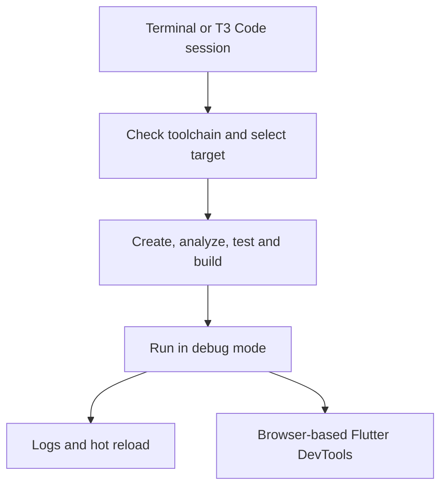
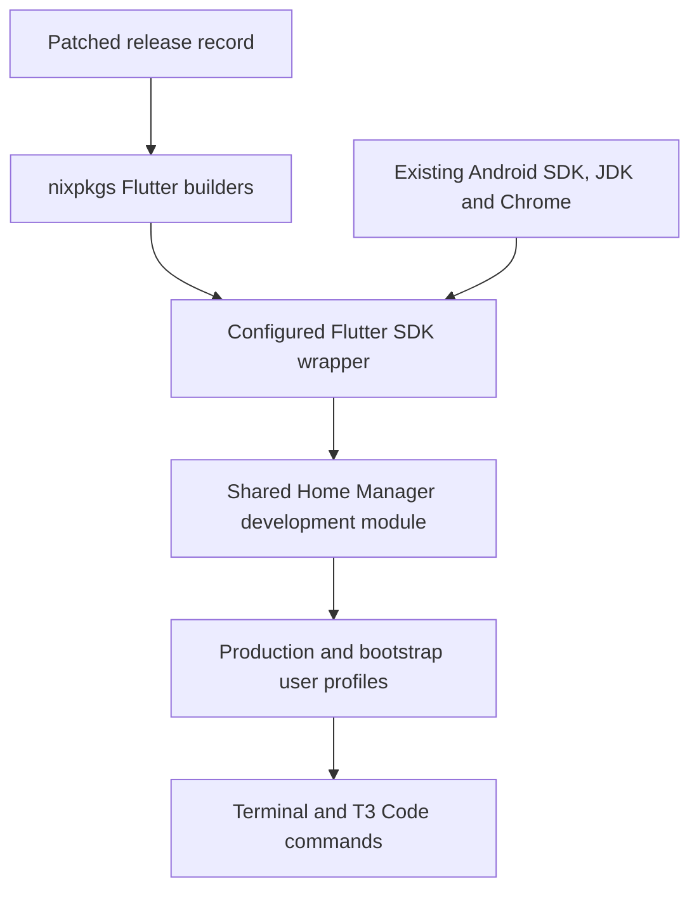

# Flutter Development on All Hosts - Plan

## Goal Capsule

- **Objective:** The owner can develop and debug Flutter applications from the terminal and T3 Code on every managed host.
- **Means:** Reuse the pinned nixpkgs Flutter builders with a patched stable release record and a shared Home Manager module (KTD1-KTD3).
- **Product authority:** The confirmed Product Contract governs behavior; the Planning Contract governs implementation within it.
- **Execution profile:** One PR, three sequential units, implemented and shipped by the current LFG run.
- **Stop conditions:** Stop on an invalidated settled decision or an unavailable safe SDK package; do not apply configurations to either host.
- **Open blockers:** None. Native Darwin and installed-host evidence require their respective builders or hosts.

---

## Product Contract

### Summary

Provide a shared Flutter development environment for every managed host, covering the targets in R3.
Use the terminal and T3 Code for development, with browser-based Flutter DevTools for source debugging.

### Problem Frame

The owner wants the development environment ready for future Flutter projects on both personal machines and reported no current inconvenience.
The repository already manages the adjacent platform tools, but does not explicitly provide a Flutter development SDK.

### Key Decisions

- **Full host-native target coverage.** Governs R3. (session-settled: user-directed — chosen over SDK-only or mobile-only setup: the owner requested every target available on each host OS.)
- **Terminal and T3 Code workflow.** Governs R2, R5, R6. (session-settled: user-directed — chosen over an editor-centered workflow: the owner named the terminal and T3 Code for development and debugging.)
- **One managed stable SDK as the default.** Governs R1, R4. (session-settled: user-approved — chosen over adding project-specific SDK management: the owner confirmed the shared default and that scope boundary.)

### Requirements

**SDK and access**

- R1. Provide the same repository-declared stable Flutter release and its bundled Dart SDK and DevTools as the default on all managed hosts.
- R2. Make those tools available in ordinary terminals and T3 Code agent and terminal sessions, including sessions from the desktop app launched through the OS GUI.

**Target support**

- R3. Support the following development targets on each host kind:

  | Host kind | Targets |
  | --- | --- |
  | NixOS, x86_64-linux | Android, web, Linux desktop |
  | macOS, aarch64-darwin | Android, web, iOS, macOS desktop |

- R4. Reuse the existing managed Android SDK, NDK, JDK, Xcode and browser, adding the dependencies needed by R3 without creating competing SDK installations.

**Development and debugging**

- R5. Support sample-project creation, analysis, tests, builds and debug runs for R3, including runtime logs and hot reload.
- R6. Allow CLI-launched debug sessions to connect to browser-based Flutter DevTools for breakpoints, stepping and variable inspection.
- R7. Document the terminal and T3 Code workflow for checking toolchains, finding devices, choosing a target and opening DevTools.

**Bootstrap compatibility**

- R8. Include the shared SDK declarations in production and bootstrap configurations without adding authenticated provisioning or device-dependent steps to bootstrap evaluation or builds.

### Key Flows

- F1. **Start development.** In either context from R2, the owner checks the toolchain, creates a sample project, analyzes and tests it, then builds and runs a target from R3. Covers R1-R5, R7.
- F2. **Debug an app.** With a debug run active, the owner or agent reads logs and requests hot reload; the owner connects DevTools for source inspection. Covers R5-R7.

### Acceptance Examples

- AE1. **Production session.** Given a configured production host and an available target, a fresh session in either R2 context can complete F1; `flutter doctor -v` supplies toolchain diagnostics. Covers R1-R5, R7.
- AE2. **Source debugging.** Given a sample app running in debug mode, changing its code can trigger hot reload, and DevTools can pause at a breakpoint and inspect a variable. Covers R5, R6.
- AE3. **Bootstrap build.** Given a bootstrap output and no Apple sign-in or running devices, its configuration still evaluates and builds; installed-host runtime evidence remains separate. Covers R8.

### Scope Boundaries

- Project-specific Flutter version managers and channel switching are deferred; R1 defines this work's default.
- Editor extensions and a new debugger interface inside T3 Code are excluded; R2 and R6 define the supported workflow.
- App Store distribution, release signing automation and application-specific configuration are excluded.
- Building a real application or changing unrelated development tools is excluded.

### Dependencies and Evidence

Mobile debug runs require an available Android device or emulator, or an iOS simulator or device.
Production Apple development depends on the existing Xcode setup; bootstrap configurations already skip its authenticated provisioning.

Repository declarations establish configuration intent, not a working installed environment.
Record repository checks, platform builds and installed-host smoke checks separately; unavailable platform evidence remains pending.
A missing optional IDE is not a failure of the R2 workflow.

### Sources and Research

- `home/h82/dev/android.nix` and `packages/android-sdk.nix`: existing Android SDK, NDK and JDK declarations and SDK pin ownership.
- `home/h82/dev/default.nix` and `home/h82/dev/mobile-devices.nix`: shared development imports and macOS-only virtual-device setup; the default declares an Android AVD, with no iOS simulator entry.
- `home/h82/dev/cpp.nix`: shared C/C++ tools, whose presence alone does not prove a working Flutter Linux build environment.
- `modules/darwin/xcode.nix`: production Xcode provisioning and its bootstrap exclusion.
- `home/h82/default.nix` and `modules/shared/darwin-apps.nix`: Chrome declarations for the two host kinds.
- `home/h82/t3code.nix`: managed agent entry points and enabled device support; Flutter tool discovery still needs verification.
- [Flutter installation](https://docs.flutter.dev/install), [Android setup](https://docs.flutter.dev/platform-integration/android/setup), [iOS setup](https://docs.flutter.dev/platform-integration/ios/setup), [Linux setup](https://docs.flutter.dev/platform-integration/linux/setup), [macOS setup](https://docs.flutter.dev/platform-integration/macos/setup) and [web setup](https://docs.flutter.dev/platform-integration/web/setup): upstream installation and target prerequisites.
- [DevTools from the CLI](https://docs.flutter.dev/tools/devtools/cli) and [DevTools debugger](https://docs.flutter.dev/tools/devtools/debugger): connecting CLI-launched applications and inspecting source execution.

---

## Planning Contract

**Product Contract preservation:** Unchanged in scope; the planning-owned questions were resolved below, and a short Problem Frame was added without changing R1-R8, F1-F2 or AE1-AE3.

### Key Technical Decisions

- KTD1. **Pin Flutter 3.47.9 while nixpkgs is older.** Use a complete generated release record with `flutterPackages.mkFlutter` and `wrapFlutter`, retaining the pinned source's common and 3.47 patches. The current Flutter 3.47.4 and Dart 3.13.3 predate [GHSA-frr6-h895-5pxp](https://github.com/dart-lang/sdk/security/advisories/GHSA-frr6-h895-5pxp); 3.47.9 includes Dart 3.13.7 and stays within the existing package's release series. Prefer nixpkgs' wrapped stable package once its version is at least this pin. Governs implementation of R1, R3. (session-settled: user-approved — chosen over a project-specific version manager: this instantiates the confirmed repository-managed stable default.)
- KTD2. **Generate metadata with upstream machinery.** Use a disposable copy of the exact pinned nixpkgs and its Flutter updater to obtain source, Dart, dependency-lock and artifact hashes; keep only the resulting release record. This avoids copying the SDK builder or changing unrelated flake inputs. Hash generation is execution work, and Darwin artifact downloads on Linux do not establish a successful Darwin SDK build.
- KTD3. **Keep runtime prerequisites with the executable.** Extend the wrapped SDK through a small package wrapper that supplies the managed Android SDK and JDK and the existing Chrome location. Expose it through the normal user profile and preserve bundled Dart and writable upstream caches. This follows existing package-wrapper patterns and reduces reliance on a GUI parent's environment. Governs R2, R4-R6.
- KTD4. **Keep platform ownership intact.** Add CocoaPods only on Darwin, retain production Xcode provisioning, and change the existing Android composition only if the chosen Flutter template demonstrably needs an absent component. Use the SDK's patched `aapt2` for a proven NixOS Android build failure. Governs R3, R4, R8.
- KTD5. **Check materialized outputs once per platform.** Add one focused Flutter check accepting user-generation entries, reuse it from Darwin output checks, and classify the Linux host-dependent check in `hostClosureChecks`. Exercise the executable reached through each profile and its target artifacts; do not treat package-option membership as proof. Governs R1-R4, R8.

### High-Level Technical Design

The package and generation checks follow this ownership boundary; runtime checks additionally exercise the real launch contexts in R2.

### Assumptions and Execution-Time Discovery

- The 3.47 package patches apply to 3.47.9; U1 must establish this before integrating the SDK.
- Normal user-profile discovery supplies the executable to T3 after restart; U2 must test a minimal environment, and installed-host GUI checks must verify the actual launch contexts separately.
- Mobile runtime checks use available devices or virtual devices; no additional permanent device fleet or simulator manager is planned.
- Application dependency downloads need network access and writable user/project caches. A missing project-specific Android component is resolved through the existing declarative SDK owner, never by mutating the store.

### Risks and Boundaries

The selected SDK's source, Dart and engine metadata must agree; a version-only override is insufficient under KTD1-KTD2.
Native plugin and Android Gradle builds can expose gaps a bare app or `flutter doctor` misses, so U2 includes a representative native-plugin smoke check.
The existing signed macOS T3 application remains unchanged; preserve its normal account and credential paths.
New persistent GUI environment agents, a mutable SDK copy and broad toolchain rewrites are considered unnecessary unless U2 produces a concrete discovery failure that requires the smallest adequate fix.

### Research Basis

The pinned nixpkgs Flutter directory exports `mkFlutter` and `wrapFlutter`; its wrapper already supplies the target artifacts and Linux GTK/compiler environment.
The [Flutter release index](https://storage.googleapis.com/flutter_infra_release/releases/releases_linux.json) identifies 3.47.9 as stable; 3.50.0 is newer, but is not needed for the compatibility-preserving security fix.
Apply the materialized-output and mutation guidance in `.compound-engineering/artifacts/solutions/best-practices/nix-check-reads-option-value-not-materialized-output.md` and `.compound-engineering/artifacts/solutions/best-practices/mutation-testing-reveals-decorative-nix-check-assertions.md` when implementing KTD5.
If GUI environment publication becomes necessary, follow `.compound-engineering/artifacts/solutions/best-practices/nix-darwin-preactivation-reads-previous-generation-etc.md`; activation-only `launchctl setenv` does not survive login.

---

## Implementation Units

### U1. Provide a patched shared SDK package

**Goal:** Produce a reproducible SDK satisfying R1 and the target portion of R3.
**Dependencies:** None.
**Files:** `packages/flutter.nix`, `packages/flutter-release.json`; package install-check logic belongs with `packages/flutter.nix`.
**Approach:** Implement KTD1-KTD2, preserving upstream patch ordering and wrapper target defaults; use the generated record without copying upstream builder implementations.
**Execution note:** Prove package construction and command startup before adding host integration.
**Test scenarios:**

- The selected Flutter and bundled Dart report the release record's versions and satisfy the advisory's patched floor.
- Target artifacts for both managed host kinds are present in the corresponding packages.
- Package startup uses a disposable writable home without attempting to update the immutable SDK.

**Verification:** Linux package build and executable smoke checks pass; Darwin package and artifact evidence is obtained on Darwin CI and recorded separately.

### U2. Integrate the SDK and runtime prerequisites

**Goal:** Make R2-R6 work through the shared user environment, preserving R8.
**Dependencies:** U1.
**Files:** `home/h82/dev/flutter.nix`, `home/h82/dev/default.nix`, `packages/flutter.nix`, `tests/flutter.nix`; `home/h82/dev/android.nix` and `packages/android-sdk.nix` only for demonstrated template incompatibilities.
**Approach:** Implement KTD3-KTD4 and use the existing host-kind branches; leave T3's signed bundle and agent homes intact.
**Execution note:** This is packaging work; prefer real command and disposable project smoke checks over unit tests that mirror declarations.
**Test scenarios:**

- Covers AE1. The profile's Flutter and bundled Dart run with a minimal parent environment and select the managed SDK/JDK/browser defaults.
- Covers F1. A disposable sample completes analysis, tests and supported Linux builds; an Android build repeats successfully to exercise writable cache reuse.
- A maintained native plugin exercises Android native tooling; Apple plugin build and CocoaPods fallback checks run on an appropriate Mac when available.
- Covers AE2. A debug session exposes logs, accepts hot reload and supports DevTools source inspection on an available target; T3 Device tools own device interaction.
- Covers AE3. Production and bootstrap outputs retain the SDK without authenticated bootstrap setup or running devices.

**Verification:** Separate package/configuration results from target builds and actual terminal/T3/device results; do not claim unavailable GUI or Darwin evidence as passed.

### U3. Guard the generated environment and document usage

**Goal:** Protect the generated configuration and document F1-F2 under R7.
**Dependencies:** U2.
**Files:** `tests/flutter.nix`, `tests/darwin-outputs.nix`, `flake.nix`, `tests/check-shards.nix` if its routing interface requires changes, `docs/flutter.md`, `README.md`.
**Approach:** Implement KTD5 and document target commands, active T3 worktrees, explicit device selection, hot reload, stop/reconnect and the private per-run DevTools link.
**Test scenarios:**

- Removing the shared module import makes the materialized-profile check fail for its own missing-tool assertion.
- Removing a required artifact or prerequisite makes its owning assertion fail without an earlier evaluation failure.
- Covers AE3. Production and bootstrap profile coverage is preserved on both host kinds.
- The documented Android mismatch recovery directs changes to the managed SDK composition and does not instruct writes into the store.

**Verification:** Relevant checks, shard classification, Markdown lint and formatting pass; the guide clearly identifies missing hardware/GUI evidence and owner-operated prerequisites.

---

## Verification Contract

- Run `git diff --check`, changed-Markdown lint and `nix fmt -- --ci` before pushing.
- Run the focused Flutter check and affected Android/Darwin/shard guards on supported builders, then `nix flake check --no-build` for evaluation.
- Sweep new check derivation closures so `hostClosureChecks` matches their actual host/Home Manager dependencies; mutation evidence must fail for the guarded reason.
- Require current-head CI with the `full-ci` label, including all declared checks, VM checks and every production/bootstrap Linux and Darwin output before declaring the PR ready.
- Use disposable projects for create/analyze/test/build verification, with a native-plugin case and repeated Android build where available. Record web, Android and host-desktop results separately, plus iOS simulator on Darwin.
- On installed hosts, compare command identity and selected toolchains in an ordinary terminal, a T3 terminal and a GUI-launched T3 agent session; verify logs, hot reload, DevTools breakpoints and variable inspection on an available target.
- Do not run host switches. Missing builders, GUI sessions or devices remain pending evidence rather than passed checks. Clean up task-owned processes, scratch SDK-generation copies and disposable projects; preserve pre-existing devices and other tasks' resources.

---

## Definition of Done

- U1-U3 satisfy their cited requirements, with focused package/configuration checks and all required CI evidence recorded.
- The PR contains the shared SDK integration, generated release pin, checks and terminal/T3 guide, with no abandoned implementation attempts.
- Security-version selection is proven by actual package output, and SDK source/Dart/engine metadata remain consistent.
- Unavailable installed-host or device evidence is named explicitly; no configuration application or signing action is implied.
- All task-owned temporary processes and generation/project data are removed after their use.
