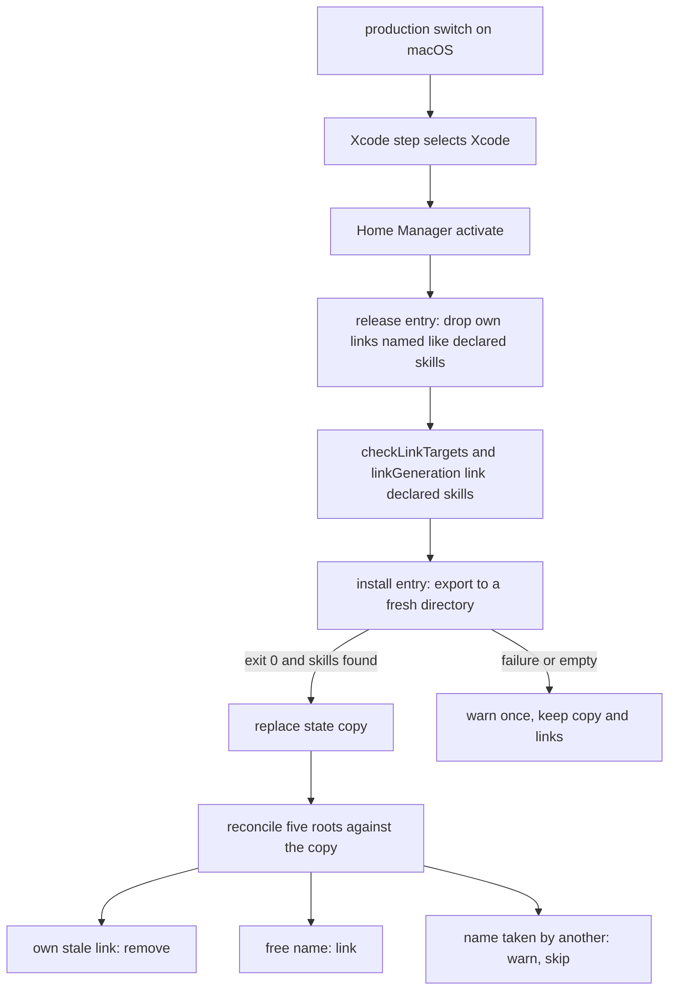

# Xcode Agent Skills in Every Harness - Plan

## Goal Capsule

- **Objective:** On the macOS host, every managed coding agent started the ordinary way offers the agent skills the selected Xcode ships.
- **Means:** Home Manager activation exports the skills with `xcrun agent skills export` and links them into each harness's skill root (KTD1, KTD2).
- **Authority:** The Product Contract below, then the repository safeguards in `AGENTS.md`, then the Planning Contract.
- **Execution profile:** Four units in one PR. The implementer builds and verifies in the repository; the owner runs the production switch and the checks on the Mac.
- **Stop conditions:** Stop if `xcrun agent skills export` cannot run outside an interactive session at all, or if a fix would need an agent to run `darwin-rebuild switch` or `nr switch`.
- **Open blockers:** None.

---

## Product Contract

Product Contract preservation: changed: added R13 — it settles the deferred Antigravity question in favor of support. R1 through R12, the Key Decisions, and the Acceptance Examples are unchanged.

### Summary

A production switch on the macOS host exports the skills of the selected Xcode and installs them into the skill roots of Claude Code, Codex, Pi, Grok Build, and Antigravity.
The repository names no Xcode skill, so the installed set follows whatever the selected Xcode exports.

### Problem Frame

Xcode 27 ships agent skills written by Apple for SwiftUI, App Intents, Siri integration, Swift Testing migration, `xctrace`, and build security settings.
Xcode 27.3 (build 27C5020n) exports 14 of them, about 1.1 MB in total.
An agent sees them only when it is launched through `xcrun agent`.
The owner starts the five managed harnesses directly or through T3 Code, so none of those sessions offers the skills during Apple platform work.

The existing shared skills are Nix store directories linked into every skill root by `home/h82/agents/skills.nix`.
Xcode cannot join that path: `macos-xcode` installs it outside Nix during a production switch, it exists only on the macOS host, and the export carries no license file while this repository is public.

### Key Decisions

- KD1. Export from the installed Xcode during the switch. Governs R1, R2, R11. (session-settled: user-directed — chosen over committing an exported snapshot to the repository: a snapshot would redistribute Apple content in a public repository and need a manual refresh on every Xcode change, while reaching the NixOS host was not worth either cost.)
- KD2. Install every skill Xcode exports and keep no name list in the repository. Governs R3, R4. (session-settled: user-directed — chosen over an allowlist and over an exclusion list: the owner accepted about 10 KB of added skill descriptions in every session so that new Xcode skills arrive without a repository change.)
- KD3. An export failure never fails the switch. Governs R6. This follows `home/h82/dev/mobile-devices.nix`, whose helper reports a failure and lets activation continue.
- KD4. A skill the repository declares wins a name it shares with an Xcode skill. Governs R8. The declared skills are pinned and reviewed; the Xcode set changes without review.
- KD5. Install the exported skills unmodified. Governs R9. Editing Apple's files would have to be repeated and re-checked after every Xcode release.

### Requirements

**Delivery**

- R1. A production switch on a macOS host installs every skill the selected Xcode exports into the skill roots of Claude Code, Codex, Pi, Grok Build, and Antigravity.
- R2. The switch that installs or upgrades Xcode also installs that Xcode's skills, including when nothing in the Home Manager generation changed.
- R3. A skill that a later Xcode adds is installed by the next production switch with no repository change.
- R4. A skill that Xcode stops exporting is removed from every skill root by the next production switch that exports successfully.
- R5. Bootstrap outputs and NixOS hosts install no Xcode skill and report nothing about them.
- R13. An Antigravity run that Compound Engineering starts in a private run home lists the installed Xcode skills.

**Failure and coexistence**

- R6. When Xcode is missing or the export fails, the switch completes, prints one warning that names the failure, and leaves the previously installed Xcode skills in place.
- R7. The step removes or replaces only skill directories it installed earlier; skills declared in the repository and any other content of a skill root stay untouched.
- R8. When an exported skill has the same name as a skill the repository declares, the declared skill stays, the Xcode skill is skipped, and the switch prints one warning naming it.
- R9. Each installed skill contains exactly the files Xcode exported, unmodified.
- R10. Each harness lists an Xcode skill once.

**Repository hygiene**

- R11. No file exported from Xcode is committed to the repository.
- R12. A repository check runs the install step against a stub `xcrun` and proves R1, R4, R6, R7, and R8 on the resulting directories.

### Acceptance Examples

- AE1. **Covers R1, R10.** Given Xcode 27.3 selected and no Xcode skill installed, when the owner runs a production switch, then each of the five skill roots holds the 14 exported skills and each harness lists `swiftui-specialist` once.
- AE2. **Covers R2, R3, R4.** Given the skills of one Xcode installed, when a switch upgrades Xcode to a release that adds one skill and drops another, then after that same switch every root has the added skill and lacks the dropped one.
- AE3. **Covers R6.** Given 14 Xcode skills installed, when a switch runs while `xcrun agent skills export` exits non-zero, then the switch succeeds, one warning is printed, and the 14 skills are unchanged.
- AE4. **Covers R7, R8.** Given a future Xcode that exports a skill named `frontend-design`, when a switch runs, then the repository's `frontend-design` is unchanged in every root, a warning names the skipped skill, and the other exported skills are installed.
- AE5. **Covers R5.** Given the bootstrap output of the macOS host or any NixOS host, when it is applied, then no Xcode skill is installed and no warning about them appears.

### Scope Boundaries

- The NixOS host gets no Xcode skill.
- No allowlist or exclusion list for Xcode skills.
- No rewriting of skill frontmatter for harnesses that ignore Claude-specific keys such as `when_to_use` and `effort`.
- The Xcode MCP tools and plugin content that `xcrun agent` also provides are not part of this work.
- No change to how `macos-xcode` selects or installs Xcode.
- No live `darwin-rebuild switch` or `nr switch` by an agent; the owner runs the switch.
- Considered and not built: retrying the export after a failure. R6 keeps the previous skills and the next switch exports again; a retry loop would be worth adding only if the first `xcrun agent` call after an Xcode upgrade turns out to fail routinely.
- Considered and not built: a check that the exported `SKILL.md` files parse in each harness. R9 forbids editing them, so a failed parse could only be reported, and the Mac verification already shows it.

### Dependencies / Assumptions

- `xcrun agent skills export --output-dir <path> [--replace-existing]` exists in the selected Xcode and exported 14 skills from a plain shell on this host. The Xcode app was open during that run.
- The 14 current Xcode skill names do not collide with the 21 skills the repository links today.
- The five harnesses accept a skill whose frontmatter carries keys they do not know; this is unverified per harness and belongs to hardware verification.
- Repository checks prove the install step, not that a signed-in harness session lists the skills; that evidence comes from the Mac.

### Sources / Research

- `home/h82/agents/skills.nix`: the five skill roots and the store-link model for declared skills.
- `modules/darwin/xcode.nix` and `docs/macos.md`: Xcode is installed by `macos-xcode` in system `postActivation`, on production outputs only.
- `home/h82/dev/mobile-devices.nix`, `packages/mobile-devices.nix`, `scripts/mobile-devices`, `tests/mobile-devices.sh`: precedent for an activation helper that calls `/usr/bin/xcrun`, reports its own failures, and is tested against a stub `xcrun`.
- `.compound-engineering/artifacts/solutions/best-practices/home-manager-activation-does-not-run-on-every-rebuild.md`, section "Scope and limits": on a macOS host Home Manager's nix-darwin module runs each user's `activate` from `system.activationScripts.postActivation` on every apply.
- `.compound-engineering/artifacts/solutions/integration-issues/darwin-home-manager-activation-lacks-java-home-and-which-for-avdmanager.md`: activation runs with a bare environment.
- `.compound-engineering/artifacts/solutions/integration-issues/first-simctl-after-xcode-upgrade-fails-on-stale-coresimulatorservice.md`: a tool called right after an Xcode upgrade can fail once.
- `packages/antigravity-acp-path.nix`: the wrapper links named skills into a Compound Engineering run home.
- `CONCEPTS.md`, entry "Skill root": how harnesses list a skill reachable through more than one root.
- Exported skill names on Xcode 27.3: `adopt-c-bounds-safety`, `app-intents-specialist`, `app-intents-whats-new-27`, `app-resizability`, `audit-xcode-security-settings`, `building-document-based-swiftui-applications`, `device-interaction`, `macos-touch-gestures`, `modernize-tests`, `siri-app-integration`, `siri-evaluations`, `swiftui-specialist`, `swiftui-whats-new-27`, `xctrace`.

---

## Planning Contract

### Key Technical Decisions

- KTD1. **The step is a `home.activation` entry ordered after `linkGeneration`, enabled when `config.my.kind == "darwin"` and `!config.my.bootstrap`.** Implements R1, R2, R5. On macOS, Home Manager activates on every apply, and its `postActivation` text follows the Xcode step that `modules/darwin/xcode.nix` adds with `lib.mkBefore`. `home.activation.mobileDevices` already depends on both facts.
- KTD2. **One exported copy lives in a per-user state directory, and each skill root gets a directory symlink per skill to that copy.** Implements R1, R9, R10. This is the shape the declared skills already have: the link is the directory, so `SKILL.md` itself is a regular file, and a harness that resolves links sees one location from every root.
- KTD3. **The link target is the ownership record.** Implements R4, R7. A root entry belongs to this step exactly when it is a symlink whose target lies inside the state directory. No manifest file exists to drift from the roots.
- KTD4. **The helper exports into a fresh directory beside the state copy and replaces the copy only after the export exits zero with at least one skill directory containing `SKILL.md`.** Implements R6. A failed or empty export leaves the copy and every link as they were.
- KTD5. **After a successful export the helper reconciles each root against the copy.** Implements R1, R3, R4, R8. It removes its own links whose skill is gone, adds a link where the name is free, and warns once per skill name where the name is taken by something it does not own.
- KTD6. **A second activation entry ordered before `checkLinkTargets` removes this step's links whose names the repository declares.** Implements R8. Without it, a later repository skill that reuses an installed Xcode name would meet a foreign symlink at its target and Home Manager would abort activation.
- KTD7. **The helper is a packaged script that takes the `xcrun` path, the state directory, and one `--root` per skill root as arguments.** Implements R12. It follows `packages/mobile-devices.nix`: the module passes `/usr/bin/xcrun`, and the check passes a stub. `home/h82/agents/skills.nix` exposes its root list through one internal read-only option so the module and the roots cannot diverge.
- KTD8. **The Antigravity ACP wrapper links every skill directory of the state copy into a Compound Engineering run home, after the declared names.** Implements R13. The run home reads skills only from its own `GEMINI_HOME`, and the wrapper already links there at launch, when the Xcode names are known.

### High-Level Technical Design

### Assumptions

- `xcrun agent skills export` works from Home Manager activation, which runs as the user with a bare environment. U1's helper is fail-open, and U4 lists the Mac check that proves it.
- The export may need the Xcode app closed or open; the Mac check in the Verification Contract covers the closed case.
- A directory symlink into a state directory under the user's home is listed by each harness the same way as a symlink into the Nix store.

### Sequencing

U1 first. U2 depends on U1's interface. U3 depends on the state-directory option U2 exposes. U4 documents the result.

---

## Implementation Units

### U1. Xcode skills helper and its check

- **Goal:** A packaged helper that exports, swaps, reconciles, and releases, proven against a stub `xcrun`.
- **Requirements:** R1, R3, R4, R6, R7, R8, R9, R12; KTD2 through KTD7.
- **Dependencies:** None.
- **Files:** `scripts/xcode-skills` (new), `packages/xcode-skills.nix` (new), `tests/xcode-skills.sh` (new), `flake.nix`.
- **Approach:**
  1. Two modes: the install mode of KTD4 and KTD5, and the release mode of KTD6, which takes declared names and the roots.
  2. The helper reports its own failures on stderr and exits 0 for them; only a usage error exits non-zero.
  3. One warning line per failure and one per colliding skill name, not one per root.
  4. Register the check beside `mobile-devices` in `flake.nix`. That block is `checks.x86_64-linux`, so the helper and its test must run on Linux with the stub; `tests/check-shards.nix` places a new check in a light shard without an edit.
- **Patterns to follow:** `scripts/mobile-devices`, `packages/mobile-devices.nix`, `tests/mobile-devices.sh`, and the `mobile-devices` check in `flake.nix`.
- **Execution note:** Write `tests/xcode-skills.sh` first and watch each scenario fail against an empty helper. Before trusting the check, read the mutation-testing learnings `AGENTS.md` lists under "Before adding a repository check", in particular the `printf … | grep -q` under pipefail, nullglob, and env-assignment-prefix entries.
- **Test scenarios:**
  - Covers AE1. Stub exports three skills into empty roots: every root has three directory symlinks that resolve to the state copy, and each `SKILL.md` is a regular file with the stub's bytes.
  - Covers AE2. A second run whose stub exports one new skill and omits one old skill: every root gains the new link and loses the old one, and the state copy matches the second export.
  - Covers AE3. A run whose stub exits non-zero after an earlier good run: exit status 0, exactly one warning line, and the state copy and every link byte-identical to before.
  - A run whose stub exits 0 but writes no skill directory: same outcome as the failing stub.
  - A run with no `xcrun` at the given path: exit status 0, one warning, nothing changed.
  - Covers AE4. A root already holds a directory or foreign symlink named like an exported skill: that entry is untouched, one warning names the skill, and the other skills are linked.
  - A root holds an unrelated entry and a dangling foreign symlink: both are untouched after install and after a removal run.
  - Release mode with a name this step installed: its links are gone from every root and other links stay. Release mode with a name owned by something else: nothing is removed.
  - A root directory that does not exist yet is created.
  - A usage error exits non-zero.
- **Verification:** `tests/xcode-skills.sh` passes against the helper built for `aarch64-darwin`, the `x86_64-linux` check passes in CI, and each scenario fails when its helper behavior is removed.

### U2. Activation wiring on macOS production

- **Goal:** Production macOS activation runs the release mode before `checkLinkTargets` and the install mode after `linkGeneration`; bootstrap and NixOS run neither.
- **Requirements:** R1, R2, R5, R6, R8; KTD1, KTD6, KTD7.
- **Dependencies:** U1.
- **Files:** `home/h82/agents/xcode-skills.nix` (new), `home/h82/agents/default.nix`, `home/h82/agents/skills.nix`, `tests/darwin-config.nix`, `tests/darwin-outputs.nix`.
- **Approach:**
  1. `skills.nix` exposes its roots through one internal read-only option; the new module passes them and `lib.attrNames config.my.agentSkills` to the helper.
  2. Both entries follow the `mobileDevices` shape: a `DRY_RUN` branch that only echoes, and an `elif !` call whose branch only echoes, so a non-zero exit cannot stop activation.
  3. The module also exposes the state directory, relative to the home directory, for U3.
- **Patterns to follow:** `home/h82/dev/mobile-devices.nix` and its assertions in `tests/darwin-config.nix` and `tests/darwin-outputs.nix`; `home/h82/security/non-nixos-secrets.nix` for the darwin-and-not-bootstrap condition.
- **Execution note:** Read `.compound-engineering/artifacts/solutions/best-practices/activation-step-grep-check-passes-an-echo-only-step.md` before extending the activation assertions.
- **Test scenarios:**
  - Production macOS fixture: the generation's `activate` calls the built helper's install mode after `linkGeneration` with `/usr/bin/xcrun` and all five roots.
  - Production macOS fixture: the release call precedes `checkLinkTargets` and carries every declared skill name.
  - Covers AE5. Bootstrap macOS fixture and NixOS user configuration: neither activation entry exists.
  - A dry run reaches only the echo lines.
- **Verification:** `darwin-config` and `darwin-outputs` pass, and each new assertion fails when the entry it guards is removed or reordered.

### U3. Xcode skills in Compound Engineering's Antigravity run homes

- **Goal:** The ACP wrapper links the Xcode skills into a run home.
- **Requirements:** R13; KTD8.
- **Dependencies:** U2 for the state directory option.
- **Files:** `packages/antigravity-acp-path.nix`, `home/h82/default.nix`, `tests/antigravity-acp-path.nix`.
- **Approach:** The wrapper takes an optional directory relative to `HOME`. Inside `link_run_home`, after the declared names, it links each child directory of that path that holds a `SKILL.md` when the destination name is free. A missing directory links nothing, which is the state on NixOS.
- **Patterns to follow:** The existing `for skill in …` loop in `link_run_home` and its coverage in `tests/antigravity-acp-path.nix`.
- **Test scenarios:**
  - A run home launch with two skill directories in the state path: both are linked beside the declared ones.
  - A state-path skill named like a declared skill: the declared link is kept.
  - No state directory: the launch succeeds and only declared skills are linked.
  - A `GEMINI_HOME` that is not a run home: nothing is linked, as today.
- **Verification:** The `x86_64-linux` `antigravity-acp-path` check passes in CI; on the Mac, its derivation inputs are checked through `nix derivation show`.

### U4. Documentation

- **Goal:** The repository guides describe the new step and its limits.
- **Requirements:** R5, R6, R11.
- **Dependencies:** U1, U2, U3.
- **Files:** `AGENTS.md`, `docs/macos.md`, `CONCEPTS.md` only if the "Skill root" entry needs the non-store source stated.
- **Approach:** Add the module, helper, and check to the project structure and to "Harness plugin and skill integration" in `AGENTS.md`. In `docs/macos.md`, add the step to the production activation list with its fail-open behavior, the state directory, and how to remove the skills by hand. State that repository checks do not prove a signed-in session lists the skills.
- **Test expectation:** none -- documentation only; the `agent-instructions` check consumes `AGENTS.md` and `CONCEPTS.md` and must still pass.
- **Verification:** `markdownlint-cli2` passes on the changed files and `agent-instructions` passes.

---

## Verification Contract

| Check | Command | Proves | Where |
| --- | --- | --- | --- |
| Helper behavior, local | `bash tests/xcode-skills.sh` with the helper from `nix build` of `packages/xcode-skills.nix` | U1 scenarios on macOS userland | macOS builder |
| Helper behavior, declared | `checks.x86_64-linux.xcode-skills` | U1 scenarios | CI light shard |
| Activation wiring | `nix build --no-link .#checks.aarch64-darwin.darwin-config` and `.#checks.aarch64-darwin.darwin-outputs` | U2 scenarios | macOS builder |
| Wrapper | `checks.x86_64-linux.antigravity-acp-path` | U3 scenarios | CI light shard |
| Instruction inputs | `checks.x86_64-linux.agent-instructions` | U4 keeps the check inputs valid | CI light shard |
| Shard coverage | `checks.x86_64-linux.check-shards-guard` | the new check belongs to a shard | CI light shard |
| Linux-only inputs from macOS | `nix derivation show` on the four `x86_64-linux` checks above | their text inputs evaluate with the change | macOS builder |
| Declared macOS checks | `nix flake check` | `checks.aarch64-darwin` has no regression | macOS builder |
| Text hygiene | `git diff --check` and `markdownlint-cli2` on changed Markdown | formatting | local |
| Formatting | `nix fmt -- --ci` | Nix layout | CI `fmt` job; `formatter.aarch64-darwin` is absent |
| Linux and closure jobs | `host-checks`, `vm-checks`, `build`, `build-darwin` under the `full-ci` label | every production and bootstrap output | CI |
| Mac evidence | the owner runs a production switch, then confirms 14 links per root and one listing of `swiftui-specialist` in each harness, once with Xcode closed | AE1, R2, the assumptions | owner, reported separately |

`checks.aarch64-darwin` holds only `darwin-config`, `darwin-provisioning`, `pinentry-keyring`, `agent-unmanaged`, `zsh-prezto`, and `darwin-outputs`; every other check is `x86_64-linux`. Follow `.compound-engineering/artifacts/solutions/best-practices/verify-linux-only-nix-check-inputs-on-macos-through-derivation-show.md` for the `nix derivation show` row. A Linux check that has not run is deferred to CI, never passed.

## Definition of Done

- U1 through U4 are implemented and their verification outcomes hold.
- Every row of the Verification Contract that a macOS builder can run has passed locally; rows deferred to CI or to the owner are reported as deferred, not passed.
- No file exported from Xcode is in the diff, and the scratch export used during planning stays outside the repository.
- No abandoned experiment, unused option, or test-only production seam remains in the diff.
- The PR body lists what was verified locally, what waits on CI, and the Mac evidence the owner still has to collect.
