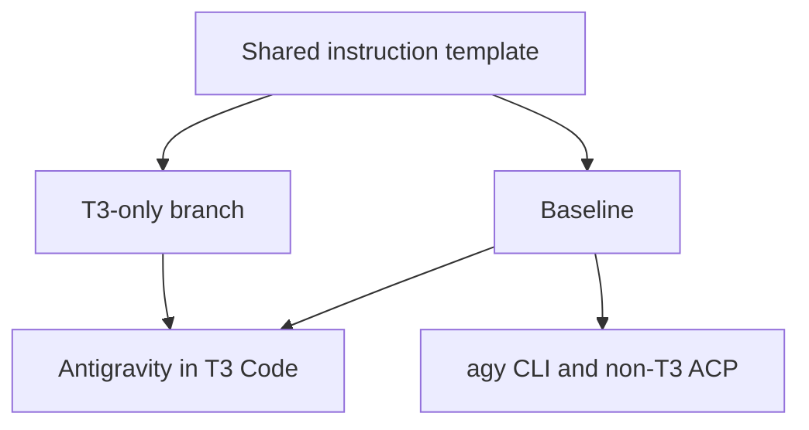
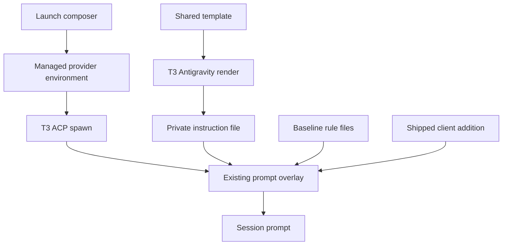

# Antigravity T3 Instructions - Plan

## Goal Capsule

- **Objective:** Antigravity sessions in T3 Code receive the delegation and model-selection instructions that govern the other supported T3 harnesses.
- **Means:** Use the existing ACP overlay with a provider-specific instruction file (KTD1, KTD2).
- **Authority:** The owner confirmed the scope for [issue #177](https://github.com/hyperlapse122/dotfiles/issues/177) in the brainstorm session.
- **Execution profile:** Three dependent units in one PR; LFG implements, reviews, and publishes it.
- **Stop conditions:** A settled scope decision proves infeasible, or required shipping evidence cannot be obtained.
- **Open blockers:** None.

---

## Product Contract

### Summary

Deliver the shared template's T3-only instructions to Antigravity sessions launched through T3 Code.
Keep instruction delivery scoped to the launch context so the same runtime can continue serving other callers.

### Problem Frame

Antigravity in T3 Code currently receives baseline instructions without the delegation and model-selection policy that governs the other supported T3 harnesses.
The shared ACP wrapper also serves callers outside T3, so changing its default would apply that policy beyond the requested context.

### Key Decisions

- **Scope the extra instructions to T3 launches.** (session-settled: user-approved — chosen over adding T3 policy to every ACP wrapper launch: the wrapper also serves non-T3 Compound Engineering callers.) Governs R1, R2.
- **Keep this change about delivery.** The owner confirmed that changes to policy content and Grok delivery belong outside this work; see Scope Boundaries.

### Requirements

**Instruction delivery**

- R1. Sessions launched through the repository-managed Antigravity provider in T3 Code receive the shared baseline plus the current T3-only branch, including the T3 delegation and T3 CE model-selection sections.
- R2. Antigravity's `agy` CLI sessions and non-T3 ACP launches receive only the shared baseline from the repository's instruction template.
- R3. Both contributions come from `home/h82/agents/instructions/instructions.md.tmpl`, with no separately maintained copy of the policy text.
- R4. Instruction composition preserves the client's system prompt addition alongside the repository instructions.

**Routing documentation**

- R5. `AGENTS.md` and `docs/agent-routing.md` describe the resulting Antigravity T3 delivery path and any remaining driver limitation.

### Key Flows

- F1. T3 Code launches an Antigravity session; instruction composition supplies the contributions required by R1, R3, and R4.
- F2. The owner or Compound Engineering launches Antigravity outside T3 Code; instruction composition follows R2 and R3.

### Acceptance Examples

- AE1. **Covers R1, R3, R4.** Given a T3 Antigravity launch with a client system prompt addition, when the session prompt is assembled, then it contains the baseline, both T3 policy sections, and the client's addition.
- AE2. **Covers R2.** Given an `agy` CLI launch, when it loads repository instructions, then those instructions contain the baseline without the T3-only branch.
- AE3. **Covers R2.** Given a non-T3 Compound Engineering ACP launch through the shared wrapper, when its prompt is assembled, then the repository contributes the baseline without the T3-only branch.
- AE4. **Covers R3.** Given a later change to the shared T3 branch, when the normal configuration application regenerates instructions, then a subsequent T3 Antigravity launch receives that change without editing a second policy source.

### Scope Boundaries

- Changing delegation policy, model choices, or reasoning-effort rules is outside this work.
- Grok instruction delivery is separate work.
- This change does not migrate a running session's prompt; the acceptance examples concern sessions launched after the updated configuration is applied.

### Dependencies / Assumptions

- The ACP wrapper serves both T3 and non-T3 callers, so the selected transport must distinguish those launch contexts to meet R1 and R2.
- Repository checks can establish rendered instructions and prompt assembly; signed-in runtime delivery remains separate evidence, as defined in `CONCEPTS.md` and the existing Antigravity runtime learning below.
- The repository currently documents the Antigravity driver as accepting no per-launch prompt option; current upstream driver behavior was not independently verified during this brainstorm.

### Sources / Research

- [Issue #177](https://github.com/hyperlapse122/dotfiles/issues/177): requested outcome and CLI boundary.
- `home/h82/t3code.nix:39` and `scripts/t3-instructions.py:204`: current T3 additions cover Claude, Codex, and Pi.
- `packages/antigravity-acp-overlay/system_prompt_overlay.py:21`: existing baseline rule loading and prompt composition.
- `packages/antigravity-acp-path.nix:1` and `home/h82/t3code.nix:116`: the wrapper is shared with non-T3 callers.
- `home/h82/agents/instructions/default.nix:26` and `scripts/agent-instructions:125`: shared-template baseline rendering.
- `.compound-engineering/artifacts/solutions/integration-issues/antigravity-acp-runtime-loads-no-global-rule-files.md`: why file placement alone did not deliver instructions, and why repository checks and signed-in loading evidence differ.

---

## Planning Contract

Product Contract clarified at R1 to name the repository-managed provider instance; no scope change.

### Key Technical Decisions

- KTD1. **Select the extra file through the managed provider's environment.** Reconcile `ANTIGRAVITY_ACP_T3_INSTRUCTIONS_FILE` to the absolute path of `~/.t3/userdata/instructions/antigravity.md` in `scripts/t3-instructions.py`, preserving unrelated environment entries. This instantiates R1 and R2 without changing the shared wrapper default. (session-settled: user-approved — chosen over a global ACP wrapper addition: non-T3 callers share that wrapper.) T3 Code 0.1.9 merges provider environment entries into ACP's spawn environment; an additional executable would add path-resolution and sibling-harness constraints without helping this boundary.
- KTD2. **Compose baseline, optional T3 file, then the shipped client addition.** Extend `system_prompt_overlay.py` at its existing prompt boundary for R1 and R4. An unset or empty file variable adds nothing; an explicitly configured unreadable file propagates its read failure, matching existing rule-file reads rather than silently omitting the contribution.
- KTD3. **Reuse the existing render and reconciliation boundaries.** Add Antigravity to T3 addition rendering and installation for R3, without changing the template's policy text or baseline delivery. Use the existing scratch-home composer and materialized activation tests for configuration evidence, and the overlay tests for assembled prompt evidence.

### Assumptions

- The managed provider ID is `antigravity`, as in the existing integration; owner-created provider instances retain their own configuration.
- Current source evidence establishes the pinned driver path, not delivery in an authenticated installed session.

### High-Level Technical Design

The per-launch environment selects the extra input; the shared wrapper keeps its existing baseline defaults per KTD1.
Non-T3 calls use the same overlay without that input per KTD2.

### Source Evidence

- [T3 0.1.9 AntigravityDriver](https://github.com/pingdotgg/t3code/blob/v0.1.9/apps/server/src/provider/Drivers/AntigravityDriver.ts): provider environment feeds the spawn input.
- [T3 0.1.9 instanceEnvironment](https://github.com/pingdotgg/t3code/blob/v0.1.9/packages/provider-core/src/server/instanceEnvironment.ts) and [antigravityAuthSupport](https://github.com/pingdotgg/t3code/blob/v0.1.9/apps/server/src/provider/antigravityAuthSupport.ts): string-valued entries survive to the child environment; the new path must be absolute.
- [T3 0.1.9 AntigravityInstallation](https://github.com/pingdotgg/t3code/blob/v0.1.9/apps/server/src/provider/AntigravityInstallation.ts): configured executable paths resolve to real paths and require a sibling harness.
- [T3 0.1.9 AntigravityAcpSupport](https://github.com/pingdotgg/t3code/blob/v0.1.9/apps/server/src/provider/acp/AntigravityAcpSupport.ts): the client prompt append is sent through ACP metadata for the qualified runtime.

---

## Implementation Units

### U1. Add the optional prompt input

- **Goal:** Implement KTD2 at the existing overlay boundary.
- **Requirements:** R1, R2, R4; F1, F2.
- **Dependencies:** None.
- **Files:** `packages/antigravity-acp-overlay/system_prompt_overlay.py`, `tests/test_antigravity_acp_overlay.py`.
- **Approach:** Read the selected input on prompt assembly and preserve the shipped extractor's result; follow the overlay's current file-reading and composition conventions.
- **Patterns to follow:** The current sorted baseline rule reader and stand-in shipped extractor tests.
- **Test scenarios:**
  1. Covers AE1. Distinct baseline, T3, and multiline client markers appear in the required order, with client text intact.
  2. Covers AE3. An unset or empty selector leaves baseline-plus-client behavior intact.
  3. A selected file works without baseline rules or a client append.
  4. A selected nonexistent file raises the file-read error from KTD2.
- **Verification:** Overlay tests exercise the real overlay module; they do not establish signed-in ACP behavior.

### U2. Render and select the T3 addition

- **Goal:** Connect the generated Antigravity addition to the managed T3 provider using KTD1 and KTD3.
- **Requirements:** R1, R2, R3; F1, F2.
- **Dependencies:** U1.
- **Files:** `home/h82/t3code.nix`, `scripts/t3-instructions.py`, `tests/test_t3_instructions.py`, `tests/t3code-launch.py`, `tests/agent-instructions.py`; adjust existing check inputs in `flake.nix` only if the extended tests need them.
- **Approach:**
  1. Extend the existing T3 render and private-file installation to Antigravity.
  2. Reconcile only the owned environment key on the native Antigravity instance, retaining the legacy-adapter retirement behavior and unrelated settings.
  3. Extend the existing materialized activation check to inspect the installed file and its selected absolute path.
- **Patterns to follow:** Existing provider-environment reconciliation for Grok, native launch composition, and `tests/lib/t3code-launch-manifest.nix`.
- **Test scenarios:**
  1. Covers AE1. Activation produces a T3-only Antigravity file containing both policy sections and points the managed environment entry at it.
  2. Covers AE2, AE3. Baseline rendering remains unchanged, and the shared wrapper acquires no T3 default.
  3. Repeated composition replaces a stale owned entry once while retaining unrelated entries and settings.
  4. Covers AE4. Replacing the generated file and recomposing selects the updated contribution without copying policy text into settings.
- **Verification:** Python composer tests prove mutable-setting reconciliation; materialized activation tests prove installed files and settings across the existing host fixtures. Existing baseline receipts and wrapper checks guard the non-T3 path.

### U3. Document and verify the delivery boundary

- **Goal:** Align routing documentation with KTD1-KTD3 and complete existing repository verification.
- **Requirements:** R5; verification of R1-R4.
- **Dependencies:** U1, U2.
- **Files:** `AGENTS.md`, `docs/agent-routing.md`; update existing instruction checks where they assert the former limitation.
- **Approach:** Describe the managed Antigravity environment-file delivery as the ACP exception to native prompt-option delivery, retain Grok's limitation, and distinguish source/check evidence from signed-in machine evidence.
- **Patterns to follow:** The existing Native T3 launches documentation and `tests/agent-instructions.nix`.
- **Test expectation:** No new documentation-specific test; run the affected existing instruction check because both documents are its inputs.
- **Verification:** Existing repository checks pass on supported builders; unavailable platform checks remain pending CI, and authenticated machine checks remain separately reported.

---

## Verification Contract

| Boundary | Verification | Limit |
| --- | --- | --- |
| Prompt assembly | `python3 tests/test_antigravity_acp_overlay.py` | Stand-in shipped extractor, no authenticated request |
| Mutable launch settings | `python3 tests/test_t3_instructions.py` | Scratch homes |
| Generated delivery and documentation | Existing `agent-instructions` and `t3code-traits` flake checks | Build only on supported platforms; report deferred checks separately |
| Rebuilt runtime and shared wrapper | Build the affected Antigravity package with its install check and run existing `antigravity-acp-path` check | Package/launch evidence, no signed-in session |
| Branch readiness | Follow `AGENTS.md` pre-push checks and require current-head full CI | Apply `full-ci`; require platform closure jobs before declaring readiness |

Use distinct markers at the composition boundary so lost or leaked contributions can be distinguished.
Retain existing mutation witnesses and extend only those needed to demonstrate that the new delivery assertions fail when their contribution is removed.
The Darwin formatter is unavailable in this flake; formatting evidence comes from a supported builder or CI.
No host switch is authorized by this plan; installed-session checks follow an owner-authorized configuration application.

---

## Definition of Done

- U1-U3 satisfy their cited requirements and acceptance examples with no unresolved implementation blocker.
- R1 and R2 are checked at the assembled prompt and generated launch boundaries; R3-R5 use the existing source and documentation checks.
- The PR records local results, current-head CI evidence, and any unperformed signed-in machine verification separately.
- No abandoned code, temporary test resources, or unrelated changes remain in the branch.
