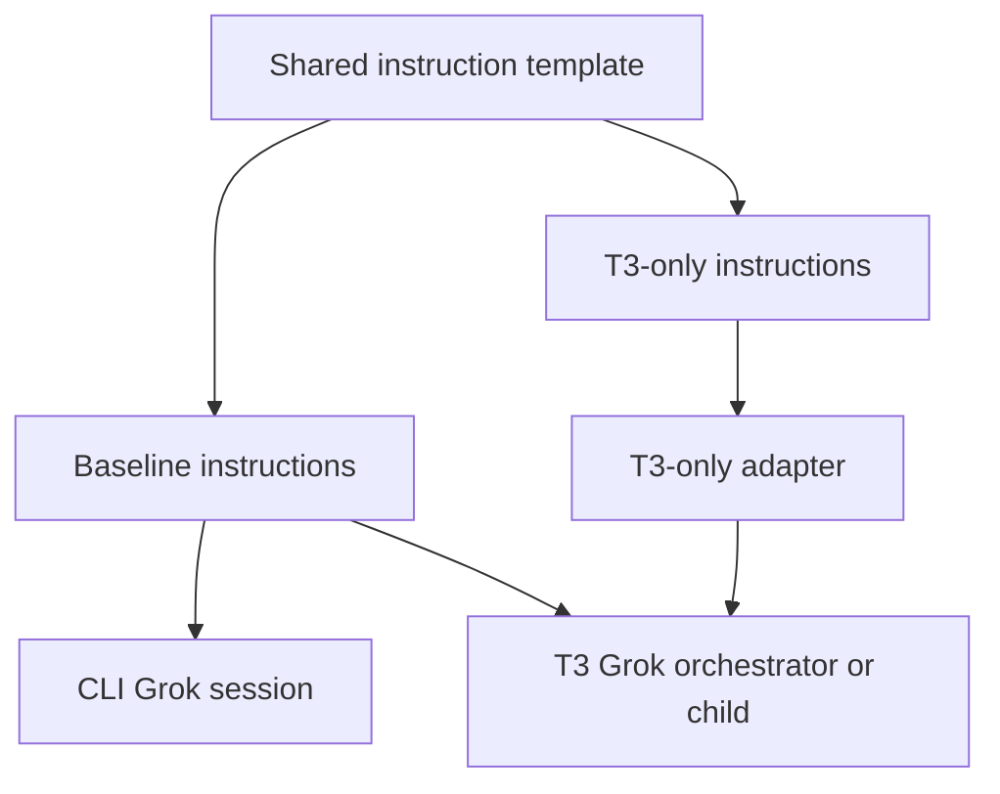
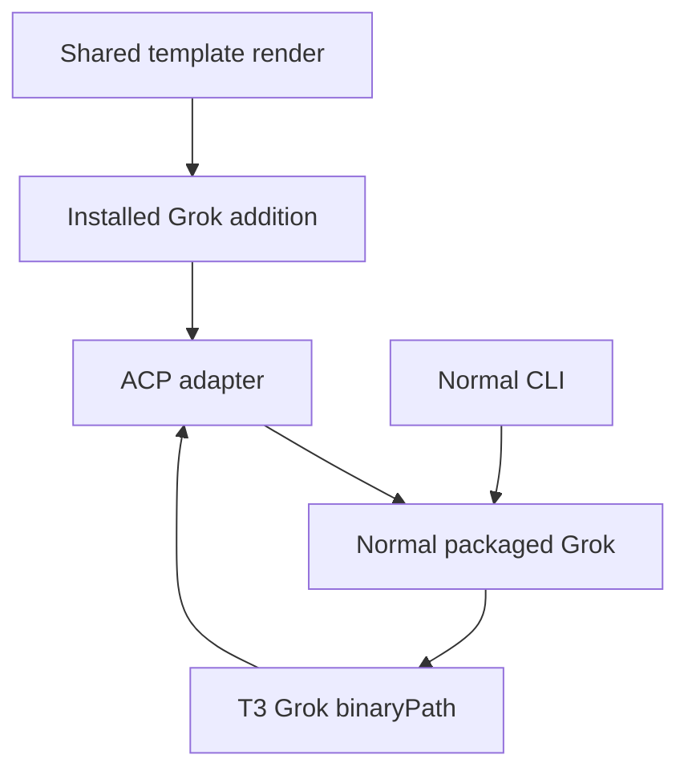
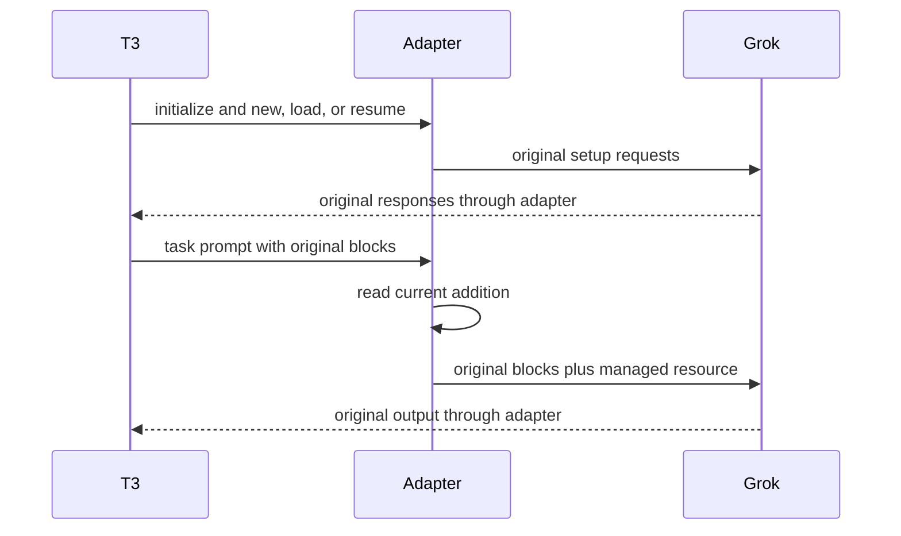

# T3 Instructions for Grok Sessions - Plan

## Goal Capsule

- **Objective:** The owner can use Grok in T3 Code under the same shared delegation and model-selection policy as Claude, Codex, and Pi.
- **Means:** A T3-only ACP adapter that supplies the current policy as prompt context (KTD1).
- **Product authority:** Issue [#176](https://github.com/hyperlapse122/dotfiles/issues/176) and the owner-confirmed Product Contract below.
- **Execution profile:** Three implementation units in one PR; LFG implements, reviews, and publishes. Production switches remain owner-run.
- **Stop conditions:** Stop if the pinned runtime rejects the chosen context input or the adapter cannot preserve native commands and session continuation.
- **Open blockers:** None for implementation; U1 owns the pinned-runtime compatibility evidence.

---

## Product Contract

Product Contract unchanged.

### Summary

Deliver the shared T3 instructions to Grok through a T3-only adapter.
Cover orchestrator sessions, delegated Grok children, and resumed T3 sessions while preserving normal CLI behavior and the shared Grok home.

### Problem Frame

The repository currently attaches T3 instructions to Claude, Codex, and Pi, but provides no corresponding Grok attachment.
A Grok orchestrator or child therefore lacks the repository-managed T3 delegation and model-selection addition that its peers receive.
The managed baseline path alone does not provide that addition.

The issue describes T3 Code 0.1.7, while the current repository pins 0.1.9.
The newer pinned Grok driver still exposes no prompt or launch-arguments setting.

### Key Decisions

- **Allow a local T3-only adapter.** Governs R2, R4, R5. (session-settled: user-directed — chosen over requiring upstream-native instruction support: the owner chose local delivery while preserving the normal Grok home and CLI behavior)

### Actors

- A1. The owner starts or resumes sessions in T3 Code and also uses Grok from a terminal.
- A2. T3 Code launches Grok orchestrators and delegated children, including children requested by another provider.
- A3. Grok receives instructions and performs the task in either a T3 session or a normal CLI session.

### Requirements

**Instruction delivery**

- R1. The Grok addition comes from the T3-only branch of `home/h82/agents/instructions/instructions.md.tmpl`, retaining that template as the shared policy authority.
- R2. Every new or resumed T3 Grok session receives the `T3 delegation` and `T3 CE model selection` sections alongside its baseline instructions before task work begins.
- R3. R2 applies to delegated Grok children regardless of the parent provider, including children authorized to delegate further.

**Launch isolation and compatibility**

- R4. Normal CLI Grok sessions receive only the baseline, including while a T3 Grok session runs concurrently.
- R5. The adapter uses the normal Grok home, credentials, plugins, settings, and session data without creating a shadow home or swapping the baseline file.
- R6. The adapter preserves T3's own instruction additions, tools, permission behavior, model selection, and session continuation.

**Managed lifecycle**

- R7. Reapplying configuration refreshes the managed addition without accumulating copies or replacing unrelated user configuration.
- R8. The delivery behavior applies on both managed host kinds wherever T3 Grok is enabled.
- R9. Existing repository descriptions of Grok instruction delivery are updated to match the implemented route and its remaining limitations.

### Key Flows

- F1. Start or resume a T3 Grok session. **Covers R1, R2, R3, R5, R6, R8.** T3 starts Grok through the managed adapter; the session receives the shared addition and its baseline before handling the task. The same delivery applies when T3 starts Grok as a delegated child.
- F2. Run Grok from a terminal. **Covers R4, R5.** The owner starts the normal CLI while T3 may also be running; the CLI uses the shared account state and baseline without receiving the T3-only addition.

The diagram shows the intended instruction boundary; it does not select an injection mechanism.

### Acceptance Examples

- AE1. **Covers R1, R2, R6.** When the owner starts a fresh T3 Grok session or resumes an existing one after applying the change, Grok receives both named policy sections alongside the baseline and T3's own instructions.
- AE2. **Covers R2, R3, R6.** When another provider delegates a task to Grok, the child receives the shared T3 policy without depending on the parent to paste it into the task brief. If that child is authorized to delegate further, the same policy remains available to it.
- AE3. **Covers R4, R5.** When CLI and T3 Grok sessions run concurrently, the CLI remains baseline-only and both retain access to the owner's normal Grok state.
- AE4. **Covers R1, R2, R7.** When the template changes and configuration is reapplied, subsequent new and resumed T3 Grok sessions receive the refreshed addition once, while unrelated user configuration remains intact.
- AE5. **Covers R8, R9.** The same delivery contract applies to enabled T3 Grok launches on NixOS and macOS, and the delivery documentation no longer presents an implemented route as an unresolved driver limitation.

### Scope Boundaries

- Antigravity instruction delivery remains separate work.
- Changing the delegation policy, model ladder, or ordinary CLI policy is outside this change; this work adds a recipient for the existing policy.
- A T3 Code fork, Grok binary patch, or dependency upgrade is not a settled means of delivery; a proposed need for one must be assessed during planning.
- Rewriting historical conversation content is outside scope; R2 governs resumed sessions from their next task work onward.

### Dependencies / Assumptions

The repository pins T3 Code 0.1.9 and Grok Build 1.0.77.
T3's pinned Grok driver accepts a binary path and constructs `agent stdio` arguments with permission flags selected by runtime mode.
That provides a launch boundary to investigate, but does not prove that an adapter can supply instructions through it.

Grok's interactive help advertises `--rules`; whether it affects `agent/stdio` sessions remains unverified.
The managed `~/.grok/AGENTS.md` path is established by source inspection, while authenticated runtime loading has not been observed in this brainstorm.

### Sources / Research

- Issue [#176](https://github.com/hyperlapse122/dotfiles/issues/176) defines the delivery gap and desired CLI separation.
- `home/h82/t3code.nix:39` renders the T3 branch for Claude, Codex, and Pi; `scripts/t3-instructions.py:204` composes their additions and `:309` manages Grok's native-control environment entries.
- `home/h82/agents/instructions/default.nix:26` and `scripts/agent-instructions:17` establish Grok's managed baseline destination.
- `tests/t3code-launch.py:37` currently rejects Grok prompt arguments; it encodes the existing limitation rather than proving delivery.
- Pinned upstream [Grok settings](https://github.com/pingdotgg/t3code/blob/v0.1.9/packages/provider-grok/src/settings.ts) expose no prompt setting; [ACP launch support](https://github.com/pingdotgg/t3code/blob/v0.1.9/packages/provider-grok/src/server/acpSupport.ts) defines the process boundary and runtime-mode arguments.

---

## Planning Contract

### Key Technical Decisions

- KTD1. **Supply an embedded text resource on each ACP task prompt.** Governs R1, R2, R3, R4, R5, R7. The adapter reads the rendered Grok addition when forwarding `session/prompt` and includes one managed resource identified by a fixed URI. It preserves every original prompt block and metadata field, replacing only its own resource if already present. This follows T3's existing prompt-context delivery rather than replacing Grok's system prompt. Metadata `rules` is rejected because upstream applies it only at creation; a plain text block is rejected because Grok joins text into the query and command arguments. Per-request context supports resumed tasks without editing stored history. The adapter choice implements the Product Contract's settled local-delivery decision; its resource encoding is a technical choice, not a new settlement.
- KTD2. **Use T3's Grok binary-path setting as the boundary.** Governs R4, R5, R6, R8. Install a separately named packaged adapter, retain the ordinary `grok` package, and declare only the Grok provider's `config.binaryPath` leaf. Non-agent invocations such as version and skill discovery pass through to Grok. The adapter preserves launch arguments, cwd, environment, stdout protocol, stderr, signals, and exit status. The existing T3 permission modes select the original Grok arguments.
- KTD3. **Keep the proxy stateless about session setup.** Governs R2, R3, R6, R7. Pass initialization, new/load/resume, responses, notifications, approvals, model changes, and unknown methods through unchanged. Refresh the installed instruction file at the prompt boundary, so configuration application does not require a policy cache or saved-session migration. A missing or unusable instruction file stops forwarding task work with a generic diagnostic that excludes its contents.
- KTD4. **Extend existing owners of rendering and activation evidence.** Governs R1, R7, R8, R9. Add Grok to the existing T3 render/install loop and test it through materialized activation. Keep protocol and packaged-wrapper checks in the adapter package's install check; update `t3code-traits` for actual Grok selection and preserve `agent-instructions` as the policy-content owner. The template text and policy hashes need no change unless implementation changes their bytes.

### High-Level Technical Design

The adapter has one modified direction: client task prompts gain the KTD1 resource. Grok-to-client output stays a byte stream.

### Assumptions and Evidence Limits

The current upstream Grok prompt parser handles embedded text resources separately from query text and includes them in attached context. That source is not version-matched to the pinned 1.0.77 binary; U1 must establish compatibility before launch wiring is accepted. ACP context delivery does not claim a system-role override or guarantee model compliance.

One managed resource per outgoing request is KTD1's duplication boundary. Historical turns remain historical context, per the Product Contract's history boundary; reapplication does not rewrite them. Native control commands that perform no task may ignore attached context, but task-producing skill and continuation routes must receive it.

The existing CLI baseline destination is verified configuration, not authenticated consumption evidence. Repository and fake-peer results are reported separately from real-runtime or hardware evidence.

### Research Basis and Impact

- T3 v0.1.9's `provider-acp` adapter and `orchestrationInstructions.ts` already put orchestration instructions into prompt content; native slash commands retain their leading query text.
- xAI source at `2bdd1d6a6369de0e8c68132ea4539e9abd9e14a8`, `xai-grok-shell/src/session/prompt_parser.rs`, separates embedded resources from text query parts. Its `mvp_agent/mod.rs` explicitly limits `_meta.rules` to session creation. These facts select KTD1 over setup metadata; runtime validation remains necessary.
- `.compound-engineering/artifacts/solutions/integration-issues/antigravity-acp-runtime-loads-no-global-rule-files.md` explains why file placement cannot prove ACP consumption; it informs U1's evidence boundary.
- The change adds no provider, tool, model, approval mode, or user-state migration. Antigravity and ordinary Grok configuration retain their existing owners.

### Deferred to Implementation

The pinned runtime's exact resource and slash-command behavior is execution evidence owned by U1. If it contradicts KTD1, stop and report the incompatibility instead of wiring an unproved route or changing the Product Contract.

---

## Implementation Units

### U1. Package the Grok ACP context adapter

- **Goal:** Deliver the current addition through the chosen prompt boundary while preserving the Grok launch and protocol.
- **Requirements:** R1, R2, R3, R4, R5, R6, R7; F1, F2; KTD1, KTD2, KTD3.
- **Dependencies:** None.
- **Files:** `scripts/t3-grok-instructions.py`, `packages/t3-grok-instructions.nix`, `tests/test_t3_grok_instructions.py`.
- **Approach:** Build the separately named adapter and package it with Python and the normal Grok dependency. Use the package's install check to exercise its materialized script with a recording ACP peer and check the wrapper's ordinary version/help delegation. Keep the transformation isolated to KTD1; do not add a session store, lifecycle metadata mutation, prompt override, or saved-history rewrite.
- **Patterns to follow:** `packages/grok-build.nix` for native package/wrapper handling; existing Python script packages and `scripts/t3-instructions.py` for small helpers and generic failures.
- **Execution note:** Start with a pinned-runtime compatibility check for embedded resources, new/resumed tasks, and native slash parsing, using disposable state and fake credentials where possible. Do not count a fixture peer as proof that Grok consumes the resource.
- **Test scenarios:**
  1. Covers AE1, AE2. A task prompt with existing T3 text, images, metadata, and a session ID receives one current managed resource; all original fields remain.
  2. Covers AE4. Changing the instruction file between prompts refreshes the resource, and replaying an already managed request replaces only the managed resource.
  3. New/load/resume requests, bidirectional approvals and responses, Unicode frames, fragmented input, unknown extensions, EOF, cancellation, and nonzero child exits preserve the relevant protocol and process outcome.
  4. Covers AE3. Ordinary version/help invocations bypass instruction injection and use the original Grok arguments and normal home; task forwarding with an unreadable addition fails without printing its contents.
  5. Task-producing slash/skill inputs retain their query and arguments; control commands retain their native behavior; the first task after resume and compaction receives the current resource.
- **Verification:** Package install checks prove transport and launch behavior. A separately recorded pinned-runtime result establishes the compatibility assumption or stops this unit. The fixture seam does not prove authenticated model compliance.

### U2. Wire Grok into managed T3 delivery

- **Goal:** Select the adapter and render the Grok addition during normal configuration application.
- **Requirements:** R1, R2, R3, R4, R5, R7, R8; AE1, AE2, AE3, AE4; KTD2, KTD4.
- **Dependencies:** U1.
- **Files:** `home/h82/t3code.nix`, `tests/t3code-launch.py`, `tests/lib/t3code-launch-manifest.nix`, `tests/t3code-traits.nix`, `tests/agent-instructions.py` only if its policy contract needs extension.
- **Approach:** Extend the current render/install context for Grok, declare its adapter binary path, and replace the old Grok prompt-absence expectation with the actual delivery route. Keep existing composer-owned environment controls and unrelated user settings. Follow existing host-trait enablement rather than adding host-name branches.
- **Patterns to follow:** T3's Pi `config.binaryPath` leaf and the existing twice-run materialized activation test.
- **Test scenarios:**
  1. Covers AE1, AE2, AE5. Materialized activation on both host kinds selects the adapter and installs Grok's T3-only render with the same policy body as the other T3 additions.
  2. Covers AE3, AE4. Reapplication preserves baseline bytes, unrelated provider keys and environment entries, and produces one installed addition and adapter selection.
  3. The launch test fails when Grok selects the ordinary executable or its installed addition is missing or contaminated with baseline-only content.
- **Verification:** Existing T3 trait and agent-instruction checks cover the actual activation output; no separate package-presence flake check is added.

### U3. Align delivery documentation and finish verification

- **Goal:** Describe the implemented Grok delivery boundary and report its evidence accurately.
- **Requirements:** R8, R9; AE5; KTD4.
- **Dependencies:** U1, U2.
- **Files:** `docs/agent-routing.md`, `AGENTS.md`, and this plan only when execution evidence corrects a technical assumption.
- **Approach:** Replace Grok's stale driver-limitation description with the actual adapter route, preserve the separate Antigravity limitation, and state the supported application/resume boundary. Report transport, real-runtime, platform and hardware evidence separately.
- **Test expectation:** No new tests for prose; the existing `agent-instructions` check consumes the changed instruction documentation.
- **Verification:** The documentation matches the packaged route and the observed runtime evidence, with no claim that an unavailable platform or signed-in session passed.

---

## Verification Contract

- Run the adapter package install check, the existing `t3code-traits` and `agent-instructions` checks, and the local builder's supported flake evaluation/checks.
- Run `git diff --check`, lint changed Markdown, and apply the repository's formatter policy for the available platform.
- Follow `AGENTS.md` for required full-CI closure evidence on the current PR head, including all declared checks, VM tests, and production/bootstrap Linux and Darwin outputs. Unavailable local evidence is deferred to CI.
- Record the U1 pinned-runtime compatibility result separately from deterministic transport fixtures. Hardware verification remains separate, and no production switch is authorized by this plan.

---

## Definition of Done

- U1 and U2 satisfy their behavioral scenarios and the Product Contract's delivery and CLI-isolation requirements.
- U3 describes the verified route and any remaining evidence limits.
- Required checks pass on their supported builders; pending CI or hardware evidence is named rather than treated as passed.
- The final diff contains no abandoned adapter approaches, experimental production code, or task-owned running test processes or disposable resources.
