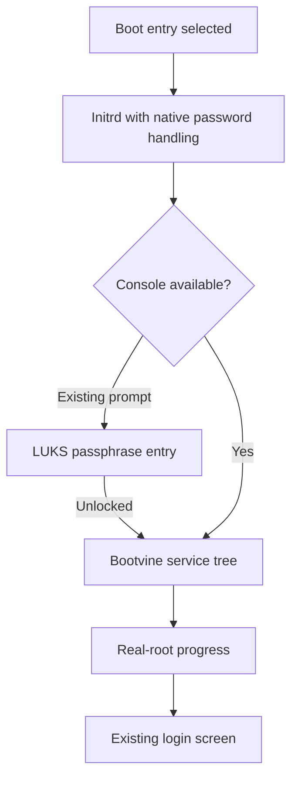
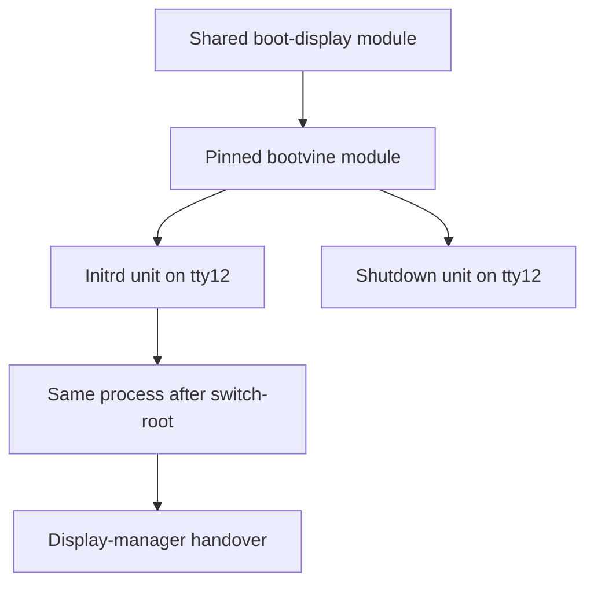

# NixOS Boot Progress with bootvine - Plan

## Goal Capsule

- **Objective:** The owner can see which services are running and what is delaying each NixOS boot.
- **Means:** Replace Plymouth with bootvine.
- **Product authority:** Owner-confirmed scope from the brainstorm on 2026-11-15; Requirements R1–R8 govern behavior.
- **Open blockers:** None.
- **Execution profile:** One PR; implementation, review, and shipping proceed through the authorized LFG run.

---

## Product Contract

### Summary

Make live service progress the normal NixOS boot display through bootvine, with the coverage and boot-access behavior defined by R1–R8.

### Problem Frame

The current quiet splash hides service activity and delays from the owner during boot.

### Key Decisions

- **Routine visibility.** Governs R1, R3. (session-settled: user-directed — chosen over the current quiet Plymouth screen: the owner wants to see service activity and delays on every boot.)
- **Bootstrap coverage.** Governs R1, R5. (session-settled: user-directed — chosen over production-only coverage: the owner also wants bootvine during installation and recovery while keeping the boot menu.)
- **Upstream display behavior.** Governs R2, R4, R8. The default interface meets the visibility goal without a custom theme or timing policy.

### Requirements

**Progress display**

- R1. Every production and bootstrap NixOS output must start bootvine automatically instead of Plymouth on each boot.
- R2. Show progress from the systemd initrd through the transition to the real root, yielding to any password prompt that already owns the console.
- R3. Show running and waiting services, elapsed running times, and the slowest completed services using bootvine's normal tree and timeline.
- R4. Hand the console to the existing login screen when the display manager takes its terminal.

**Boot access**

- R5. Preserve the existing boot-menu policies: hidden by default for production and visible for bootstrap.
- R6. Preserve production Secure Boot and TPM2 root-unlock behavior.
- R7. When manual root unlock is needed, keep the LUKS passphrase prompt visible and usable through bootvine or its existing console-agent fallback, then continue after successful unlock.

**Default behavior**

- R8. Use bootvine's default appearance and timing, including its normal shutdown and reboot display.

### Key Flows

- F1. **Boot to login.** Covers R1–R7. After entry selection under R5, show initrd progress when the console is available, handle any required unlock under R7, continue through the real-root transition, and yield to the existing login screen under R4.

- F2. **Shutdown or reboot.** Covers R8. The normal bootvine shutdown display follows stopping services until systemd takes over final shutdown.

### Acceptance Examples

- AE1. **Covers R2, R3.** Given a slow service before login, its running time and dependencies are visible in the current boot stage, with completed runs represented according to upstream timeline defaults.
- AE2. **Covers R1, R5, R7.** Given a bootstrap boot, the boot menu remains available; selecting its entry starts bootvine and permits the normal LUKS passphrase unlock.
- AE3. **Covers R6, R7.** Given a production boot, TPM2 can unlock the root normally; when automatic unlock is unavailable, a visible manual passphrase prompt remains available under R7.
- AE4. **Covers R4.** When the display manager switches to its terminal, the existing login screen becomes usable.
- AE5. **Covers R8.** When the owner shuts down or reboots, bootvine shows service shutdown using its default behavior.

### Scope Boundaries

- This work covers the NixOS boot display; macOS is outside its scope.
- Custom themes, retained boot-performance reports, and service-startup optimization are outside this change.

### Dependencies and Assumptions

bootvine's NixOS integration supports the systemd initrd, password prompts, display-manager handover, and shutdown described in the upstream sources below.

### Sources and Research

- `modules/nixos/system/boot-splash.nix` and `tests/boot-splash.nix`: current production-only Plymouth behavior and bootstrap menu expectations.
- `modules/nixos/system/boot.nix` and `docs/install.md`: production and bootstrap bootloader and root-unlock behavior.
- `hosts/MS-7D91/hardware.nix`: current production-only early NVIDIA loading, relevant to early console availability.
- [Upstream NixOS installation](https://codeberg.org/wvhulle/bootvine/src/branch/main/docs/install.md) and [NixOS module](https://codeberg.org/wvhulle/bootvine/src/branch/main/nix/nixos-module.nix).
- [Upstream screen and lifecycle guide](https://codeberg.org/wvhulle/bootvine/src/branch/main/docs/guide.md) and [configuration defaults](https://codeberg.org/wvhulle/bootvine/src/branch/main/docs/configuration.md).

---

## Planning Contract

**Product Contract preservation:** Clarified R2, R7, F1, and AE3 to preserve upstream password-agent ownership; the owner-confirmed coverage and boot-access scope is unchanged.

### Key Technical Decisions

- KTD1. **Use pinned nixpkgs.** Enable its existing `services.bootvine` module and default `pkgs.bootvine` 0.1.3; a separate input would duplicate an available integration. Governs R1–R4, R8.
- KTD2. **Keep boot policy separate from display.** Enable bootvine outside the bootstrap gate in `boot-splash.nix`; retain the production-only menu timeout there and leave `boot.nix` untouched. Governs R1, R5, R6. (session-settled: user-directed — chosen over production-only display coverage: the owner wants the same progress display in bootstrap while retaining its menu.)
- KTD3. **Preserve native console-agent cooperation.** Leave the systemd console password agent enabled and use bootvine's built-in handling rather than forcing prompt ownership with custom service ordering. The pinned implementation waits behind requests that predate its startup. Governs R2, R7.
- KTD4. **Reuse the current proof boundaries.** Update the existing generated-output owner and extend the encrypted-root VM's imports; a separate VM would repeat the disk setup without covering a different repository integration. Governs R1–R8.

### High-Level Technical Design

The shared boot-display module enables the pinned NixOS integration; its initrd process survives switch-root and the separate shutdown unit handles F2.
The bootloader and cryptroot policy remain owned by the existing boot module per KTD2.

### Assumptions

- The existing early NVIDIA loading can remain unchanged; bootvine needs a Linux virtual terminal rather than Plymouth's graphics path.
- Physical NVIDIA visibility, SDDM handover, and TPM2 fallback are hardware evidence rather than outcomes established by repository checks.

### Research Basis

The pinned [NixOS module](https://github.com/NixOS/nixpkgs/blob/d5cc6833999746cffdfe0598f7bc801a57b887a9/nixos/modules/services/system/bootvine.nix) and [package](https://github.com/NixOS/nixpkgs/blob/d5cc6833999746cffdfe0598f7bc801a57b887a9/pkgs/by-name/bo/bootvine/package.nix) establish KTD1.
The [v0.1.3 console lifecycle](https://codeberg.org/wvhulle/bootvine/src/tag/v0.1.3/bootvine/src/console_session/live_desk.rs) establishes KTD3.
The existing `tests/boot-splash.nix`, `tests/boot-layout.nix`, and [pinned upstream VM test](https://github.com/NixOS/nixpkgs/blob/d5cc6833999746cffdfe0598f7bc801a57b887a9/nixos/tests/bootvine.nix) shape KTD4.
The materialized-output and masked-unit learnings under `.compound-engineering/artifacts/solutions/best-practices/` support checking enabled generated units rather than declarations alone.

---

## Implementation Units

### U1. Replace the shared boot display

- **Goal:** Implement R1–R8 through KTD1–KTD3.
- **Dependencies:** None.
- **Files:** `modules/nixos/system/boot-splash.nix`, `tests/boot-splash.nix`, `docs/adding-a-host.md`, `docs/install.md`, `docs/recovery.md`.
- **Approach:**
  1. Enable the existing bootvine module for both variants and remove Plymouth and its quiet-console overrides.
  2. Preserve the production-only menu timeout and the existing hardware module declarations.
  3. Replace Plymouth-specific assertions with materialized initrd, real-root, and shutdown unit wiring, including executable content, switch-root survival, tty ownership, default configuration, and Plymouth absence.
  4. Retain the menu and relevant early-driver expectations, and update operational descriptions to match the native console behavior.
- **Patterns:** `tests/lib/configurations.nix` enumerates both variants; `tests/lib/etc-file.nix` and the existing initrd contents access inspect generated files.
- **Test scenarios:**
  - Covers F1 / AE1. Both variants include enabled bootvine startup units in initrd and real root, using the default package and settings.
  - Covers AE2. The generated bootstrap bootloader retains its visible menu; production retains its hidden menu.
  - Covers AE3. Plymouth's password agent is absent while the standard console password agent remains available.
  - Covers F2 / AE5. The enabled shutdown unit starts bootvine in shutdown mode.
- **Verification:** `nix build --no-link .#checks.x86_64-linux.boot-splash`.

### U2. Exercise encrypted-root boot with bootvine

- **Goal:** Exercise the repository's F1 and manual-unlock integration under R2 and R7.
- **Dependencies:** U1.
- **Files:** `tests/boot-layout.nix`.
- **Approach:** Import the shared boot-display module into the existing disposable installed-system fixture and retain its actual LUKS root unlock and filesystem assertions, following KTD4.
- **Patterns:** Reuse its OCR and keyboard input rather than creating a second disk-layout fixture.
- **Test scenarios:**
  - Covers R7, the manual-passphrase portions of AE2 and AE3. The boot displays a usable passphrase prompt, accepts the fixture passphrase, and reaches the installed encrypted-root system with bootvine included.
  - Covers R2. Bootvine's runtime evidence records its initrd-to-real-root lifecycle without preventing the existing login and filesystem outcomes.
- **Verification:** `nix build --no-link .#vmChecks.boot-layout`.

---

## Verification Contract

U1 and U2 own the local checks named above.
Before push and before declaring the PR ready, follow the existing repository verification and current-head CI policy in `AGENTS.md`, including the required `full-ci` label and platform evidence.
Keep physical hardware observations separate from repository and VM results as defined by `CONCEPTS.md`.

---

## Definition of Done

- U1 and U2 satisfy their traced requirements and their local checks pass.
- Operational documentation describes the implemented boot and recovery behavior.
- The reviewed change is pushed as an open PR with its required CI evidence recorded.
- Abandoned implementation attempts are removed from the final diff.
