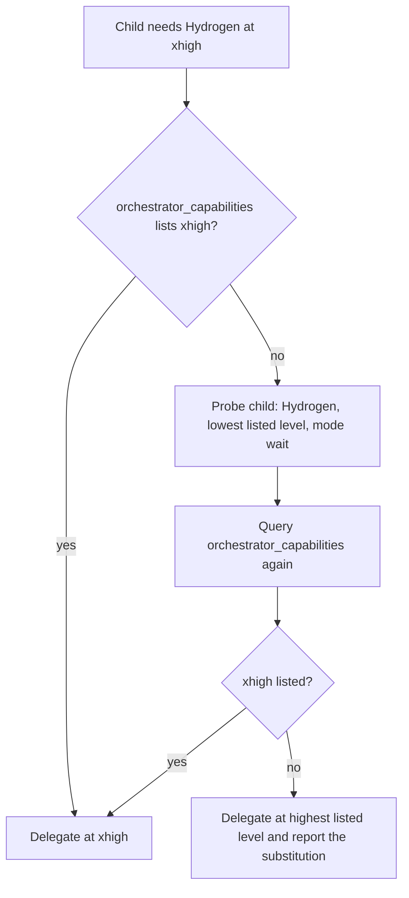

# Antigravity Delegation Hardening - Plan

## Goal Capsule

- **Objective:** Antigravity sessions cannot start their own subagents, so agents delegate only through T3 Code. When T3 Code's cached model options hide the highest reasoning level the model table asks for, the agent repairs the cache itself without asking the user, and otherwise falls back to the highest available level and says so.
- **Means:** A `tool_filter` overlay on the rebuilt Antigravity ACP runtime (KTD1) and a probe-child recovery sentence in the T3-only instruction branch (KTD3).
- **Product authority:** The repository owner, through this Product Contract. The Product Contract outranks the Planning Contract, which outranks the units.
- **Execution profile:** One PR, three units. It changes one runtime package build and the T3 instruction render, with no host-specific code.
- **Stop conditions:** Stop if `scripts/antigravity-acp-repack --check` cannot fit the third overlay into the pinned archive on any platform, or if a T3-only sentence appears in a baseline render.
- **Who finishes:** The executing agent implements, verifies, and opens the PR. The owner merges and switches hosts.
- **Open blockers:** None.

---

## Product Contract

### Summary

The rebuilt Antigravity ACP runtime turns off its built-in `start_subagent` tool in every session, which also removes the browser subagent. The T3-only instructions tell an agent what to do when Gemini Hydrogen's `thinking_level` lacks `xhigh`: start a short probe child at a listed level so T3 Code records Hydrogen's real levels, query capabilities again, and then delegate at `xhigh`. If `xhigh` is still missing, the agent delegates at the highest listed level and names the substitution.

### Problem Frame

Antigravity sessions in T3 Code have two delegation paths. One is the runtime's own `start_subagent`. The other is T3's `delegate_task`, which the shared instructions require. The other managed harnesses already lose their native subagent tools in T3 launches: Claude denies `Agent`, Codex disables `multi_agent`, and Grok gets `GROK_SUBAGENTS=0`. Antigravity is the only harness that still has its own subagent tool.

The T3 CE model-selection ladder puts top-rung Antigravity children on Gemini Hydrogen at `thinking_level` `xhigh`. T3 Code validates `target.options` against its cached provider catalog and rejects an unlisted value with `invalid_request`. When that cache lacks `xhigh`, the ladder cannot be followed. The rejection does not trigger a refresh, because T3 Code refreshes an instance on `provider_unavailable` only. Until now, the only recovery has been a person pressing "Refresh provider status" in T3 Code.

### Requirements

**Subagent tools in the ACP runtime**

- R1. Every session of the rebuilt Antigravity ACP runtime starts with `start_subagent` disabled, whatever the calling client is and whatever tool filter that client sends.
- R2. The browser subagent and its `chrome_*` tools are unavailable in those sessions. This follows from R1 and needs no separate control.
- R3. Built-in tools other than `start_subagent` behave as they do today, including a client's own `enabledTools` and `disabledTools` filter.

**Hydrogen `xhigh` recovery in T3 Code**

- R4. When `orchestrator_capabilities` lists Gemini Hydrogen without `xhigh` in `thinking_level` and a delegation needs `xhigh`, the agent starts a minimal Hydrogen probe child at a listed level without asking the user, lets it finish, and queries capabilities again.
- R5. When the second query lists `xhigh`, the agent delegates the original child at `xhigh`.
- R6. When the second query still lacks `xhigh`, the agent delegates at the highest listed `thinking_level` and names the substitution in its report, as the ladder's fallback rule does for a missing model.
- R7. The procedure uses only existing T3 tools. It adds no repository command, script, or package, and it does not call T3 Code's internal WebSocket API.
- R8. The procedure lives in the T3-only branch of the shared instruction template, so baseline and non-T3 renders never see it.

### Acceptance Examples

- AE1. **Covers R1, R3.** Given a client that sends `disabledTools: ["run_command"]`, when a session starts, then both `run_command` and `start_subagent` are disabled and every other built-in stays enabled.
- AE2. **Covers R1.** Given a client that sends `enabledTools` naming `start_subagent`, when a session starts, then `start_subagent` is still disabled.
- AE3. **Covers R4, R5.** Given capabilities that list Hydrogen `thinking_level` as `low`, `medium`, `high`, when a top-rung CE reviewer must start, then the agent starts a probe child at a listed level, queries again, finds `xhigh`, and starts the reviewer at `xhigh`.
- AE4. **Covers R6.** Given the same missing `xhigh` after the probe, then the reviewer starts at `high` and the report says that `high` replaced `xhigh`.
- AE5. **Covers R4.** Given capabilities that already list `xhigh`, then no probe child starts.

### Key Decisions

- **Turn off the browser subagent too.** Governs R1, R2. (session-settled: user-directed — chosen over keeping the browser subagent and blocking only model-started subagents: one switch matches the other harnesses' T3 controls and keeps the overlay small.)
- **Apply the switch to the whole runtime, not only T3 launches.** Governs R1. The user asked for every `antigravity-acp` caller, including Compound Engineering run homes.
- **The agent refreshes on its own, with no user prompt.** Governs R4, R7. (session-settled: user-directed — chosen over asking the user to press Refresh and over driving T3 Code's UI through preview tools: the user wants a hack that needs no human.)
- **No new command, script, or package for the refresh.** Governs R7. (session-settled: user-directed — chosen over adding a refresh command: the request asked for the recovery without a new command.)
- **A probe child rather than a forced `xhigh` request.** Governs R4. The user's first proposal was to send `xhigh` anyway. A test on 2026-11-16 showed T3 Code rejects an unlisted `thinking_level` with `invalid_request` and refreshes nothing. A started Antigravity session, by contrast, reports its config options to T3 Code's provider catalog.
- **Fall back to the highest listed level.** Governs R6. It keeps the run going and reuses the ladder's existing substitution-and-report rule.

### Scope Boundaries

- The `agy` CLI's own subagent behavior is unchanged.
- No periodic or settings-based refresh is added, such as lowering T3 Code's provider health refresh interval.
- No new T3 tool, CLI subcommand, or repository script.
- The ladder's model and thinking-level choices are unchanged.
- Considered and not built: a substring check for the new instruction sentence. The `t3` receipt hash in `tests/agent-instructions.py` already pins the whole render, and a substring check would pass a negated sentence (see Sources). Evidence that would change this: a template edit that needs the sentence to move between sections without a hash update.

### Dependencies / Assumptions

- T3 Code 0.1.9 validates `delegate_task` options against `provider.models[].capabilities.optionDescriptors` and refreshes an instance only on `provider_unavailable` (`resolveTargetRechecking` in the server bundle).
- T3 Code's Antigravity provider records each model's `thinking_level` options only from a session whose current model is that model (`observeThinkingLevels`, called from `onSessionStarted` and `onConfigOptionsUpdated`). A model it has never observed gets a copy of the current session model's options (`buildAntigravityModelsFromSession`). This explains the missing `xhigh`: Hydrogen shows another model's levels until a Hydrogen session runs. The record lives in memory, so a T3 Code restart can bring the gap back.
- ACP runtime 1.4.5 calls `ToolFilterConfig.resolve_disabled_builtins()` once per agent configuration (`_create_agent_config` in `acp_server/server.py`), which every new, loaded, and resumed session goes through. It derives `enable_subagents` from whether `BuiltinTools.START_SUBAGENT` is in that set, and injects the browser subagent only when subagents are enabled.

### Sources / Research

- `packages/antigravity-acp.nix`, `scripts/antigravity-acp-repack`, `packages/antigravity-acp-overlay/`: the existing overlay mechanism.
- Runtime modules `acp_server/tool_filter.py` and `acp_server/server.py` (session capability construction near `subagents_enabled`), from the archive in the 1.4.5 build.
- `home/h82/agents/instructions/instructions.md.tmpl` (T3 CE model selection, Antigravity effort sentence) and `docs/agent-routing.md`, which must stay aligned.
- `docs/agent-routing.md` Antigravity ladder evidence: a Hydrogen `xhigh` request was rejected because T3 listed only low, medium, and high, and a later lookup listed `xhigh`.
- `.compound-engineering/artifacts/solutions/integration-issues/antigravity-acp-runtime-loads-no-global-rule-files.md`: the overlay precedent and the limit that repository checks prove the archive, not a signed-in session.
- `.compound-engineering/artifacts/solutions/best-practices/substring-sentence-check-passes-a-negated-instruction.md`.
- `.compound-engineering/artifacts/plans/2026-11-16-1048-refactor-t3-ladder-aa-retune-plan.md`: the ladder that sets Hydrogen `xhigh` for the top rung.

Product Contract preservation: restructured, no scope change. R4 now says the probe finishes instead of "cancels or finishes" (KTD3 picks the finish path). The deferred questions are resolved in place by KTD1, KTD2, KTD3, and the confirmed catalog mechanism under Dependencies / Assumptions. A Key Decision records the no-new-command constraint that was already in R7.

---

## Planning Contract

### Key Technical Decisions

- KTD1. **Hook `tool_filter` by rebinding `ToolFilterConfig.resolve_disabled_builtins`.** The overlay wraps the shipped method and adds `BuiltinTools.START_SUBAGENT` to whatever set it returns. It takes the enum through the module's own `sdk_types_module`, so the overlay needs no new import. Wrapping the result covers the empty filter, the denylist, the `enabledTools` allowlist, and filters restored from session sidecars, because all of them pass through this one call. The client's filter stays stored as the client sent it. Governs R1, R3.
- KTD2. **Register the overlay against `_tool_name_to_builtin`.** `scripts/antigravity-acp-repack --extend` refuses a function that is not defined at module level, and `resolve_disabled_builtins` is a method. The extension entry therefore names `tool_filter` with the module-level guard `_tool_name_to_builtin`, and the overlay itself rebinds the class attribute. The entry goes into the two tables that list extensions, `packages/antigravity-acp.nix` and `scripts/t3code-release`. `tests/test_t3code_release.py` asserts those tables agree and builds its own stand-in runtime archive, so that archive needs a matching `tool_filter.py` stand-in. Governs R1.
- KTD3. **The probe child runs to completion with `mode: "wait"`.** Hydrogen at the lowest listed `thinking_level` gets a one-line task, such as replying `OK`, and the parent waits in the same turn because this turn needs the refreshed catalog. Waiting until the child finishes guarantees its session started and reported its config options, so nothing has to be cancelled. Governs R4, R7. Implements the self-refresh Key Decision.
- KTD4. **One instruction paragraph in the T3 CE model-selection section, after the Antigravity effort sentence.** The paragraph names the trigger (no `xhigh` for Hydrogen in `orchestrator_capabilities` when a child needs it), the probe, the second lookup, and the fallback, and tells the agent not to ask the user. It cites the ladder's existing substitution sentence instead of restating it. Governs R4, R5, R6, R8.

### High-Level Technical Design

The recovery is a short branch before an Antigravity `xhigh` delegation:

### Assumptions

- The pinned runtime archive has room for a third overlay on both page sizes. Repository research fitted it on `aarch64-darwin`. `x86_64-linux` is unverified locally and is checked by the stop condition in the Goal Capsule.

---

## Implementation Units

### U1. Force `start_subagent` off in the ACP runtime

**Goal:** Every session of the rebuilt runtime has `start_subagent` disabled, whatever filter the client sends.

**Requirements:** R1, R2, R3, KTD1, KTD2. Implements the browser-subagent and whole-runtime Key Decisions.

**Dependencies:** None.

**Files:**

- `packages/antigravity-acp-overlay/tool_filter_overlay.py` (new)
- `packages/antigravity-acp.nix` (one `extensions` entry, header comment)
- `scripts/t3code-release` (`EXTENSIONS`)
- `tests/test_t3code_release.py` (a `tool_filter.py` stand-in defining `_tool_name_to_builtin` in `runtime_archive`)
- `tests/test_antigravity_acp_overlay.py`

**Approach:**

1. Write the overlay in the style of `paths_overlay.py`: keep a reference to the shipped method, define a wrapper that returns the shipped set plus `START_SUBAGENT`, and assign the wrapper back onto `tool_filter.ToolFilterConfig`.
2. Add `{ module = "tool_filter"; function = "_tool_name_to_builtin"; }` to `extensions`, and the matching tuple to `EXTENSIONS` in `scripts/t3code-release`.
3. Extend the package header comment to say the rebuild also disables `start_subagent`.

**Patterns to follow:** `packages/antigravity-acp-overlay/paths_overlay.py` (rebinding through the shipped module) and `OverlayCase.load` in `tests/test_antigravity_acp_overlay.py`, which imports a stand-in module whose last line imports its overlay.

**Test scenarios:** in `tests/test_antigravity_acp_overlay.py`, with a stand-in `tool_filter` module that defines a minimal `BuiltinTools` enum, `ToolFilterConfig`, and `_tool_name_to_builtin`. This seam catches the overlay's set arithmetic and its rebinding. It cannot catch whether the real `server.py` still reads the method; the install check and a signed-in session cover that.

- An empty filter resolves to exactly `{START_SUBAGENT}`.
- Covers AE1. `disabledTools: ["run_command"]` resolves to `{RUN_COMMAND, START_SUBAGENT}`.
- Covers AE2. `enabledTools` listing `start_subagent` and `view_file` still includes `START_SUBAGENT` in the disabled set and excludes `VIEW_FILE`.
- A filter rebuilt with `ToolFilterConfig.from_dict` (the sidecar path) also resolves with `START_SUBAGENT` disabled.
- `to_dict()` returns the client's fields unchanged, so the stored filter does not gain `start_subagent`.

**Verification:** The overlay tests pass. `scripts/antigravity-acp-repack --check` fits all three overlays into the pinned runtime. The `antigravity-acp` package builds with its install check (archive contents, and on macOS an `initialize` answer). `tests/test_t3code_release.py` passes with the new extension in both tables.

### U2. Add the Hydrogen `xhigh` recovery to the T3-only instructions

**Goal:** A T3 session that cannot see Hydrogen `xhigh` refreshes the catalog with a probe child and then delegates at `xhigh` or at the highest listed level.

**Requirements:** R4, R5, R6, R7, R8, KTD3, KTD4. Implements the self-refresh and no-new-command Key Decisions.

**Dependencies:** None.

**Files:**

- `home/h82/agents/instructions/instructions.md.tmpl`
- `tests/agent-instructions.py` (the `t3` receipt hash)

**Approach:**

1. In the `# T3 CE model selection` section, add one paragraph after the Antigravity effort sentence, worded per KTD4.
2. Render the T3 branch with the repository renderer and replace only the `t3` hash. Baseline hashes must not change.

**Patterns to follow:** commit `ee5825d`, which changed the same section and touched only the template, `docs/agent-routing.md`, and the `t3` hash.

**Test scenarios:**

- The `t3` receipt matches the new render.
- Every non-T3 receipt is unchanged, which proves R8.

**Verification:** `agent-instructions` passes with only the `t3` hash changed.

### U3. Align documentation

**Goal:** Repository documents describe the runtime-wide subagent switch and the recovery.

**Requirements:** R1, R4, R8.

**Dependencies:** U1, U2.

**Files:**

- `docs/agent-routing.md`
- `AGENTS.md`

**Approach:**

1. In `docs/agent-routing.md`, say that the rebuilt Antigravity runtime disables `start_subagent` in every session, beside the existing per-harness T3 controls whose sentence says those controls apply to T3 launches. Update the ladder text to name the probe-child recovery and replace "Refresh capability evidence after a rejection" with it.
2. In `AGENTS.md`, extend the `packages/antigravity-acp-overlay/` description to include the `tool_filter` overlay.

**Test expectation:** none — documentation only. `docs/agent-routing.md` and `AGENTS.md` are inputs to the `agent-instructions` check, which must still pass.

**Verification:** Markdown lint passes and `agent-instructions` stays green.

---

## Verification Contract

| Gate | Command or evidence | Proves |
| --- | --- | --- |
| Overlay unit tests | `python3 tests/test_antigravity_acp_overlay.py` | U1 behavior |
| Archive fit | `scripts/antigravity-acp-repack --check` with three `--extend` entries against the pinned runtime | U1 fits the archive |
| Package build | `nix build --no-link .#checks.aarch64-darwin.antigravity-acp-overlay` and a build of the `antigravity-acp` package | U1 install check |
| Release tool alignment | `t3code-release` check (`tests/test_t3code_release.py`) | KTD2 tables agree |
| Instructions | `agent-instructions` check | U2, U3 |
| Repository gates | `git diff --check`, `markdownlint-cli2` on changed Markdown, `nix flake check` on the local builder | Project rules in `AGENTS.md` |
| CI | `full-ci` label, with `host-checks`, `vm-checks`, `build`, and `build-darwin` green on the head | Linux build and the remaining closures |

Linux builds of the runtime are deferred to CI from this macOS host. A signed-in Antigravity session that confirms `start_subagent` is gone, and a real catalog gap that the probe repairs, are hardware evidence for the owner after the switch. They are reported separately, not as repository checks.

---

## Definition of Done

- U1, U2, and U3 are in one PR, and every gate in the Verification Contract has passed locally or is recorded as deferred to CI.
- Only the `t3` receipt hash changed in `tests/agent-instructions.py`.
- No new script, command, or package exists for the refresh.
- Abandoned attempts and stray files are removed from the diff.
