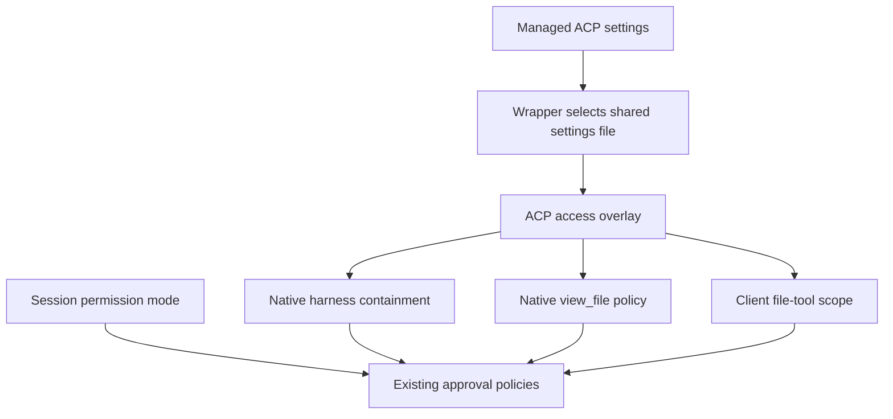

# Antigravity Non-Workspace File Access - Plan

## Goal Capsule

- **Objective:** Use files outside project folders from the owner's Antigravity CLI and ACP sessions.
- **Means:** The managed settings and ACP overlay described by KTD1 and KTD2.
- **Product authority:** The scope confirmed by the owner in this conversation, as recorded in the Product Contract below.
- **Open blockers:** None.
- **Execution:** One PR; LFG owns implementation, review, and delivery. Host activation remains an owner-run operation.

---

## Product Contract

### Summary

Enable non-workspace file access in repository-managed Antigravity CLI and ACP sessions.
Keep file location eligibility separate from the session's command and file-change approval policy.

### Problem Frame

The installed ACP 1.4.5 rejected a Downloads MP4 before returning media because its file path was outside the workspace.
Its workspace boundary is separate from T3's Full access mode, and the ordinary ACP settings file does not reach every provider instance or temporary run home.

### Key Decisions

- **Access across permission modes.** Governs R2 and R3. (session-settled: user-approved — chosen over Full access only: the owner wants external paths usable regardless of session mode.)
- **Include CLI alongside ACP.** Governs R1, R4, and R5. (session-settled: user-approved — chosen over ACP-only configuration: the owner requested the same access policy for CLI use.)

### Requirements

**Access behavior**

- R1. The managed ACP runtime honors `allowNonWorkspaceAccess` with the CLI setting's meaning: permission to read and edit files outside active workspace folders.
- R2. Enabling the setting permits outside-workspace file access in every session permission mode.
- R3. Existing session policies continue to determine whether commands and file changes require approval.

**Managed configuration**

- R4. Repository-managed user configuration enables `allowNonWorkspaceAccess` for both Antigravity CLI and ACP on supported hosts.
- R5. The ACP policy applies to every caller of the managed runtime, including sessions using the ordinary home, T3 provider instance homes, and Compound Engineering private run homes.

### Acceptance Examples

File access follows the existing agent interaction; this policy change adds no separate user flow.

- AE1. **Covers R1, R2, R4.** With the managed setting enabled, a CLI or ACP session can read an existing file in Downloads outside every active workspace folder. Its location alone does not cause a workspace-boundary rejection.
- AE2. **Covers R2, R3.** A Supervised session editing that external file follows its existing file-change approval process. A Full access session follows its existing automatic approval behavior. Both modes admit the external path.
- AE3. **Covers R4, R5.** An ordinary CLI launch, a T3 ACP session, and a CE ACP run each receive the enabled policy, even when the ACP caller supplies its own configuration home.

<!-- ce-section: work-relationships -->
### How This Work Fits Together

This access change enables the previously requested video investigation.
Any later T3 video-routing instructions depend on evidence from that investigation; this is the current follow-up direction.

### Scope Boundaries

- This plan covers the file-access policy and its managed configuration in ACP and CLI.
- Deferred: repeat the downloaded-video trials with Gemini Carbon, Argon, and Hydrogen, then add T3 video-analysis instructions if native video input succeeds.

### Sources / Research

- [Antigravity settings](https://antigravity.google/docs/settings?tab=cli) documents `allowNonWorkspaceAccess` separately from Agent Mode and tool approval rules.
- [Current agent settings](home/h82/agents/gemini.nix) manages mutable CLI settings and ordinary ACP authentication settings; neither declaration currently includes `allowNonWorkspaceAccess`.
- [ACP packaging](packages/antigravity-acp.nix) rebuilds the separately pinned ACP 1.4.5 runtime from [T3 release metadata](packages/t3code-release.json). The CLI has its own [release pin](packages/antigravity-cli-release.json).
- [T3 configuration](home/h82/t3code.nix), [ACP wrapper](packages/antigravity-acp-path.nix), and [routing documentation](docs/agent-routing.md) describe the separate provider and CE run homes that R5 must cover.

---

## Planning Contract

### Key Technical Decisions

- KTD1. **Read one shared ACP setting without replacing the caller's home.** The existing mutable-settings activation owns `allowNonWorkspaceAccess=true` in the ordinary ACP settings file and the CLI settings file. The ACP wrapper names the shared file through `ANTIGRAVITY_ACP_SHARED_SETTINGS_FILE`, leaving authentication and session storage in the caller's own home. Without that environment entry, the overlay reads the current ACP settings path. This implements R4 and R5 without copying credentials or reconciling every temporary home.
- KTD2. **Extend the existing runtime rebuild.** Add a `server` overlay that reads the boolean setting and changes the native harness containment, the native `view_file` scope policy, and the three client file-tool scope checks. Retain the existing workspace list and permission-handler policies for R1–R3. Use the shipped harness containment enum rather than treating the filesystem root as a workspace. The existing repack extension and archive/install checks own delivery of this addition.
- KTD3. **Keep configuration parsing narrow.** Accept the boolean `true` as enabled; false, absence, or an unreadable or malformed settings file retain the shipped scope behavior. Use the runtime's Hjson parser and recognize the added key in its settings diagnostics. This follows the existing ACP settings loader's tolerant behavior.

### High-Level Technical Design

The shared file supplies only the access setting; each caller retains its own authentication and conversation state.

### System-Wide Impact

KTD2 affects native and client-provided file operations, including sessions recreated after a model change or resume.
Existing enterprise policies remain governed by R3; the change does not reinterpret an administrative deny as permission.
The pinned ACP's Python interfaces and harness enum are available in the installed archive; install-time initialization checks whether the overlay still imports against the actual package.

---

## Implementation Units

### U1. Add the ACP access overlay

- **Goal:** Implement R1–R3 through KTD2 and KTD3.
- **Dependencies:** None.
- **Files:** `packages/antigravity-acp-overlay/server_overlay.py`, `packages/antigravity-acp.nix`, `tests/test_antigravity_acp_overlay.py`.
- **Approach:** Extend the shipped server module using the existing repack mechanism. Intercept only its file-scope boundaries and native harness configuration; retain approval callbacks and workspace metadata.
- **Patterns:** The existing `system_prompt`, `paths`, and `tool_filter` overlays and their stand-in module tests.
- **Test scenarios:**
  - Covers AE1. With the setting enabled, a native file read and each client file operation admit an external path.
  - Covers AE2. The same paths are eligible across session modes while the original approval policy is retained.
  - False, missing, malformed, or incorrectly typed values retain the existing scope behavior.
  - An enabled setting changes the native containment enum without replacing workspace context or other harness configuration.
- **Verification:** The overlay behavior suite passes and the rebuilt package's existing archive and initialization checks accept the new overlay. Stand-ins prove behavior; package checks detect incompatibility with the shipped module imports.

### U2. Deliver the setting to CLI and every ACP home

- **Goal:** Implement R4 and R5 through KTD1.
- **Dependencies:** U1.
- **Files:** `home/h82/agents/gemini.nix`, `packages/antigravity-acp-path.nix`, `tests/gemini.nix`, `tests/antigravity-acp-path.nix`.
- **Approach:** Add the key to the existing mutable settings declarations and have the wrapper provide the shared settings path using the same environment-default pattern as the instruction paths.
- **Test scenarios:**
  - Covers AE3. Ordinary, T3, and CE run-home launches receive the shared path without relocating their home or replacing authentication settings.
  - Activation materializes the enabled CLI and ACP key while retaining unrelated keys.
  - An explicit shared-file environment entry is preserved by the wrapper.
- **Verification:** Existing activation and wrapper checks exercise the packaged outputs and scratch homes.

### U3. Document the delivered behavior

- **Goal:** Explain the R1–R5 behavior and its setting delivery in the existing routing documentation.
- **Dependencies:** U1, U2.
- **Files:** `docs/agent-routing.md`.
- **Approach:** Describe KTD1 and KTD2 beside the current ACP delivery paths.
- **Test expectation:** None — documentation only; the existing instruction check consumes this document.
- **Verification:** The affected documentation-input check and Markdown lint accept the updated document.

---

## Verification Contract

Use the existing `antigravity-acp-overlay`, `antigravity-acp-path`, `gemini`, and `agent-instructions` check owners, plus the ACP package's install check.
Local execution uses the supported Darwin builder; repository-required platform and host-output evidence follows the existing full-CI policy in `AGENTS.md`.
No browser surface changes in this plan.

---

## Definition of Done

- U1–U3 implement R1–R5 and cover AE1–AE3.
- The relevant checks and package install check pass, with unsupported local evidence recorded separately from CI results.
- Implementation, review fixes, and the plan are committed in the PR; abandoned implementation attempts are removed.
- No host switch is part of this work.
