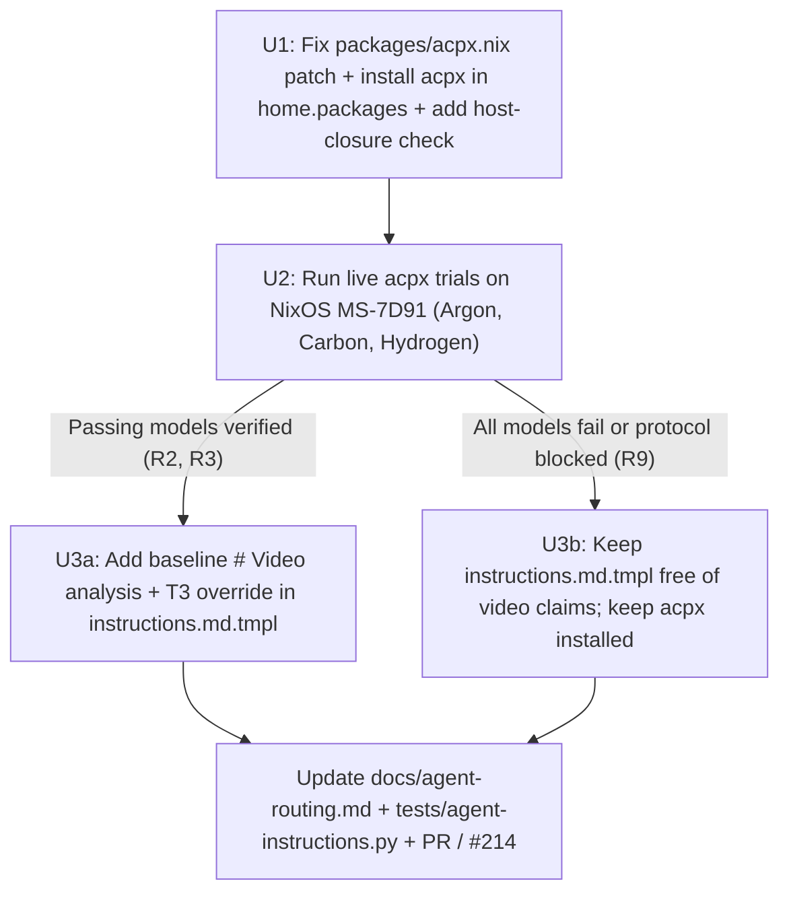
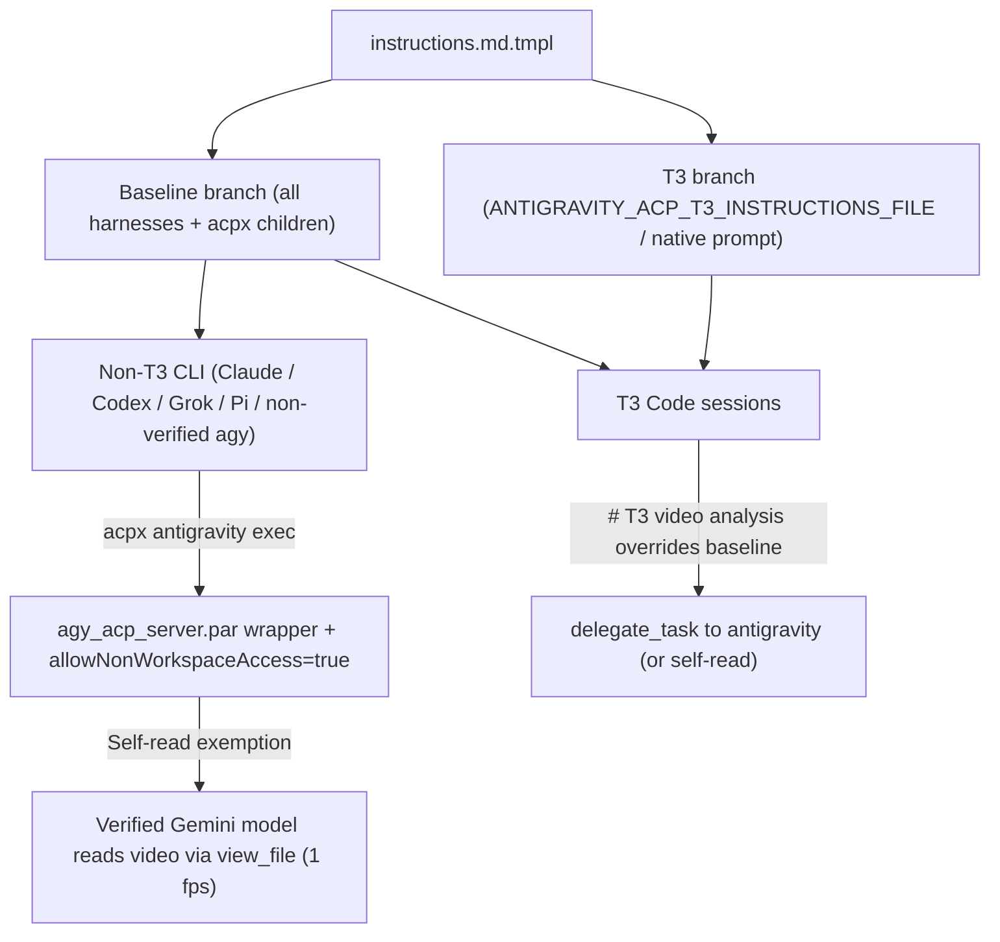

# Acpx Video Analysis - Plan

## Goal Capsule

- **Objective:** Agents in CLI sessions outside T3 Code can inspect local video files natively whenever a verified delegation route exists.
- **Means:** Install `acpx` unconditionally via Home Manager (`KTD2`), fix its `0.22.0` project-config bypass patch (`KTD1`), verify non-interactive `acpx` delivery against the managed Antigravity ACP runtime (`KTD4`), and conditionally update shared instructions, routing documentation, and receipt checks (`KTD5`).
- **Product authority:** Issue #214 (`hyperlapse122/dotfiles#214`) and the scope confirmed by the owner in this session, recorded in the Product Contract below.
- **Execution profile:** Single pull request closing #214; implementation runs sequentially (`U1` -> `U2` -> `U3`) because `U2` requires the repaired `.#acpx` binary from `U1` and `U3` branches on `U2` findings.
- **Finish and ship:** `lfg` executes `U1`–`U3` through `ce-work`, runs simplification and review, commits, pushes, opens the PR with `Closes #214` and `full-ci`, posts trial evidence on #214, and monitors CI to completion.
- **Open blockers:** None.

---

## Product Contract

### Summary

Install `acpx` in user packages and verify that `acpx` delivers native video to the managed Antigravity ACP runtime across Gemini 4 Argon, Carbon, and Hydrogen.
When the route succeeds, add common video-analysis instructions without frame-extraction fallbacks while keeping T3 Code sessions on `delegate_task`.
When `acpx` cannot deliver video, record the blockers and keep video claims out of the common instructions while leaving `acpx` installed.

### Problem Frame

PR #213 enabled native video analysis inside T3 Code by routing `delegate_task` calls to the managed Antigravity ACP runtime (`agy_acp_server.par`), which reads local video at one timestamped frame per second.
CLI sessions outside T3 Code — Claude Code, Codex, Grok Build, Pi, and non-Gemini Antigravity CLI runs — lack `delegate_task` and currently have no verified way to inspect local video files.
The repository already packages `acpx` (`0.22.0`) and puts `agy_acp_server.par` on `PATH` with `allowNonWorkspaceAccess` enabled, but OMP retirement (`f4e8e5a`) dropped `acpx` from `home.packages` and `acpx` has not been verified for native video delivery.

### Key Decisions

- **Install `acpx` unconditionally in `home.packages`.** Governs R1, R9. (session-settled: user-directed — chosen over conditional installation or `npx`/`nix run` wrappers: the owner wants `acpx` on `PATH` for CLI sessions regardless of whether video delivery clears all blockers.)
- **Prohibit frame-extraction fallbacks on `acpx` failure.** Governs R7. (session-settled: user-approved — chosen over permitting `ffmpeg` extraction or prompting before extracting: match #213 so instructions cover only verified native video and surface failures directly.)
- **Keep T3 Code sessions on `delegate_task`.** Governs R8. T3 launches load both the baseline common file and the T3 addition, so the T3 addition must explicitly override the baseline guidance.
- **Allow passing Antigravity Gemini models outside T3 to read video directly.** Governs R6. Antigravity CLI and `acpx`-spawned `agy_acp_server.par` children both load the common rules, so self-reading prevents recursive `acpx` calls.
- **Keep the #213 model ranking order.** Governs R6. Preserve #213's Argon, Carbon, Hydrogen preference while gating each model on passing the `acpx` native-video check.

### Requirements

**Packaging**

- R1. Shared Home Manager configuration installs the repository-packaged `acpx` binary into `home.packages` on NixOS and macOS hosts.

**Verification and Trials**

- R2. Implementation verifies non-interactive `acpx` invocation against the managed `agy_acp_server.par` runtime, recording exact arguments, model selection, `thinking_level` control, outside-workspace access behavior, and timeouts or transport limits.
- R3. Implementation runs a short native-video check through `acpx` for Gemini 4 Argon, Carbon, and Hydrogen, confirming each run reads the video file natively without frame-extraction or conversion tools.
- R4. Per-model results and any transport or option limitations appear in the PR description and on issue #214.

**Instructions and Routing**

- R5. When `acpx` delivers native video, the common branch of `home/h82/agents/instructions/instructions.md.tmpl` instructs agents that cannot view video themselves to delegate local video analysis through `acpx` using the verified invocation.
- R6. The common video-analysis section lists only verified passing models in Argon, Carbon, Hydrogen order and directs sessions running those verified passing Gemini models to open local videos directly instead of delegating.
- R7. The common video-analysis section prohibits frame-extraction fallbacks and alternative CLI workarounds, instructing agents to report `acpx` failures or unavailability directly to the user.
- R8. When `acpx` delivers native video, the T3 branch of `home/h82/agents/instructions/instructions.md.tmpl` keeps video analysis on `delegate_task` and specifies that T3 video rules replace the baseline `acpx` video instructions.
- R9. When `acpx` cannot deliver native video to the runtime, implementation leaves the common instruction branch free of video-support claims while keeping `acpx` installed per R1.

**Documentation and Checks**

- R10. `docs/agent-routing.md` records the `acpx` verification findings, per-model trial results, and resulting instruction behavior, and `tests/agent-instructions.py` receipt hashes pass for all renders.

### Acceptance Examples

- AE1. **Covers R5, R7.**
  - **Given:** A Claude Code, Codex, Grok Build, or Pi CLI session needs a local video's content after `acpx` video trials pass.
  - **When:** It follows its baseline instructions.
  - **Then:** It delegates through `acpx` with the verified flags and reports an `acpx` error or timeout without running `ffmpeg` or `agy -p`.
- AE2. **Covers R6.**
  - **Given:** An `acpx`-spawned `agy_acp_server.par` child or `agy` CLI session running a verified Gemini 4 model loads the common rules.
  - **When:** It inspects a local video file.
  - **Then:** It opens the file directly with its native file-viewing tool instead of invoking `acpx`.
- AE3. **Covers R8.**
  - **Given:** A T3 Code session receives both the baseline `# Video analysis` instructions and the T3 addition after `U2` passes at least one model.
  - **When:** It needs a local video's content.
  - **Then:** It delegates through `delegate_task` and follows T3's model scope instead of running `acpx` or baseline model limits.
- AE4. **Covers R1, R9.**
  - **Given:** `acpx` fails to pass required `model` or `thinking_level` options or cannot deliver native video during trials.
  - **When:** The PR opens.
  - **Then:** `home.packages` still includes `acpx`, the blockers are recorded per R4, and the common instruction branch contains no video-analysis claim.

### Dependencies / Assumptions

- The test host has the rebuilt `agy_acp_server.par` on `PATH` and active Antigravity ACP settings (`allowNonWorkspaceAccess: true` and valid OAuth credentials under `~/.gemini/antigravity-acp/`) during `acpx` verification.
- Live CLI sessions receive the exposed `acpx` binary and updated instruction renders after the owner runs `nr switch`.

### Sources / Research

- GitHub issue #214 (`hyperlapse122/dotfiles#214`), #196 / PR #213 (`.compound-engineering/artifacts/plans/2026-11-17-1104-feat-antigravity-video-delegation-plan.md`), and PR #195 (`.compound-engineering/artifacts/plans/2026-11-17-0040-feat-antigravity-non-workspace-access-plan.md`).
- `packages/acpx.nix`, `packages/acpx-release.json`, `flake.nix`, `home/h82/default.nix`, `tests/acpx-config.sh`, `tests/shell-utilities.nix`, `tests/darwin-config.nix`, and `tests/darwin-outputs.nix`.
- `packages/antigravity-acp-path.nix`, `packages/antigravity-acp-overlay/server_overlay.py`, `packages/antigravity-acp-overlay/system_prompt_overlay.py`, `packages/antigravity-acp-overlay/tool_filter_overlay.py`, `tests/antigravity-acp-path.nix`, and `home/h82/agents/gemini.nix`.
- `home/h82/agents/instructions/instructions.md.tmpl`, `scripts/agent-instructions`, `docs/agent-routing.md`, and `tests/agent-instructions.py`.
- Institutional learnings: `antigravity-acp-runtime-loads-no-global-rule-files.md`, `t3code-antigravity-acp-openssl-missing-ca-bundle-hangs-sessions.md`, `substring-sentence-check-passes-a-negated-instruction.md`, `help-text-check-passes-while-cli-routes-to-wrong-host.md`, `mutation-testing-reveals-decorative-nix-check-assertions.md`, and `shebang-script-stub-cannot-observe-argv0.md`.

---

## Planning Contract

### Key Technical Decisions

- KTD1. **Fix the `packages/acpx.nix` `readConfigFile(projectPath)` patch for `acpx` `0.22.0`.** Building `.#acpx` currently fails `postInstallCheck` (`tests/acpx-config.sh`) because `acpx` `0.22.0` treats `{ config: void 0, exists: false }` as a truthy `projectConfig` in `loadResolvedConfig` (`projectConfig !== void 0`), reporting `.loaded.project == true`. Patching `readConfigFile(projectPath),` to `void 0,` restores the project-config bypass.
- KTD2. **Add `packages/acpx.nix` unconditionally to `home/h82/default.nix`.** Instantiates the settled product decision governing R1 and R9 `(session-settled: user-directed — chosen over conditional installation or npx/nix run wrappers: the owner wants acpx on PATH for CLI sessions regardless of whether video delivery clears all blockers.)`. Unconditional placement next to `antigravity-cli.nix` and `antigravity-acp-path.nix` delivers `acpx` to NixOS production, NixOS bootstrap, and macOS hosts and passes `tests/darwin-config.nix` `assertMapping` without adding an entry to `modules/shared/darwin-apps.nix`.
- KTD3. **Guard `acpx` user-profile delivery in a `hostClosureChecks` check and `tests/darwin-outputs.nix`.** Rather than duplicating `packages/acpx.nix`'s `postInstallCheck` (`tests/acpx-config.sh`) or `tests/antigravity-acp-path.nix`'s C-stub wrapper test, follow `tests/serve-html-profiles.nix`: verify `entry.user.home.path/bin/acpx` resolves to `packages/acpx.nix` and runs under `env -i` across `configurations.userEntries` (NixOS + bootstrap).
- KTD4. **Require `--approve-reads --non-interactive-permissions deny`, `--timeout 300`, and `--format json` transcript scoring against an independent 1-fps reference in `U2`.** `tool_filter_overlay.py` disables `start_subagent` but leaves shell execution enabled inside `agy_acp_server.par`, so non-interactive read-only approval with denied writes/commands enforces R7 at the transport boundary while `--timeout 300` bounds unauthenticated `session/new` stalls without cutting off slow models like Carbon (222.7 s in PR #213). Inspecting `--format json` events proves `model`, `thinking_level`, native `view_file` usage, and absence of shell commands.
- KTD5. **Place verified non-T3 guidance in one unbranched `# Video analysis` section under `{{ else -}}` and strengthen `# T3 video analysis` override wording when `U2` passes.** `scripts/agent-instructions` splits Antigravity rules by top-level `#` headings under 24,000 bytes per file, and `tests/agent-instructions.py` enforces five `EXPECTED` receipt digests (`darwin`, `darwin-claude`, `nixos`, `nixos-claude`, `t3`). Keeping the baseline video section unbranched (or omitted under R9) preserves existing receipt keys and `< 24000` byte files; when `# Video analysis` is added, explicit replacement wording in `# T3 video analysis` (`{{ if .t3 -}}`) overrides both baseline transport and baseline model list when `packages/antigravity-acp-overlay/system_prompt_overlay.py` concatenates both branches.

### High-Level Technical Design

The delivery sequence gates instruction updates on live `acpx` verification, and runtime delivery separates T3 sessions from non-T3 CLI and `acpx` child sessions:

Runtime instruction composition and delegation differ by launch environment because `packages/antigravity-acp-path.nix` leaves `ANTIGRAVITY_ACP_T3_INSTRUCTIONS_FILE` unset by default:

### Assumptions

The defaults below resolve the open operational forks left from brainstorm in pipeline mode:

- **Transport permissions and external paths:** `U2` tests `--approve-reads --non-interactive-permissions deny` first against a synthetic short `.mp4` outside `--cwd`. If `agy_acp_server.par` cannot run `view_file` under that permission mode or refuses out-of-`--cwd` paths, treat that refusal as an R9 blocker rather than switching to `--approve-all`.
- **Required `model` and `thinking_level` options:** `U2` tests each of Gemini 4 Argon, Carbon, and Hydrogen with `--model` and `--config-option thinking_level=high` (matching PR #213). Per AE4, if `acpx` fails to apply `--model` or `thinking_level` cleanly, or if a model fails the independent 1-fps check, withhold that model (or withhold baseline video instructions under R9 if none pass).
- **Credential state and ambient env handling:** `U2` uses existing `~/.gemini/antigravity-acp/` credentials without copying or mutating T3's private `t3Home` OAuth state, and tests whether clearing ambient API/Vertex variables (`GEMINI_API_KEY`, `GOOGLE_API_KEY`, etc.) is required. If `~/.gemini/antigravity-acp/` is unauthenticated and `session/new` stalls, `U2` halts on missing host sign-in rather than copying T3 tokens.
- **Host OS trial scope:** Live `U2` trials run on Linux (`MS-7D91`) against the built `.#acpx` derivation without executing `nr switch`. macOS packaging (`tests/darwin-config.nix`, `tests/darwin-outputs.nix`, `AGY_ACP_FORCE_FILE_STORAGE=1`, and `["agy_acp_server.par"]`) is verified through Nix evaluation, CI Darwin builds, and recorded separately from live Linux evidence.

### System-Wide Impact

- **T3 Antigravity double-delivery:** `packages/antigravity-acp-overlay/system_prompt_overlay.py` prepends `~/.gemini/config/rules/nix-config-*.md` (`{{ else -}}`) before `ANTIGRAVITY_ACP_T3_INSTRUCTIONS_FILE` (`{{ if .t3 -}}`). Even if `U2` passes only a subset of models for `acpx`, `# T3 video analysis` must explicitly override both the `acpx` route and the baseline model list so T3 Code keeps PR #213's behavior.
- **User `~/.acpx/config.json` vs project `.acpxrc.json`:** `packages/acpx.nix` strips project-local `.acpxrc.json` loading, not user `~/.acpx/config.json`. Any `agents.antigravity` override in `~/.acpx/config.json` redirects `acpx` away from `agy_acp_server.par`; `U2` inspects `~/.acpx/config.json` before trials, and documentation notes that invariant.
- **Flake check shard routing:** `tests/check-shards.nix` fails via `check-shards-guard` unless any new NixOS/user-closure check is listed in `hostClosureChecks` in `flake.nix`.
- **Store hash side effects:** Editing `instructions.md.tmpl` alters Home Manager generation store hashes across both NixOS and Darwin fixtures, requiring synced `EXPECTED` SHA-256 updates in `tests/agent-instructions.py`.

### Risks & Dependencies

- **Ambient API keys bypassing Antigravity OAuth:** CLI shells with `GEMINI_API_KEY`, `GOOGLE_API_KEY`, or Vertex environment variables set may cause `agy_acp_server.par` to bypass subscription OAuth unless cleared by the documented `acpx` invocation or confirmed harmless in `U2`.
- **Stalled `session/new` on expired ACP sign-in:** `agy_acp_server.par` waits indefinitely for browser OAuth rather than failing fast; passing `--timeout 300` in every documented `acpx` call mitigates unbounded agent hangs and surfaces exit errors cleanly per R7.
- **Residual child processes on timeout:** Interrupted `acpx` runs on NixOS can leave `agy_acp_server.par` or `localharness_external` processes behind if signaled mid-turn; `U2` checks process cleanup after its runs and timeout tests.

### Scope Boundaries

**Considered and Not Built**

- **Custom `acpx-video` wrapper script:** Omitted unless `U2` finds raw `acpx` flags and env handling too fragile for prompt instructions; keeping raw `acpx` avoids maintaining another wrapper binary beside `packages/antigravity-acp-path.nix`.
- **Automatic copying of T3 `t3Home` OAuth tokens:** Rejected to avoid credential exposure and refresh-token races with running T3 Code sessions.
- **`--approve-all` ACP permission mode:** Rejected because `tool_filter_overlay.py` leaves `run_command` active; permitting arbitrary shell tools would weaken R7's prohibition on `ffmpeg` and recursive `acpx`.
- **Per-closure C stub `agy_acp_server.par` and `.acpxrc.json` test in `tests/acpx-delivery.nix`:** Already owned at the package boundaries by `packages/acpx.nix` `postInstallCheck` (`tests/acpx-config.sh`) and `tests/antigravity-acp-path.nix`; `tests/acpx-delivery.nix` follows `tests/serve-html-profiles.nix` instead.
- **Extra per-rule substring assertions in `tests/agent-instructions.py`:** `EXPECTED` SHA-256 receipts, `body()` `< 24000`-byte Antigravity checks, and `check_receipt()` mutation loops already cover every rendered byte.

**Deferred to Follow-Up Work**

- Live macOS `acpx` -> `agy_acp_server.par` runtime verification (`AGY_ACP_FORCE_FILE_STORAGE=1`, `["agy_acp_server.par"]`).
- Multi-video inspection and audio-track evaluation beyond short single-clip 1-fps verification.

**Outside Scope / Non-Goals**

- Frame-extraction fallbacks (`ffmpeg` or image slicing) when `acpx` fails or is unavailable.
- Alternative non-T3 video delegation routes such as `agy -p` direct CLI calls if `acpx` fails.
- Executing host activation (`nr switch`) during implementation; host activation remains owner-run.

---

## Implementation Units

### U1. Repair acpx 0.22.0 packaging and install acpx across hosts

- **Goal:** Make `packages/acpx.nix` build cleanly under `postInstallCheck`, install `acpx` unconditionally into `home.packages` on NixOS and macOS, and guard delivery across host closures.
- **Requirements:** R1, KTD1, KTD2, KTD3
- **Dependencies:** None
- **Files:**
  - `packages/acpx.nix` (modify `substituteInPlace` patch for `0.22.0`)
  - `tests/acpx-config.sh` (verify diagnostic output on `jq` failure)
  - `home/h82/default.nix` (add `packages/acpx.nix` unconditionally to `home.packages`)
  - `tests/acpx-delivery.nix` (create `user.home.path/bin/acpx` + `env -i` profile check)
  - `tests/darwin-outputs.nix` (add `$gen/home-path/bin/acpx` delivery assertion)
  - `flake.nix` (register `acpx-delivery` in `checks.${system}` and `hostClosureChecks`)
- **Patterns to follow:** `tests/serve-html-profiles.nix` (`forEveryUser` / `user.home.path` resolution and `env -i` check with `or ""` / `or null` guards).
- **Execution note:** Package sanity stays in `packages/acpx.nix` `postInstallCheck` (`tests/acpx-config.sh`); `tests/acpx-delivery.nix` proves user-profile delivery without duplicating `tests/acpx-config.sh` or `tests/antigravity-acp-path.nix`, and receives a builder-level mutation round confirming red `nix log` failures.
- **Approach:**
  1. Update `packages/acpx.nix` `postPatch` so `readConfigFile(projectPath),` is replaced with `void 0,` matching `acpx` `0.22.0`'s `loadResolvedConfig` check (`projectConfig !== void 0`), and keep `tests/acpx-config.sh` failures readable in `nix log`.
  2. Add `(import ../../packages/acpx.nix { inherit pkgs; })` unconditionally to `home.packages` in `home/h82/default.nix` beside `antigravity-cli.nix` and `antigravity-acp-path.nix`.
  3. Add `tests/acpx-delivery.nix` (registered under `checks.x86_64-linux.acpx-delivery` and `hostClosureChecks` in `flake.nix`) verifying that every `configurations.userEntries` generation (NixOS production and bootstrap) installs `bin/acpx` in `user.home.path`, resolves it to `packages/acpx.nix`, and executes it under `env -i "$command" --version` (or `--help`).
  4. Extend `tests/darwin-outputs.nix` to verify `$gen/home-path/bin/acpx` resolves to `packages/acpx.nix` on Darwin fixture generations.
  5. Run a mutation round on `acpx-delivery` (dropping `acpx` from `home.packages`) and restore after verifying `nix log`.
- **Test Scenarios:**
  - *Happy path:* `nix build --no-link .#acpx` builds `0.22.0` and passes `tests/acpx-config.sh` (`.loaded.global == true` and `.loaded.project == false`).
  - *Integration (Linux + bootstrap):* For every entry in `configurations.userEntries`, `user.home.path/bin/acpx` resolves to `packages/acpx.nix` and exits zero under `env -i`.
  - *Edge case (Darwin mapping):* `tests/darwin-config.nix` `assertMapping` stays green without adding `acpx` to `modules/shared/darwin-apps.nix`, and `tests/darwin-outputs.nix` includes the `bin/acpx` check.
  - *Error/failure path (mutation):* Removing `acpx` from `home/h82/default.nix` fails `acpx-delivery` inside the builder rather than at Nix evaluation time.
- **Verification:** `nix build --no-link .#acpx`, `.#checks.x86_64-linux.acpx-delivery`, `.#checks.x86_64-linux.darwin-config`, and `.#checks.x86_64-linux.check-shards-guard` pass; Darwin build execution of `tests/darwin-outputs.nix` is recorded as deferred to CI.

### U2. Verify non-interactive acpx delivery and native video reading across Gemini 4 models

- **Goal:** Establish exact non-interactive `acpx` arguments, auth/env behavior, and per-model native video pass/fail results across Gemini 4 Argon, Carbon, and Hydrogen before touching instruction templates.
- **Requirements:** R2, R3, R4, KTD4
- **Dependencies:** U1
- **Files:**
  - `packages/antigravity-acp-path.nix` (read-only dependency; modify only if live trial exposes a wrapper bug preventing video delivery)
  - Temporary `/tmp` fixture clip and JSON transcript logs (cleaned up after recording results)
- **Patterns to follow:** PR #213's scoring protocol recorded in `docs/agent-routing.md` ("Video trial evidence": 1-fps integer reference frames, checking tool transcripts for single native file read and zero shell commands) and CE's `acpx` invocation in `compound-engineering-plugin` (`--format json --approve-reads --non-interactive-permissions deny --model <model> antigravity exec --config-option mode=default --config-option thinking_level=high --file <prompt>`).
- **Execution note:** Invoke the built `.#acpx` output directly with `/etc/profiles/per-user/h82/bin` (the active `agy_acp_server.par` wrapper) on `PATH` instead of running `nr switch`. Use a short synthetic `.mp4` created in `/tmp` solely as test input data (never as an agent fallback).
- **Approach:**
  1. Check `~/.acpx/config.json` (confirm no `agents.antigravity` override) and verify `~/.gemini/antigravity-acp/` authentication status without reading or copying T3's `t3Home` OAuth files.
  2. Generate one short synthetic `.mp4` test clip (4–5 seconds with distinct visual state changes at integer seconds 0, 1, 2, 3) outside the `--cwd` directory, plus independent reference PNGs at each integer second.
  3. Run non-interactive `acpx --cwd <work> --format json --timeout 300 --approve-reads --non-interactive-permissions deny --model <model> antigravity exec --config-option mode=default --config-option thinking_level=high --file <prompt>` for each of Gemini 4 Argon, Carbon, and Hydrogen (`gemini-4-argon`, `gemini-4-carbon`, `gemini-4-hydrogen`). Also probe ambient `GEMINI_API_KEY` / `GOOGLE_API_KEY` sensitivity and verify that an error/bad-path invocation exits cleanly without falling back.
  4. Inspect every JSON stream for accepted model/config options, native file-viewing tool calls, zero shell/`ffmpeg`/recursive `acpx` calls, and clean process teardown; score each response against the independent 1-fps PNGs.
- **Test Scenarios:**
  - *Happy path (per model):* `acpx` launches `agy_acp_server.par`, applies the requested model and `thinking_level=high`, reads the external `.mp4` natively via its file-viewing tool, describes every integer-second visual transition accurately with zero contradictions, and runs zero shell commands.
  - *Edge case (out-of-workspace path):* With `--cwd` pointing to an empty directory and the `.mp4` in a separate `/tmp` path, `allowNonWorkspaceAccess` permits reading without failing `--approve-reads`.
  - *Edge case (ambient env):* Verify whether inherited `GEMINI_API_KEY` / `GOOGLE_API_KEY` requires explicit `env -u` sanitization in the documented invocation.
  - *Error/failure path:* Invalid video path or denied permission exits non-zero cleanly and leaves zero stray `agy_acp_server.par` processes.
- **Verification:** Complete per-model trial data table (model, requested flags, completion times, score against 1-fps reference, protocol/option quirks or blockers) is recorded and feeds directly into `U3`, PR body, and issue #214.

### U3. Update shared instructions, routing documentation, and instruction receipt checks

- **Goal:** Conditionally add verified baseline `acpx` video guidance and T3 precedence wording (or withhold video claims on blocker per R9), and update `docs/agent-routing.md` and `tests/agent-instructions.py`.
- **Requirements:** R4, R5, R6, R7, R8, R9, R10, KTD5
- **Dependencies:** U2
- **Files:**
  - `home/h82/agents/instructions/instructions.md.tmpl` (when `U2` passes, add `# Video analysis` in `{{ else -}}` and update `# T3 video analysis` in `{{ if .t3 -}}` to state precedence over baseline)
  - `docs/agent-routing.md` (document `U2` trial findings, per-model table, resulting baseline & T3 rules, Linux-only live vs Darwin CI scope, and `~/.acpx/config.json` invariant)
  - `tests/agent-instructions.py` (update `EXPECTED` SHA-256 digests when `instructions.md.tmpl` changes and verify rendered bodies)
- **Patterns to follow:** `home/h82/agents/instructions/instructions.md.tmpl` (`# T3 delegation` override wording), `docs/agent-routing.md` (`## T3 video analysis` / `### Video trial evidence`), and `tests/agent-instructions.py` (`EXPECTED` receipt checks, `body()` `< 24000`-byte checks, and `check_receipt` mutation loop).
- **Approach:**
  1. If `U2` passes for one or more models: add one top-level `# Video analysis` section inside `{{ else -}}` in `home/h82/agents/instructions/instructions.md.tmpl` specifying the verified `acpx` command, timeout/permission flags, any required env clearing, only the R3-passing models in Argon, Carbon, Hydrogen order, the self-read rule for those models, the 1-fps / dropped-trailing-partial-second caveat, and explicit prohibition of `ffmpeg`, other frame/conversion tools, and `agy -p`.
  2. In that same passing branch, update `# T3 video analysis` under `{{ if .t3 -}}` so it explicitly states that T3 video rules replace the baseline `acpx` video instructions (both transport and model/self-reading scope).
  3. If `U2` hits an unresolvable blocker across all models (R9): omit `# Video analysis` from `{{ else -}}` and leave `# T3 video analysis` unchanged so the common branch carries no video claims while leaving `acpx` installed.
  4. Update `docs/agent-routing.md` with exact `U2` trial data, verified flags, Linux-only live scope vs macOS deferred runtime verification, and the resulting routing behavior.
  5. When `instructions.md.tmpl` changes, recompute `EXPECTED` SHA-256 receipts in `tests/agent-instructions.py`, verify rendered bodies across `darwin`, `darwin-claude`, `nixos`, `nixos-claude`, and `t3` (including `body()` `< 24000`-byte Antigravity chunks and `check_receipt()` mutation checks); under R9, confirm existing `EXPECTED` receipts still pass and zero baseline `acpx` video claims appear.
- **Test Scenarios:**
  - *Covers AE1 & AE2.* When `U2` passes, rendered baseline hashes (`darwin`, `darwin-claude`, `nixos`, `nixos-claude`) match `EXPECTED`, contain the verified `acpx` invocation, direct passing Gemini models to self-read, and forbid `ffmpeg` and `agy -p`.
  - *Covers AE3.* When `U2` passes, `t3` renders (`{'t3': True}` and `{'t3': True, 'antigravity': True}`) match `EXPECTED['t3']` and state `delegate_task` precedence over the baseline `acpx` instructions.
  - *Covers AE4.* When `U2` triggers R9, existing `EXPECTED` receipts pass unchanged with zero `acpx` video-analysis claims in baseline renders while `acpx-delivery` passes.
  - *Edge case (Antigravity rule packing):* Every split `nix-config-*.md` rule file stays under 24,000 bytes with `trigger: always_on` frontmatter, and `T3 delegation` never leaks into non-T3 renders.
- **Verification:** `nix build --no-link .#checks.x86_64-linux.agent-instructions`, `.#checks.x86_64-linux.markdown-lint`, and `nix fmt -- --ci` pass; mutation checks on `tests/agent-instructions.py` fail as designed and are restored if edited.

---

## Verification Contract

Run local verification on the `MS-7D91` (`x86_64-linux`) builder and record Darwin-only builds separately as CI-deferred (`full-ci` label on the PR per `AGENTS.md`).

| Check / Gate | Command | Scope & What It Proves |
| --- | --- | --- |
| Package build + config bypass | `nix build --no-link .#acpx` | `acpx` `0.22.0` builds, passes `versionCheckHook` and `tests/acpx-config.sh` |
| User profile delivery | `nix build --no-link .#checks.x86_64-linux.acpx-delivery` | `user.home.path/bin/acpx` resolves to `packages/acpx.nix` and runs under `env -i` across NixOS & bootstrap |
| Darwin config mapping | `nix build --no-link .#checks.x86_64-linux.darwin-config` | Unconditional `acpx` satisfies macOS fixture mapping without `modules/shared/darwin-apps.nix` |
| Instruction receipts & routing | `nix build --no-link .#checks.x86_64-linux.agent-instructions` | All 5 `EXPECTED` hashes, `< 24000`-byte Antigravity chunks, and `check_receipt` invariants pass |
| Shard coverage | `nix build --no-link .#checks.x86_64-linux.check-shards-guard` | `acpx-delivery` is registered in `hostClosureChecks` and no shard errors occur |
| Formatting & Markdown lint | `nix fmt -- --ci` and `nix build --no-link .#checks.x86_64-linux.markdown-lint` | Nix formatting and Markdown lint rules (`.markdownlint-cli2.jsonc`) pass |
| Full local flake check | `nix flake check` | All `checks.x86_64-linux` derivations build and pass after final edits |
| Darwin closure & outputs | CI `build-darwin` job (`full-ci` label) | `checks.aarch64-darwin.darwin-outputs` (`bin/acpx`) and `darwinConfigurations.*` (deferred to CI on Linux) |

---

## Definition of Done

- All Implementation Units (`U1`–`U3`) are implemented, committed cleanly, and pass every local check in the Verification Contract without executing `nr switch`.
- At least one mutation round on `acpx-delivery` (and on `tests/agent-instructions.py` if modified) has been observed failing in `nix log` and restored cleanly.
- Temporary `/tmp` test video fixtures, reference frames, and trial transcript files created during `U2` are deleted, and no abandoned experimental edits remain in the repository diff.
- Per-model `U2` trial results and any protocol or host limitations appear in `docs/agent-routing.md`, the PR description (`Closes #214`), and a comment on issue #214.
- PR checks (`fmt`, `flake-check`, `light-*`, plus `full-ci` jobs `host-checks`, `vm-checks`, `build`, and `build-darwin`) pass on the PR head commit.
