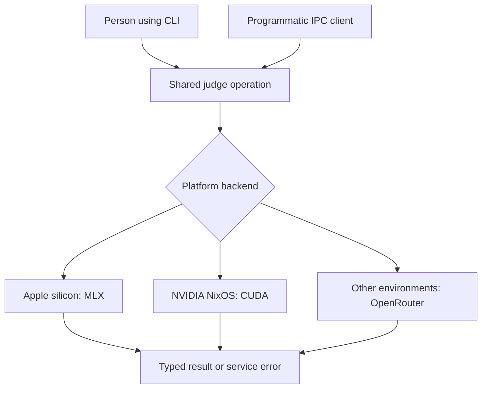
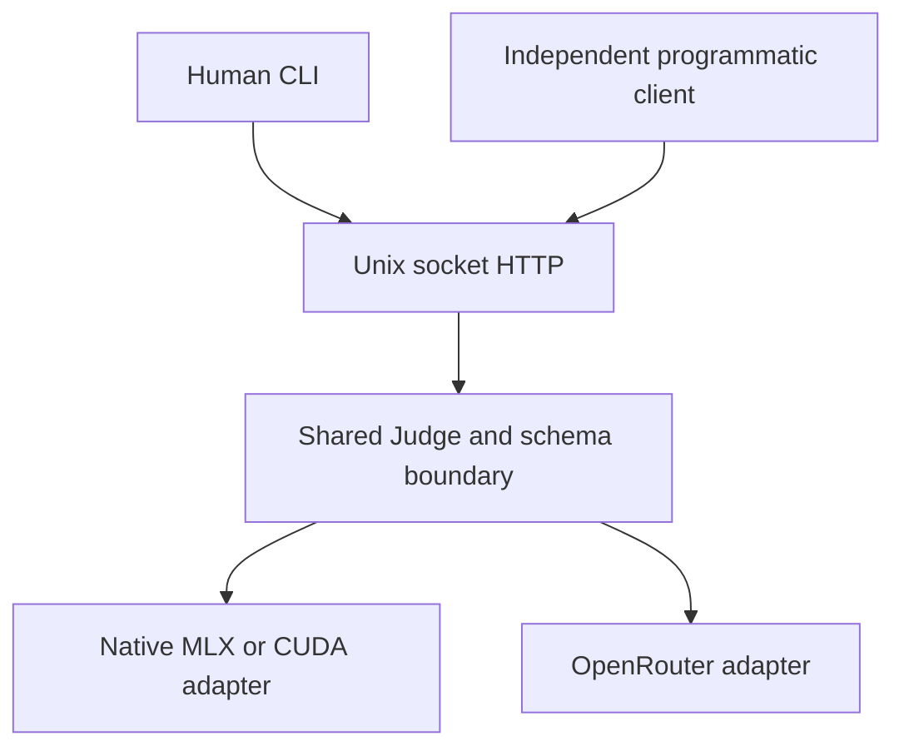
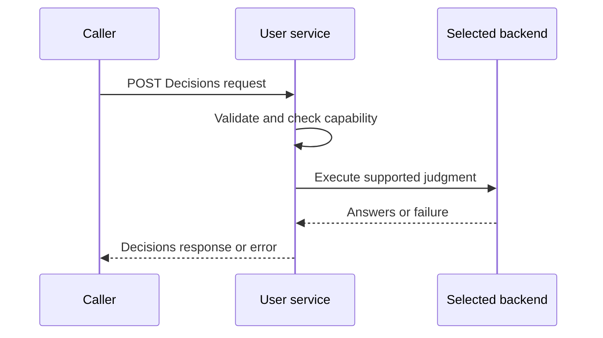
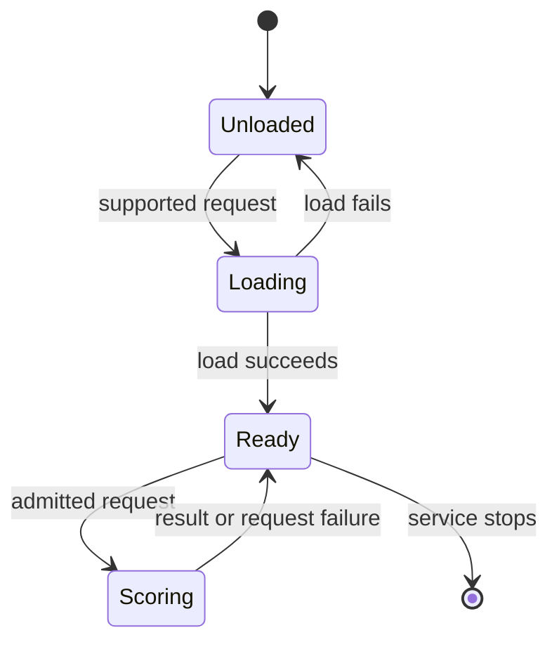
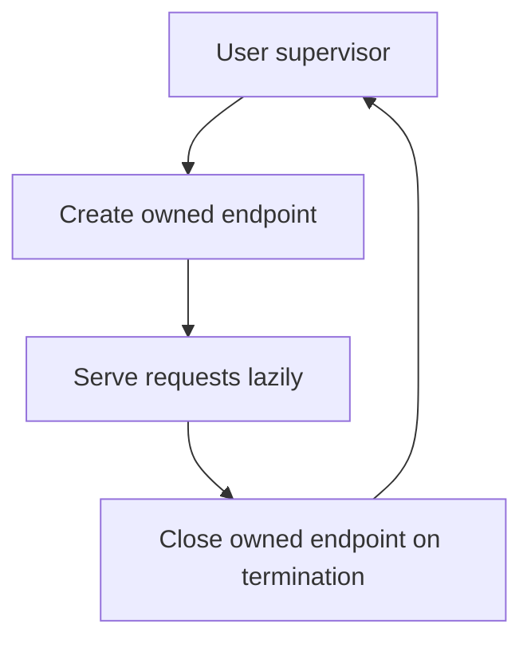
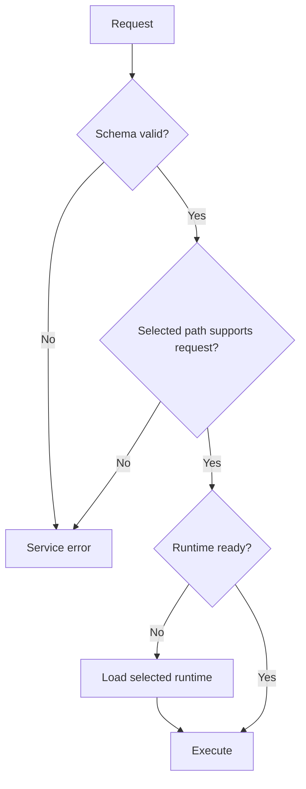
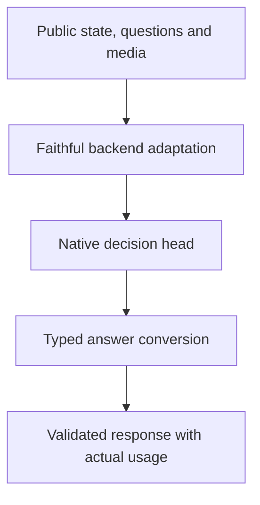
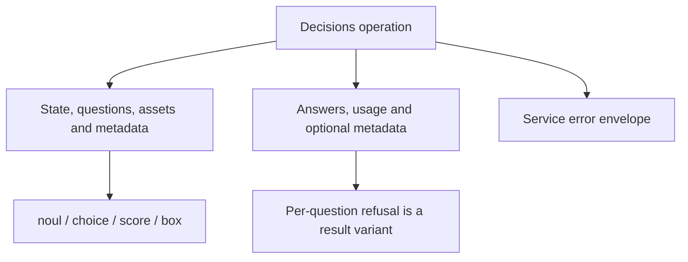

# Portable Decisions API Foundation - Plan

## Goal Capsule

- **Objective:** People and future harness clients can request typed model judgments through one portable foundation.
- **Means:** Port omp's shared Judge layer and expose the official Decisions contract through a human CLI and IPC.
- **Product authority:** The confirmed scope in this conversation governs this foundation; agent workflow consumers remain separate work.
- **Execution profile:** One PR; LFG implements and ships through CI, while the owner retains the merge decision.
- **Stop conditions:** Report an infeasible required native backend rather than substitute a model or platform.
- **Open blockers:** None established by research; native runtime construction and target-device inference are implementation work.

---

## Product Contract

### Summary

Add a generic decision service with `judge` as its initial entry point.
Use the official Decisions API contract across MLX, CUDA and OpenRouter, with human terminal access and programmatic IPC access.
Each selected model supplies the capabilities it actually supports.

### Problem Frame

The repository manages several coding harnesses but has no shared IPC service for typed model judgments.
Future consumers need a common judgment boundary before their workflow policies can be separated from those harnesses.

### Key Decisions

- **omp as porting reference.** Its shared judgment boundary supplies concrete prior art. Governs R1. (session-settled: user-directed — chosen over a new task-routing product: reuse omp's Judge foundation.)
- **Service definitions as public authority.** Provider terminology avoids turning an omp helper alias into a new API. Governs R2, R3, R4, R5, R6, R7, R8. (session-settled: user-directed — chosen over exposing the eval helper's `bool` alias: follow the official Decisions definitions.)
- **A full contract behind one entry point.** The initial interface can expose the whole operation without adding specialized consumers. Governs R2, R14, R19. (session-settled: user-directed — chosen over a reduced first-use-case API: provide all Decisions functionality and track additional entry points separately.)
- **Human CLI and programmatic IPC.** Future harnesses need a shared service boundary. Governs R11, R12, R13. (session-settled: user-directed — chosen over harness shell invocation: reserve the CLI for people.)
- **Model-specific capabilities.** A shared contract does not make different models interchangeable. Governs R8, R9, R10. (session-settled: user-directed — chosen over capability emulation or automatic model substitution: support only the selected model's functions.)
- **Generic foundation first.** Separate consumers can be planned against the common boundary. Governs R1. (session-settled: user-directed — chosen over bundling inline/delegation and worker model/effort selection as the first use case: keep this work generic.)
- **Platform inference split.** Local accelerators serve the two managed platform classes. Governs R15.

### Requirements

**Port and public contract**

- R1. Port omp's reusable Judge layer as the common, workflow-independent foundation, using its pinned judgment sources as the implementation reference rather than importing its coding-session runtime.
- R2. Expose the complete Decisions operation defined by the [OpenRouter Decisions reference](https://openrouter.ai/docs/api/api-reference/alphadecisions/submit-a-decisions-request) and its [OpenAPI schemas](https://openrouter.ai/openapi.json), preserving their public names and semantics as closely as possible across backends.
- R3. Accept the operation's complete request shape, including structured `state`, named `questions`, structured instructions and criteria, and variant-specific validation.
- R4. Preserve the official `noul`, `choice`, `score` and `box` semantics, including `noul` as a numeric probability rather than a boolean.
- R5. Return schema-conforming answers and per-question `refusal` results while preserving valid optional fields actually supplied by the backend.
- R6. Carry the operation's provider preferences, request metadata, model identity, usage and response metadata according to their official required and optional definitions.
- R7. Accept the documented image, audio, video, file and asset-reference forms under the [multimodal Decisions contract](https://openrouter.ai/docs/guides/community/multimodal-decisions), respecting the selected model and endpoint's supported forms.
- R8. Return errors in the official service error form, including capability errors for unsupported requests and the endpoint's defined request, access, quota and backend failure cases.

**Capability and inference fidelity**

- R9. Limit successful execution to the selected model's capabilities on its active backend, without silently changing models, moving local requests to a remote service, or emulating an unsupported primitive.
- R10. Execute the local model's native decision head and preserve its actual input support; ordinary chat generation is not a substitute for that inference path.

**Access and entry points**

- R11. Provide a terminal CLI intended for people to submit judgments and inspect answers or errors.
- R12. Provide IPC access for programmatic clients independently of CLI invocation.
- R13. Give CLI and IPC callers the same Decisions request and result semantics through the shared foundation.
- R14. Make all functionality covered by R2-R8 available through the initial `judge` entry point, subject to R9.

**Platforms and model selection**

- R15. Use MLX on Apple silicon macOS, CUDA on NVIDIA-equipped NixOS, and OpenRouter in other environments.
- R16. Allow the caller or configuration to select the decision model within the active backend.
- R17. Prioritize multilingual capability, including Korean, and multimodal input support in local model selection, using Clef-Flash 9B as the first candidate from the research below.
- R18. Make the foundation available through this repository's managed user environment and existing platform/trait assembly conventions.

**Follow-up work**

- R19. At implementation completion, register additional entry points as follow-up GitHub issues that identify their intended behavior and relationship to the delivered foundation.

<!-- ce-section: work-relationships -->
### How This Work Fits Together

This plan covers the generic judgment foundation.
The following relationships describe the current understanding of later work, not a committed roadmap:

- **Enables:** Claude Code, Codex and other harness plugins that consume the foundation through IPC.
- **Enables:** Separate consumers for inline versus delegation decisions, worker model and effort selection, task grouping and CE workflow choices.
- **Still to decide:** The names and responsibilities of additional entry points; R19 records that work at implementation completion.

### Actors

- A1. A person using the terminal CLI.
- A2. A programmatic client using IPC; harness plugins are future examples.
- A3. The selected local inference runtime or OpenRouter model endpoint.

### Key Flows

- F1. **Human judgment.** A1 supplies a Decisions request and the configured model; the shared foundation invokes A3 and presents the answer or error. **Covers R2-R11, R13-R17.**
- F2. **Programmatic judgment.** A2 submits the same operation through IPC and receives its typed result independently of the CLI. **Covers R2-R10, R12-R17.**

The flows share contract semantics per R13; they do not promise equal numerical judgments from different models.

### Acceptance Examples

- AE1. **Mixed questions.** Given a selected model that supports `noul`, `choice` and `score`, when either caller submits all three as named questions over one state, the result preserves the question names and official answer semantics. **Covers R3-R6, R13-R14.**
- AE2. **Capabilities vary.** Given a selected model/endpoint with `box` support and a supported image form, an appropriate `box` request returns its defined coordinates; when the selected model lacks `box`, that request returns a capability error without a replacement model. The same rule applies to unsupported audio, video or file input. **Covers R7-R9, R14.**
- AE3. **Refusal and optional output.** Given a response with a refusal for one question and an answer for another, both outcomes survive; omitted confidence, annotations or cost fields stay omitted rather than becoming invented values. **Covers R5-R6.**
- AE4. **Host inference path.** Given a valid request supported by the configured local model, the Mac uses MLX and NVIDIA NixOS uses CUDA; a client in an environment outside those classes uses its selected OpenRouter model. **Covers R9-R10, R15-R18.**

### Scope Boundaries

- Agent execution policy is later work: inline versus delegation, worker model/effort choice, task splitting and CE workflow decisions are not bundled consumers.
- Harness plugins are deferred; the programmatic boundary in this work is R12.
- Specialized entry points are deferred under R19; no GitHub issues are created during this requirements-writing task.
- A comparison CLI, replay database, benchmark product and autonomous task executor are outside this foundation.
- The adopted operation is Decisions under R2; OpenRouter Extractions and unrelated service/account APIs are outside this scope.

### Model Research

**Recommendation:** Start local implementation planning with Clef-Flash 9B.
Its dedicated scoring head has both a CUDA reference and an MLX conversion.
Use explicitly selected OpenRouter models to access other supported capabilities; this does not authorize automatic substitution under R9.

| Candidate | Published decision and media support | Role in this foundation |
| --- | --- | --- |
| [Clef-Flash 9B](https://huggingface.co/Cloudflare/clef-flash) | Native `noul`, `choice`, `score`; text and vision inputs | First local candidate; dedicated MLX loader and CUDA reference exist. |
| [Clef 27B](https://huggingface.co/Cloudflare/clef) | Same three primitives; text and vision inputs | Larger local comparison where memory permits; no demonstrated quality advantage in this work. |
| [Jev 1.14](https://openrouter.ai/typesafe/jev-1.14) | Text, images and `box` on its documented route | OpenRouter candidate for `box`; a local MLX/CUDA deployment was not established. |
| [Gemini Decision 1](https://openrouter.ai/google/gemini-decision-1) | Three primitives; text, images, audio, video and supported documents | OpenRouter candidate for richer media and files; does not provide `box`. |
| [Clef Omni](https://huggingface.co/Cloudflare/clef-omni) | Three primitives; text, images, audio and video | Additional media candidate; an MLX decision-head deployment was not established. |
| [Perplexity Decider v1.3 family](https://huggingface.co/perplexity-ai/pplx-decider-v1.3) | Native decision scoring with image/text input and a separate readout | Alternative family; the large reference's roughly 49 GiB of BF16 weights is unsuitable for full residency in 12 GiB VRAM, while its Flash sibling is smaller. |

The [MLX community releases](https://huggingface.co/mlx-community/clef-4bit) publish dedicated decision-head loaders.
Published Flash download sizes are 6.2 GB at 4-bit and 10.7 GB at 8-bit; these are download sizes, not runtime memory.
Their reported text-only performance comes from an M5 Max, not the current M5 Pro.

Read-only observations recorded during this research identify 64 GiB of Mac unified memory and an RTX 3060 with 12,288 MiB VRAM on the linked NixOS host.
The full Flash BF16 release cannot reside entirely in that VRAM.
A [third-party CUDA implementation](https://miguelcarrascob.github.io/clef/hardware-results/) reports INT8 quantization with partial CPU offload on a different 12 GB card, an RTX 4070 Ti; it supplies a deployment candidate, not evidence for this RTX 3060.

Korean judgment quality, local multimodal behavior and performance on these two machines remain unmeasured.
Backbone language coverage does not establish the post-trained decision model's Korean quality.
[Qwen3.8](https://huggingface.co/Qwen/Qwen3.8-27B) and [Gemma 4](https://huggingface.co/google/gemma-4-12B) are generative comparison candidates, rather than drop-in implementations of the native decision head.

### Dependencies and Assumptions

- The published OpenRouter alpha operation and model catalog can change; the cited contract was researched on 2026-11-18.
- Model support depends on the endpoint and loader as well as the weights. For example, OpenRouter's [Clef listing](https://openrouter.ai/cloudflare/clef) documents a Workers AI state truncation limit distinct from the model's architectural context capacity.
- Local deployment depends on a runtime that executes the decision head within available memory; no inference or model download was performed for this brainstorm.

### Sources and Research

- [OpenRouter Decisions guide](https://openrouter.ai/docs/guides/features/decisions), endpoint reference and OpenAPI definition linked in R2: public operation authority.
- [TypeSafe System One API](https://docs.typesafe.ai/api/system-one) and [`noul`](https://docs.typesafe.ai/primitives/noul), [`choice`](https://docs.typesafe.ai/primitives/choice), [`score`](https://docs.typesafe.ai/primitives/score), [`box`](https://docs.typesafe.ai/primitives/box) definitions: native service semantics; provider wire formats are not assumed identical.
- [omp shared judgment types](https://github.com/can1357/oh-my-pi/blob/a344c4b31a12ca27fc7c426ebf91b2de302f4bca/packages/ai/src/judgment/types.ts), [native adapters](https://github.com/can1357/oh-my-pi/blob/a344c4b31a12ca27fc7c426ebf91b2de302f4bca/packages/ai/src/judgment/systemone.ts) and [eval Judge bridge](https://github.com/can1357/oh-my-pi/blob/a344c4b31a12ca27fc7c426ebf91b2de302f4bca/packages/coding-agent/src/eval/judgment-bridge.ts), pinned at `a344c4b31a12ca27fc7c426ebf91b2de302f4bca`: port boundary and the helper-specific `bool` conversion.
- [omp auto-thinking consumer](https://github.com/can1357/oh-my-pi/blob/a344c4b31a12ca27fc7c426ebf91b2de302f4bca/packages/coding-agent/src/auto-thinking/classifier.ts) and [auto-parallel consumer](https://github.com/can1357/oh-my-pi/blob/a344c4b31a12ca27fc7c426ebf91b2de302f4bca/packages/coding-agent/src/auto-parallel/planner.ts): evidence for a shared layer serving separate consumers, not bundled requirements.
- `modules/shared/host.nix`, `lib/host-facts.nix`, `lib/hosts.nix`, `packages/` and `home/h82/agents/`: current platform and packaging boundaries.
- `home/h82/agents/synthetic-models.nix` and `scripts/synthetic-models-watch`: existing agent model catalog ownership, separate from this decision-model runtime.
- [Grounded ideation](.compound-engineering/artifacts/ideation/2026-11-18-omp-judge-decision-api-ideation.html): considered alternatives and their disposition; this Product Contract governs the selected scope.

---

## Planning Contract

**Product Contract preservation:** unchanged; its technical questions are resolved below or deferred to implementation.

### Key Technical Decisions

- KTD1. **Python shared core.** Port omp's stateless Judge boundary into a Python package so the protocol layer and native inference adapters share one language; preserve upstream MIT attribution. The public types follow R2-R8 instead of omp's narrower conversion helpers. This avoids a second TypeScript-to-Python protocol solely to retain upstream syntax. Governs U2-U4; cites R1, R10, R13.
- KTD2. **Private, fixed-source native runtimes.** Use CPython 3.12 package sets rather than the flake's default 3.14, with separate Darwin MLX and Linux CUDA closures. Start MLX with `mlx==0.32.3`, `mlx-lm==0.32.0`, `mlx-vlm==0.7.4`; start CUDA with Torch 2.11.0 CUDA 12.8, Transformers 5.10.2 and torchao 0.17.0. These versions have Python 3.12 artifacts; the complete dependency closure and actual compatibility are established by U1. The publisher-tested MLX trio and CUDA reference explain these overrides rather than a global nixpkgs update. Cites R10, R15, R17.
- KTD3. **HTTP over a private Unix socket.** Use the maintained `aiohttp` server and Unix connector, with the official Decisions path as the single inference operation. The human CLI connects to that service; independent clients can use HTTP directly without a CLI subprocess. Bind a pathname socket in a private user-owned directory, use one shared socket-discovery implementation, and refuse to replace a live or foreign endpoint. This keeps ordinary HTTP tooling usable without adding a TCP service or a separate RPC envelope. Cites R11-R14.
- KTD4. **Supervised user process, lazy model ownership.** Home Manager declares systemd and launchd user services; inference runs serially in one worker and weights load on the first supported request. The supervisor owns restart; the service owns its socket and releases it on orderly shutdown. Report request and load failures without automatic retries; a disconnected caller cannot assume its inference or remote billing stopped. This avoids two socket-activation implementations and preserves one resident model per service. Cites R8-R13, R18.
- KTD5. **Full-schema boundary and transparent remote adapter.** Vendor a dated snapshot of the Decisions operation's transitive OpenAPI schemas with source digest and attribution. One validator checks requests and outputs. Forward OpenRouter request documents and service errors without omp's lossy reconstruction. Local adapters return capability errors for valid features they cannot represent, including provider constraints they cannot honor; per-question refusal remains an answer. Cites R2-R9, R14.
- KTD6. **Pinned decision heads and user-owned weights.** Select `mlx-community/clef-flash-8bit` revision `5a195dc147926b63b1d139691ed4480ca9f92c0e` on Darwin and `Cloudflare/clef-flash` revision `22b75507981345858dd152fbd9a6f8c0c4068b0a` on CUDA. Package reviewed loader code separately from the weights. Start CUDA from the Apache-2.0 [clef-local source](https://github.com/MiguelCarrascoB/clef/tree/ae54c872be10b13cdf55b5d56466d37eecdc061c) at `ae54c872be10b13cdf55b5d56466d37eecdc061c`, preserving the vision tower and joint head under its INT8/offload path. Acquire weights by immutable revision into the user's existing Hub cache when requested; do not fetch at login. Disable loader truncation and reject unsupported representations rather than changing state. Cites R7-R10, R16-R17.
- KTD7. **Platform facts and runtime secrets.** Add shared `my.cuda.enable`, defaulted from the existing NixOS NVIDIA driver declaration, so the generic Home Manager module selects the R15 backend without hostname branches. Use TOML configuration and runtime environment overrides for the inference model, socket and request settings. Reuse the existing runtime OpenRouter key-file paths; local inference never requires that key. Preserve explicit CA environment overrides in services. Cites R15-R18.

### Assumptions

- A lightweight service at user-session start, with lazy model loading, suits this owner's usage; idle model unloading is not introduced.
- Python 3.12 is the common starting runtime because the selected releases publish compatible artifacts; U1 must establish the complete native dependency set.
- No accuracy or latency target was agreed. The model recommendation is provisional until actual Korean and multimodal results exist.

### High-Level Technical Design

**Components (KTD1, KTD3, KTD5):**

**Protocol sequence (KTD3-KTD5):**

**Native execution states (KTD4, KTD6):**

**Process lifecycle (KTD4):**

**Request decisions (KTD5, R8-R9):**

**Data adaptation (KTD5-KTD6):**

**Public surface (R2-R8, KTD5):**

### System-Wide Impact

The shared option extends the existing host-facts projection automatically; it does not require a second projection table.
The new user module reaches both production and bootstrap outputs, with missing remote credentials reported at request time.
Model code belongs to immutable program dependencies, while weights remain persistent user state under KTD6.
The human and programmatic access paths converge before validation and inference, so neither can bypass the selected model's capability boundary.

### Risks and Dependencies

- The published offload results use a different GPU. U1/U3 must establish the chosen native-head path rather than treat the report as this host's result; infeasibility triggers the Goal Capsule's stop condition.
- Current nixpkgs MLX/VLM and Torch defaults do not supply KTD2. Native dependency overrides are isolated from unrelated tools, and their source hashes must identify the actual fetched artifacts.
- The alpha API may change after the researched snapshot. KTD5 fixes the delivered contract; updating it later is deliberate maintenance.
- Cancellation of a caller does not establish remote non-execution. KTD4's no-retry choice avoids silently duplicating a paid request without adding a durable job system.

### Deferred to Implementation

- Resolve and hash the transitive runtime closures and loader sources under KTD2/KTD6, including NixOS dynamic-library integration for CUDA binary artifacts.
- Establish real native text/image inference on available target hardware; record unavailable platform evidence separately rather than treating schema fixtures as model execution.
- Determine exact loader adaptation helpers and test fixture organization within the boundaries below.

---

## Implementation Units

### U1. Package the native decision runtimes

- **Goal:** Supply the fixed MLX and CUDA decision-head dependencies and reviewed loader sources.
- **Requirements:** R1, R10, R15, R17; AE4.
- **Dependencies:** None.
- **Files:** `packages/decide-runtime.nix`, `packages/decide-runtime-pins.json`, `tests/decide-runtime.py`.
- **Approach:** Apply KTD2/KTD6 in isolated platform package sets; retain upstream licenses and record source/model revisions. This unit owns runtime packaging, not the common application's package.
- **Patterns:** `packages/pi-runtime.nix` fixed sources and package install checks; `packages/antigravity-acp-path.nix` native library/trust environment handling.
- **Test scenarios:**
  1. Each platform's packaged Python imports its selected loader and native dependencies without a model download.
  2. The CUDA path uses a CUDA-enabled Torch build and includes its quantization dependency; it does not silently load the default CPU package.
  3. Pin metadata resolves to the reviewed loader and immutable model revisions.
- **Verification:** Platform runtime packages build on supported builders; required hardware inference remains distinct from import/build evidence.

### U2. Port the shared Judge contract and OpenRouter adapter

- **Goal:** Implement the complete public operation with a lossless remote path.
- **Requirements:** R1-R9, R13-R14, R16; AE1-AE3.
- **Dependencies:** None.
- **Files:** `packages/decide/decide/core.py`, `packages/decide/decide/schema.py`, `packages/decide/decide/openrouter.py`, `packages/decide/decide/config.py`, `packages/decide/decide/schemas/decisions.json`, `packages/decide/NOTICE`, `tests/decide-contract.py`, `tests/fixtures/decide/`.
- **Approach:** Apply KTD1/KTD5, preserving the official contract at the port boundary and keeping provider credentials outside serialized configuration.
- **Patterns:** The pinned omp shared types and adapters cited in Product Contract; existing Python helpers for package-local modules.
- **Test scenarios:**
  1. Covers AE1. A mixed named request preserves structured guidance and numeric primitive semantics.
  2. Covers AE3. A mixed answer/refusal response retains optional metadata and omissions.
  3. A controlled HTTP endpoint receives the complete request, provider preferences and metadata; its documented error body survives unchanged.
  4. Invalid variant fields fail schema validation, while valid unsupported features remain capability failures.
- **Verification:** Deterministic contract and fake-provider integration tests prove the wire boundary without real credentials or inference.

### U3. Connect MLX and CUDA native heads

- **Goal:** Run supported local judgments through the selected model's actual head.
- **Requirements:** R3-R10, R14-R17; AE1-AE4.
- **Dependencies:** U1, U2.
- **Files:** `packages/decide/decide/local.py`, `packages/decide/decide/mlx.py`, `packages/decide/decide/cuda.py`, `tests/decide-local.py`.
- **Approach:** Adapt the reviewed native loaders under KTD6 and express capabilities for each loader/model path; preserve image association and all representable structured guidance. Derive actual token usage from inference data rather than inventing optional fields.
- **Patterns:** The pinned MLX `clef_mlx` helper and CUDA offload implementation; no chat generation path.
- **Test scenarios:**
  1. Covers AE2. Unsupported box, media combinations and provider constraints return capability errors without invoking a replacement backend.
  2. Supported image-plus-question records retain ordering and reach the native head.
  3. Context overflow is an error, not silent truncation; native load failure remains on the configured route.
  4. Available target hardware completes a small Korean text and image judgment through the real head, with device and memory evidence attributed to that machine.
- **Verification:** Adapter fixtures establish conversion semantics; actual hardware runs establish the selected runtime path separately.

### U4. Deliver the human CLI and shared IPC service

- **Goal:** Make `judge` usable by people and independent IPC clients.
- **Requirements:** R8-R14, R16; F1-F2, AE1-AE3.
- **Dependencies:** U2, U3.
- **Files:** `packages/decide/decide/cli.py`, `packages/decide/decide/server.py`, `packages/decide/decide/ipc.py`, `packages/decide/decide/__main__.py`, `packages/decide.nix`, `tests/decide-ipc.py`.
- **Approach:** Apply KTD3/KTD4 with human-oriented `judge` input and readable results, accepting full request files/stdin so structured media is not reduced to convenience flags. A service lifecycle command supports supervisors; it is not a second decision operation.
- **Patterns:** Load the `cli-design` skill for command/help/error design; package sanity belongs in this package's install check.
- **Test scenarios:**
  1. Covers F1/F2 and AE1/AE3. Human CLI and an independent HTTP-over-Unix client observe the same controlled response and error semantics.
  2. A second service cannot replace a live or foreign socket; an owned stale endpoint can be restarted and orderly shutdown removes only its own endpoint.
  3. Concurrent requests do not create simultaneous native model execution; one request failure leaves subsequent requests usable.
  4. Missing service, bad request and unavailable credentials produce actionable errors without printing secrets or request bodies.
- **Verification:** Start the packaged service in an isolated user directory and exercise it through both clients with deterministic backends; this proves IPC rather than GPU quality.

### U5. Integrate platform delivery and service configuration

- **Goal:** Install and supervise the foundation through the existing user environment.
- **Requirements:** R15-R18; AE4.
- **Dependencies:** U4.
- **Files:** `modules/shared/host.nix`, `modules/nixos/hardware/nvidia.nix`, `home/h82/dev/decide.nix`, `home/h82/dev/default.nix`, `flake.nix`, `tests/decide.nix`, `tests/check-shards.nix` as needed.
- **Approach:** Apply KTD7 and materialize the KTD4 service on both host kinds; package selection follows facts rather than a host name. Reuse production secret paths and preserve bootstrap operation without requiring a remote credential for local inference.
- **Patterns:** `home/h82/security/ssh.nix`, `home/h82/agents/cross-model-peers.nix`, `home/h82/agents/pi.nix`, `tests/lib/configurations.nix` and materialized-file helpers.
- **Test scenarios:**
  1. Covers AE4. Darwin selects MLX, NVIDIA NixOS selects CUDA, and NixOS without NVIDIA selects OpenRouter.
  2. Production and bootstrap outputs contain the package and enabled service with their effective executable, socket and runtime arguments.
  3. Credential files are referenced by runtime path only; local service construction does not require their plaintext values.
- **Verification:** One assembly check owns materialized delivery; register it in the correct shard and classify host closures as repository policy requires.

### U6. Document usage and register additional entry points

- **Goal:** Explain the delivered CLI/IPC and record the agreed follow-up work.
- **Requirements:** R11-R19; F1-F2.
- **Dependencies:** U5.
- **Files:** `docs/decide.md`, `README.md` if its tool index needs a link.
- **Approach:** Document configuration, native model provisioning, the IPC operation and model-specific capability errors. At implementation completion, search for existing matching GitHub issues and create missing follow-ups for specialized Decisions entry points under R19; link the resulting issues from the PR and documentation as appropriate.
- **Patterns:** Repository English documentation and existing helper runbooks.
- **Test expectation:** No additional test for prose; examples must match the exercised CLI and IPC surface.
- **Verification:** Usage describes the delivered operation and states actual build/hardware evidence; follow-up issue URLs exist and identify what remains.

---

## Verification Contract

Repository verification follows `AGENTS.md`; its full CI and production/bootstrap output requirements remain authoritative.
Package-level protocol, adapter and IPC suites use fake credentials and deterministic controlled backends.
The assembly check owns platform delivery, while native runtime build/import evidence and actual model inference are reported separately.

| Evidence | Owner | Scope and completion signal |
| --- | --- | --- |
| Official contract | `tests/decide-contract.py` | Full-schema request/result variants and remote preservation pass. |
| Native adapters | `tests/decide-local.py` | Supported conversion and unsupported-feature errors pass without substitute routes. |
| IPC and CLI | `tests/decide-ipc.py` | Packaged service is exercised by human CLI and independent socket client. |
| Native runtime packaging | `tests/decide-runtime.py`, package install checks | Selected platform dependencies and loader imports pass on supported builders. |
| User delivery | `tests/decide.nix` | Materialized platform/service configuration passes for relevant facts and host variants. |
| Target-device inference | U3 evidence | Real native head and vision run on available target hardware; missing hardware evidence stays explicitly deferred. |

Narrow commands are the named Python suites through their package install check and the declared `decide` assembly check.
Before shipping, run the repository's prescribed branch checks and require the current-head full CI evidence under `AGENTS.md`.

---

## Definition of Done

- U1-U6 implement their traced requirements and acceptance examples without weakening the Product Contract.
- CLI and IPC are usable through the delivered package and platform services.
- Required repository/CI evidence is complete; hardware inference results and any unavailable evidence are accurately separated.
- Additional entry-point follow-ups required by R19 are registered and linked.
- Applied review findings are committed; remaining findings carry their assessed dispositions in the PR.
- Abandoned experiments and task-owned disposable resources are removed, preserving user caches and credentials.
