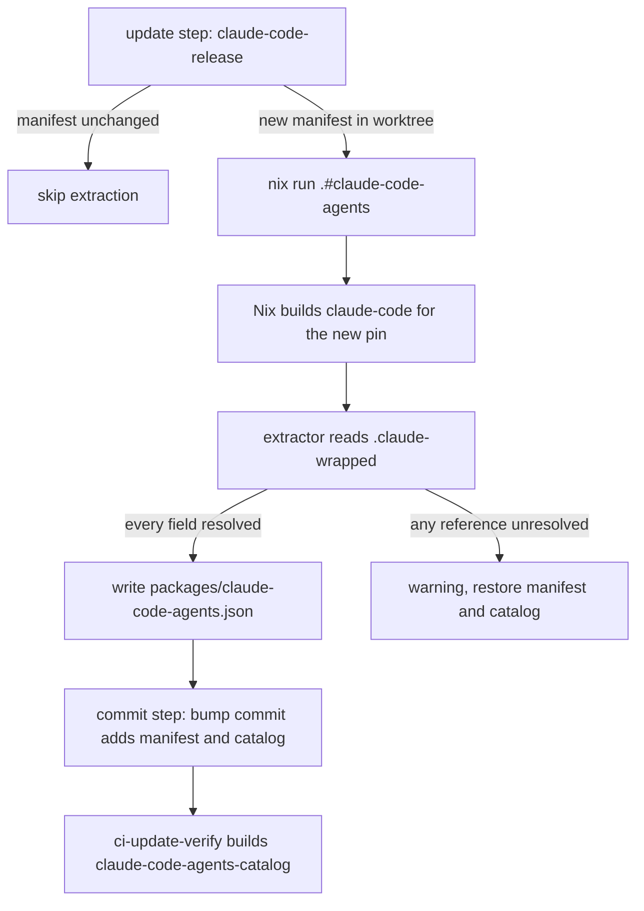

# Claude Code Built-in Agent Catalog - Plan

## Goal Capsule

- **Objective:** The owner can read, from this repository, the exact set of subagents built into the pinned Claude Code release, and that set never describes a different Claude Code version than the one installed. This gives the later `decide` routing work a trustworthy list of choices.
- **Product authority:** This plan covers the catalog and its lockstep with the Claude Code pin only. Teaching `decide` to choose an agent, and installing the catalog onto hosts, are later work and not active scope.
- **Means:** A static extractor reads the Nix-built Claude Code binary and the dependency updater runs it beside the pin bump (KTD1, KTD4).
- **Open blockers:** None.
- **Stop conditions:** Stop and report when extraction from the pinned 2.1.326 binary cannot resolve every agent field without guessing, because that contradicts the refuse-on-failure decision governing R9.
- **Execution profile:** One pull request. Standard depth, four units.
- **Finishes and ships:** `ce-work` implements; the `lfg` pipeline reviews, opens the PR, and watches CI.

---

## Product Contract

### Summary

A committed catalog records the metadata of every subagent built into the pinned Claude Code release. The dependency updater regenerates it in the same commit that bumps Claude Code, and refuses the bump when it cannot. Claude Code's own agent behavior is left unchanged.

### Problem Frame

The owner plans to let the `decide` CLI pick which Claude Code subagent a task should be delegated to. That needs the list of choices as data. Today the list exists only inside the Claude Code binary, a single Bun-compiled ELF of about 371 MB, where each built-in agent is a JavaScript object literal with minified references. Nothing in the repository records which agents exist, what each is for, or what tools and model it gets, so a Claude Code bump can add, remove, or reshape agents with no visible diff.

### Requirements

**Catalog content**

- R1. The catalog lists every agent definition marked `source: "built-in"` in the pinned Claude Code release, including agents registered only under a feature flag or runtime condition.
- R2. Each entry records the agent's type name, its when-to-use description, its allowed and disallowed tools as real tool names, and its model setting.
- R3. An entry whose tools or model depend on a runtime condition records that it is conditional instead of guessing one value.
- R4. The catalog records the Claude Code version it was extracted from.
- R5. The catalog contains no system prompt bodies.

**Lockstep with the Claude Code pin**

- R6. The catalog is committed to the repository so every change shows up as a reviewable diff.
- R7. The scheduled dependency updater regenerates the catalog from the new release in the same commit that bumps the Claude Code pin.
- R8. A repository check fails whenever the catalog's recorded version differs from the pinned Claude Code version.
- R9. When extraction fails for a new release, including when a minified tool reference cannot be resolved to a real tool name, the updater does not bump Claude Code and reports the failure.

**Effect on Claude Code**

- R10. Nothing is written to `~/.claude/agents/`, and Claude Code keeps using its own built-in agents.
- R11. The catalog can be read from Nix as a value or file so later work can consume it without re-extracting.

### Key Decisions

- **Catalog only; no installed agent files.** Built-in agents carry runtime-only behavior that a user agent file cannot reproduce: Explore's model cap of `opus` applies only when `source` is `built-in`, and prompts are assembled at runtime with interpolation. An installed copy would change behavior instead of mirroring it. Governs R10. (session-settled: user-directed — chosen over installing the copies into `~/.claude/agents/`: the copies cannot carry the built-in runtime behavior, so installing them would alter how Claude Code behaves)
- **Upstream wins; no local edits.** The catalog is a verbatim mirror of the pinned release, overwritten on every bump. Governs R2, R7. (session-settled: user-directed — chosen over keeping local overrides across updates and over a local-first copy that only reports upstream changes: the catalog exists as decision input, not as a place to customize agents)
- **Committed snapshot updated with the pin.** Committing the catalog makes agent changes visible in the bump PR and gives `decide` a plain file to read. Governs R6, R7, R8. (session-settled: user-approved — chosen over extracting at build time from the package: build-time extraction is harder to drift but hides changes from review)
- **Metadata only.** Name, purpose, tools, and model are enough for choosing an agent, and prompt bodies are the part most likely to break extraction. Governs R2, R5. (session-settled: user-approved — chosen over also storing prompt templates: prompts add review value but make extraction fragile)
- **Refuse the bump on extraction failure.** Lockstep takes priority over staying current, so a release the extractor cannot read keeps Claude Code on the previous version until the extractor is fixed. Governs R9. (session-settled: user-approved — chosen over bumping anyway and marking the catalog stale: a stale catalog would break the lockstep guarantee)

### Acceptance Examples

- AE1. **Covers R7, R8.** Given a new Claude Code release whose built-in agents parse cleanly, when the updater runs, then one commit contains the new pin and the regenerated catalog, and the version check passes.
- AE2. **Covers R9.** Given a new release where a minified tool reference in Explore's `disallowedTools` cannot be resolved, when the updater runs, then no commit bumps Claude Code and the run reports which agent and field failed.
- AE3. **Covers R8.** Given someone edits the pin by hand without regenerating the catalog, when repository checks run, then the version check fails.
- AE4. **Covers R1, R3.** Given `claude-code-guide`, whose tools come from a runtime getter, when the catalog is generated, then its entry exists and its tools are marked conditional.

### Scope Boundaries

- `decide` choosing an agent, including the request shape and decision type it would use, is deferred to later work.
- Where the catalog is installed on each host is deferred to that same work.
- Plugin agents, such as those from the Compound Engineering plugin, and user-defined agents are excluded.
- System prompt bodies are excluded, per R5.
- Customizing or overriding built-in agents is outside this work.

### Dependencies / Assumptions

- The macOS (`aarch64-darwin`) binary embeds the same agent definitions as the Linux binary, so extracting from one platform is enough. Unverified.
- `DISABLE_AUTOUPDATER = "1"` in `home/h82/agents/claude.nix:19` keeps Claude Code from updating itself outside Nix, so the installed version matches the pin. The variable is set and checked by `tests/claude.nix:74`, but its runtime effect has not been tested.

### Sources / Research

- Pinned release 2.1.326 embeds at least ten definitions with `source:"built-in"` and `baseDir:"built-in"`: `Explore`, `Plan`, `general-purpose`, `statusline-setup`, `claude-code-guide` (type name held in a variable, tools from a `get tools()` getter, `model:"haiku"`), `claude` (`tools:["*"]`), `comment-thread-analyst` (`maxTurns:6`), `fork` (type name in variable `mT`), a web-fetch agent whose `get model()` depends on feature flags, and a workflow-orchestration agent. Explore and Plan use minified identifiers in `disallowedTools`; `statusline-setup` uses literal names `["Read","Edit"]`. Output styles, bundled workflows, and a `teammate` factory also carry `source:"built-in"` but are not agent definitions.
- Minified names repeat across Bun modules (`ft` is `"Agent"` in one module and `""` in others), so a global lookup is ambiguous.
- `packages/claude-code.nix:4-6` reads `packages/claude-code-manifest.json`; `.github/workflows/update-dependencies.yml:159` runs `scripts/claude-code-release` and `:272-275` commits `chore(packages): bump claude-code to $NEW_VER`.
- `flake.nix:1088-1110` already compares the built Claude Code version against the manifest pin.
- `scripts/t3code-release:299-336` is the precedent for refusing a release a dependent rebuild cannot fit.
- `packages/decide/decide/cli.py:114` and `packages/decide/decide/schemas/decisions.json` define the decision types `noul`, `choice`, `score`, and `box`; `decide` has no agent concept yet.
- No repository code writes under `~/.claude/agents/`.

**Product Contract preservation:** Product Contract unchanged; Outstanding Questions resolved into KTD2, KTD3, and KTD5, and the Sources agent list corrected from the verified binary.

---

## Planning Contract

### Key Technical Decisions

- KTD1. **A separate extractor reads the Nix-built binary for the pin being installed.** A new `scripts/claude-code-agents` finds the binary through `claude` on `PATH` and reads its sibling `.claude-wrapped`, and the packaged helper puts the `claude-code` package built from the current manifest on that `PATH`. Because `nix run` evaluates the dirty worktree, the updater extracts from exactly the artifact the new pin installs, with Nix's fetch and hash check, and `scripts/claude-code-release` stays unchanged. Rejected: teaching `claude-code-release` to download and unpack `claude.zst` itself, which duplicates the fetch, the checksum, and the patched-binary path.
- KTD2. **Identifiers resolve inside their own Bun module.** The extractor splits the embedded JavaScript at each `// @bun` module header, resolves a name from its local definition, and resolves an imported name (`import{a as b}from"<chunk>"`) through the single module whose final `export{…}` exports `a`. Module headers carry no chunk path, so the import path is not used for the lookup, and zero or several exporting modules is an extraction failure. Array spreads resolve recursively, and a member reference such as `NI.tools` resolves through the referenced agent object, where an absent field stays absent. Any unresolved, ambiguous, or non-literal reference outside a getter is an extraction failure. Governs R2, R9. (session-settled: user-approved — chosen over bumping anyway and marking the catalog stale: lockstep outranks staying current)
- KTD3. **An agent definition is an object literal with `agentType`, `source:"built-in"`, and `baseDir:"built-in"`.** This excludes output styles, workflows, and the `teammate` factory. The extractor also fails when `general-purpose`, `Explore`, or `Plan` is missing, so a format change that silently matches nothing cannot produce a shrunken catalog. Governs R1.
- KTD4. **Getters and interpolation are recorded, not evaluated.** A `get tools()` or `get model()` getter, or any value that depends on a runtime call, becomes a conditional marker on that field. A `whenToUse` template keeps its raw text with `${…}` placeholders and an interpolated flag. Governs R3.
- KTD5. **The catalog is `packages/claude-code-agents.json`, and one check owns its correctness.** The file holds the binary's embedded version string (`// Version: …`) and agents sorted by type name, with stable key order so diffs stay small. A new light check `claude-code-agents-catalog` re-runs the extractor on the pinned package and fails on any difference from the committed file, which covers a stale version (R8), a hand edit, and an extractor change without regeneration. Nix consumers read the file with `builtins.fromJSON (builtins.readFile …)`; no extra flake output is added until a consumer exists. Governs R4, R6, R8, R11.
- KTD6. **Refusal holds back only the Claude Code pin.** Item 4 of the update step becomes a soft-failed block like items 7-13: when the release script or the extractor fails, it emits a `::warning` with the extractor's last stderr line and restores both `packages/claude-code-manifest.json` and the catalog, and every other pin still updates. The extractor runs only when the manifest changed, and writes through a temporary file and rename. Governs R7, R9.

### High-Level Technical Design

### Assumptions

- The extractor needs only Python's standard library and reads the 371 MB binary through `mmap`; `grep` hit ugrep complexity limits on long patterns.
- The x86_64-linux binary the updater builds is the extraction source; macOS and linux-arm64 binaries are assumed to embed the same definitions.
- Identifier resolution within a module is sufficient for 2.1.326; if a field in the pinned binary needs cross-module resolution beyond `import`/`export` renames, the Goal Capsule stop condition applies.

---

## Implementation Units

### U1. Built-in agent extractor

**Goal:** A packaged script that turns a Claude Code binary into the catalog JSON or fails with a message naming the agent and field.

**Requirements:** R1, R2, R3, R4, R5, R9; KTD1, KTD2, KTD3, KTD4.

**Dependencies:** None.

**Files:**

- `scripts/claude-code-agents` (create)
- `tests/test_claude_code_agents.py` (create)
- `tests/fixtures/claude-code-agents/` (create: small synthetic binaries with embedded module text)
- `packages/agent-tools.nix` (modify: `claudeCodeAgents` helper wrapped so `claude` on `PATH` is the pinned package)
- `flake.nix` (modify: `packages.${system}.claude-code-agents` and a `pythonScriptCheckWith` check named `claude-code-agents`)

**Approach:**

1. Locate `.claude-wrapped` next to the real path of `claude` on `PATH`, and read the version from the embedded `// Version:` comment.
2. Split module text at `// @bun` headers, find agent literals per KTD3, and parse each field with a small tokenizer for literals, identifiers, arrays, spreads, member references, getters, and templates.
3. Resolve references per KTD2, mark conditionals per KTD4, drop `getSystemPrompt` and prompt fields per R5, and write the JSON through a temporary file and `os.replace`.
4. Exit 1 with `claude-code-agents: <agent>: <field>: <reason>` on the first failure.

**Patterns to follow:** `scripts/claude-code-release` (stdlib, `Failure`, exit codes) and `scripts/t3code-release` (temp-file write, one-line reasons); `tests/test_claude_code_release.py` (subprocess runs with `PATH` stubs); `catalogHelper` and `t3codeRelease` in `packages/agent-tools.nix` for a wrapped helper with `doInstallCheck`.

**Test scenarios:** (the fixture seam proves parsing and resolution; it cannot prove the real binary still parses, which U2's check covers)

- A fixture with `general-purpose`, `Explore`, and `Plan` in one module, using literal tool arrays, writes three sorted entries with the fixture's version.
- `disallowedTools:[ft,...l4]` where `ft` and `l4` are defined in the same module resolves to the real names, while a same-named `ft` in another module is ignored.
- An identifier imported with `import{q as ft}from"<chunk>"` resolves through the one module whose `export{x as q}` exports `q`.
- An imported name exported by two modules fails as ambiguous.
- `tools:NI.tools` where `NI` has no `tools` records the field as absent.
- `agentType:mT` with `mT="fork"` defined locally records type `fork`.
- A `get tools(){…}` getter and a `get model(){…}` getter record conditional markers instead of values.
- A `whenToUse` template with `${Mn}` keeps the placeholder and sets the interpolated flag.
- An output-style literal with `source:"built-in"` but no `baseDir` and a `teammate` factory are not listed.
- A reference with no definition in its module fails, names the agent and field, and leaves an existing output file untouched.
- A binary missing `Plan` fails.
- The output never contains a `getSystemPrompt` body.

**Verification:** The `claude-code-agents` check passes, and running the packaged helper on the pinned 2.1.326 package lists at least the definitions in Sources.

### U2. Initial catalog and lockstep check

**Goal:** Commit the catalog for the current pin and guard it with a check that fails on any drift.

**Requirements:** R4, R6, R8, R11; KTD5.

**Dependencies:** U1.

**Files:**

- `packages/claude-code-agents.json` (create, generated by the U1 helper from the pinned package)
- `tests/claude-code-agents-catalog.nix` (create)
- `flake.nix` (modify: register `checks.${system}.claude-code-agents-catalog`)

**Approach:** The check runs the extractor against `import ./packages/claude-code.nix { inherit pkgs; }` into the build directory and compares it with the committed file, printing a diff and `fail=1` on any difference. Interpolate store paths only inside guarded builder text so a mutation fails the assertion, not evaluation. The check stays out of `hostClosureChecks` because its closure is the package, not a host generation; sweep its `.drv` closure to confirm.

**Patterns to follow:** The `claude-code` check at `flake.nix:1088-1120` for reading the manifest and accumulating failures; `tests/synthetic-models.nix` for reading the real JSON file and printing every problem.

**Test scenarios:**

- Covers AE3. With the committed catalog's `version` changed to another value, the check fails and names the version difference.
- With one agent's tool removed from the committed file, the check fails.
- With the committed file regenerated from the pinned package, the check passes.

**Verification:** `claude-code-agents-catalog` passes on the branch and fails under both mutations above, run in a scratch copy per the copied-worktree learning.

### U3. Updater integration

**Goal:** The scheduled updater regenerates the catalog with every Claude Code bump and holds back only that pin when extraction fails.

**Requirements:** R7, R9; KTD6.

**Dependencies:** U1, U2.

**Files:**

- `.github/workflows/update-dependencies.yml` (modify: item 4 of the update step and the claude-code block of the commit step)
- `tests/update-dependencies-reconcile.sh` (modify: `nix` stub case, seeded catalog, failure scenario)
- `tests/update-workflow.py` (modify only if its stub needs the new `nix run` call)

**Approach:**

1. Wrap item 4 as `if ! { release && (manifest unchanged || extractor) }; then ::warning …; git checkout -- <manifest> <catalog>; fi`, reading the extractor's message from a temp log as item 8 does, with exit status taken from the command rather than `$?` after `tee`.
2. In the commit step, `git add` the catalog in the claude-code block so it lands in the `chore(packages): bump claude-code to …` commit.

**Patterns to follow:** Items 7-13 and item 8's `t3code_log` handling in the same step; `tests/update-dependencies-reconcile.sh` restoration assertions at lines ~282-300.

**Test scenarios:**

- Covers AE1. A stubbed release that writes a new manifest and a stubbed extractor that writes a new catalog produce a bump commit containing both files and no `::warning`.
- Covers AE2. A stubbed extractor that exits 1 leaves both the manifest and the catalog at their seeded contents, emits one `::warning` carrying the extractor's message, and other pins still update.
- A release run that reports "already up to date" does not invoke the extractor.

**Verification:** `update-dependencies-reconcile` passes, including `actionlint`.

### U4. Documentation

**Goal:** Readers of the project instructions can find the extractor, the catalog, and the refusal rule.

**Requirements:** R6, R9.

**Dependencies:** U1, U2, U3.

**Files:**

- `AGENTS.md` (modify: add `claude-code-agents` to the scripts list and note the catalog beside the Claude Code pin)

**Approach:** One sentence each, in English, matching the existing list style; add no verification rules.

**Test scenarios:** Test expectation: none -- documentation only; the `agent-instructions` check, which reads `AGENTS.md`, must still pass.

**Verification:** `agent-instructions` passes and `markdownlint-cli2` reports no issues.

---

## Verification Contract

| Gate | Command | Proves |
| --- | --- | --- |
| Extractor unit tests | `nix build --no-link .#checks.x86_64-linux.claude-code-agents` | U1 |
| Catalog lockstep | `nix build --no-link .#checks.x86_64-linux.claude-code-agents-catalog` | U2, R8 |
| Updater regression | `nix build --no-link .#checks.x86_64-linux.update-dependencies-reconcile` | U3 |
| Instructions input | `nix build --no-link .#checks.x86_64-linux.agent-instructions` | U4 |
| Shard membership | `nix build --no-link .#checks.x86_64-linux.check-shards-guard` | registration |
| Formatting and lint | `nix fmt -- --ci`, `git diff --check`, `markdownlint-cli2` on changed Markdown | repository rules |
| Full evidence | `full-ci` label with `host-checks`, `vm-checks`, `build`, and `build-darwin` green on the head | AGENTS.md readiness |

The darwin build runs only in CI and is recorded as deferred to CI, not passed, when verified from this Linux host.

---

## Definition of Done

- U1-U4 are implemented, and every gate in the Verification Contract passes locally or is recorded as deferred to CI.
- `packages/claude-code-agents.json` matches a fresh extraction from the pinned 2.1.326 package.
- The two U2 mutations were each shown to fail the catalog check.
- No dead-end or experimental code from abandoned approaches remains in the diff.
