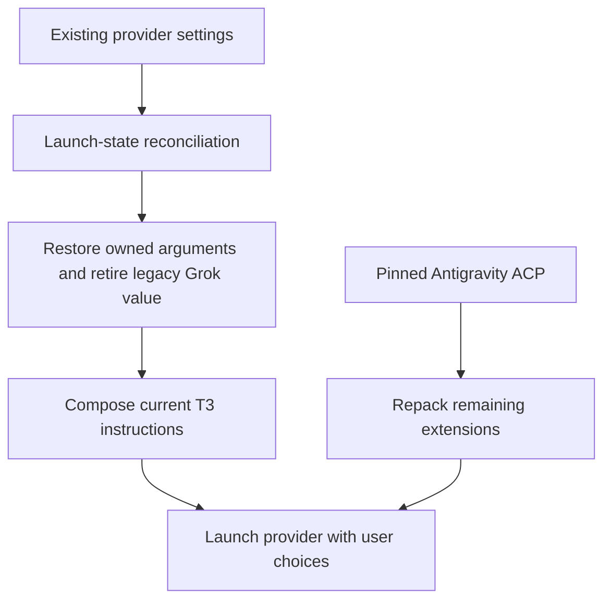

# Enable Native Subagents in T3 Code - Plan

## Goal Capsule

- **Objective:** Dotfiles leaves native subagent availability in T3 Code to the provider, the app, and the user's settings.
- **Means:** Retire dotfiles' launch controls, follow the app's delegation guidance, and remove the ACP filter overlay (KTD1, KTD2, KTD3).
- **Product authority:** The dotfiles owner, through this Product Contract.
- **Execution profile:** One dotfiles PR.
- **Stop conditions:** Surface any conflict with a session-settled decision.
- **Who finishes:** The executing agent implements, verifies, opens the PR, and follows its CI. The owner merges and switches hosts.
- **Open blockers:** None.

---

## Product Contract

### Summary

Remove dotfiles' native subagent blocks from T3 Code launches, repository instructions, and the shared Antigravity ACP runtime. Use the installed T3 Code app's routing policy.

### Key Decisions

- **Ship the dotfiles changes first.** Governs R1, R2, R3, R4, R7. (session-settled: user-directed — chosen over changing both layers in one release: the macOS app needs its signed bundle for existing passkey support.)
- **Retain managed Codex compatibility.** Governs R6. (session-settled: user-approved — chosen over removing the managed overrides: ChatGPT sharing has rejected native agent history.) [T3 Code PR #17499](https://github.com/pingdotgg/t3code/pull/17499)
- **Restore Antigravity's provider filtering.** Governs R3. The shared ACP filter also controls availability of the browser subagent.

### Requirements

**Tool availability**

- R1. Remove dotfiles' native subagent disable settings from Claude, existing-mode Codex, and Grok launches in T3 Code.
- R2. Let the managed T3 Claude provider use Claude's default spawn depth unless the user selected a provider-specific depth. Preserve the standalone Claude setting.
- R3. Remove the unconditional subagent denial from the packaged Antigravity ACP runtime for every caller and honor the client and provider's tool filtering.

**Delegation in T3 sessions**

- R4. Remove dotfiles' blanket native-tool prohibition and follow the installed T3 Code app's guidance on native and T3 delegation.
- R5. Keep `delegate_task` for tasks that request it or require T3 capabilities. Honor the provider, model, effort, isolation, and access requirements of the user and the skill.
- R6. Keep the native subagent compatibility settings for T3's managed ChatGPT-sharing Codex mode.

**Existing installations**

- R7. Reconcile prior dotfiles-owned controls once while preserving unrelated settings and individually identifiable user overrides.

### Acceptance Examples

- AE1. **Covers R1, R7.** Fresh installations launch without dotfiles' retired flags. Upgrades remove the recorded Codex and Claude contributions and the prior Grok managed value while preserving user arguments and later Grok edits.
- AE2. **Covers R2, R4, R5.** A compatible same-provider foreground child can use the native tool. A request for a T3 worktree can use `delegate_task`. A T3-specific Claude depth choice survives activation.
- AE3. **Covers R3.** A client of the packaged ACP can use a provider-supported subagent tool when its own filter permits it. Explicit client denials still apply.
- AE4. **Covers R1, R6.** Existing-mode Codex launches without dotfiles' disable flags. Managed Codex retains T3's ChatGPT-sharing settings.

### Scope Boundaries

- The T3 Code desktop and CLI distributions retain their shipped guidance, including rules for background and further delegation. An upstream-signed release or a supported instruction replacement setting would be needed for changes to that layer. [T3 Code orchestration guidance](https://github.com/pingdotgg/t3code/blob/v0.1.9/packages/provider-core/src/server/orchestrationInstructions.ts#L4-L13)
- The separate `agy` CLI and explicit user or project permissions remain outside the change.

---

## Planning Contract

### Key Technical Decisions

- KTD1. **Use the launch-state record for migration.** Restore Codex and Claude launch arguments from their recorded user bases or remove individually identifiable contributions from edited arguments. Grok has no prior value record. Retire the exact old managed environment entry once and record migration in the existing launch state. An identical user value written before migration is indistinguishable from the managed entry. The next user edit survives subsequent activations.
- KTD2. **Use T3 routing according to capability.** The dotfiles instruction template and routing reference allow native tools when the installed app and task permit them. CE's transport instructions and model ladder govern an actual T3 delegation. The CE cross-model disclosure and isolation exception still apply.
- KTD3. **Remove the ACP extension from both owners.** T3's release updater and the ACP build must name the same remaining extensions. Google supplies the restored tool filter.
- KTD4. **Use the T3 Claude instance environment for spawn depth.** T3 merges empty environment values into the child process. The pinned Claude parser treats an empty value as unset for this integer setting. Supply it only when the managed instance has no explicit value.

### High-Level Technical Design

---

## Implementation Units

### U1. Retire launch controls

**Goal:** Reconcile fresh and upgraded provider settings without the retired overrides.

**Requirements:** R1, R2, R6, R7, AE1, AE4.

**Dependencies:** None.

**Files:** `scripts/t3-instructions.py`, `tests/test_t3_instructions.py`, `tests/t3code-launch.py`.

**Approach:** Remove Codex and Claude control contributions from current composition. Keep schema-one migration reads and Pi approval. Use the exact recorded baseline when the previous launch is unchanged. When users added arguments around the previous launch, preserve those additions and clean the recorded launch portion. For other edits, remove only identifiable contributions. Retire Grok's managed `GROK_SUBAGENTS=0` shape once. Keep Grok's updater setting and apply KTD4 to Claude.

**Test scenarios:**

- Covers AE1. Upgrade an intact launch record and one with appended user arguments. Preserve a preexisting Codex disable or Claude deny list while dropping dotfiles' contributions.
- Covers AE1. Apply to a fresh configuration and to a legacy Grok environment. A later explicit Grok opt-out survives the second application.
- Covers AE2. Verify the Claude default only when its instance environment has no user depth entry.

**Verification:** Reconciliation tests and the materialized T3 activation check.

### U2. Align the T3 instruction template

**Goal:** Remove dotfiles' blanket routing rule and retain the exceptions needed for T3-specific work.

**Requirements:** R4, R5, AE2.

**Dependencies:** None.

**Files:** `home/h82/agents/instructions/instructions.md.tmpl`, `docs/agent-routing.md`, `tests/agent-instructions.py`.

**Approach:** Apply KTD2 to both copies of the T3 delegation guidance. Preserve the instructions for existing T3 cross-model operations and leave baseline renders unchanged. Refresh the T3 render receipt.

**Test scenarios:**

- Covers AE2. The rendered T3 layer permits a corresponding native route and retains T3 routing for a worktree or cross-provider child. Baseline harness receipts remain stable.

**Verification:** The declared `agent-instructions` check verifies the template and routing documentation.

### U3. Restore the shipped Antigravity filter

**Goal:** Let the shared ACP runtime resolve subagent availability using its existing filter.

**Requirements:** R3, AE3.

**Dependencies:** None.

**Files:** `packages/antigravity-acp.nix`, `packages/antigravity-acp-overlay/tool_filter_overlay.py`, `scripts/t3code-release`, `tests/test_antigravity_acp_overlay.py`, `tests/test_t3code_release.py`, `docs/agent-routing.md`, `AGENTS.md`.

**Approach:** Remove the filter overlay and its fixtures while applying KTD3. Preserve the instructions, skills, and server overlays. Update the routing and contributor documentation to describe the packaged runtime.

**Test scenarios:**

- Covers AE3. The release-updater fixture repacks the remaining extensions without a tool-filter module. The package install check verifies the resulting archive and the existing applicable runtime properties.

**Verification:** The ACP overlay and release updater tests, plus the packaged ACP install check.

---

## Verification Contract

| Scope | Evidence |
| --- | --- |
| Provider launch | Reconciliation unit tests and the Linux `t3code-traits` check |
| Instructions | Linux `agent-instructions` check and changed Markdown lint |
| ACP | Linux `antigravity-acp-overlay` and `t3code-release` checks, plus the packaged ACP output |
| Shipping | Repository pre-push policy and required checks on the pull request head |

## Definition of Done

- The dotfiles-owned restrictions in R1–R4 and R7 are removed at their launch, prompt, or shared runtime boundary.
- Existing-mode and managed Codex match AE4, and T3 delegation satisfies R5.
- The pull request records local evidence, platform checks deferred to CI, and hardware or signed-in session verification separately.
