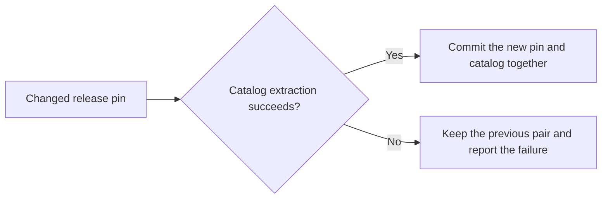

# Harness Built-in Subagent Catalogs - Plan

## Goal Capsule

- **Objective** — The repository owner can identify the built-in subagents available as candidates for future CE decision delegation from each covered, pinned harness release.
- **Product authority** — This plan governs the catalog data and its release lifecycle. Follow-up work owns agent selection and invocation.
- **Open blockers** — None for the Codex and Pi delivery.

---

## Product Contract

### Summary

Extend the Claude Code catalog pattern to Codex and Pi. Keep a reviewable record of each pinned release's built-in subagents, including a confirmed empty roster where applicable.

### Problem Frame

The owner wants a Compound Engineering agent to hand a decision to a harness's own subagent. A future routing step needs to know which roles the target release ships and what those roles are suited to. The existing Claude Code catalog supplies that input for Claude Code alone. [Claude Code catalog plan](2026-11-18-1218-feat-claude-builtin-agent-catalog-plan.md)

### Requirements

**Catalog coverage and content**

- R1. Cover the repository-pinned releases of Codex and Pi.
- R2. Record each release's complete built-in roster, including agents whose registration depends on runtime conditions.
- R3. Record each agent's native identifier and any declared purpose, tool allowances or restrictions, and model settings, including declared inheritance or runtime conditions.
- R4. Tie each roster to the release identity of the artifact or source the repository pins.
- R5. Record an empty roster only when the pinned release provides evidence that it ships no built-in subagents.

**Release lifecycle**

- R6. Commit the generated catalog data in a machine-readable form so each release's agent changes are visible in review and a later consumer can read it without repeating extraction.
- R7. Regenerate each affected catalog in the same update commit as its release pin.
- R8. If extraction cannot establish the new release's roster or resolve a declared static value, keep the previous matching pin and catalog and report what failed.
- R9. A repository check detects when committed catalog data differs from the metadata of the corresponding pinned release.

### Key Decisions

- **Catalog the native agents.** This gives CE a roster tied to each harness's release and leaves CE plugin releases to their own follow-up. Governs R1 and R2. (session-settled: user-directed — chosen over including CE plugin agents in this catalog: the immediate need is to identify harness-native delegation candidates)
- **Use the Claude Code update contract.** A catalog can inform a routing decision only if it describes the matching pin. Governs R6–R9.

### Release Update Flow

When the dependency updater finds a changed release pin, it derives the catalog from that release and publishes the pair under R7. On extraction failure, it reports the failure and keeps the previous pair under R8.

### Acceptance Examples

- AE1. **Covers R2, R3, R6, and R7.** Given a Codex release that adds a role with an inherited model, the dependency update shows the new role and its inherited setting in the catalog diff beside the pin change.
- AE2. **Covers R4 and R7.** Given a Codex update and an unchanged Pi pin, the Codex catalog records the new Codex source revision and the Pi catalog still describes the pinned Pi release.
- AE3. **Covers R5 and R8.** The pinned Pi 1.5.2 source yields a confirmed empty roster. An extractor that finds no entries after an unexpected upstream change cannot use that empty result as evidence to advance the pin.
- AE4. **Covers R9.** If a hand edit changes an agent's tool metadata while leaving its version intact, the catalog check fails.

### Scope Boundaries

- Antigravity CLI and ACP are tracked separately in [#230](https://github.com/hyperlapse122/dotfiles/issues/230).
- Grok Build is excluded because its repository retirement is planned separately.
- Track CE plugin agent management as a separate follow-up issue. User-defined and project-defined agents are also outside this catalog.
- System prompt bodies and agent installation or customization are outside this work.
- Selecting or invoking a harness subagent for CE, including any `decide` integration, is follow-up work. Runtime eligibility can depend on the session, its permissions, and local agent configuration.

### Sources / Research

- The Claude Code catalog is the precedent for generating and comparing metadata against a pinned package. [Dependency updater](../../../.github/workflows/update-dependencies.yml), [catalog check](../../../flake.nix)
- Codex registers `default`, `explorer`, and `worker` in the source tagged for release 0.169.0. The tagged release workflow ran at commit `d32063f96c2dff1dc96af839b3952abb6acfeda4`. [Codex role registry](https://github.com/openai/codex/blob/d32063f96c2dff1dc96af839b3952abb6acfeda4/codex-rs/core/src/agent/role.rs)
- Pi 1.5.2 excludes subagents from the default distribution. Its subagent extension is an example that can be installed separately. [Pi release pin](../../../packages/pi-release.json), [upstream README at the pinned revision](https://github.com/earendil-works/pi/blob/b4afdddf44e059c67ccf5097e5317d913521b470/packages/coding-agent/README.md#pi), [upstream example at the pinned revision](https://github.com/earendil-works/pi/blob/b4afdddf44e059c67ccf5097e5317d913521b470/packages/coding-agent/examples/extensions/subagent/README.md)

---

## Planning Contract

### Key Technical Decisions

- KTD1. Derive Codex roles from the built-in Rust registry at the pinned release's resolved commit. Pin the unpacked source hash beside the binary assets using the same GitHub tag resolution and Nix hashing pattern as Pi. Parse the entire supported registry structure, including each referenced embedded role configuration. Reject an unrecognized registration, role field, or override. Store model inheritance when the role supplies no model. Governs R2–R4.
- KTD2. Use the source pin that builds Pi. Require the upstream statement that Pi ships without subagents and verify the known built-in extension registry before recording a confirmed empty result. A separate extension example is outside that registry. Changes to this evidence fail extraction until reviewed. Governs R2, R4, and R5.
- KTD3. Generate separate JSON files under `packages/` and expose an offline extractor for each harness. Both use the committed source pins in Nix. The release workflow regenerates a catalog only after its pin changes, restores both files on failure, and stages each pair in its own release commit. The dependency verification script already checks all declared checks again after a rebase. Governs R6–R9.

### Resolved Scope

Codex and Pi ship together in one pull request. Antigravity CLI and ACP have their own follow-up because the two pinned distributions have different unresolved registration paths. [Antigravity follow-up #230](https://github.com/hyperlapse122/dotfiles/issues/230)

**Product Contract preservation** — R1 and AE2 reflect the narrowed delivery scope. The content and lifecycle requirements remain in force for Codex and Pi.

---

## Implementation Units

### U1. Extract native declarations from pinned source

- **Goal** — Generate the Codex catalog and the confirmed empty Pi catalog from reproducible sources. Covers R1–R6 and R9.
- **Files** — `scripts/codex-release`, `tests/test_codex_release.py`, `scripts/harness-agents`, `packages/codex-release.json`, `packages/codex-agents.json`, `packages/pi-agents.json`, the shared source expressions for package and extractor, `packages/agent-tools.nix`, and `flake.nix`.
- **Approach** — Resolve source metadata only for a candidate that can advance the pin. Use strict static parsing for Codex and positive evidence for the empty Pi roster. Exclude prompt bodies. Give the comparison check the same packaged tools used by the updater. The existing shard generator assigns the new source-only check to a light shard.
- **Test scenarios** — The pinned Codex registry yields `default`, `explorer`, and `worker`, with the commented-out role excluded. An added role appears, while unsupported registration or role configuration fails. The pinned Pi release produces an empty array. Loss of its upstream absence statement or a changed built-in extension registry fails extraction. A version-preserving catalog edit fails comparison.
- **Verification** — Build the Codex release test and the new catalog check. Add targeted extractor fixtures to the check for structures the current pins do not exercise.

### U2. Keep release pins and catalogs paired

- **Goal** — Each release updater maintains its own pair. Covers R7 and R8. Depends on U1.
- **Files** — `.github/workflows/update-dependencies.yml` and `tests/update-dependencies-reconcile.sh`.
- **Approach** — Follow the Claude Code update pattern. Run each extractor only when its own pin changes. On release or extraction failure, restore that pair, report the failing operation, and continue independent updates.
- **Test scenarios** — Both successful updates include the generated catalogs in their release commits. A partial catalog write followed by failure restores the corresponding pin and catalog while the other release succeeds. An unchanged pin skips extraction.
- **Verification** — Build the existing dependency-reconciliation check.

---

## Verification Contract

Run the catalog, Codex release, and dependency-reconciliation checks locally. Use the repository's pre-push checks and platform CI requirements for the PR. Record Darwin builds as deferred to CI on Linux.

## Definition of Done

- [ ] Both committed catalogs agree with fresh extraction from their pinned sources.
- [ ] Both scheduled release paths maintain their own pin and catalog pair and preserve it on failure.
- [ ] The pull request links the Antigravity follow-up and reports verification on its current head.
