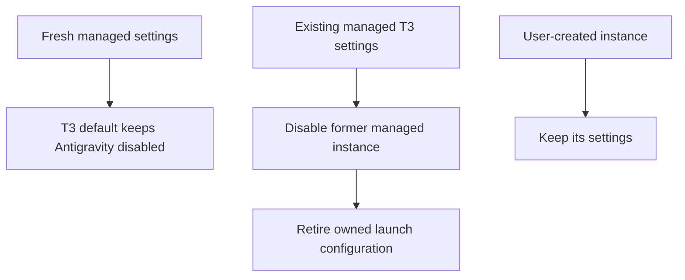

# Retire Antigravity ACP - Plan

## Goal Capsule

**Objective.** The owner's NixOS and macOS configurations operate without the managed Antigravity ACP runtime.

**Means.** Retire the ACP package and its consumers together, with a targeted upgrade for the former T3 provider (KTD1).

**Product authority.** The Product Contract records the owner's confirmed retirement scope.

**Open blockers.** None before planning.

**Execution profile.** One pull request. LFG owns implementation, review, delivery, and CI through merge readiness.

---

## Product Contract

### Summary

Retire the Antigravity ACP runtime and the repository's routes that depend on it, including automatic local video delegation. Keep standalone agent tools usable and preserve existing user data.

### Problem Frame

Gemini 3.8 Flash's speed was the owner's reason for using Antigravity through ACP. That benefit is gone for the owner, while the repository still rebuilds the runtime and maintains separate launch, authentication, and routing integration.

### Key Decisions

- **Retire automatic video delegation with ACP.** Governs R4. (session-settled: user-directed — chosen over a replacement video route: a replacement would keep the automation the owner wants to retire.)
- **Retire the repository's ACP integration.** Governs R1, R2, R3, R5, R6, R7, R8 and R9. The approved scope preserves standalone tools and stored data while removing the dependencies that kept the runtime in service.

### Requirements

**Distribution and routing**

- R1. Retire the repository's Antigravity ACP distribution and provisioning, including its rebuild, wrappers, release pin, settings and sign-in setup, and dedicated checks.
- R2. T3 Code's default and formerly repository-managed provider settings do not activate Antigravity ACP for new sessions or delegated tasks.
- R3. Remove Antigravity ACP from the repository-managed Compound Engineering review and delegation routes.
- R4. End automatic local video delegation in both T3 Code and ordinary shell sessions.
- R5. End the live Antigravity quota query in `agent-usage` that depends on ACP credentials and runtime metadata.

**Existing state and standalone tools**

- R6. Retire the repository-owned ACP entries from T3 Code's mutable settings while preserving unrelated settings and user-created provider instances.
- R7. Preserve existing ACP credentials, ACP-owned settings, and session data on disk, including stored conversations that Tokscale can already read.
- R8. Continue delivering the standalone `agy` CLI with its own instructions, skills, plugins, and settings.
- R9. Keep the generic `acpx` installation usable for other agents.

### Acceptance Examples

- AE1. A fresh managed home on either platform has no enabled Antigravity ACP provider and receives no repository-supplied runtime. **Covers R1, R2.**
- AE2. A home with the former managed provider and stored ACP sessions upgrades. The managed provider is no longer active, and the stored credentials, session files, and unrelated settings are still present. **Covers R2, R6, R7.**
- AE3. An agent without native video viewing receives a local video task from T3 Code or an ordinary shell. The managed instructions do not send the video to another agent. **Covers R4.**

### Scope Boundaries

- A replacement for automatic video delegation is outside this retirement. **See R4.**
- Upstream T3 Code and user-configured providers remain outside the repository's retirement scope. **See R2, R6.**

### Sources and Research

- The repository's tool retirement policy governs existing user data and mutable settings. [Repository instructions](../../../docs/contributing.md#tool-retirement)
- T3 Code's managed provider and retirement declarations show where configured state survives an upgrade. [T3 Code module](../../../home/h82/t3code.nix)
- Both video delegation routes are in the shared instruction template. [Instruction template](../../../home/h82/agents/instructions/instructions.md.tmpl)
- Live quota queries and historical conversation reporting have separate consumers. [Agent usage](../../../scripts/agent-usage) and [Tokscale wrapper](../../../scripts/tokscale)

---

## Planning Contract

### Key Technical Decisions

- KTD1. **Use T3 Code's disabled default and disable the former managed instance before removing its launch settings.** In the bundled T3 0.1.9 settings code, Antigravity is disabled by default and history restoration applies to Cursor, Grok, and OpenCode. On upgrade, disable the native instance when it has the old managed profile path or the historical package's direct Nix store path. Publish the disable and launch settings removal in one settings merge before native argument composition. A later composition failure cannot leave an enabled provider with its override removed. Preserve custom providers, including a custom registry adapter using the old ID. An explicit user project override can enable the upstream driver and falls under the R6 scope boundary.
- KTD2. **Drop the ACP release section at its consumers.** The T3 CLI and desktop pins each need only their own asset metadata. Remove the updater's embedded runtime table extraction and archive rebuild check together with the runtime pin and the quota wrapper's use of its version.
- KTD3. **Keep CLI discovery and historical reporting at their existing paths.** Antigravity CLI instructions and plugins have native delivery, and Tokscale reads saved conversations directly. Remove the ACP-only skill tree and live quota reader while retaining those independent consumers. [Standalone CLI instructions](../../../home/h82/agents/instructions/default.nix) and [Tokscale wrapper](../../../scripts/tokscale)

### High-Level Technical Design

The diagram shows the settings paths the implementation needs to account for.



---

## Implementation Units

### U1. Retire ACP distribution and launch configuration

- **Goal.** Remove the runtime from fresh configurations and retire the former managed integration on upgrade.
- **Requirements.** R1, R2, R5, R6, R7, R8, R9. Covers AE1 and AE2.
- **Files.** `home/h82/default.nix`, `home/h82/t3code.nix`, `home/h82/agents/gemini.nix`, `home/h82/agents/skills.nix`, `home/h82/agents/plugin-skills.nix`, `packages/antigravity-acp*.nix`, `packages/antigravity-acp-overlay/`, `packages/agent-tools.nix`, `packages/t3code-release.json`, `scripts/antigravity-acp-repack`, `scripts/t3code-release`, `scripts/t3-instructions.py`, `scripts/agent-settings`, `scripts/agent-usage`, `flake.nix`, `.github/workflows/update-dependencies.yml`, and their existing checks under `tests/`.
- **Approach.** Follow KTD1–KTD3. Run the retirement in the settings merger so its guarded write covers the entire migration. Match the direct store path by the historical package name and executable suffix. Remove the former registry command path and the generated environment entry while preserving user fields. Keep the current profile path in the value-sensitive retirement declaration. Stop provisioning ACP settings and sign-in links. Remove ACP from the release updater, its scheduled failure handling, and the live usage reader. Retain the CLI, historical Tokscale discovery, and the generic ACP client.
- **Test scenarios.** Apply the materialized settings to a fresh home and to upgrades from both managed runtime paths. Include owned launch environment, unrelated fields, a custom runtime, and another provider instance. Apply twice and inspect the resulting settings. Check that a downstream composition failure leaves the former managed provider disabled. Exercise the packaged updater with T3 assets only and verify the scheduled job keeps the current pin on failure. Verify the live usage provider set excludes ACP quota while the remaining readers still run. Check the platform profiles for the standalone CLI and retired executables.
- **Verification.** Use the existing T3 traits, Antigravity profiles and skills, Gemini activation, T3 release, agent usage, and check-shards checks. Darwin profile evidence belongs to the native `darwin-outputs` check.

### U2. Remove ACP from agent routing

- **Goal.** Retire automatic video delegation and the managed Antigravity CE routes while keeping the remaining agents usable.
- **Requirements.** R3, R4, R8. Covers AE3.
- **Files.** `home/h82/agents/instructions/instructions.md.tmpl`, `home/h82/agents/cross-model-peers.nix`, `home/h82/agents/gemini.nix`, `tests/agent-instructions.py`, `tests/lib/cross-model-peers.nix`, `AGENTS.md`, `CONCEPTS.md`, `README.md`, `docs/agent-routing.md`, `docs/repository-reference.md`, and `docs/macos.md`.
- **Approach.** Remove the Antigravity ACP review peer and T3 ladder route. Remove both automatic video rules and update the instruction receipts from rendered output. Update current references to describe the surviving standalone CLI and link historical evidence through existing artifacts where relevant.
- **Test scenarios.** Render baseline and T3 instruction branches and check the retired behavior is absent. Verify the generated CE allowlist retains Claude and Codex, and the CLI still receives its own user-scope instructions.
- **Verification.** Run the `agent-instructions` and affected peer/settings checks. Use repository Markdown lint for the changed documents.

---

## Verification Contract

Run the affected checks from the repository root. Each named check owns its materialized contract.

```sh
nix build --no-link \
  .#checks.x86_64-linux.t3code-traits .#checks.x86_64-linux.t3code-release \
  .#checks.x86_64-linux.antigravity-profiles .#checks.x86_64-linux.antigravity-skills \
  .#checks.x86_64-linux.gemini .#checks.x86_64-linux.agent-usage \
  .#checks.x86_64-linux.agent-instructions .#checks.x86_64-linux.check-shards-guard \
  .#checks.x86_64-linux.update-dependencies-reconcile
```

Use the repository's pre-push checks and full CI policy in [Contributing](../../../docs/contributing.md#build-and-development-commands).

---

## Definition of Done

- The generated configurations meet the Product Contract for clean and upgraded homes.
- The checks in the Verification Contract pass on their supported platforms.
- The diff contains the retirement and its supporting changes.
