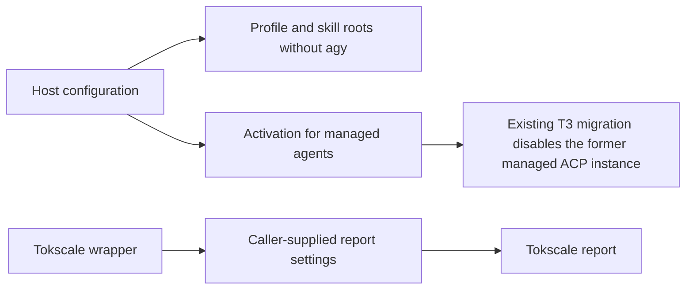

# Retire Antigravity from managed hosts

## Goal Capsule

**Objective.** A fresh NixOS or macOS configuration needs no Antigravity CLI, Gemini client configuration, or Antigravity-specific usage collection.

**Means.** Remove active declarations and keep the existing T3 Code migration for the former managed ACP provider (KTD1, KTD2).

**Authority.** The confirmed removal scope and the repository's tool retirement policy govern the change. Stop if the work requires deleting user-owned data.

**Execution.** One pull request. LFG implements, reviews, publishes, and monitors CI.

## Product Contract

### Summary

Retire the standalone Antigravity CLI (`agy`) and its repository integrations on both hosts. End the repository's automatic collection of old ACP sessions for Tokscale.

### Problem Frame

The owner ended the Gemini subscription. Host activation and scheduled dependency updates still maintain the Antigravity CLI and its settings.

### Requirements

- R1. Fresh production and bootstrap configurations omit the CLI, its update machinery, and its Gemini settings, instructions, skills, plugins, and MCP integration.
- R2. Tokscale receives no Antigravity-specific history directories or pricing from the repository. Existing caller-supplied settings continue to work.
- R3. Preserve existing Antigravity credentials, mutable settings, plugin state, and conversation files. Keep the existing T3 migration for the former managed ACP provider.
- R4. Keep Claude Code, Codex, and Pi instruction, skill, and plugin delivery working, including macOS Xcode skill collision handling.

### Key Decisions

- **Retire repository management and preserve local data.** Governs R1 and R3. (session-settled: user-directed — chosen over deleting existing credentials and conversations: the owner wants the repository to stop managing Antigravity.)
- **End automatic Tokscale collection of old ACP sessions.** Governs R2. (session-settled: user-approved — chosen over continuing to read the saved ACP directories: the owner confirmed that the retirement includes this reporting integration.)

## Planning Contract

### Key Technical Decisions

- KTD1. Remove the standalone package and Antigravity-specific Home Manager deliveries. Leave mutable Antigravity files alone. Home Manager can drop links it owns, and the existing T3 migration still disables the former repository-managed provider for hosts upgrading from an older generation.
- KTD2. Remove the wrapper's automatic additions to `TOKSCALE_EXTRA_DIRS` and the repository's Gemini pricing override. Preserve the caller's environment, the other pricing override, and Tokscale's own discovery behavior.
- KTD3. Use the remaining shared skill declarations for Xcode collision handling and keep the shared Compound Engineering plugin pin. Remove the Antigravity-only plugin skill enumeration and installation. Update existing profile and instruction checks to cover the retired outputs.

### High-Level Technical Design

## Implementation Units

### U1. Retire Antigravity distribution and delivery

- **Goal and requirements.** R1, R3, R4.
- **Files.** `flake.nix`, `home/h82/default.nix`, `home/h82/agents/`, `packages/agent-tools.nix`, `packages/antigravity-cli.nix`, `packages/antigravity-cli-release.json`, `scripts/agent-instructions`, `scripts/antigravity-cli-release`, `.github/workflows/update-dependencies.yml`, affected tests, and active repository guides.
- **Approach.** Apply KTD1 and KTD3. Remove Antigravity package and settings consumers, then their dedicated tests and updater steps. Keep the existing T3 migration and its regression coverage. Put retired profile coverage alongside existing unmanaged-agent checks.
- **Test scenarios.** A fresh profile contains no `agy`, retired ACP executables, or Gemini deliveries. The other three harnesses still get their instruction and skill files. An old T3 settings file still transitions through the existing migration. The scheduled dependency workflow continues to update and publish the remaining pins.
- **Verification.** Use the existing instruction, plugin, skill, unmanaged-agent, T3 launch, and update reconciliation owners. Use `checks.aarch64-darwin.darwin-outputs` for materialized Mac outputs and the matching Linux checks on an appropriate builder.

### U2. Retire Antigravity from Tokscale configuration

- **Goal and requirements.** R2.
- **Files.** `scripts/tokscale`, `home/h82/agents/tokscale.nix`, `tests/tokscale.sh`, and `tests/tokscale.nix`.
- **Approach.** Apply KTD2. Update the existing wrapper and pricing checks.
- **Test scenarios.** With both old ACP directory layouts on disk, the wrapper passes an existing `TOKSCALE_EXTRA_DIRS` unchanged and leaves it unset when the caller omits it. Device name, API token handling, and the remaining custom price still have coverage.
- **Verification.** Run `tests/tokscale.sh` via its existing package check or against the repository script with the package substitutions. Run the Linux `tokscale` flake check on an appropriate builder.

## Verification Contract

Run affected checks on builders that support them and record evidence deferred to CI. Apply the repository's pre-push checks and require full CI on the pull request's head.

## Definition of Done

Active host configurations and the release workflow no longer manage Antigravity. The existing migration and shared harness integrations still work. The pull request has the required CI evidence.
