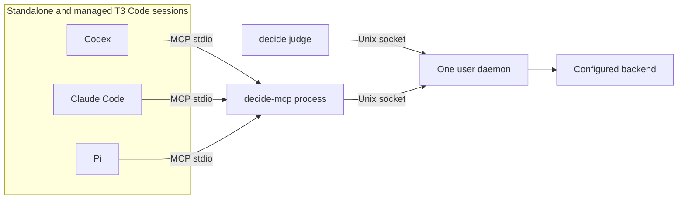
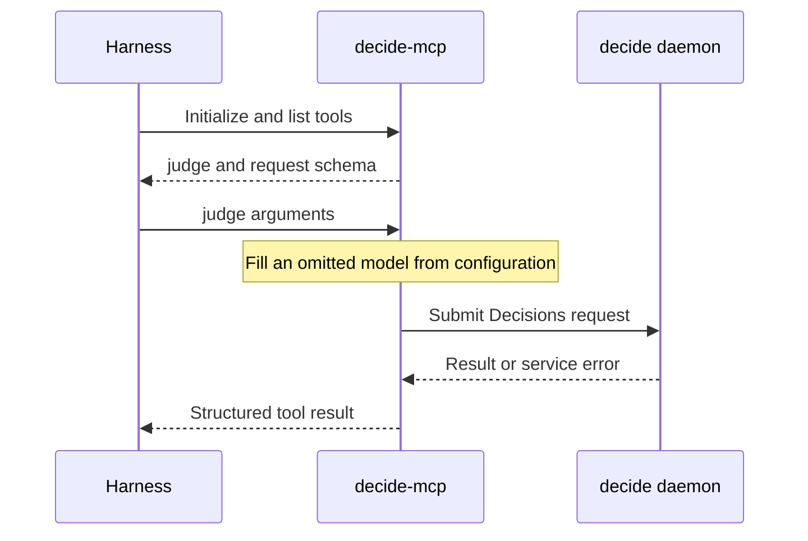

# Decide MCP for Managed Harnesses - Plan

## Goal Capsule

- **Objective.** The owner can use the same Decisions capability from any managed coding harness or the terminal, with one shared model runtime per user on each host.
- **Means.** Add a local MCP client of the existing `decide` daemon.
- **Product authority.** The confirmed transport split and managed session coverage govern this plan.
- **Execution profile.** One PR. The owner decides when to merge.
- **Stop condition.** Stop if the agreed shared daemon or a managed harness cannot be supported within the confirmed scope.
- **Open blockers.** None identified.

---

## Product Contract

### Summary

Expose the existing Decisions operation as one MCP tool in Codex, Claude Code, and Pi.
The terminal CLI and the MCP server share the managed `decide` daemon.

### Problem Frame

The owner can submit a typed judgment from the terminal, but the managed harnesses have no Decisions tool.
Loading a model inside each harness's MCP process would duplicate model residency across active sessions.

### Key Decisions

- **MCP for harness integration.** The same tool can reach the three managed harnesses. Governs R5, R6. (session-settled: user-directed — chosen over a Codex-native tool extension: use the tool protocol supported by all three managed harnesses.)
- **One daemon with two client entry points.** A single runtime can reuse loaded weights across CLI and MCP requests. Governs R1, R2, R3. (session-settled: user-directed — chosen over inference inside each MCP process: keep model loading and inference in the shared daemon.)
- **Transport at each boundary.** The existing private client transport supports multiple callers, and the harness can start its own MCP process. Governs R2, R5. (session-settled: user-approved — chosen over extending stdio to the daemon boundary: use stdio for MCP and preserve the daemon's Unix socket for its clients.)

### Requirements

**Shared Decisions runtime**

- R1. One managed `decide` daemon per user on each host owns model loading and inference for CLI and MCP requests.
- R2. The human CLI and MCP server connect to that daemon through the same configured private Unix socket.
- R3. When the daemon is unreachable, an MCP judgment fails with a tool error and performs no inference.
- R4. The owner can continue using the existing human CLI and Decisions IPC contract.

**Harness access and tool behavior**

- R5. Each harness starts the local `decide` MCP server and communicates with it over stdio.
- R6. Codex, Claude Code, and Pi offer the tool in new standalone and repository-managed T3 Code sessions through user-scope registration.
- R7. The server exposes one tool, `judge`, which accepts the existing Decisions request fields.
- R8. When a tool call omits the model, the tool uses the configured `decide` default.
- R9. The tool returns the structured Decisions result or service error, including per-question refusals and capability errors where applicable.

### Actors

- A1. The repository owner submitting a judgment through the terminal.
- A2. A managed coding harness calling the `judge` tool.
- A3. The MCP server and CLI, acting as clients of the user's Decisions daemon.

### Key Flows

- F1. In a new managed session, the harness discovers `judge`, sends a request to the MCP process, and receives the daemon's result through the tool. Covers R2, R5, R6, R7, R8, R9.
- F2. The owner submits through the CLI while a harness uses MCP. The daemon serves both entry points. Covers R1, R2, R4.

### Acceptance Examples

- AE1. In a fresh standalone session and a fresh managed T3 Code session for each harness, the model can discover and call `judge` and receive a structured answer to a Decisions question. Covers R5, R6, R7, R9.
- AE2. With a local model already loaded by the daemon, judgments from the CLI and multiple MCP clients use that daemon without loading another model instance. Covers R1, R2, R4.
- AE3. An omitted model uses the configured default. An explicit request that the selected backend cannot serve returns its capability error. Covers R8, R9.
- AE4. With the daemon unreachable, a `judge` call produces a tool error. Covers R3.

### Scope Boundaries

- Automated routing, lifecycle hooks, focused decision tools, and distribution outside the managed harnesses are later work.

### Dependencies and Assumptions

- The managed daemon selects MLX, CUDA, or OpenRouter according to the existing host configuration. [Decisions backends](../../../docs/decide.md#backends-and-models)
- Claude Code and Codex already have managed user-scope MCP registrations. The pinned Pi supports local stdio MCP. Tool discovery and invocation through a live T3 Code Pi session still need to be established. [Claude Code settings](../../../home/h82/agents/claude.nix) · [Codex settings](../../../home/h82/agents/codex.nix) · [Pinned Pi MCP reference](https://github.com/earendil-works/pi/blob/b4afdddf44e059c67ccf5097e5317d913521b470/packages/coding-agent/docs/mcp.md) · [T3 Code providers](../../../home/h82/t3code.nix)

### Sources

- [Existing Decisions IPC contract](../../../docs/decide.md#use-ipc) and [managed daemon configuration](../../../home/h82/dev/decide.nix).
- [MCP stdio transport](https://modelcontextprotocol.io/specification/2025-11-25/basic/transports#stdio).
- [T3 Code MCP settings and runtime boundaries](../solutions/integration-issues/t3-acp-sessions-ignore-user-mcp-config.md).

---

## Planning Contract

### Key Technical Decisions

- KTD1. **Package the official MCP SDK with the client.** Add a `decide-mcp` entry point to the host-selected `decide` package. Run it with a Nix Python environment containing the SDK and IPC dependencies so the native inference environments need no MCP dependencies. Reuse the package's generated model default, the existing client config loader, and the socket client. Covers R1–R5, R8.
- KTD2. **Keep the daemon as the Decisions authority.** Publish a standalone JSON Schema projected from the bundled Decisions request schema, with `model` optional at the MCP boundary. Use the daemon's response or error as structured MCP content and include its serialized JSON for clients that only read text. Covers R7–R9.
- KTD3. **Use the harnesses' existing user settings.** Reconcile one server entry per harness and use Pi's direct tool exposure. Use the same store path selected by the daemon module. Pass the socket and config discovery environment through Codex's stdio allowlist and set Codex and Pi's per-server call deadlines above the default Decide request timeout. The IPC client still enforces its configured deadline and propagates cancellation through the socket. Covers R2, R5, R6.

### High-Level Technical Design

Each MCP connection has its own client process. The daemon owns the backend for all connections.

### Implementation Assumptions

- The managed NixOS user session provides its normal runtime directory. An explicit socket configured by the owner takes precedence under the existing discovery rules. Codex filters environment variables for stdio servers, so KTD3 applies even when the Codex process itself receives the right environment.
- The managed T3 Pi provider starts the repository's packaged Pi. Whether its live session consumes the expected user-scope MCP file is an execution-time check. If the file is ignored, establish whether the provider launch can carry the same registration within the agreed scope.

---

## Implementation Units

### U1. Package the Decisions MCP client

**Goal** — Serve the Decisions tool through the packaged stdio entry point.

**Requirements** — R1–R5, R7–R9. Covers F1, F2 and AE2–AE4.

**Dependencies** — Existing Decisions daemon and schema.

**Files** — `packages/decide.nix`, `packages/decide/decide/config.py`, `packages/decide/decide/cli.py`, `packages/decide/decide/schema.py`, `packages/decide/decide/mcp.py`, and `tests/decide-ipc.py`. The install check exercises the shipped command and the real Unix socket path with a fake inference backend.

**Approach** — Implement KTD1 and KTD2. Share packaged configuration resolution with the CLI. Keep the existing CLI flags and IPC endpoint. Preserve explicit model values and let the daemon decide what the selected backend supports.

**Patterns to follow** — The existing packaged CLI and socket service in `packages/decide/decide/`, with the package install-check fixture in `tests/decide-ipc.py`.

**Test scenarios**

- Covers AE2. Start one Decisions service with a fake backend. Submit through the packaged CLI and two packaged stdio clients, and verify that the same service receives the requests.
- Covers AE3. Verify the advertised tool and schema, then submit a request without `model` and another with an explicit model. Inspect the exact forwarded bodies and verify the structured response includes refusals and metadata.
- Covers AE3 and AE4. Verify a daemon error with extra metadata reaches the harness as a tool error. Repeat with the configured socket unavailable.

**Verification** — The packaged command completes MCP discovery and judgment against a socket fixture that also serves the CLI.

### U2. Register the tool in the managed harnesses

**Goal** — Make the packaged client discoverable from new Codex, Claude Code, and Pi sessions through their user settings.

**Requirements** — R1, R2, R5, R6. Covers F1 and AE1.

**Dependencies** — U1.

**Files** — `home/h82/agents/decide-server.nix`, `home/h82/agents/claude.nix`, `home/h82/agents/codex.nix`, `home/h82/agents/pi.nix`, `home/h82/dev/decide-package.nix`, `home/h82/dev/decide.nix`, `tests/claude.nix`, `tests/codex-settings.nix`, `tests/pi.nix`, and `docs/decide.md`. Reuse existing activation checks for their respective settings. A scratch settings check proves registration. An actual runtime call proves consumption.

**Approach** — Implement KTD3 through existing per-entry settings merges. Use Pi's user `mcp.json` and enable direct exposure. Keep the registration scoped to the user and retain unrelated entries.

**Patterns to follow** — The managed `fff` entries in Claude Code and Codex, the Pi activation and settings tests, and the documented T3 MCP scope boundary.

**Test scenarios**

- Apply the managed registration to scratch user settings containing an unrelated server. Verify that each harness's effective user settings contain one `decide` server and the unrelated entry.
- Covers AE1. In fresh standalone and managed T3 sessions with their normal configuration, verify that each harness discovers and invokes `judge`, with the request reaching the configured socket. Record runtime evidence separately from settings checks.

**Verification** — Each managed registration resolves the host-selected client and uses only the declared server entry. Verify live sessions wherever the updated generation and corresponding runtime are available.

---

## Verification Contract

- Build the Decisions package to run the packaged CLI, socket, and MCP install checks.
- Run the affected repository harness settings checks on supported local builders. Record Darwin builds and runtime evidence separately.
- Record end-to-end discovery and a judgment for each standalone and managed T3 Code session combination. Evidence from a scratch home or fixture establishes only the boundary it exercised.

---

## Definition of Done

- The packaged stdio tool and all three user-level registrations satisfy R1–R9.
- The package and settings checks pass. The handoff states which of the live-session acceptance examples ran and which require a target-host run after deployment.
