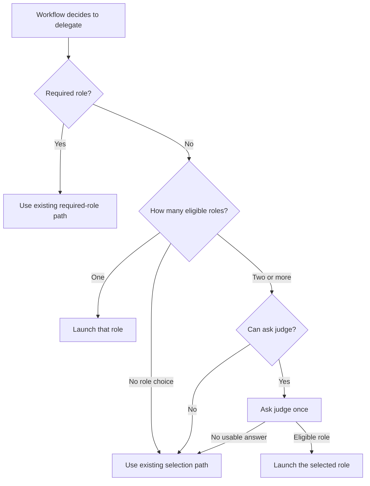

# Decide for Subagent Role Selection - Plan

## Goal Capsule

- **Objective.** When a managed session can hand off a task to several suitable subagents, it can choose one and launch it with a single judgment.
- **Means.** Use the shared parent instructions and the existing `decide` MCP tool (KTD1).
- **Product authority.** [Issue #244](https://github.com/hyperlapse122/dotfiles/issues/244) and the confirmed scope below.
- **Open blockers.** None.
- **Stop condition.** Stop if the supported launch tools cannot honor a selected role anywhere in scope.
- **Execution profile.** One pull request.
- **Finishes and ships.** `ce-work` implements and verifies. `lfg` reviews, opens the PR, and watches CI.

---

## Product Contract

### Summary

Once the workflow has decided to delegate, the parent asks `judge` to choose among eligible roles when two or more are available. A usable answer goes straight to the existing launch path.

### Problem Frame

Managed coding agents can see subagent metadata in more than one place. The roles a parent can actually launch depend on the active tool and the session. A choice based on the wrong roster can select a role that the launch tool ignores or cannot run.

### Key Decisions

- **Choose the role after delegation is decided.** This lets each session establish that it can carry a judgment through to a real launch. Governs R1 and R4. (session-settled: user-directed — chosen over asking about optional delegation and role together: verify role selection first and evaluate whether to delegate in [#246](https://github.com/hyperlapse122/dotfiles/issues/246).)

### Requirements

**Role eligibility**

- R1. The current workflow decides whether to delegate and retains its required roles, permissions, launch route, provider, model, and reasoning effort. [Agent routing rules](../../../home/h82/agents/instructions/t3-guide.md#t3-delegation)
- R2. The parent considers roles that the current session can launch through that route and whose descriptions and tool restrictions fit the task.
- R3. Claude Code uses the pinned built-in catalog as its starting point and checks availability in the running session. [Claude Code catalog](https://github.com/hyperlapse122/dotfiles/blob/8da1e5b/packages/claude-code-agents.json)

**Judgment and launch**

- R4. When the workflow leaves the role open and two or more roles qualify, the parent asks `judge` once using a `choice` question containing a short task summary, the eligible role descriptions, and an option to abstain. [Decide MCP tool](../../../docs/decide.md#use-the-mcp-tool)
- R5. The request contains only information permitted for the configured backend. [Decide backends](../../../docs/decide.md#backends-and-models)
- R6. The parent launches an eligible role returned by `judge` directly through the existing route.
- R7. The parent follows the existing direct launch path for a required role and selects a sole eligible role directly, in both cases without calling `judge`.
- R8. The parent uses the existing selection path when the session offers no role choice, `judge` cannot be used, or its answer is unusable.

**Session coverage**

- R9. Establish whether a role choice is available in standalone and managed T3 Code sessions for Claude Code, Codex, and Pi. For every session type with a choice, demonstrate which candidates reached `judge` and which role the parent launched.

### Actors

- A1. The parent agent applies the workflow rules, filters candidates, and launches the child.
- A2. The `decide` MCP tool returns the choice or abstains.
- A3. The session's existing launch tool starts the selected subagent.

### Key Flows

- F1. Once delegation is decided, the parent checks for a required role, then filters the roles available through the session's launch route. With at least two eligible roles it asks `judge` once when the request can be sent. The parent launches a usable choice and follows the existing selection path if it cannot get one. Covers R1–R8.

### Acceptance Examples

- AE1. **Covers R2–R6 and R9.** A session can launch two roles suitable for independent read-only research. A third role is unavailable or lacks a required tool. The request contains only the two eligible roles, their descriptions, an allowed task summary, and an abstention option. The parent launches the returned role through the existing route.
- AE2. **Covers R1 and R7.** If a CE skill names a required role or filtering leaves one eligible role, the parent uses the applicable launch path without querying `judge`.
- AE3. **Covers R5 and R8.** A session offers no role choice, the configured backend cannot receive enough evidence, the tool fails, or the response abstains or names an unlisted role. The parent uses the existing selection path.

### Scope Boundaries

- Choosing whether to delegate is tracked in [#246](https://github.com/hyperlapse122/dotfiles/issues/246).
- This work consumes existing roles and catalogs. Changes to catalog generation and adding roles to a session are separate work.

### Sources / Research

- The existing CI triage rule is a precedent for asking one `choice` question with an abstention option and applying a fallback. [Decide for CI triage](../../../docs/agent-routing.md)
- The pinned catalogs record the built-ins for Codex and an empty built-in roster for Pi. The running session supplies the evidence for R9. [Codex catalog](https://github.com/hyperlapse122/dotfiles/blob/8da1e5b/packages/codex-agents.json) · [Pi catalog](https://github.com/hyperlapse122/dotfiles/blob/8da1e5b/packages/pi-agents.json)

---

## Planning Contract

### Key Technical Decisions

- KTD1. Put the decision in the common user-scope instructions alongside the existing CI triage use of `judge`. The parent owns candidate filtering and the existing launcher owns execution. Reuse the native and T3 launch routes through the current instruction delivery. Governs R1, R4–R8.
- KTD2. Link the pinned Claude Code catalog into the managed home as `~/.local/share/nix-config/claude-code-agents.json`. Use the catalog to start with the pinned built-in definitions. The running session determines which roles are available, and its effective descriptions and restrictions take precedence where supplied. Use catalog metadata only for the corresponding built-in definition. Resolve any relevant conditional field before counting that role as eligible. Governs R2, R3.
- KTD3. Use the role selector and descriptions exposed to the parent by its existing launch route. Honor session or tool instructions that restrict use of a selector. T3 0.1.9's local `delegate_task` puts its generic `role` in the child prompt. It retains the route's tools and execution settings. Use the actual role selector for native and T3 launches on their respective routes. Filter out roles that would change required access, provider, model, or effort unless the existing launch can preserve those settings. Governs R1, R2, R8, R9.
- KTD4. Summarize the task by purpose and tool needs. Only include role descriptions and task details permitted for the configured backend. When the backend is unknown, use information permitted to leave the machine and fall back if that information is insufficient. Governs R4, R5, R8.

### Sources

- [Pinned Codex spawn tool schema](https://github.com/openai/codex/blob/d32063f96c2dff1dc96af839b3952abb6acfeda4/codex-rs/core/src/tools/handlers/multi_agents_spec.rs) and [pinned T3 local dispatch](https://github.com/pingdotgg/t3code/blob/v0.1.9/apps/server/src/mcp/OrchestratorMcpService.ts#L2364-L2480) and [child prompt construction](https://github.com/pingdotgg/t3code/blob/v0.1.9/apps/server/src/mcp/delegatedTaskModes.ts#L90-L94).
- [Instruction receipts and branch isolation](../../../tests/agent-instructions.py) and [live MCP evidence](../solutions/integration-issues/t3-acp-sessions-ignore-user-mcp-config.md).

---

## Implementation Units

### U1. Deliver the shared role selection policy

**Goal.** Deliver the policy and pinned Claude metadata to managed parent sessions. Covers R1–R8.

**Dependencies.** None.

**Files.** `home/h82/agents/instructions/default.nix`, `home/h82/agents/instructions/instructions.md.tmpl`, `tests/agent-instructions.nix`, `tests/agent-instructions.py`.

**Approach.** Add a short section near the shared CI triage guidance. Add the catalog to the managed home as a link to the pinned JSON. Update the existing rendered receipts and check that the materialized catalog matches its source. The T3 addendum already carries the routing rules. Its current receipt should still pass.

**Test scenarios.**

- The instructions check observes the updated policy in each common render and the catalog at the path named by that render.
- The original T3-only receipt still passes.

**Verification.** Build the repository's instruction check on an available builder. The existing receipts cover delivered text and branch boundaries. U2 covers live behavior.

### U2. Demonstrate session behavior and document coverage

**Goal.** Record which routes expose a choice and prove that a judgment can reach a real launch. Covers R1–R9.

**Dependencies.** U1.

**Files.** `docs/agent-routing.md`. Use disposable transcripts for runtime proof.

**Approach.** Exercise the candidate policy in scratch or isolated sessions using synthetic tasks. Inspect the active tool and the actual calls in the transcript. Establish the role-choice status of all six harness and session combinations and trace a judgment through launch for every choice-capable session type. When testing a launch, use existing route controls and a short read-only task.

**Test scenarios.**

- Covers AE1. Two eligible read-only roles and one ineligible role yield one `judge` call with only the eligible roles plus abstention. The transcript shows the returned role in the actual launch.
- Covers AE2. A required role and a sole eligible role each take the direct path without a `judge` call.
- Covers AE3. A route with no usable selector keeps its existing behavior. A judgment that abstains or fails also leaves selection with the existing workflow.

**Verification.** Trace the judge request, answer, and role argument separately. Record any required evidence that cannot be run and why.

---

## Verification Contract

Run the platform's `agent-instructions` flake check and the repository's applicable pre-push checks. Live coverage follows U2 and uses synthetic task summaries. Report live session evidence and CI evidence separately.

---

## Definition of Done

- The three managed instruction files deliver the shared policy and the managed Claude Code catalog matches its pin.
- The session matrix establishes role-choice availability for all six configurations. Each choice-capable configuration has a candidate-to-launch trace. The direct and fallback cases have runtime evidence.
- The patch contains the policy, its delivery coverage, and the evidence needed to explain how it behaves.
