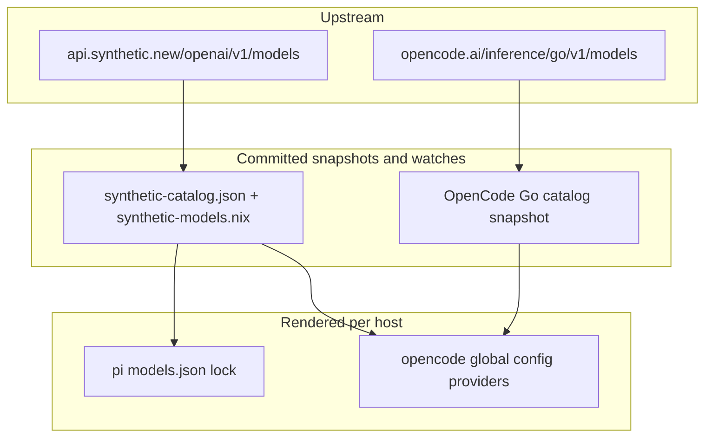
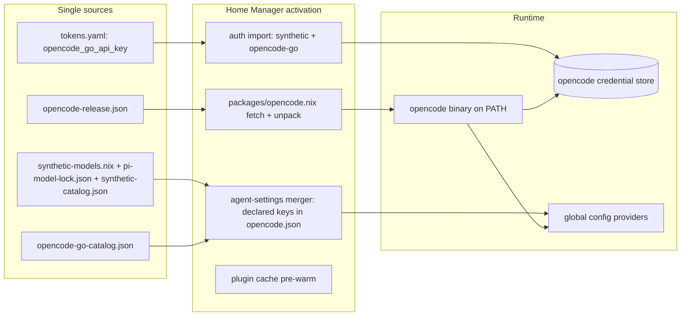

# OpenCode v2 Managed Harness - Plan

## Goal Capsule

- **Objective:** After this work, OpenCode v2 is a repository-managed harness on both hosts — a release-pinned binary, a locked Synthetic provider, an OpenCode Go provider with a pinned catalog and a SOPS-managed key, shared instruction/plugin/skill integration, and T3 Code parity — so the owner can later move the Synthetic subscription to OpenCode Go without unmanaged glue.
- **Means:** Pin the upstream GitHub release artifacts; reuse the existing Synthetic model-lock chain as the single source; add a standing OpenCode Go catalog watcher; wire the shared instruction, plugin, and skill machinery; re-enable the T3 Code provider instance.
- **Product authority:** The owner, through this brainstorm's dialogue and the confirmed scope synthesis of 2026-11-19.
- **Stop conditions:** Stop if the Go key fails validation at provisioning or the Go models endpoint serves no usable catalog — both are assumption failures planning cannot absorb.
- **Who finishes:** The executing agent implements, verifies, and opens the PR; the owner merges.
- **Execution profile:** One PR, eight units (U1–U8), no runtime or host change beyond the managed switch.
- **Open blockers:** None.

---

## Product Contract

### Summary

Make OpenCode v2 the fourth managed harness beside Claude Code, Codex, and Pi. The binary is pinned from upstream GitHub release artifacts, Synthetic renders from the existing lock chain, OpenCode Go gets its own standing catalog snapshot and SOPS token, and T3 Code's opencode instance returns at full parity.

> Product Contract preservation: changed — R2 drops removal of the mise copy (owner decision); R9 and R11 state their delivery mechanism as KTD1 and KTD3 settled it in the confirmed plan-time synthesis; R18 no longer lists files. No other requirement changed.

### Problem Frame

OpenCode was removed from this repository on 2026-10-23 and its guards still assert its absence, yet the owner runs it daily from a user-level mise install (currently 2.3.2) with a hand-written global config that only loads the Compound Engineering plugin from git. No part of that setup is declared, verified, or reproducible. The owner plans to switch the Synthetic subscription to OpenCode Go later; at that point Pi's Synthetic-only wiring loses its provider. Re-introducing OpenCode now as a fully managed harness puts the destination in place before the switch, with the same declarative ownership, catalog pinning, and secret handling the other three harnesses already get. The earlier rejection of OpenCode v2 (issue #139, recorded in `2026-11-11-2037-feat-pi-tools-project-trust-plan.md`) was about replacing Pi inside T3 Code; this work adds a fourth harness instead and does not touch Pi.

### Requirements

**Managed harness**

- R1. The repository pins OpenCode v2 from the upstream GitHub release's per-OS/architecture artifacts (today v2.3.2), recording version and hashes the way `codex-release.json` does; it neither builds OpenCode from source nor installs it through mise.
- R2. The pinned OpenCode binary is installed on both hosts exactly as the release ships it; any mise-installed copy is left untouched, and PATH order between the two is not managed.
- R3. The managed global config (`~/.config/opencode/opencode.json`) follows the declared-key settings-tier pattern: declared keys return to their declared value on rebuild, keys outside the declared set stay the user's.
- R4. Release automation follows new upstream releases and re-pins only strictly newer versions, owned by the scheduled update workflow.

**Synthetic provider**

- R5. OpenCode's Synthetic provider is declared from the existing single source chain (`synthetic-models.nix`, committed `synthetic-catalog.json`, the Pi model lock) so Pi and OpenCode render the same locked catalog.
- R6. OpenCode hides or disables the same Synthetic models Pi hides, and its credential comes from the published `synthetic_api_key` file without interactive auth.

**OpenCode Go provider**

- R7. The Go model catalog is fetched from `https://opencode.ai/inference/go/v1/models` into a committed snapshot that the scheduled workflow refreshes under the same validation and shrink-floor rules as the Synthetic catalog.
- R8. OpenCode's Go provider renders its model set from the committed snapshot, and the wiring satisfies Go's client-identification requirements (coding-agent user agent and session ID) so subscription models actually work.
- R9. The Go API key lives in SOPS `secrets/tokens.yaml` as `opencode_go_api_key`, publishes beside the other API keys, and reaches OpenCode through credentials seeded from the published file at activation (KTD1); the value never appears in the repository, the Nix store, logs, or command lines.
- R10. The key value is provisioned at implementation time from the owner-provided plaintext key file; the revoked former key is not reused.

**Shared policy integration**

- R11. The shared user-scope instruction template is delivered to the path OpenCode actually reads, with `docs/agent-routing.md` and the instruction tests updated in the same change; no OpenCode-specific content branch is added (KTD3).
- R12. The pinned Compound Engineering plugin is installed and enabled at user scope for OpenCode.
- R13. Every shared user-scope skill is discoverable exactly once through OpenCode's skill root.

**T3 Code**

- R14. T3 Code's opencode provider instance is re-enabled at parity with the other instances, pointing at the managed build.
- R15. T3 OpenCode sessions receive the T3-only instruction branch through the same launch-input mechanism as the other harnesses.

**Records and guards**

- R16. The retirement guards flip: the managed OpenCode binary and config merge are asserted by `tests/opencode.nix`, which keeps the owner's own config keys, and existing OpenCode user data stays untouched. `tests/agent-retirement.py` is registered by no check and also asserts Pi absent, so it is left as it is.
- R17. Publish still deletes the retired `opencode_api_key` and now also publishes `opencode_go_api_key`; the host-secrets token list and its test reflect both.
- R18. Repository documentation reflects the fourth managed harness wherever it enumerates harnesses or skill roots.

The catalog fan-out both providers join, with OpenCode as the second consumer of the Synthetic chain and the only consumer of the Go chain:

### Key Decisions

- D1. **Full T3 Code parity.** (session-settled: user-directed — chosen over keeping OpenCode standalone-only: the instance had been explicitly disabled since the 2026-10-23 removal.) Governs R14, R15.
- D2. **Distribution through pinned GitHub release artifacts.** (session-settled: user-directed — chosen over building in nix or reinstalling through mise.) Governs R1, R2, R4.
- D3. **New token name `opencode_go_api_key`.** (session-settled: user-approved — chosen over un-retiring `opencode_api_key`: the former key is revoked, and its retirement record and deletion test stay meaningful.) Governs R9, R10, R17.
- D4. **The existing Synthetic chain stays the single source of truth.** Governs R5, R6.
- D5. **The Go catalog refresh is a standing scheduled snapshot, not a one-time fetch.** (session-settled: user-approved.) Governs R7.
- D6. **CLI only; desktop artifacts are not managed.** (session-settled: user-approved.) Governs R1, R2.

### Key Flows

- F1. First-activation takeover
  - **Trigger:** A host switches to a generation containing the managed harness.
  - **Steps:** Publish decrypts and stages `opencode_go_api_key`; activation installs the pinned release build; the merger assigns declared keys in the global config while leaving undeclared user keys; OpenCode starts against the locked providers.
  - **Covered by:** R2, R3, R9.

### Acceptance Examples

- AE1. **Covers R9, R17.** Given a state directory still holding the retired `opencode_api_key`, when publish runs, then the retired file is deleted, `opencode_go_api_key` is published mode 400 beside the others, and no plaintext key lands in the repository.
- AE2. **Covers R4.** Given upstream published a strictly newer release, when the scheduled updater runs, then the pin moves with fresh hashes; given upstream is at or below the pinned version, then the pin files are left alone.
- AE3. **Covers R7.** Given a fresh catalog whose valid rows fall below the retention floor, when the watcher refreshes, then it refuses and the committed snapshot stays unchanged.
- AE4. **Covers R15.** Given a T3 OpenCode session, when it starts, then it receives the T3-only instruction branch and not other harnesses' branches.
- AE5. **Covers R3, R5, R6.** Given the managed generation is active, when OpenCode lists models, then the Synthetic catalog matches the lock with Pi's hidden set, and user keys outside the declared set survive a rebuild.

### Scope Boundaries

- The Synthetic-to-Go subscription switch itself — cancel, subscribe, and whatever later happens to Pi's Synthetic wiring — is later work; Pi is untouched in this plan.
- CE work-engine and cross-model-peer activation for OpenCode stays unconfigured.
- Go usage and limit tracking (agent-usage or tokscale integration) is deferred.
- Desktop artifacts (`opencode-desktop-*`) are not managed.
- The mise-installed copy and the user's mise configuration are left untouched; PATH order between that copy and the managed binary is not managed.

Considered and not built:

- Bearer-key support in the Go catalog watcher. The endpoint answered HTTP 200 without a key on 2026-11-19, and an auth demand later fails the scheduled refresh step and so the whole run, so it becomes a flag change then.
- Hiding Go models flagged for contributor training or limited regions. The Go catalog hides nothing by default and none was asked for; revisit if the owner wants them excluded.

### Dependencies / Assumptions

- The owner-provided key file's content is valid for the Go subscription at provisioning time.
- `https://opencode.ai/inference/go/v1/models` serves the catalog this work fetches. Checked 2026-11-19: HTTP 200 without a key, 31 model rows.
- OpenCode v2 supports declarative provider/model config and user-scope skills, plugins, and instructions as its docs describe (checked 2026-11-19 against opencode.ai/docs/config and /docs/providers, and against the v2.3.2 binary).
- The Compound Engineering plugin supports OpenCode v2 as a runtime (CE configuration already names OpenCode as a harness and peer).

### Sources / Research

- Grounding dossier: `/tmp/compound-engineering-1000/ce-brainstorm/opencode-v2-harness/grounding.md` (machine-local, best effort; a missing copy is not a blocker — the repo citations below govern).
- Repo: `home/h82/agents/pi.nix`, `home/h82/agents/synthetic-models.nix`, `home/h82/agents/synthetic-catalog.json`, `scripts/catalog_snapshot.py`, `scripts/synthetic-models-watch`, `.github/workflows/update-dependencies.yml`, `scripts/host-secrets`, `tests/host-secrets.nix`, `home/h82/t3code.nix`, `tests/t3code-traits.nix`, `tests/t3code-opencode-disabled.py`, `tests/agent-retirement.py`, `packages/codex-release.json`, `scripts/npm-release`, `home/h82/agents/instructions/`, `home/h82/agents/agent-plugins.nix`, `home/h82/agents/skills.nix`.
- External: [OpenCode config](https://opencode.ai/docs/config/), [OpenCode providers](https://opencode.ai/docs/providers/), [OpenCode Go](https://opencode.ai/console/go), [release v2.3.2](https://github.com/anomalyco/opencode/releases/tag/v2.3.2).
- Prior decision context: `.compound-engineering/artifacts/plans/2026-11-11-2037-feat-pi-tools-project-trust-plan.md` records issue #139's OpenCode v2 rejection on T3-replacement grounds, superseded by this request.

<!-- ce-section: work-relationships -->
### How This Work Fits Together

This plan covers one area: the OpenCode harness integration. A later area — switching the Synthetic subscription to OpenCode Go, with whatever that means for Pi — depends on this work and can be planned separately; it is the current understanding of the follow-on, not a committed roadmap, and a later plan may revise or discard it.

---

## Planning Contract

### Key Technical Decisions

- KTD1. **Credentials are seeded at activation with `opencode auth import`, not config substitution.** Verified on v2.3.2: catalog providers ignore `providers.<id>.settings.apiKey`; the working non-interactive routes are the provider's env var and `auth import` (schema round-tripped: an array of `{id, integrationID, label, active, value:{type:"key",key}}` entries). `scripts/opencode-auth-sync` reads the published key files, compares them with the credentials stored under the label `nix-config`, and for each provider (`synthetic`, `opencode-go`) imports a 0600 temp JSON entry and deletes the file. `auth import` skips an account that is already stored even when its key changed (verified on v2.3.2), so a rotated key first logs out its stale account with `auth logout <integration> nix-config`, which runs non-interactively; the step orders after secret publication and uses `nixConfigSecretsPublish` on macOS as `piAuth` does. A saved account outranks an environment connection, and the DB holds the same plaintext an interactive `/connect` would. (session-settled: user-approved — chosen over `{file:...}` config substitution and wrapper-env injection: catalog-provider config keys are ignored, and service env does not survive rotation or direct binary launches.)
- KTD2. **Provider rendering uses the catalog IDs `synthetic` and `opencode-go` with snapshot-driven `models` maps; no policies lockdown.** Synthetic's declared map carries exactly the locked models from `synthetic-models.nix`/`pi-model-lock.json`, and every other model in the committed `synthetic-catalog.json` renders `disabled: true` — so opencode's visible Synthetic set equals Pi's locked set, including Pi's hidden-model exclusions. The Go map renders every model of the committed Go snapshot with its limit and cost fields. OpenCode's own catalog already routes each of those models over the protocol it is served on, so no per-model protocol or base URL is declared; built-in Go models absent from the snapshot are not disabled either, because the repository holds no list of the built-in set (v2.3.2 has `mimo-v2.5` and `mimo-v2.5-pro` beyond the 31 snapshot rows). R8's client identification comes from keeping the built-in `opencode-go` provider ID, so no custom user agent is declared. Global `policies` are left undeclared so the owner can still `/connect` anything else. (session-settled: user-approved — chosen over a custom provider ID or a `provider.use` deny-all allowlist: custom IDs cannot guarantee Go's client-identification treatment, and a lockdown was not asked for.)
- KTD3. **The shared instruction template gains no content branch; OpenCode receives the unmodified base render.** The delivery path is `~/.config/opencode/AGENTS.md` (auto-loaded user-global). Because codex/pi already render byte-identical base output, the `EXPECTED` receipt keys in `tests/agent-instructions.py` need no new entries; the model ladder table stays unchanged and the "Providers without a row" fallback rule covers OpenCode. (session-settled: user-approved — chosen over adding an OpenCode model-table row and harness branch: no instruction-content change was requested, and byte-identical rendering keeps receipt churn out.)
- KTD4. **The plugin is declared in the global config's `plugins` array, pinned by the CE release's full commit SHA.** Verified installable form: `git+https://github.com/EveryInc/compound-engineering-plugin#<full-40-hex>`; the rev comes from `home/h82/agents/agent-plugin-pins.nix` so both use one pin. The declared form is the owner's existing `name@spec` shape with the revision appended, `compound-engineering@git+https://github.com/EveryInc/compound-engineering-plugin.git#<rev>` (verified: `opencode plugin add` accepts it, reports "already configured", and installs the pinned revision into the cache). `prefixEntries` takes one entry per path, so a single prefix replaces the owner's unpinned entry and any earlier pin while other user entries survive; the bare `git+https://...#<rev>` form that `plugin add` writes for a bare spec would not match that prefix, so it is never used. `agent-plugins.nix` and `agent-plugin-sync` are untouched (the Pi precedent for a harness whose native mechanism lives elsewhere). (session-settled: user-approved — chosen over writing an `agent-plugin-sync` OpenCode adapter: the native config path is verified end-to-end and cheaper to keep pinned.)
- KTD5. **Distribution mirrors `scripts/codex-release` minus the source block.** `packages/opencode-release.json` pins the v2.3.2 assets `opencode-linux-x64.tar.gz` (glibc) and `opencode-darwin-arm64.zip` with SRI hashes from the release's `SHA256SUMS`; `packages/opencode.nix` fetches each asset and installs its single self-contained binary unmodified: no build, no patching, and `dontFixup` so stripping cannot damage the embedded payload. On NixOS the glibc binary runs through the host's existing `nix-ld`; the build sandbox has no loader for it, so Linux gets no in-sandbox run and its version proof is U4's live smoke. `scripts/opencode-release` reads the release list rather than `releases/latest`, because the repository publishes a v1 line and unrelated `process-daemon-v*` tags beside v2 and `latest` points at v1 (v1.19.6 on 2026-11-19); it takes the highest non-prerelease `v2.x.y` tag and refuses prereleases, missing assets, and non-newer versions. No `*-agents.json` roster exists for OpenCode, so no `source` block and no `harnessAgents` row. The declared config sets `update: "disable"`. (session-settled: user-directed — chosen over patching the ELF interpreter with `autoPatchelfHook` or building from source: prebuilt binaries are installed as downloaded because binary build and patch steps break easily.)
- KTD6. **Skills get a fourth declared root, `.config/opencode/skills`.** `home/h82/agents/skills.nix` gains the root and every test that re-asserts the root list extends in the same change, keeping AGENTS.md's one-root-per-harness rule. OpenCode's own root outranks its `.claude/skills` compatibility discovery, so IDs stay unambiguous.
- KTD7. **The T3 re-enable is one atomic flip.** `t3code.nix` enables the instance with `config.binaryPath` on the managed build, drops the `providerModelPreferences.opencode` prune, and loses its "OpenCode is gone" comment; `tests/t3code-opencode-disabled.py` becomes an enabled-state assertion; the `t3code-traits` fixtures flip; `scripts/t3-instructions.py`'s harness tuple gains `('opencode', 'opencode')`. OpenCode has no per-launch instruction option and a global `instructions` entry would reach sessions outside T3 Code, so the T3-only branch is listed in the instance's `OPENCODE_CONFIG_CONTENT` environment entry, which T3 Code 0.1.9 passes to the server it starts (verified in the T3 binary; v2.3.2 parses it as a config document with `instructions`). The entry is declared with `upsertPaths` keyed by name. `scripts/t3-instructions.py` is unchanged, and the prune of `providerModelPreferences.opencode` is dropped.
- KTD8. **The Go catalog chain is a new standing watcher, not an extension of the synthetic one.** `scripts/opencode-go-models-watch` shares `scripts/catalog_snapshot.py`, fetches `https://opencode.ai/inference/go/v1/models`, and writes `home/h82/agents/opencode-go-catalog.json` under the same shrink-floor and write-if-changed rules. Each row keeps only what the render reads: `id`, `name`, `limit`, and the text input, output, and cache-read prices of `cost`. The row validator requires the prices the render reads to be numbers, so a malformed row is skipped and never reaches a snapshot that would break evaluation of every host; protocol and base-URL fields are not kept, because OpenCode's own catalog routes each model. The scheduled workflow gains a catalog row (own commit message, published before the dependencies candidate). The drift job gains no Go loop: the snapshot refreshes itself every run and no hand-edited source file exists for an issue to ask a person to reconcile, so an unreachable endpoint surfaces as a failed refresh step and a failed run. `scripts/ci-update-verify`, `tests/update-workflow.py`, and the reconcile stubs extend accordingly.
- KTD9. **The Go token follows the existing per-secret option pattern.** `secrets/tokens.yaml` gains `opencode_go_api_key`; `scripts/host-secrets`'s token list gains the name (the retired `opencode_api_key` stays retired and its deletion test stays); `modules/nixos/system/secrets.nix` gains `my.secrets.enableOpencodeGoApiKey`-style wiring beside the synthetic precedent with `modules/nixos/profile.nix` defaulting it on; `secrets/README.md` and `tests/agent-api-key-secrets.nix` gain the row; the auth-provisioning VM check exercises the new token's unprivileged consumer on NixOS, with the darwin state-dir path covered by the host-secrets test. Provisioning the real value uses the owner-provided plaintext file with `sops set --value-stdin`; if the host's local age identity cannot authorize the edit, the owner performs the PIN entry (an owner-kept physical step).

### High-Level Technical Design

The one-paragraph shape: two committed catalogs and one release pin enter activation; activation materializes the binary, merges declared config keys, seeds credentials, and pre-warms the plugin; runtime reads only what activation laid down plus the credential store. Snapshot-vs-live drift is expected — the watchers reconcile it, they are not prevented from it.

### Assumptions

- The Go models endpoint is reachable without a bearer token (HTTP 200 on 2026-11-19).
- The unmodified glibc binary runs on NixOS through the `nix-ld` module in `modules/nixos/system/nix-ld.nix`; the mise-installed 2.3.2 is the same binary and runs on the host today.
- The Compound Engineering plugin's OpenCode runtime support is functional (CE configuration already names OpenCode as a harness and peer); activation pre-warm will surface any packaging incompatibility early.
- `~/.config/opencode/opencode.json` is read live by opencode v2 (config reloads automatically), so the merged declared keys reach the running harness without a service restart; credential changes take effect at the next session start.

---

## Implementation Units

### U1. Release pin and package

- **Goal:** A pinned, per-system OpenCode binary the flake installs, with an updater that follows strictly newer releases.
- **Requirements:** R1, R2, R4; covers D2, D6.
- **Dependencies:** none.
- **Files:** `packages/opencode-release.json`, `packages/opencode.nix`, `scripts/opencode-release`, `tests/test_opencode_release.py`, `flake.nix` (apps + check registration), `scripts/ci-update-publish` only if the release row needs publish placement.
- **Approach:** Mirror `scripts/codex-release` with `TAG_PREFIX = "v"` and asset names verified against the live v2.3.2 release; skip the source/`nix-prefetch-url` block entirely. The package fetches each pinned asset with `fetchurl`, unpacks (tar for Linux, zip for darwin), and installs the single `opencode` binary unmodified per KTD5: no build, no patching, `dontFixup` set. The install check that runs the binary applies on Darwin only. Register the `opencode-release` check (light shard; no host closure).
- **Patterns to follow:** `scripts/codex-release` downgrade guard and digest conversion; `packages/codex.nix` per-system `or throw` and `versionCheckHook` install check.
- **Test scenarios:**
  - A newer upstream release moves version and hashes; an equal or older tag leaves both files untouched (Covers R4, AE2).
  - A release list whose newest entries are a v1 tag and a `process-daemon-v*` tag still resolves to the highest `v2.x.y` release, and a v2 prerelease is skipped (Covers R4).
  - A release missing a pinned asset or with a mismatched `SHA256SUMS` line refuses and keeps the previous pin.
  - The package builds for `x86_64-linux` and `aarch64-darwin`, and the installed binary is byte-identical to the member of the pinned archive.
  - On Darwin the install check runs the binary and it reports the pinned version.
- **Verification:** `nix build --no-link .#checks.x86_64-linux.opencode-release` passes; the package builds for both systems and the byte-identical check passes. Linux execution is proven by U4's live smoke.

### U2. Go API key plumbing and provisioning

- **Goal:** `opencode_go_api_key` flows from SOPS to a user-readable published file on both hosts without touching the retired-key history.
- **Requirements:** R9, R10, R17; covers D3.
- **Dependencies:** none (provisioning of the real value is gated on the owner-provided file).
- **Files:** `secrets/tokens.yaml`, `scripts/host-secrets`, `modules/nixos/system/secrets.nix`, `modules/nixos/profile.nix`, `secrets/README.md`, `tests/host-secrets.nix`, `tests/agent-api-key-secrets.nix`, the auth-provisioning VM check.
- **Approach:** Extend the token list, the NixOS option (`enableOpencodeGoApiKey` beside the synthetic precedent), the profile default, and the README table; keep `retired=(opencode_api_key)` untouched. Widen `vmChecks.auth-provisioning` so a real unprivileged consumer reads the new token after a switch (per-boundary permissions only — never a service-wide umask); cover the darwin state-dir publish in the host-secrets test.
- **Test scenarios:**
  - Publish stages and publishes `opencode_go_api_key` mode 400 beside the others and still deletes the retired key (Covers R9, R17, AE1).
  - The VM check decrypts, publishes, and consumes the new token as an unprivileged user; a repeated switch stays green.
  - A tokens.yaml without the new key fails the secret-list check rather than publishing an empty file.
- **Verification:** `nix build --no-link .#vmChecks.auth-provisioning`; the host-secrets and agent-api-key-secrets checks pass.
- **Execution note:** The real provisioning step runs `sops set --value-stdin` reading the owner's plaintext file; the key value must not appear in argv, logs, or the conversation. If the local identity route demands a YubiKey PIN, pause for the owner — that entry is owner-kept.

### U3. OpenCode Go catalog snapshot chain

- **Goal:** A committed, standing-refreshed snapshot of the Go model catalog feeding the provider render.
- **Requirements:** R7, R8; covers D5.
- **Dependencies:** none.
- **Files:** `scripts/opencode-go-models-watch`, `home/h82/agents/opencode-go-catalog.json`, `packages/agent-tools.nix`, `flake.nix` (app, check, reconcile wiring), `.github/workflows/update-dependencies.yml`, `scripts/ci-update-verify`, `tests/update-workflow.py`, `tests/test_opencode_go_models_watch.py`, and `tests/update-dependencies-reconcile.sh` for the release row.
- **Approach:** Share `scripts/catalog_snapshot.py` as the synthetic watcher does; validate the endpoint's row shape per KTD8 and keep the shrink floor and write-if-changed semantics; a failed refresh restores the committed file and fails the run. Workflow work: a producer step (restore-on-failure + commit), publish ordering before dependencies, an OpenCode release row in the dependency updater with its own commit, the verifier target set gaining the new check name, and the job timeout budget recomputed.
- **Test scenarios:**
  - A fresh snapshot below the retention floor is refused and the committed file survives (Covers R7, AE3).
  - A row served over any protocol is kept with its `limit` and prices, and a row whose cost lacks a numeric price the render reads is skipped with its previous entry kept (Covers R8).
  - An unreachable endpoint leaves the committed snapshot and fails the run without blocking the Synthetic snapshot or the dependencies; the next reachable run publishes again.
  - The workflow policy tests pass with the new row: catalog publishes before dependencies, the drift job carries no push token, and the timeout budget still covers all steps.
- **Verification:** `nix run .#opencode-go-models-watch` fetches and validates; the `opencode-go-models-watch` and `update-dependencies-reconcile` checks pass.

### U4. Harness module: locked providers, declared config, credentials, plugin

- **Goal:** The managed opencode package installed with a declared-tier global config, seeded credentials, and the pinned plugin — the takeover of the unmanaged setup.
- **Requirements:** R1–R6, R8, R9, R12, R16; covers KTD1–KTD5.
- **Dependencies:** U1 (binary), U2 (published key), U3 (Go snapshot).
- **Files:** `home/h82/agents/opencode.nix`, `home/h82/agents/default.nix`, `flake.nix` (check registration + `hostClosureChecks`), `tests/opencode.nix`, `tests/agent-retirement.py`.
- **Approach:** The module builds the package from `packages/opencode.nix` and adds it to `home.packages`. A rendered declared document carries the declared keys — `update: "disable"`, the pinned `plugins` array entry per KTD4 (rev from `agent-plugin-pins.nix`), and the `providers.synthetic` and `providers.opencode-go` models maps rendered per KTD2 from the single sources — merged into `~/.config/opencode/opencode.json` by `agent-settings` with an ownership ledger beside it, so undeclared user keys survive.
  - The credential activation step runs after installPackages and secret publication (`nixConfigSecretsPublish` on darwin), gated on `!config.my.bootstrap` as `piAuth` is, because bootstrap generations hold no published keys. It writes the 0600 import JSON, runs `opencode auth import --standalone` for both providers so activation never starts or depends on a background service, and removes the file. Production hosts fail loudly when a published key file is absent.
  - Activation pre-warms the plugin cache with `opencode plugin add` for the pinned spec. That command also writes the global `plugins` array, so it runs before the merge and the merge normalizes the array.
  - Flip `tests/agent-retirement.py`'s absence assertions to presence assertions for the binary and config root, keeping the preserved-user-state list intact.
- **Test scenarios:**
  - After activation, the merged config holds the declared keys at their declared values and preserves an undeclared user key on a second run (Covers R3, AE5).
  - A config seeded with the owner's existing unpinned CE plugin entry and another user plugin ends with one pinned CE entry plus the user plugin (Covers R12).
  - `opencode models` lists exactly the locked Synthetic set (Pi's hidden set excluded) and the Go snapshot set (Covers R5, R6, R8, AE5) — a live-session probe against `--standalone`, not a file diff.
  - A one-token request through a Go model served over a non-chat-completions protocol shows the built-in provider identification works (Covers R8). Run on 2026-11-19: the request reached the Go service and was refused with "An active OpenCode Go subscription is required", an account state outside the repository, so a successful completion remains unverified.
  - With published keys present, `auth list` shows both providers active without interactive auth (Covers R6, R9); with the file absent on a production host, activation fails loudly instead of importing an empty key.
  - A bootstrap activation skips the credential step and still completes.
  - The credential database file is readable by the owner only after import (observed mode `0600` on v2.3.2).
  - The plugin entry names the pinned rev and the cache holds it after pre-warm (Covers R12).
- **Verification:** `nix build --no-link .#checks.x86_64-linux.opencode` (registered in `hostClosureChecks`); live probes run the managed binary by its store path, not `opencode` from PATH, since a mise-installed copy may come first.
- **Execution note:** Mostly packaging/config — prefer the live-models smoke probe plus activation output over unit coverage.

### U5. Shared instructions delivery

- **Goal:** OpenCode receives the shared personal instructions at its user-global path, CLI and receipt discipline intact.
- **Requirements:** R11; covers KTD3.
- **Dependencies:** U4 (the delivery path test reads the same home).
- **Files:** `home/h82/agents/instructions/default.nix`, `tests/agent-instructions.nix`, `tests/agent-instructions.py`, `docs/agent-routing.md`.
- **Approach:** Add `opencode = ".config/opencode/AGENTS.md"` to the targets map and the test deliveries/manifest; no template edit, so `EXPECTED` stays as is and the `receipt()` keying is untouched. Extend the test's T3 tuple with `opencode` so the shared-T3-branch assertion covers it.
- **Test scenarios:**
  - The opencode render is byte-identical to the codex/pi base render and hashes to the existing `EXPECTED` keys (Covers R11).
  - The materialized `~/.config/opencode/AGENTS.md` appears in the delivery manifest and the home-file count assertions hold on both kinds.
- **Verification:** `python3 tests/agent-instructions.py home/h82/agents/instructions/instructions.md.tmpl` passes with unchanged hashes.

### U6. Skills root

- **Goal:** Every shared skill discoverable by OpenCode through its declared root, exactly once.
- **Requirements:** R13; covers KTD6.
- **Dependencies:** U4.
- **Files:** `home/h82/agents/skills.nix`, `tests/darwin-outputs.nix`, `tests/darwin-config.nix`, `tests/pinned-skills.nix`, `tests/korean-skills.nix`, `tests/test-audit-skill.nix`.
- **Approach:** Add `.config/opencode/skills` to the roots list and extend each test that re-asserts the literal list. The test-audit skill is linked under the OpenCode root like every other shared skill, so `tests/test-audit-skill.nix` extends its two-root list with the OpenCode root.
- **Test scenarios:**
  - The skill-linking step materializes each shared skill under the OpenCode root and the count assertions hold.
  - A skill present in two roots still resolves to one ID per root in the OpenCode discovery order.
- **Verification:** `nix build --no-link .#checks.aarch64-darwin.darwin-outputs` (and the Linux equivalents) pass; `tests/korean-skills.nix` and `tests/pinned-skills.nix` stay green.

### U7. T3 Code parity flip

- **Goal:** The T3 opencode instance returns enabled on the managed build with instructions and controls at parity.
- **Requirements:** R14, R15; covers D1, KTD7.
- **Dependencies:** U1, U2, U4.
- **Files:** `home/h82/t3code.nix`, `tests/t3code-traits.nix`, `tests/t3code-opencode-disabled.py`, `scripts/t3-instructions.py`, `tests/test_t3_instructions.py`, `home/h82/agents/instructions/instructions.md.tmpl` (no-op — composer only).
- **Approach:** Enable the instance with `config.binaryPath` on the managed build, remove the `providerModelPreferences.opencode` prune and the disable comment; replace the disabled-state merge assertion with an enabled-state one (same merger harness, seeded 0-byte-file case included); extend the composer loop and printf key set to emit `instructions/opencode.md`; add the launch fall-through or its `instructions`-config fallback per KTD7's execution-time finding, and extend the t3-instructions fixtures.
- **Test scenarios:**
  - The merged settings.json holds the opencode instance enabled and pointed at the managed build, stable across a second merge (Covers R14).
  - A T3 OpenCode session receives the T3-only instruction branch and not other harnesses' branches (Covers R15, AE4) — asserted through the launch mechanism T3 actually uses, probed live if the flag path is uncertain.
  - The composer renders `instructions/opencode.md` byte-identical to the other T3 renders.
- **Verification:** `nix build --no-link .#checks.x86_64-linux.t3code-traits`; `python3 tests/test_t3_instructions.py`; a live T3 launch probe on the NixOS host.

### U8. Documentation

- **Goal:** The repository's docs describe the fourth harness.
- **Requirements:** R18.
- **Dependencies:** U1–U7 (documents what landed).
- **Files:** `README.md`, `docs/repository-reference.md`, `docs/agent-routing.md`, `docs/macos.md`, `AGENTS.md`.
- **Approach:** Update the active-agents lines, the harness enumerations, the per-harness T3 launch-mechanism sentence, and the scripts/packages listings. Update the skill-root statements that say three roots to four: `docs/macos.md` ("linked into all three managed skill roots"), and in `AGENTS.md` both the Xcode export sentence ("links the skills into the three skill roots") and the shared-skill mandate that lists `.claude/skills`, `.codex/skills`, and `.pi/agent/skills`. The model ladder table gains no OpenCode row (KTD3), which `agent-routing.md`'s fallback rule already covers.
- **Test scenarios:** Test expectation: none — docs-only content verified by markdownlint and the agent-instructions check that consumes `docs/agent-routing.md` and `AGENTS.md`.
- **Verification:** `markdownlint-cli2` on changed files; `nix build --no-link .#checks.x86_64-linux.agent-instructions` (the check consumes both docs).

---

## Verification Contract

| Gate | Command | Applies to |
| --- | --- | --- |
| Formatting | `nix fmt -- --ci` | every change |
| Flake checks (light shards) | `nix flake check --no-build` then `nix build --no-link .#checkShards.<shard>` | U1–U7 checks |
| Release + watcher checks | `nix build --no-link .#checks.x86_64-linux.opencode-release .#checks.x86_64-linux.opencode-go-models-watch` | U1, U3 |
| Harness + instructions checks | `nix build --no-link .#checks.x86_64-linux.opencode .#checks.x86_64-linux.agent-instructions` | U4, U5 |
| Reconcile regression suite | the `update-dependencies-reconcile` check | U3 |
| Secrets VM check | `nix build --no-link .#vmChecks.auth-provisioning` | U2 |
| Instruction self-check | `python3 tests/agent-instructions.py home/h82/agents/instructions/instructions.md.tmpl` | U5 |
| T3 suites | `python3 tests/test_t3_instructions.py`; the t3code-traits and opencode-disabled-replacement checks | U7 |
| Docs | `scripts/lint-staged-markdown` over changed files; `git diff --check` | U8, all commits |
| Live smoke | the managed binary's `--version`, `models --standalone`, and `auth list`, run by store path on the switched host | U1, U4, U7 |

macOS verification of Linux-only checks goes through `nix derivation show -r` and `nix store prefetch-file --json` hash comparison, per the repository reference. NixOS VM checks and host closures build on the Linux builder.

---

## Definition of Done

- Every requirement R1–R18 is covered by a green check or a recorded live probe; each unit's Requirements line names the requirements it carries.
- The PR body and the diff agree with the Product Contract preservation note: only R2, R9, R11, and R18 changed after the brainstorm.
- On the switched host the managed binary, run by store path, reports the pinned version, `models --standalone` lists the locked sets, and a T3 OpenCode session receives its instruction branch.
- `secrets/tokens.yaml` carries the provisioned `opencode_go_api_key` with no plaintext in the repository, the Nix store, logs, or the conversation; the retired `opencode_api_key` deletion behavior is intact.
- Cleanup: abandoned attempts, scratch fixtures, and experimental config keys are removed from the diff; `git diff --check` and markdownlint are clean; the branch is pushed and CI is green on the head (or the shipping precondition's local-only rule applies).
