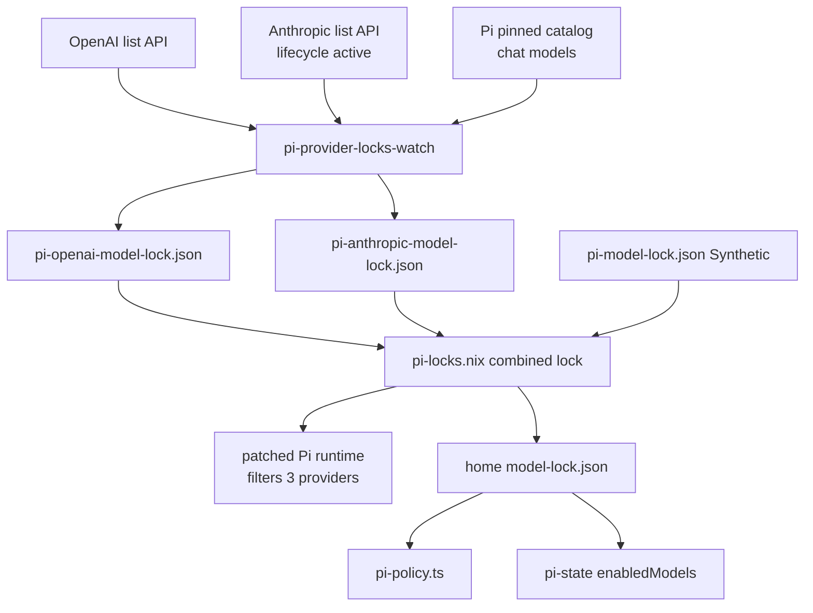

## Goal Capsule

- **Objective:** Pi can use the owner's OpenAI and Anthropic API accounts, and the models it offers from those accounts are as tightly controlled as its Synthetic models are today.
- **Means:** Widen Pi's compiled model lock from one provider to three, with committed ID snapshots for OpenAI and Anthropic that CI refreshes (KTD1, KTD2, KTD4).
- **Product authority:** The owner's decisions in the brainstorm that produced this plan. This plan supersedes the earlier decision that Synthetic is Pi's only provider (issue #33).
- **Execution profile:** One pull request. The units are ordered by dependency and land together because the runtime lock, the snapshots, and the CI refresh must agree.
- **Open blockers:** None. The owner must add the `OPENAI_API_KEY` and `ANTHROPIC_API_KEY` Actions secrets for the snapshots to narrow after merge (see Risks).

---

## Product Contract

### Summary

Pi accepts three providers: `synthetic`, `openai`, and `anthropic`. Each is limited to a committed model list, and the OpenAI and Anthropic lists are built from each provider's model-list API and refreshed by CI every 30 minutes. Credentials come from the keys already published for OpenCode. Synthetic stays the default.

### Problem Frame

OpenCode already reaches OpenAI and Anthropic through keys that every production host publishes, but Pi cannot use them. Pi is locked to Synthetic at three layers: its runtime refuses any other provider, its policy extension ends sessions that see one, and its state reconciler writes only the Synthetic credential and settings. Adding a key to Pi's `auth.json` would change nothing, because no OpenAI or Anthropic model would appear.

### Requirements

**Provider availability**

- R1. Pi offers `openai` and `anthropic` models alongside `synthetic`, and every other provider stays hidden.
- R2. Pi's default provider and default model remain Synthetic.
- R3. Project settings, extensions, and `models.json` cannot add to, replace, or redefine any of the three providers.

**Model lock**

- R4. Each of the three providers exposes only the models in its committed snapshot. Selecting, or restoring a session on, a model outside the snapshot fails the way it does for Synthetic today.
- R5. The OpenAI and Anthropic snapshots hold the models that the provider's model-list API returns and that Pi's built-in catalog also defines. Anthropic models are limited to the `active` lifecycle. Model details such as context size and cost come from Pi's built-in catalog.
- R6. The existing scheduled catalog job refreshes both snapshots every 30 minutes, with the same publication path as the Synthetic and OpenCode Go snapshots. When a refresh fails or its API key secret is missing, the job warns and keeps the committed snapshot.

**Credentials**

- R7. On production hosts, activation gives Pi API-key credentials for `openai` and `anthropic` from the already published `openai_api_key` and `anthropic_api_key` files, with no interactive login and no new SOPS secret. Unrelated entries in Pi's `auth.json` survive, and bootstrap outputs gain no credential.

**Documentation**

- R8. Every document that calls Pi Synthetic-only describes the three-provider policy instead.

### Acceptance Examples

- AE1. **Covers R4, R5.** Given the OpenAI list API returns an embedding model and a chat model that Pi's built-in catalog does not define, when the snapshot is refreshed, neither appears in it.
- AE2. **Covers R6.** Given the Actions secret for Anthropic is absent, when the scheduled job runs, it warns, keeps the committed Anthropic snapshot, and still refreshes the others.
- AE3. **Covers R1, R2.** Given a production host after activation, when a fresh Pi session starts, it opens on the Synthetic default and the model picker lists Synthetic, OpenAI, and Anthropic models only.
- AE4. **Covers R3.** Given an extension tries to register a different `openai` model or route, when Pi loads it, the locked `openai` definition remains in effect.

### Key Decisions

- **Provider allowlist grows from one to three instead of opening Pi's built-in providers.** (session-settled: user-directed — chosen over lifting the provider lock for all built-ins: the owner wants only OpenAI and Anthropic added.) Governs R1, R3.
- **OpenAI and Anthropic get a committed model lock, not Pi's full built-in catalog.** (session-settled: user-directed — chosen over exposing the full catalog: the owner wants a config lock built from the providers' list APIs.) Governs R4, R5.
- **The lock refreshes through the existing 30-minute CI job.** (session-settled: user-directed — chosen over manual refresh: it matches the Synthetic and OpenCode Go snapshots.) Governs R6.
- **Anthropic server-side fallback models stay allowed.** (session-settled: user-directed — chosen over dropping them from requests: the owner allows a locked model's request to be served by the fallback models its catalog entry lists, even when they are outside the lock.) Governs R4.
- **Credentials reuse the published OpenCode keys.** Governs R7.

### Scope Boundaries

- Rows for Pi on OpenAI or Anthropic in the delegation ladder (`docs/agent-routing.md`) are deferred.
- OAuth subscription logins for Pi are deferred; this plan uses API keys only, so usage is billed through the API.
- Opening any other Pi provider, such as Google, is out of scope.
- OpenCode's configuration and the existing Synthetic lock are unchanged.
- Restricting Anthropic's server-side fallback models to the lock is out of scope: the owner allows them.

### Dependencies / Assumptions

- Pi's built-in catalog defines `openai` and `anthropic` models. Confirmed against the pinned revision: its catalog lists 44 OpenAI and 18 Anthropic chat models whose IDs follow the providers' API IDs.
- The owner adds `OPENAI_API_KEY` and `ANTHROPIC_API_KEY` as Actions secrets. Until then the snapshots stay at their committed content.
- T3 Code's Pi provider launches the repository's packaged Pi, so it inherits the three-provider lock. Unverified.
- A model the list API returns but Pi's built-in catalog lacks stays hidden until the Pi pin moves.

### Outstanding Questions

#### Deferred to Planning

- Resolved by KTD2: the Pi runtime applies the ID allowlist over a static built-in provider.
- Resolved by KTD3: a snapshot records IDs only.
- Resolved by U1: the refresh helper authenticates each list API with that provider's own header scheme and paginates Anthropic's.

#### Deferred to Implementation

- The `anthropic-version` header value: use the one shown in the Anthropic list-models reference at implementation time.
- Whether T3 Code's Pi provider lists the new models without a settings change: verify in a live session after merge.

### Sources

- `packages/pi-model-policy.patch`, `home/h82/agents/pi-policy.ts`, `scripts/pi-state`, `home/h82/agents/pi.nix`, `packages/pi.nix`: the current Synthetic-only lock.
- `home/h82/agents/opencode.nix`, `secrets/README.md`: the existing OpenAI and Anthropic key publication and OpenCode credential import.
- `.github/workflows/update-dependencies.yml`, `scripts/opencode-go-models-watch`, `scripts/catalog_snapshot.py`: the snapshot refresh pattern.
- [OpenAI list models](https://developers.openai.com/api/reference/resources/models/methods/list/index.md): returns `id`, `created`, `owned_by`, and `shutdown_date`, with no context size, cost, or modality.
- [Anthropic list models](https://platform.claude.com/docs/en/api/http/beta/models/list.md): returns `lifecycle`, capabilities, and token limits, with no cost.
- `.compound-engineering/artifacts/plans/2026-11-11-2037-feat-pi-tools-project-trust-plan.md`: the earlier decision to enforce the Synthetic lock in Pi's model runtime.

---

## Planning Contract

Product Contract preservation: unchanged.

### Context and Research

- The Pi runtime is built from pinned upstream source (`packages/pi-release.json`, rev `b4afdddf44e059c67ccf5097e5317d913521b470`) with `packages/pi-model-policy.patch` applied and the Synthetic lock compiled in as `dotfiles-model-lock.ts` (`packages/pi-runtime.nix`). The patch makes `providerIds()` return only `synthetic`, builds the config from the lock, and turns provider, native-provider, and virtual-model registration into no-ops.
- Upstream's `ModelRuntime.create` wraps every built-in provider with `withRemoteCatalog`, which fetches an overlay from pi.dev. The lock keeps these out today because no built-in provider survives. Widening to `openai` and `anthropic` must not bring that network refresh back.
- Upstream models.json offers no field that filters a built-in provider's models by ID: `models` adds or replaces, and `modelOverrides` edits. The allowlist therefore needs a runtime change.
- Pi's pinned model catalog (`nix/model-catalog.json` names a revision; `https://pi.dev/api/models/revisions/<revision>?types=chat,image,classifier` serves it) carries full definitions for both providers, so snapshots need IDs only.
- `scripts/pi` runs `pi-state --auth-only --key <synthetic>` on every launch, so a T3 Code session also needs the new credentials from the wrapper, not only from activation.
- Snapshot refresh scripts share `scripts/catalog_snapshot.py` (`run_fetch`, `existing_rows`, `check_shrink_floor`, `write_if_changed`). `run_fetch` sends only a Bearer header, which does not fit Anthropic's list API.
- The `update-dependencies-reconcile` check (`tests/update-workflow.py`) owns the workflow's regression coverage, and `scripts/ci-update-verify` lists the catalog verification targets.
- `home/h82/agents/opencode.nix` and `tests/opencode.nix` read `pi-model-lock.json` directly, so that file stays Synthetic-only.

### Key Technical Decisions

- KTD1. **One combined lock document feeds every reader.** `home/h82/agents/pi-locks.nix` merges `pi-model-lock.json` with the two new snapshots into `{ syntheticModelLocks, openaiModelLocks, anthropicModelLocks }`. The runtime build, the home `model-lock.json`, the policy extension, and `pi-state` read that document, and `pi-model-lock.json` itself is unchanged. This keeps one contract per reader and leaves the OpenCode readers untouched. Governs R1, R4.
- KTD2. **Locked built-in providers are static and filtered.** (session-settled: user-directed — chosen over exposing the full catalog: the owner wants a config lock.) For `openai` and `anthropic`, the patched runtime takes the built-in provider as shipped, without the pi.dev remote overlay, `models.json` overlay, extension overlay, or auth base-URL override, and exposes only `chat`-type models whose ID is in the lock. Pi's catalog holds a `classifier` entry that shares the ID `gpt-6-luna` with a chat entry, so the ID alone does not identify a model. Pi's own refresh hooks for these providers do not run, so Pi makes no model-list request. Registration entry points keep ignoring all three provider IDs. Governs R3, R4.
- KTD3. **Snapshots hold IDs only, intersected with Pi's pinned catalog at refresh time.** The refresh helper intersects the API list with the chat models of Pi's catalog at the revision `packages/pi-release.json` pins, and the runtime still filters by built-in definition, so a stale snapshot can never expose a model without a definition. Governs R5.
- KTD4. **Each provider refreshes independently.** One helper takes `--provider openai|anthropic` and two workflow steps run it, each with its own secret, snapshot file, commit, and failure handling. This matches the Synthetic and Go steps and satisfies AE2 without a partial-failure mode inside one step. Governs R6.
- KTD5. **Credentials flow through the wrapper and activation by the same path as Synthetic.** `pi-state` takes repeatable optional `--credential <provider>=<file>` arguments beside the required Synthetic key. An absent key file skips that provider, so a host with an API-key option off is not an error. `enabledModels` adds `openai/*` and `anthropic/*`, and `defaultProvider`, `defaultModel` stay Synthetic. Governs R2, R7.
- KTD6. **First snapshots are seeded from Pi's pinned catalog.** No API key is available while implementing, so the committed snapshots start as the distinct chat IDs of that catalog (44 OpenAI, 18 Anthropic) and the first scheduled refresh narrows them. The helper applies no retention floor, because the seed legitimately shrinks by more than the floor the other snapshots use. It refuses an empty result and a list that still reports more pages. Governs R5.

### Alternatives Considered

- **Full model definitions in the lock, as Synthetic has.** Rejected: OpenAI's list API carries no context, cost, or modality data, so every entry would be hand-written and drift from Pi's catalog.
- **Filter in the policy extension only.** Rejected: the extension runs after provider registration, and `pi-policy.ts` already documents that event order cannot own the guarantee. The runtime owns it.
- **A single refresh step for both providers.** Rejected under KTD4.

### High-Level Technical Design

---

## Implementation Units

### U1. Snapshot helper and seed snapshots

- **Goal:** A helper that rewrites each provider's snapshot from its list API and Pi's pinned catalog, plus the two committed seed snapshots.
- **Requirements:** R5, R6. Advances AE1.
- **Dependencies:** None.
- **Files:**
  - Create `scripts/pi-provider-locks-watch`
  - Create `home/h82/agents/pi-openai-model-lock.json`
  - Create `home/h82/agents/pi-anthropic-model-lock.json`
  - Create `tests/test_pi_provider_locks_watch.py`
  - Modify `scripts/catalog_snapshot.py`
  - Modify `packages/agent-tools.nix`
  - Modify `flake.nix`
- **Approach:**
  - Follow `scripts/opencode-go-models-watch`: `--provider`, `--snapshot FILE`, `--catalog FILE` for the API list, `--pi-catalog FILE` for Pi's catalog, one retry after a wait, `write_if_changed`. Do not call `check_shrink_floor` (KTD6). Refuse to write an empty result.
  - Snapshot shape is `{"data":[{"id":"..."}]}` sorted by `id`.
  - Resolve Pi's catalog from `packages/pi-release.json`: read `source.rev`, fetch that revision's `nix/model-catalog.json` from GitHub raw, then fetch the pi.dev revision URL it names and keep `type: chat` rows of the provider, deduplicated by ID.
  - OpenAI sends `Authorization: Bearer`. Anthropic sends `x-api-key` and the `anthropic-version` header and requests `lifecycle=active` with `limit=1000` in one request. When the response still reports `has_more: true`, the refresh fails and keeps the committed snapshot.
  - Extend `run_fetch` with an optional extra-headers argument whose default keeps current callers unchanged. Headers, including the key, still travel on stdin and never in argv.
  - Send the key only on the two fixed provider list URLs, and send those requests with `--max-redirs 0` so a custom key header is never forwarded to another host. The GitHub raw and pi.dev fetches carry no key.
  - Seed both snapshots from the pinned catalog's distinct chat IDs (KTD6).
  - Register the helper as a package and a `pi-provider-locks-watch` check beside `opencode-go-models-watch`, copying both snapshot files into the check's sandbox, and place it in a shard as `check-shards-guard` requires.
- **Patterns to follow:** `scripts/opencode-go-models-watch`, `tests/test_opencode_go_models_watch.py`, the `opencode-go-models-watch` entry in `flake.nix`.
- **Test scenarios:**
  - Covers AE1. Given an API list with `text-embedding-3-large`, `gpt-5.5`, and a chat ID absent from the Pi catalog, and a Pi catalog with `gpt-5.5`, the snapshot holds only `gpt-5.5`.
  - Given an Anthropic response with `has_more: true`, the helper exits non-zero and leaves the snapshot file unchanged.
  - Given an Anthropic model that is not `active`, it is excluded.
  - Given a fetch that fails twice, the helper exits non-zero and leaves the snapshot file unchanged.
  - Given a seeded snapshot of 44 IDs and a result of 10, the helper writes the 10. Given an empty result, it refuses to write.
  - Given a Pi catalog where one ID has a `chat` and a `classifier` entry, the snapshot lists it once.
  - The two Pi-catalog fetch commands carry no key on stdin, and each key-bearing fetch sets `--max-redirs 0`.
  - Given an unchanged result, the snapshot file's bytes and mtime stay as they were.
  - The key appears on the fetch command's stdin and nowhere in its argv, for both providers.
  - A row without a string `id` is skipped with a warning, keeping its previous entry.
- **Verification:** The new check passes, and the seed snapshots equal what the helper produces from the pinned catalog when the API list equals that catalog.

### U2. Scheduled refresh and verification wiring

- **Goal:** CI refreshes both snapshots every 30 minutes and verifies them before publishing.
- **Requirements:** R6. Advances AE2.
- **Dependencies:** U1.
- **Files:**
  - Modify `.github/workflows/update-dependencies.yml`
  - Modify `scripts/ci-update-verify`
  - Modify `tests/update-workflow.py`
  - Modify `README.md`
- **Approach:**
  - Add two steps after the Go step, each following the Synthetic step's shape: warn and exit 1 when the secret is missing, restore the file when the helper fails, commit as `chore(agents): refresh the pi <provider> model lock`, and set a `changed` output. Mark both `continue-on-error`.
  - Pass `OPENAI_API_KEY` and `ANTHROPIC_API_KEY` from the matching Actions secrets to their own steps only.
  - Extend the publish step's condition and the summary step's environment with the two new outputs.
  - Add `.#checks.x86_64-linux.pi-provider-locks-watch` to the catalog verification targets.
  - Update the fake `nix` in `tests/update-workflow.py` for the two new `run` calls and the expanded target set.
  - Say in the README's workflow paragraph that the job also refreshes the Pi OpenAI and Anthropic locks.
- **Patterns to follow:** the `catalog` and `go_catalog` steps and their cases in `tests/update-workflow.py`.
- **Test scenarios:**
  - Covers AE2. With the Anthropic secret absent, the OpenAI snapshot still publishes and the Anthropic one is untouched.
  - A change to only one snapshot publishes after verification, and the verified targets include the new check.
  - A helper failure for one provider keeps its committed file and does not block the Synthetic, Go, or other Pi snapshot.
  - A manual `dependencies` dispatch runs neither of the two new catalog steps, and `catalogs` or `all` runs them.
  - Neither new step's environment carries the other provider's secret or `GH_TOKEN_FOR_UPDATES`.
- **Verification:** `update-dependencies-reconcile` passes.

### U3. Combined lock and runtime enforcement

- **Goal:** The packaged Pi exposes exactly the locked models of the three providers and nothing else.
- **Requirements:** R1, R3, R4. Advances AE3, AE4.
- **Dependencies:** U1.
- **Files:**
  - Create `home/h82/agents/pi-locks.nix`
  - Modify `packages/pi-model-policy.patch`
  - Modify `packages/pi-runtime.nix`
  - Modify `packages/pi.nix`
  - Modify `tests/pi-runtime-policy.mjs`
  - Modify `tests/pi-runtime.py`
- **Approach:**
  - `pi-locks.nix` reads the three JSON files and returns the combined attribute set (KTD1). `packages/pi.nix` passes it as `modelLock` and `pi-runtime.nix` writes it unchanged into `dotfiles-model-lock.ts`.
  - Rewrite the patch against the pinned upstream files. `providerIds()` returns the three IDs. For `openai` and `anthropic`, `composeProvider` returns the built-in provider from `builtinProviderCatalog` without `withRemoteCatalog`, filtered in `getModels` and `getAllModels` to `chat`-type models whose ID is in the lock, with `refreshModels` removed (KTD2). The Synthetic path stays as it is.
  - Generalize the canonical-model guard in the request path so every locked provider is checked, resolving the model by provider, ID, and `chat` type, and name the message after "managed model lock".
  - Build the runtime tests from a fixed small lock fixture that the test writes itself, never from the live snapshots, so a legitimate refresh cannot fail the `pi` check that `ci-update-verify catalogs` runs. The fixture goes through the same compile path as the real lock.
  - Keep the three registration entry points as no-ops for every provider ID, so `models.json` and extensions cannot change a locked provider.
  - Build the patch by applying it to the fetched pinned source and regenerating the diff, so its context lines match the pin.
- **Execution note:** Start with the extended `tests/pi-runtime-policy.mjs` failing against the current runtime, then change the patch.
- **Patterns to follow:** the current patch's structure, and the registration probes in `tests/pi-runtime-policy.mjs`.
- **Test scenarios:**
  - Covers AE3. With fake credentials for all three providers and a lock holding two OpenAI and one Anthropic ID, `getModels()` returns the Synthetic lock models plus exactly those three, and no other provider.
  - Covers AE4. `registerProvider('openai', …)` with an extra model and a wrong base URL, and `registerNativeProvider` for `anthropic`, leave the model set and request target unchanged.
  - A `models.json` entry that adds an `openai` model or overrides an `anthropic` model's cost has no effect.
  - A lock ID with no built-in definition does not appear, and the session still starts.
  - A lock holding the `openai` ID that has both a `chat` and a `classifier` built-in entry exposes only the chat entry, in `getModels`, `getAllModels`, and the request guard.
  - An Anthropic request for a locked model keeps the `fallbacks` its built-in entry lists, including models outside the lock, and the runtime strips nothing from the request body.
  - A built-in `openai` model outside the lock is absent from `getModel`, `getAvailable`, and the stream path, and streaming it fails with the managed-lock message and no request is made.
  - Starting the runtime with network model refresh allowed makes no request to pi.dev or to either provider's model-list endpoint.
  - A foreign provider such as `google` stays absent even with a credential in `auth.json`.
  - `--list-models` from the packaged binary prints the same set the runtime API reports.
- **Verification:** The `pi` check passes with the extended runtime tests, and the packaged binary lists only the expected identities.

### U4. Policy extension, state reconciler, wrapper, and home wiring

- **Goal:** Sessions start on Synthetic, enforce the three-provider lock, and carry the new credentials from activation and from every wrapper launch.
- **Requirements:** R2, R7. Advances AE3.
- **Dependencies:** U3.
- **Files:**
  - Modify `home/h82/agents/pi.nix`
  - Modify `home/h82/agents/pi-policy.ts`
  - Modify `scripts/pi-state`
  - Modify `scripts/pi`
  - Modify `packages/pi.nix`
  - Modify `tests/pi-state.py`
  - Modify `tests/pi-wrapper.py`
  - Modify `tests/pi-policy.mjs`
  - Modify `tests/pi.nix`
- **Approach:**
  - `pi.nix` points `home.file.".pi/agent/model-lock.json"` and the policy copy at the combined document from `pi-locks.nix`, and passes the key directory's `openai_api_key` and `anthropic_api_key` to `packages/pi.nix` and to the `piAuth` activation. `models.json` keeps only the Synthetic definition.
  - `pi-policy.ts` validates the three provider locks and checks restored sessions, registry contents, and the selected model against them. A session restored on a model outside its provider's lock stops with the lock message. The registry check requires every registry model to belong to one of the three providers and to be in that provider's lock. Synthetic keeps its strict equality, and `openai` and `anthropic` do not compare counts, because a lock ID without a built-in definition is an expected state.
  - `pi-state` reads `syntheticModelLocks` as today, adds repeatable `--credential provider=file`, writes `{type: api_key, key}` for each file that exists, skips an absent file, and rejects an empty or multi-line key. `enabledModels` becomes the Synthetic list plus `openai/*` and `anthropic/*`. `defaultProvider` and `defaultModel` stay Synthetic.
  - `scripts/pi` gains `@OPENAI_KEY@` and `@ANTHROPIC_KEY@` constants and passes them as credentials on each launch. `packages/pi.nix` adds the two path arguments with the existing `plainPath` assertion and substitutes them.
- **Patterns to follow:** the existing `--key` handling in `scripts/pi-state` and the `substituteInPlace` calls in `packages/pi.nix`.
- **Test scenarios:**
  - Covers AE3. After reconciliation `settings.json` has `defaultProvider` `synthetic`, a Synthetic `defaultModel`, and `enabledModels` containing `openai/*` and `anthropic/*`.
  - Given OpenAI and Anthropic key files, `auth.json` gains both entries with mode 0600, and an unrelated `other` entry survives two runs.
  - Given an absent OpenAI key file, no `openai` entry is written, the run succeeds, and the Anthropic entry is still written.
  - A key file that is empty or holds two lines fails the run and leaves `auth.json` as it was.
  - The wrapper names the two published key paths exactly once each and passes both on launch.
  - The policy extension ends a session restored on an `openai` model outside the lock, and accepts one inside it.
  - A lock that holds an `openai` ID with no built-in definition does not stop a session at startup.
  - A session restored on a model of a provider outside the three is refused.
- **Verification:** The `pi` check passes, and `agent-api-key-secrets` still passes unchanged.

### U5. Documentation

- **Goal:** No document calls Pi Synthetic-only, and each states the three-provider policy and its credentials.
- **Requirements:** R8.
- **Dependencies:** U1, U2, U3, U4.
- **Files:**
  - Modify `README.md`
  - Modify `docs/repository-reference.md`
  - Modify `docs/agent-routing.md`
  - Modify `docs/macos.md`
  - Modify `secrets/README.md`
- **Approach:**
  - `README.md` and `docs/repository-reference.md`: describe Pi's three providers, the two snapshot files, and the refresh.
  - `docs/agent-routing.md`: rewrite the paragraph on the compiled lock to cover three providers. Leave the delegation ladder alone.
  - `docs/macos.md` and `secrets/README.md`: say Pi also receives the OpenAI and Anthropic credentials, and that the keys remain the OpenCode keys.
  - Search the tree for remaining "Synthetic-only", "Synthetic catalog", or "only provider" claims about Pi and update them.
- **Test expectation:** none -- documentation. The `agent-instructions` check reads `docs/agent-routing.md`, so it runs on this change.
- **Verification:** `agent-instructions` passes and no stale Synthetic-only claim about Pi remains.

---

## Verification Contract

| Gate | Command or evidence | Covers |
| --- | --- | --- |
| Pi runtime, state, wrapper, policy | `nix build --no-link .#checks.<system>.pi` | R1–R4, R7, AE3, AE4 |
| Snapshot helper | `nix build --no-link .#checks.<system>.pi-provider-locks-watch` | R5, AE1 |
| Workflow | `update-dependencies-reconcile`, which owns `.github/workflows/update-dependencies.yml` | R6, AE2 |
| Secrets provisioning | `agent-api-key-secrets` unchanged | R7 |
| Documentation as input | `agent-instructions` | R8 |
| Shard registration | `check-shards-guard` | new check |
| Formatting and hygiene | `nix fmt -- --ci`, `git diff --check`, `markdownlint-cli2` on changed Markdown | all |

The Pi runtime builds from source, and the new helper's check is a Linux check. Run the checks the local builder supports, and record those deferred to CI separately. Apply the `full-ci` label and require `host-checks`, `vm-checks`, `build`, and `build-darwin` on the head commit before declaring the pull request ready, as `AGENTS.md` requires.

## Definition of Done

- R1–R8 and AE1–AE4 hold, each demonstrated by the checks above.
- Both snapshot files are committed and equal the helper's output for the pinned Pi catalog.
- Pi starts on the Synthetic default, lists exactly the three locked provider sets, and carries both new credentials on a fresh home.
- No test-only option, injection parameter, or retained dead code from rejected approaches remains in the diff.
- The pull request body lists the Actions secrets the owner must add and states the Synthetic-only decision it replaces.

## Risks and Dependencies

- **Secrets absent after merge.** Until the owner adds both secrets, the seeded snapshots stay at Pi's full catalog IDs for those providers, which can include models the account cannot call. The job's warning names the missing secret.
- **Patch drift on a Pi pin bump.** The patch is context-based, and a rewrite touches more of `model-runtime.ts` than before. The runtime tests fail loudly when upstream moves.
- **Provider ID drift.** The two APIs and Pi's catalog could name one model differently. The intersection then hides the model rather than exposing an undefined one.
- **Anthropic list header scheme.** The reference shows a changing `anthropic-version`. U1's test pins the header the helper sends, and a provider rejection surfaces as a refresh failure that keeps the committed snapshot.
- **Server-side fallback models.** Pi's Anthropic catalog entries carry `compat.allowedFallbackModels`, which Anthropic's Messages API accepts as `fallbacks`. The owner allows this, so a locked model's request can be served by a model outside the lock. The lock governs what Pi offers for selection, not what Anthropic serves as a fallback.
- **Billing.** API keys bill per use, unlike the subscription logins Pi's built-in flow offers. Scope Boundaries defers OAuth.
