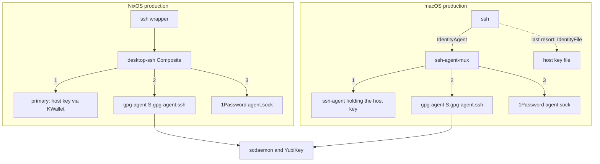

# GPG Agent SSH Support - Plan

## Goal Capsule

- **Objective:** On every production host, NixOS and macOS alike, the owner can log in over SSH with the YubiKey they already carry for signing, and with their 1Password SSH keys, without per-server configuration.
- **Means:** Enable SSH support in gpg-agent so the OpenPGP authentication subkey on the card serves as an SSH key (KTD1), extend `desktop-ssh` to an ordered list of fallback agents on NixOS (KTD2), and run `ssh-agent-mux` behind the host key on macOS (KTD3).
- **Product authority:** The owner settled the chain membership and order in this session (see Key Decisions). The Product Contract wins on behavior; the KTDs win on mechanism.
- **Execution profile:** One pull request containing U1 through U4.
- **Stop conditions:** Stop and report if gpg-agent cannot expose its SSH socket without also taking over `SSH_AUTH_SOCK` (R7), or if `ssh-agent-mux` cannot run as a launchd user agent on macOS.
- **Who finishes:** `ce-work` implements and verifies locally; the Darwin closure and `checks.aarch64-darwin` run in CI's `build-darwin` job; hardware checks with a real YubiKey and 1Password stay with the owner.
- **Open blockers:** None.

---

## Product Contract

Product Contract preservation: no scope change. The three questions deferred to planning are resolved in place by KTD1 through KTD3, and the ssh-agent-mux non-goal in Scope Boundaries now states the error and hang cases precisely.

### Summary

Production NixOS and macOS hosts offer SSH keys in one order: the host key, then the YubiKey authentication key through gpg-agent, then the 1Password keys. macOS gains the 1Password SSH agent, which it does not use today. A missing card or agent is skipped without breaking the rest of the chain.

### Problem Frame

Each of the three YubiKeys carries the same OpenPGP key, and that key already has an ed25519 authentication subkey (`0x1E305FCE7BE9F27D`). It is used only for Git signing and decryption. SSH logins rely on a per-host key and, on NixOS, the 1Password agent behind `desktop-ssh`. A Mac has only its host key file. A server that trusts the owner's YubiKey therefore cannot be reached from a Mac without copying keys around, and the card the owner always has on hand adds nothing to SSH.

### Key Decisions

- **The YubiKey joins the default chain on both platforms, and macOS also gains the 1Password agent.** Every production host then offers the same key sources. Governs R1, R3. (session-settled: user-directed — chosen over an opt-in gpg-agent socket that leaves the default chain unchanged, and over replacing the NixOS 1Password fallback with gpg-agent: the owner wants all three sources available by default on both platforms)
- **Order is host key, YubiKey, 1Password.** On a server that trusts both, the YubiKey is used instead of prompting for a 1Password unlock. Governs R2. (session-settled: user-directed — chosen over host key, 1Password, YubiKey, which would have kept every existing login path untouched)
- **gpg-agent is one member of the chain, not its owner.** The repository already guards against gpg-agent taking over `SSH_AUTH_SOCK`; the SSH config and `desktop-ssh` keep deciding which agents are asked and in what order. Governs R7.

### Requirements

**Key chain**

- R1. On production NixOS and macOS hosts, `ssh` offers the YubiKey OpenPGP authentication subkey through gpg-agent by default, with no per-server configuration.
- R2. Keys are offered in this order: the host key, then the YubiKey key, then the keys the 1Password agent exposes.
- R3. On macOS, the default chain includes the 1Password SSH agent's keys, chosen by the same vault and item rules as on NixOS (`config/1password/agent.toml`).
- R4. Bootstrap hosts keep their current SSH behavior.

**Failure behavior**

- R5. When the YubiKey is not inserted, or gpg-agent or the 1Password agent is unavailable, the chain skips that source without an error, prompt, or noticeable delay, and the remaining keys still authenticate.
- R6. Signing with the card for SSH uses the existing PIN path: `dotfiles-pinentry` supplies the stored per-card PIN and falls back to its dialog.

**Existing behavior preserved**

- R7. gpg-agent never replaces the `SSH_AUTH_SOCK` a session already has; the prezto guard in `home/h82/shell/shell.nix` and its coverage keep holding.
- R8. Git commit and tag signing with the YubiKey behaves as before.

**Documentation**

- R9. The docs describe the new chain on each platform and show how to print the YubiKey SSH public key (`gpg --export-ssh-key`) for registering on GitHub and servers.

### Acceptance Examples

- AE1. **Covers R5.** **Given** a production host with no YubiKey inserted, **when** the owner connects to a server that trusts a 1Password key, **then** the login succeeds with the 1Password key and no PIN dialog or card prompt appears.
- AE2. **Covers R1, R2, R6.** **Given** an inserted YubiKey and a server that trusts both the YubiKey key and a 1Password key, **when** the owner connects, **then** the YubiKey key authenticates and no 1Password unlock prompt appears.
- AE3. **Covers R3, R5.** **Given** a Mac whose 1Password app is not running, **when** the owner connects to a server that trusts the Mac host key, **then** the host key authenticates without waiting on the 1Password agent.
- AE4. **Covers R7.** **Given** a shell started with an existing `SSH_AUTH_SOCK`, **when** zsh initializes, **then** `SSH_AUTH_SOCK` is unchanged.

### Scope Boundaries

- Registering the YubiKey public key on GitHub or any server stays a manual step; R9 only documents it.
- Bootstrap hosts, new key generation, and retiring host keys are out of scope.
- Per-server `IdentitiesOnly` rules and mitigations for `MaxAuthTries` are deferred. The chain holds about four keys (host, YubiKey, two 1Password items), under the default limit of six; adding more 1Password items could trigger "Too many authentication failures".
- Considered and not built: per-upstream timeouts or error isolation inside `ssh-agent-mux` on macOS. A missing or stopped upstream is skipped (AE3). An upstream that errors drops the mux's whole listing, and the host key file still authenticates as the last resort; one that hangs, such as gpg-agent waiting on an open PIN dialog, stalls ssh until it answers. Both show at once on the next login and are faults rather than the unavailability R5 covers. Build isolation if either is seen in practice.
- Considered and not built: a `sshcontrol` file listing the card keygrip. gpg-agent offers the authentication key of an inserted card without one, and listing it would only make gpg-agent ask for a missing card.

### Dependencies / Assumptions

- The 1Password app's SSH agent must be enabled in its settings on the Mac; the repository installs the app (`modules/shared/darwin-apps.nix`) but cannot toggle that setting.
- All three cards hold the same authentication subkey, so one SSH public key covers every card. The docs state the cards share the OpenPGP key; the shared SSH public key follows from that and is unverified on hardware.
- A card touch policy, if set on the authentication slot, makes each YubiKey login require a touch. This plan does not change card policies.

### Sources / Research

- `home/h82/security/gpg.nix`: gpg-agent configuration without SSH support.
- `home/h82/security/ssh.nix`: per-platform `~/.ssh/config` and the `desktop-ssh` agent service with one `fallback_socket`.
- `scripts/desktop-ssh`: the `Composite` agent that lists the host key first, then one fallback agent's keys; each `ssh` invocation gets its own `Composite` through the `ssh` wrapper (`launch_ssh`).
- `home/h82/shell/shell.nix` and `tests/zsh-prezto.py`: the guard that keeps gpg-agent from claiming `SSH_AUTH_SOCK`.
- `tests/darwin-config.nix:472-474` asserts that the Darwin SSH config has no `IdentityAgent`; R3 changes that contract.
- Other checks that assert SSH config or `desktop-ssh` behavior: `tests/check_desktop_ssh_config.py`, `tests/desktop-ssh.nix`, `tests/desktop-ssh-integration.nix`, `tests/test_desktop_ssh.py`.
- `CONCEPTS.md` (Desktop SSH, Primary SSH key) and `docs/macos.md` (SSH key) describe the current chain.
- Before calling D-Bus or debugging a `desktop-ssh` signing refusal, read `.compound-engineering/artifacts/solutions/integration-issues/dbus-python-picks-last-kwalletd6-overload-agent-refuses-to-sign.md`.

---

## Planning Contract

### Key Technical Decisions

- KTD1. **On NixOS, turn on `services.gpg-agent.enableSshSupport` and force Home Manager's `sshAuthSock.enable` off; on macOS, add only `enable-ssh-support` to the agent configuration.** On NixOS, `enableSshSupport` writes `enable-ssh-support` and adds the `gpg-agent-ssh.socket` systemd unit that the socket-activated `gpg-agent --supervised` needs to serve SSH. The same option enables Home Manager's `sshAuthSock` module, which exports `SSH_AUTH_SOCK` from shell init and pushes it into systemd and D-Bus; forcing that module off keeps R7. On macOS, `enableSshSupport` would add a launchd `Ssh` socket that `--supervised` does not take (gnupg reads only systemd's `LISTEN_FDNAMES`) and set `RunAtLoad`, so a client-started agent serves SSH at `gpgconf --list-dirs agent-ssh-socket` instead, launched by the mux agent (KTD3). Governs R1, R7.
- KTD2. **On NixOS, `desktop-ssh` takes an ordered list of fallback agents: gpg-agent, then 1Password.** Each fallback is enumerated, timed out, and marked failed on its own, so one slow or broken agent drops only its own keys. gpg-agent gets a longer enumeration timeout than the current 0.3 seconds because the first listing after card insertion goes through scdaemon; 1Password keeps 0.3 seconds. `session-bind@openssh.com` is forwarded to every live fallback and succeeds when any accepts it. Pointing the single `fallback_socket` at an `ssh-agent-mux` instance was rejected: under the 0.3-second budget, a slow card read would drop the 1Password keys along with the YubiKey key. Implements the Key Decision order on R2 and R5. (session-settled: user-directed — chosen over host key, 1Password, YubiKey: on servers trusting both, use the YubiKey rather than prompting a 1Password unlock)
- KTD3. **On production macOS, run nixpkgs `ssh-agent-mux` (0.2.0) as a launchd user agent with three upstreams in order: a dedicated `ssh-agent` holding the host key, gpg-agent, then 1Password. Point `IdentityAgent` at the mux and keep `IdentityFile` on the host key.** OpenSSH's `pubkey_prepare` (`sshconnect2.c`) offers agent keys named by `IdentityFile` first, then other agent keys, and keys found only in a file last, so the host key must come from an agent to stay first; the file entry still works as the last resort when the mux is down. The mux launcher runs `gpgconf --launch gpg-agent` before starting, so gpg-agent's SSH socket exists from login. `ssh-agent-mux` skips an upstream whose socket cannot be connected and offers keys in upstream order; it implements no key-add request, so the host-key agent loads the key itself when it starts. Porting `desktop-ssh` was rejected because it depends on Linux-only pieces: `/run/user`, `prctl`, `SO_PEERCRED`, systemd, and KWallet. Governs R1, R2, R3, R5.
- KTD4. **Install `config/1password/agent.toml` on every host kind.** 1Password reads `~/.config/1Password/ssh/agent.toml` on macOS as well as Linux, so one file keeps key selection identical. Governs R3.
- KTD5. **Bootstrap hosts keep their SSH config branches.** gpg-agent's SSH socket exists on bootstrap hosts after KTD1, but nothing points at it, so their SSH behavior does not change. Governs R4.

### High-Level Technical Design

Numbers show the order in which keys reach the server. A missing YubiKey makes gpg-agent return no key; a missing agent socket is skipped. The dashed edge is used only when the mux offers nothing.

### Assumptions

- The owner chose the autonomous `lfg` route, so the plan-time scoping confirmation was skipped; these bets were not confirmed in chat.
- gpg-agent's SSH socket is `$XDG_RUNTIME_DIR/gnupg/S.gpg-agent.ssh` on NixOS and `~/.gnupg/S.gpg-agent.ssh` on macOS, the paths `gpgconf --list-dirs agent-ssh-socket` reports with the default `GNUPGHOME`. On macOS the client-started agent creates it; whether that agent coexists cleanly with Home Manager's existing launchd `gpg-agent` job is unverified on hardware.
- R5's "unavailable" means a missing socket, a stopped agent, or no card. An agent that accepts a connection and then hangs or returns a protocol error is a fault: on NixOS its own enumeration timeout (KTD2) bounds the delay, and on macOS it behaves as Scope Boundaries describes.
- The 1Password agent socket on macOS is `~/Library/Group Containers/2BUA8C4S2C.com.1password/t/agent.sock`.
- gpg-agent offers an inserted card's authentication key over SSH with no `sshcontrol` entry, and returns an empty list quickly when no card is present.
- `updatestartuptty` lines that Home Manager adds to zsh init with `enableSshSupport` only redirect pinentry and do not change `SSH_AUTH_SOCK`.
- The Mac host key at `config.my.secrets.sshKey` is an unencrypted file that `ssh-add` can load without a prompt.

### Open Questions

**Deferred to implementation**

- The gpg-agent enumeration timeout in `desktop-ssh`: start near two seconds and settle it against a real card read, since the value trades first-use reliability against delay when gpg-agent hangs.
- How `config.json` names the gpg-agent socket, which lives under the per-user runtime directory whose UID is known only at run time; resolve it at load time the way `primary_socket` is today.
- How the Mac host-key agent reloads the key after `host-secrets` replaces it on an apply: restart it from activation, or reload only when the key changed.

---

## Implementation Units

### U1. gpg-agent SSH support without SSH_AUTH_SOCK takeover

- **Goal:** gpg-agent serves the card authentication key on its SSH socket on every host, and no shell, systemd, or D-Bus environment gets `SSH_AUTH_SOCK` from it.
- **Requirements:** R1, R6, R7, R8; KTD1, KTD5.
- **Dependencies:** None.
- **Files:** `home/h82/security/gpg.nix`, `tests/darwin-config.nix`, `tests/check_desktop_ssh_config.py`, `tests/zsh-prezto.py` (unchanged unless the guard test needs the real config).
- **Approach:**
  1. On NixOS, set `enableSshSupport` in `services.gpg-agent` and `sshAuthSock.enable = lib.mkForce false` beside it, with a comment that `desktop-ssh` and `~/.ssh/config` own agent selection.
  2. On macOS, add `enable-ssh-support` to the agent configuration without `enableSshSupport` (KTD1).
  3. Keep `pinentry.package`, the cache settings, and `scdaemon.conf` unchanged, so SSH signing uses the same PIN path as Git signing.
- **Patterns to follow:** existing `services.gpg-agent` block; `lib.mkForce` use elsewhere in `home/h82/`.
- **Test scenarios:**
  - On a NixOS production fixture, the materialized `gpg-agent.conf` contains `enable-ssh-support` and `gpg-agent-ssh.socket` is installed.
  - On the same fixture, no `set-SSH_AUTH_SOCK` user service exists and the generated zsh init does not export `SSH_AUTH_SOCK`.
  - On a Darwin production fixture, the materialized `gpg-agent.conf` contains `enable-ssh-support`, the `gpg-agent` launchd agent keeps no `Ssh` socket and `RunAtLoad` stays false, and the zsh init does not export `SSH_AUTH_SOCK`.
  - Covers AE4. With the real generated zsh config, a shell started with an existing `SSH_AUTH_SOCK` keeps it (existing `tests/zsh-prezto.py` case keeps passing).
- **Verification:** The listed checks pass, and `pinentry.package` is still `dotfiles-pinentry`.

### U2. Ordered fallback agents in desktop-ssh

- **Goal:** On NixOS production, `desktop-ssh` offers the host key, then gpg-agent keys, then 1Password keys, and each fallback fails on its own.
- **Requirements:** R1, R2, R5; KTD2; AE1, AE2.
- **Dependencies:** U1.
- **Files:** `scripts/desktop-ssh`, `home/h82/security/ssh.nix`, `tests/test_desktop_ssh.py`, `tests/check_desktop_ssh_config.py`, `tests/desktop-ssh-integration.nix`.
- **Approach:**
  1. Replace `fallback_socket` with an ordered fallback list in `config.json`, each entry carrying its socket and enumeration timeout; `load_config` validates it and resolves runtime-directory paths.
  2. `Composite` keeps one `Transport` and one failed flag per fallback, appends identities in list order with the existing deduplication, and routes each sign request to the fallback that listed the key.
  3. Forward `session-bind@openssh.com` to every live fallback; reply success when any accepts.
  4. `ssh.nix` writes gpg-agent first and 1Password second.
- **Patterns to follow:** existing `Composite` and `Transport` handling, and the backend-stub harness in `tests/test_desktop_ssh.py`.
- **Test scenarios:**
  - Identities come back as primary, then the first fallback's keys, then the second's, with a key listed by both fallbacks appearing once at its first position.
  - A sign request for a key from the second fallback reaches only the second fallback.
  - Covers AE1. With the first fallback's socket missing, the second fallback's keys are listed and sign.
  - With the first fallback stalled past its timeout, the primary and the second fallback still list and sign.
  - A first fallback that answers within its own longer timeout but after 0.3 seconds still has its keys listed.
  - A malformed reply from one fallback drops only that fallback's keys.
  - `session-bind` succeeds when only one fallback accepts it and fails when none does; the binding and later sign requests share each fallback's connection.
  - The materialized `config.json` lists the gpg-agent socket before the 1Password socket.
- **Verification:** `tests/test_desktop_ssh.py`, the `desktop-ssh` check, and the desktop SSH integration test pass.

### U3. ssh-agent-mux and 1Password on production macOS

- **Goal:** A production Mac offers its host key first, then gpg-agent keys, then 1Password keys.
- **Requirements:** R1, R2, R3, R4, R5; KTD3, KTD4, KTD5; AE3.
- **Dependencies:** U1.
- **Files:** `home/h82/security/ssh.nix`, `tests/darwin-config.nix`, `tests/check_desktop_ssh_config.py`.
- **Approach:**
  1. Add a production-Darwin branch to the SSH config body: `IdentityFile` on the host key, then `IdentityAgent` on the mux socket. The bootstrap Darwin branch stays as it is.
  2. Declare a `launchd.agents` entry for a dedicated `ssh-agent` on a fixed socket that loads the host key with `ssh-add` when it starts.
  3. Declare a `launchd.agents` entry whose launcher runs `gpgconf --launch gpg-agent` and then `ssh-agent-mux` from nixpkgs with a store-path config listing the host-key agent socket, the gpg-agent socket, then the 1Password socket, and the listen path.
  4. Install `config/1password/agent.toml` for every host kind.
  5. Update the Darwin comment in `ssh.nix` that says no 1Password agent is set up.
- **Patterns to follow:** other `launchd.agents` entries in `home/h82/` and `modules/darwin/`; the production/bootstrap split already in `ssh.nix`.
- **Test scenarios:**
  - On a production Darwin fixture, `ssh -G` on the generated config reports the host key as the only `identityfile` and the mux socket as `identityagent`.
  - On a bootstrap Darwin fixture, the config still names only the host key and no `IdentityAgent`.
  - The production Darwin fixture enables an `ssh-agent-mux` launchd agent whose config lists the host-key agent socket, then the gpg-agent socket (`~/.gnupg/S.gpg-agent.ssh`), then the 1Password socket, and listens where `IdentityAgent` points.
  - The production Darwin fixture enables the host-key agent, whose socket matches the mux's first upstream and whose start loads `config.my.secrets.sshKey`.
  - Run with stub `gpgconf` and `ssh-agent-mux` on `PATH`, the mux launcher calls `gpgconf --launch gpg-agent` before it starts the mux.
  - The bootstrap Darwin fixture has neither the mux nor the host-key agent.
  - `~/.config/1Password/ssh/agent.toml` matches `config/1password/agent.toml` on both NixOS and Darwin fixtures.
- **Verification:** `checks.aarch64-darwin.darwin-config` and the Darwin build pass in CI (deferred from Linux); the Linux-evaluable Darwin config checks pass locally.

### U4. Documentation of the SSH key chain

- **Goal:** The docs describe the three-source chain on each platform and how to register the YubiKey SSH key.
- **Requirements:** R9.
- **Dependencies:** U2, U3.
- **Files:** `docs/macos.md`, `CONCEPTS.md`, `docs/recovery.md`.
- **Approach:**
  1. In `docs/macos.md` (SSH key), describe the order, the 1Password setting the owner must enable, and `gpg --export-ssh-key` for registration.
  2. In `CONCEPTS.md`, change the Primary SSH key entry from "the fallback agent" to the ordered fallback agents.
  3. Add the NixOS chain and the export command next to the desktop SSH material in `docs/recovery.md`.
- **Test expectation:** none -- documentation only; `agent-instructions` reads `CONCEPTS.md` and must still pass.
- **Verification:** `markdownlint-cli2` passes on changed files and the `agent-instructions` check passes.

---

## Verification Contract

| Gate | Command or job | Applies to |
| --- | --- | --- |
| Formatting | `nix fmt -- --ci` and `git diff --check` | all units |
| Markdown | `markdownlint-cli2` on changed Markdown | U4 |
| desktop-ssh unit tests | `nix build --no-link .#checks.x86_64-linux.desktop-ssh` | U2 |
| Shell guard | `nix build --no-link .#checks.x86_64-linux.zsh-prezto` | U1 |
| Instructions | `nix build --no-link .#checks.x86_64-linux.agent-instructions` | U4 |
| Darwin config | `checks.aarch64-darwin.darwin-config`, Darwin build in CI `build-darwin` | U1, U3 |
| Full | `nix flake check`, VM checks, host builds with the `full-ci` label | before ready |

Hardware checks with a real YubiKey, 1Password, and a test server (AE1 through AE3) are reported separately and stay with the owner.

---

## Definition of Done

- U1 through U4 are implemented and their test scenarios exist and pass.
- Every gate in the Verification Contract that this builder can run has passed; Darwin-only evidence is recorded as deferred to CI, not as passed.
- No experimental or abandoned code from rejected approaches remains in the diff.
- The PR body lists the hardware checks left to the owner.
