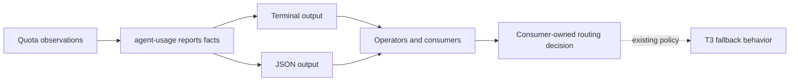
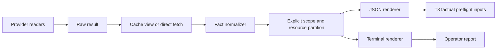
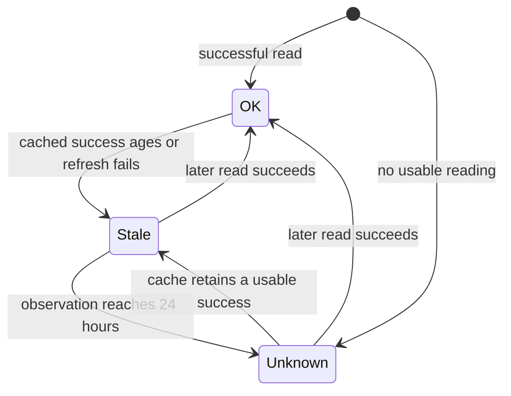

# Agent Usage Quota Facts - Plan

## Goal Capsule

- **Objective:** Operators and repository consumers can make their own routing decisions from `agent-usage` because it reports quota observations without recommending an action.
- **Means:** Normalize cached observations into a fact-only report and align T3's documented consumer contract (KTD1, KTD2, KTD3, KTD4).
- **Product authority:** [Issue #271](https://github.com/hyperlapse122/dotfiles/issues/271), confirmed without expanding the follow-up into T3 fallback-policy changes.
- **Execution:** `code`, delivered as one pull request.
- **Stop conditions:** Stop if implementation requires a Product Contract change, cannot preserve T3's factual inputs, or cannot produce the required command-boundary and rendered-instruction evidence.
- **Completion:** `lfg` implements, simplifies, reviews, ships, and watches the change through CI.
- **Open blockers:** None.

---

## Product Contract

### Summary

`agent-usage` will report quota observations in both terminal and JSON output without turning them into routing advice.
Repository consumers will retain responsibility for interpreting those observations, with T3 keeping its existing fallback policy.

### Problem Frame

Combining quota observations with low-balance warnings and skip recommendations obscures the boundary between evidence and policy.
Consumers need the same measured facts whether a balance is low, exhausted, stale, or unavailable so they can apply their own routing rules consistently.

### Key Decisions

- **Separate observation from routing policy.** `agent-usage` owns factual reporting while each consumer owns any resulting action. Governs R1, R2, R3, R4, R5, R6.

### Actors

- A1. An operator reads terminal output to inspect quota state without receiving a routing verdict.
- A2. `agent-usage` reports measured quota observations and their freshness through terminal and JSON interfaces.
- A3. Repository consumers, including T3, interpret the reported observations under their own policies.

### Requirements

**Quota reporting**

- R1. Terminal and JSON output must identify each limit's account, model, or resource scope, its used or remaining amount, its reset or replenishment time, and the observation time.
- R2. A measured low balance and a measured zero balance must use the same factual reporting structure, with neither result advising whether to send a request.
- R3. Stale and unavailable readings must be distinguishable from a measured zero rather than being presented as current exhaustion.

**Policy separation**

- R4. `agent-usage` must contain no low-balance thresholds, pace calculations or warnings, scores, or provider/model skip recommendations in either its behavior or its output.
- R5. T3 must continue making its own routing decisions from fresh, applicable quota windows without changing its existing fallback policy.

**Repository alignment**

- R6. Repository consumers, documentation, and tests must stop depending on removed policy fields and describe or verify the fact-only reporting contract instead.

### Key Flows

- F1. Report quota facts
  - **Trigger:** A1 or A3 invokes `agent-usage` in terminal or JSON mode.
  - **Actors:** A1, A2, A3.
  - **Steps:** A2 gathers quota observations, represents their amounts, timing, scope, and freshness, then emits the requested report.
  - **Outcome:** A1 receives facts without advice, and A3 retains responsibility for any routing decision.
  - **Covers:** R1, R2, R3, R4, R5.

### Acceptance Examples

- AE1. Low measured balance
  - **Given:** A quota window has 5% remaining and a known reset time.
  - **When:** A1 requests terminal or JSON output.
  - **Then:** The report shows 5% remaining, the reset time, and the observation time without a warning or request recommendation.
  - **Covers:** R1, R2, R4.

- AE2. Measured exhaustion
  - **Given:** The same kind of quota window has 0% remaining and a known reset time.
  - **When:** A1 requests terminal or JSON output.
  - **Then:** The report uses the same factual structure as AE1 and shows 0% remaining without a skip recommendation.
  - **Covers:** R1, R2, R4.

- AE3. Stale observation
  - **Given:** A previously measured value is older than its applicable freshness window.
  - **When:** A1 requests terminal or JSON output.
  - **Then:** The report marks the reading stale and preserves its observation time instead of treating it as a fresh zero.
  - **Covers:** R1, R3.

- AE4. Unavailable observation
  - **Given:** No usable quota reading is available.
  - **When:** A1 requests terminal or JSON output.
  - **Then:** The report identifies the reading as unavailable rather than as a measured zero.
  - **Covers:** R1, R3.

- AE5. Consumer-owned fallback
  - **Given:** T3 receives fresh, applicable quota observations.
  - **When:** T3 evaluates its native route.
  - **Then:** T3 applies its existing routing and fallback policy without delegating that decision to `agent-usage`.
  - **Covers:** R4, R5.

### Scope Boundaries

- Changes to T3's existing fallback policy are outside this work (R5).
- Hiding the policy behavior barred by R4 only from display is outside this work.
- Treating stale or unavailable observations as measured exhaustion is outside this work (R3).

### Sources / Research

- [Issue #271: Limit agent-usage to reporting quota facts](https://github.com/hyperlapse122/dotfiles/issues/271) defines the requested behavior and repository-alignment scope.
- [Issue #265: Check native harness quota before delegating a model call](https://github.com/hyperlapse122/dotfiles/issues/265) and [PR #270: feat(home): check quota before native delegation](https://github.com/hyperlapse122/dotfiles/pull/270) establish the T3 preflight behavior this work preserves.

---

## Planning Contract

**Product Contract preservation:** unchanged.

### Key Technical Decisions

- KTD1. **Normalize facts after acquisition and caching.** Replace `judge()` with a pure reporting transformation that deep-copies each result, adds scope, and partitions auxiliary resources without rewriting measurements. This covers fresh, cached, stale, unavailable, and lock-fallback results while leaving the stored cache format unchanged. Governs R1, R2, R3, R4.

- KTD2. **Keep a small factual schema.** Preserve provider `status`, `fetchedAt`, optional `accountHash` and safe `reason`, `windows`, and `resources`. Preserve each entry's label, amounts, optional `model` or `resource`, source timing fields, and `durationMins`; add `scope` with the values `account`, `model`, or `resource`. Remove root aggregate amounts and every pace, floor, skip, score, and historical-rewrite field rather than retaining compatibility aliases. Governs R1, R2, R3, R4, R5, R6.

- KTD3. **Render the same facts by status.** JSON retains its epoch timestamps and existing optional-field representation. Terminal provider headers carry status, entry lines carry explicit scope and amounts, `ok` and `stale` reports show the observation instant in UTC, and `unknown` reports state that observation is unavailable. Missing source timing renders as `unknown`; stale entries retain their original measurements and timing even after expiry. Governs R1, R2, R3, R4.

- KTD4. **Change only T3's references to removed reporter outputs.** The shared template and routing guide keep the existing fresh-zero preflight decision and every fallback rule, but stop naming `skip`, `skipModels`, and pace warnings as reporter outputs. Update the T3 receipt in the same change. Governs R5, R6.

### High-Level Technical Design

The acquisition and freshness states already exist. The new work begins at normalization and does not alter these transitions or their cache records.

### Assumptions

- Terminal and JSON require semantic parity rather than identical serialization: UTC terminal text and JSON epoch timestamps may represent the same facts differently.

### System-Wide Impact

The command is both an operator interface and an agent input. The change deliberately breaks the JSON policy-field contract while preserving the factual window and resource fields T3 reads; no package, cache-file, credential, or executable T3 routing-policy change is required.

### Risks & Dependencies

- Combining account, model, and auxiliary-resource scopes could make search exhaustion look like inference exhaustion. Use divergent fixtures and explicit scope assertions, following `.compound-engineering/artifacts/solutions/best-practices/converged-fixture-state-defeats-nix-check-mutation-testing.md`.
- Output-absence assertions can stay green after the wrong change. Require targeted mutation rounds for policy fields, stale nulling, missing observation or scope, and resource movement, following `.compound-engineering/artifacts/solutions/best-practices/mutation-testing-reveals-decorative-nix-check-assertions.md`.
- Source or help-text checks cannot prove the CLI contract. Keep the existing command-boundary tests as the primary owner, following `.compound-engineering/artifacts/solutions/best-practices/help-text-check-passes-while-cli-routes-to-wrong-host.md`.

---

## Implementation Units

### U1. Report only quota facts

- **Goal:** Replace routing judgments with one factual report shared by terminal and JSON output.
- **Requirements:** R1, R2, R3, R4; F1; AE1, AE2, AE3, AE4; KTD1, KTD2, KTD3.
- **Dependencies:** None.
- **Files:** `scripts/agent-usage`, `tests/test_agent_usage.py`.
- **Approach:**
  1. Replace the policy transformation with the post-cache normalizer in KTD1 and the factual schema in KTD2.
  2. Apply KTD3 to both renderers without changing provider acquisition, cache records, refresh behavior, account isolation, credential redaction, or the Claude SDK helper.
  3. Rewrite policy-oriented tests at the existing command boundary and retain reader, cache, and failure-isolation coverage with fact-only expectations.
- **Execution note:** Change the implementation and its contract tests together, then run focused mutation rounds for each new negative or state-preservation assertion.
- **Patterns to follow:** Use the existing `invoke()` helper, offline PATH stubs, local HTTP fixture, isolated `HOME`, and real Claude SDK no-prompt test in `tests/test_agent_usage.py`; use exact parsed key sets and terminal assertions rather than source greps.
- **Test scenarios:**
  - **Covers AE1, AE2.** For otherwise identical account windows with 95%/5% and 100%/0% used/remaining, require identical complete key sets and terminal structure, exact amounts, reset and observation instants, and no policy keys or advice in either mode.
  - Assert Codex account entries use `scope: account`, Claude `Fable` uses `scope: model` with `model: Fable`, and Synthetic search uses `scope: resource` with `resource: search` under `resources`.
  - Assert terminal output includes explicit entry scope, used and remaining amounts, and the UTC instant matching JSON `fetchedAt`.
  - For an entry without reset or regeneration data, assert terminal timing is `unknown` and JSON retains its existing absent or null representation.
  - Keep `codex-spark` at zero beside nonzero account windows; assert only its model-scoped entry is zero and no root aggregate or skip map exists.
  - Set Synthetic search to zero while inference windows remain nonzero; assert the resource remains outside inference `windows`.
  - **Covers AE3.** Cache a zero window with an expired reset, fail refresh, and require `status: stale`, the original amounts, reset, and observation time, with no null amount or `historicalRemainingPercent`; repeat with a nonzero stale amount.
  - Return a fresh zero with an expired reset and require the reporter to preserve status, amount, and timing without judging applicability.
  - **Covers AE4.** Fail a provider with no usable cache and require `status: unknown`, empty `windows` and `resources`, no measured amounts, and terminal `observation=unavailable`; retain the 24-hour expiry path.
  - Preserve fresh/concurrent fetch sharing, refresh and stale fallback, account-change isolation, killed-fetch lock release, provider failure isolation, credential non-disclosure, and real Claude SDK no-prompt behavior.
  - Reintroduce a skip or floor field, pace text, stale nulling, missing scope or observation, and moved search quota as separate mutations; require the corresponding scenario to fail for its own reason.
- **Verification:** Every scenario passes through the real CLI or existing SDK boundary, and no policy calculation or rendering remains in the production script.

### U2. Align T3 and its documentation

- **Goal:** Remove stale consumer references while preserving T3's independent routing behavior.
- **Requirements:** R5, R6; AE5; KTD4.
- **Dependencies:** U1.
- **Files:** `home/h82/agents/instructions/instructions.md.tmpl`, `docs/agent-routing.md`, `tests/agent-instructions.py`.
- **Approach:**
  1. Update the aligned T3 preflight paragraphs under KTD4 without changing route-failure evidence, fallback order, or no-retry rules.
  2. Regenerate the affected T3 receipt while leaving non-T3 receipts unchanged.
- **Patterns to follow:** Keep the template and `docs/agent-routing.md` synchronized in the same change and use the existing materialized-instruction check rather than adding a new text-test seam.
- **Test scenarios:**
  - The rendered T3 instructions no longer name `skip`, `skipModels`, or pace warnings as reporter outputs.
  - Fresh, applicable, unexpired zero remains the only quota observation that permits T3 to skip the native model call.
  - A fresh 5% balance, stale or unknown data, failed lookup, expired zero, non-inference resource, and uncertain account/model scope all leave the native route eligible in the preserved text.
  - Fallback order, actual-call failure handling, and retry restrictions are unchanged by diff.
  - Only the T3 instruction receipt changes; other rendered receipts remain stable.
  - **Covers AE5.** The delivered instructions retain the consumer-side routing decision without adding a live delegation test or claiming live model behavior.
- **Verification:** The existing rendered-instruction check accepts the new receipt and the two aligned documents express the same decision table.

---

## Verification Contract

| Command | Coverage | Done signal |
| --- | --- | --- |
| `nix build --no-link .#checks.x86_64-linux.agent-usage` | U1; terminal, JSON, cache, reader, redaction, and SDK behavior | All command-boundary and real-helper scenarios pass. |
| `nix build --no-link .#checks.x86_64-linux.agent-instructions` | U2; materialized T3 instructions and receipts | The updated T3 receipt and unchanged other receipts pass. |
| `markdownlint-cli2 <changed-markdown-files>` | Changed plan and routing documentation | No Markdown findings. |
| `git diff --check` | Complete change | No whitespace errors. |
| `nix fmt -- --ci` | Repository formatting gate | Formatting check passes without edits. |

Before the pull request is marked ready, the project's `full-ci` evidence rule applies: `host-checks`, `vm-checks`, `build`, and `build-darwin` must succeed on the current head. Hardware verification is not applicable to this offline CLI and documentation change. Live provider behavior and live T3 route selection are not claimed from repository checks.

---

## Definition of Done

- U1 and U2 satisfy their scenarios and verification outcomes.
- Terminal and JSON expose factual scope, amounts, timing, observation state, and freshness without policy recommendations or removed policy fields.
- Stale observations retain their measured values, unavailable observations do not become zeros, and auxiliary resources remain distinct from inference windows.
- T3's existing routing and fallback policy remains intact in behavior-preserving instruction text, with documentation and receipts aligned.
- Existing cache, account-isolation, locking, credential-redaction, and Claude no-prompt safeguards remain covered and passing.
- Targeted mutation rounds prove the new contract assertions can fail for their intended reasons.
- Abandoned-attempt code, compatibility aliases for removed policy fields, and temporary debugging output are absent from the final diff.
- Required local checks pass, and the required CI evidence is green on the pull request's current head before readiness is declared.
