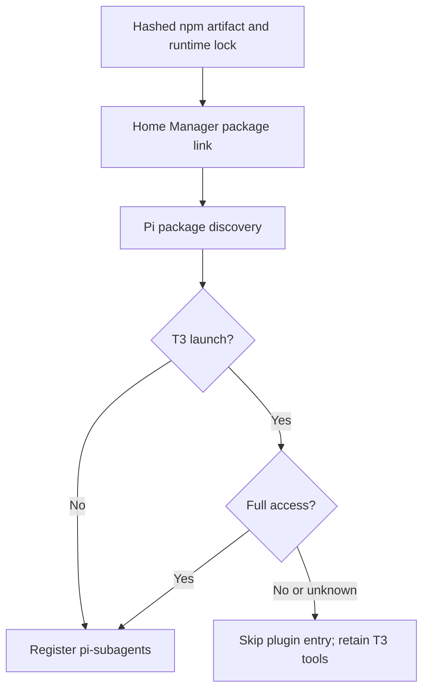

# Managed Pi Subagents - Plan

## Goal Capsule

- **Objective:** Delegate to a built-in Pi subagent from a fresh terminal Pi or an eligible T3 Pi session without installing anything by hand.
- **Means:** Register a pinned local Pi package from the shared Home Manager profile (KTD1).
- **Authority:** The Product Contract and repository instructions govern the implementation. T3 approvals remain unchanged.
- **Execution:** One PR. The implementer verifies and ships it without switching a live host or merging the PR.
- **Stop condition:** Do not ship a package that cannot run an in-process child on the packaged Pi or that makes native children reachable in restricted T3 sessions.

## Product Contract

### Summary

Add `pi-subagents` to the shared Pi configuration on NixOS and macOS. Keep T3's managed delegation available alongside the native plugin in full-access sessions.

### Problem Frame

Terminal Pi has no configured native subagent tool. T3 can create separate tasks, but that route is not the same as having a focused foreground Pi child in the current session.

### Requirements

**Installation**

- R1. Fresh managed terminal Pi and eligible T3 Pi sessions load the same pinned `pi-subagents` release without a manual install or a startup download.
- R2. Activation preserves unrelated Pi settings, packages, and the current Compound Engineering registration.

**Delegation**

- R3. New sessions that load the plugin can launch a built-in foreground child and return its result.
- R4. Positively identified full-access T3 Pi sessions expose the upstream plugin's launch paths. Restricted and indeterminate T3 sessions do not load the managed plugin. T3's approval policy and managed `delegate_task` routing remain unchanged.

### Key Decision

- Share the installation across terminal Pi and full-access T3 Pi (session-settled: user-directed — chosen over terminal-only installation or a one-off trial). Governs R1, R3, and R4.
- Keep upstream launch and child trust behavior (session-settled: user-approved). Full-access sessions expose the plugin's own background and other launch paths rather than enforcing T3 routing inside the plugin. The plugin can reuse a trusted parent's decision in a child working in another directory. Leave Pi's own trust configuration and saved decisions unchanged.

### Scope Boundaries

No custom agents, default models, effort settings, or automatic delegation rules. No migration of existing sessions' recorded tool selections or changes to T3's permission policy. Plugin-managed runs are not T3-managed tasks.

## Planning Contract

### Key Technical Decisions

- KTD1. **Package the published npm artifact and its runtime dependency closure.** The [published 0.89.1 package](https://registry.npmjs.org/pi-subagents/0.89.1) includes a compiled entry that differs from the Git source entry. Pin its integrity and lock the runtime dependencies, including `jsbi`, without installing host-supplied Pi peers. Retain the published layout so the extension can find built-in agents and runner assets. [Pi's package docs](https://github.com/earendil-works/pi/blob/v1.5.2/packages/coding-agent/docs/packages.md) explain why Pi loads such a local package without resolving its dependencies.
- KTD2. **Use one stable Home Manager path as the package source.** Pi identifies local packages by path. Pointing settings at the Home Manager link rather than a changing store path avoids stale managed entries across upgrades. Extend the existing settings merge and preserve Compound Engineering's registration.
- KTD3. **Gate plugin registration at entry.** T3 0.1.9 [exports launch mode](https://github.com/pingdotgg/t3code/blob/v0.1.9/packages/provider-pi/src/server/mcpInjection.ts) and [enforces approvals in a parent-session extension](https://github.com/pingdotgg/t3code/blob/v0.1.9/packages/provider-pi/src/server/mcpExtensionSource.ts). The plugin's [foreground child does not load ambient parent extensions](https://github.com/nicobailon/pi-subagents/blob/v0.89.1/docs/agents.md#tool-and-extension-selection), so approving the parent call is not equivalent to approving child actions. Load the managed entry in terminal Pi and positively identified full-access T3 Pi, not in restricted or indeterminate T3 launches. Excluding only a model-facing tool would leave plugin command entry points. Full-access sessions expose upstream commands without changing the repository's instructions for T3-managed delegation.

### High-Level Technical Design

### Implementation Unknown

The release declares Pi 1.2 or newer and the Linux flake's Node 22.23.5 meets the dependency floor. Only a real in-process child can establish compatibility between the bundled Pi parent and the SDK that the extension imports; do not infer it from version or command discovery alone.

## Implementation Units

### U1. Build and register the local package

- **Goal:** Make Pi discover a single managed package without pulling dependencies at activation or startup.
- **Requirements:** R1, R2. Decisions KTD1 and KTD2.
- **Dependencies:** None.
- **Files:** `packages/pi-subagents.nix`, the runtime lock under `packages/`, `home/h82/agents/pi.nix`, `scripts/pi-state`, `tests/pi-settings.py`, `tests/pi.nix`.
- **Approach:** Use `packages/npm-release-package.nix` for the release tarball and lock. Update this pin deliberately, not through the scheduled updater. Link the complete package into Home Manager and register that stable local directory in the existing atomic settings update.
- **Test scenarios:** Run the materialized settings reconciliation against a scratch home with an existing `npm:pi-subagents` registration and an unrelated object-form package. Reconcile twice and verify the original npm registration no longer loads a second copy, the one managed link resolves to the package, and the unrelated entry and Compound Engineering remain. Leave the old installation files and state intact.
- **Verification:** The Pi check exercises activation settings and packaged resources against a scratch home.

### U2. Prove foreground delegation and protect restricted T3 sessions

- **Goal:** Keep the plugin usable in eligible sessions while preserving T3 approvals.
- **Requirements:** R1, R3, R4. Decision KTD3.
- **Dependencies:** U1.
- **Files:** `packages/pi-subagents.nix`, the guarded Pi entry under `packages/`, `tests/pi-subagents.py`, `tests/pi.nix`, `docs/agent-routing.md`.
- **Approach:** T3 launches Pi in RPC mode, including discovery probes. RPC launches need both T3's extension-path marker and exact `full-access` mode. Expose upstream resources through the guarded entry rather than independently in the manifest. Leave T3 routing instructions untouched and document the plugin's distinct lifecycle.
- **Execution note:** Use the actual packaged Pi and plugin. A mocked child factory would miss differences between the bundled parent and unbundled SDK.
- **Test scenarios:** In terminal-like and full-access T3-like launches, register the extension and complete a foreground `delegate` run with a fake provider that returns a marker. In a restricted T3-like launch, the same managed package must not register its commands or provide an alternate native launch path. Keep the RPC result distinct from a live T3 desktop result.
- **Verification:** A scratch Pi session returns the fake child's result without provider credentials or public network requests. Restricted-mode launch verification observes absence of the plugin registration rather than matching the guard's source text.

## Verification Contract

- Build `.#checks.x86_64-linux.pi` locally. `.#checks.aarch64-darwin.darwin-outputs` runs the same Pi check for Darwin entries; report that evidence separately.
- Run the repository's applicable pre-push and PR checks. Describe live signed-in T3 or host verification as unverified unless observed.

## Definition of Done

Both units pass their verification, the managed plugin is absent in restricted and indeterminate T3 sessions, and the diff contains no temporary experiments. The PR records local checks and any evidence deferred to CI or the host owner.
