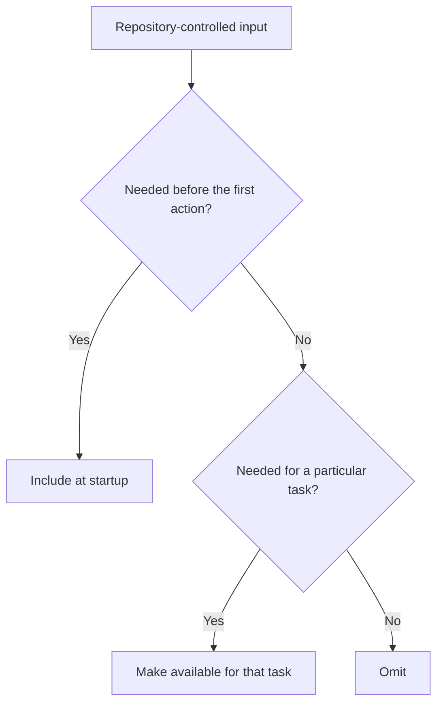

# Reduce Default Agent Context - Plan

## Goal Capsule

- **Objective.** A fresh coding session starts with fewer tokens of repository-controlled input.
- **Product authority.** The owner chose to include skill and tool discovery and permits changes to existing behavior.
- **Means.** Short startup instructions direct the agent to task-specific reading (KTD1).
- **Delivery.** One child PR targeting the branch of PR #283. The owner retains merge authority.
- **Open blockers.** None.

---

## Product Contract

### Summary

Keep the instructions an agent needs before its first action. Let the task bring in specialized guidance when it becomes relevant. Apply the same judgment to the skill descriptions and tool definitions the model sees at startup.

### Problem Frame

A request to explain one file in a T3 session currently receives full delegation and PR-watching procedures. Shared skill descriptions and tool definitions can also occupy the opening request even when the task needs none of them.

### Requirements

**What a fresh session receives**

- R1. Cover repository-controlled first-turn input for Claude Code, Codex, Pi, and OpenCode, both in the CLI and through T3 Code. Include project instructions, user instructions, launch additions, and automatically exposed skills and tools.
- R2. Keep rules that must govern the first action immediately available, including the owner's authorization boundary for a live host switch.
- R3. Deliver retained task-specific guidance when the task calls for it and before the action it governs.
- R4. Remove instructions that add no needed behavior beyond the harness defaults. Assess whether each skill or tool needs an entry in the default list.

**What counts as a reduction**

- R5. Compare fresh sessions before and after the change using the same harness, launch mode, project, and opening request. Report CLI and T3 results separately for each harness.
- R6. Use observed first-input token counts where available. Where they are unavailable, label instruction bytes and counts of initially exposed skills and tools as proxies, with the before and after values for each.
- R7. Count savings only when content leaves the initial input or occupies less of it. Content that a session still loads automatically counts even if its source file moved.

### Key Decisions

- Cover the full repository-controlled input in R1 (session-settled: user-directed — chosen over editing instruction files alone: the goal includes the cost of discovering skills and tools).
- Allow behavior to change under R3 and R4 (session-settled: user-directed — chosen over preserving every existing workflow: the owner prioritizes a smaller initial input). A rarely used skill may lose automatic selection.

### Acceptance Examples

- AE1. **Covers R2 and R3.** A T3 session explaining a file can do so without receiving the PR-watch procedure. If the user later asks it to watch a PR, the relevant guidance is available before it starts the watch. The live-host authorization rule already applies in the opening turn.
- AE2. **Covers R5 and R7.** If a shorter instruction file imports all the removed text before the model answers, the comparison includes the imported text. The shorter file alone shows no saving.
- AE3. **Covers R5 and R6.** If a harness exposes its initial skill list but no input-token count, report the change in visible entries alongside instruction bytes and tool counts. The size of a skill body opened after the first request contributes no startup saving.

### Scope Boundaries

The target is the input this repository can change. Provider-supplied text and tool definitions the repository cannot configure are outside its control. Conversation history, later tool results, model selection, and reasoning effort are separate costs.

### Sources

- The earlier Codex incident documents a 32,768-byte instruction-loading budget. It provides a historical baseline for that path. [Codex instruction budget plan](2026-11-18-1446-fix-codex-instruction-budget-plan.md)
- The routing reference describes CLI and T3 delivery and gives a local example of seven mobile references behind a single skill entry. [Agent routing](../../../docs/agent-routing.md)
- The two prompting guides inform which requirements merit a standing instruction and which belong to a particular task or observed failure. [Prompting GPT-6.2 in Codex](https://learn.chatgpt.com/guides/prompting-gpt-6-2-astra) · [Prompting Claude Opus 5.5](https://platform.claude.com/docs/en/build-with-claude/prompt-engineering/prompting-claude-opus-5-5)

## Planning Contract

### Key Technical Decisions

- KTD1. Keep the current template, native delivery paths and T3 launch composer. Put a short imperative trigger and readable path in each relevant render. Install user-scope guides under the same stable home-relative directory on each host. Use project-relative Markdown links for dotfiles-only rules. Avoid automatic import syntax for deferred content.
- KTD2. Combine the local UX flow guide with the existing design skill as an ordinary reference. Shorten the descriptions of local skills and Pi tools while retaining the distinctions needed to select them. Leave unrelated user skills, exported Xcode content, CE plugin discovery and provider-native tools under their existing owners. (session-settled: user-directed — chosen over prose-only optimization: skill and tool discovery are in scope.)
- KTD3. Retire redundant procedure and allow a former standalone skill to lose automatic selection (session-settled: user-directed — chosen over full behavior parity: lower startup input takes priority). Retain the owner's host, secret, external-review and destructive-action boundaries. If a required guide cannot be read, pause the affected action and report the missing path.
- KTD4. Compare matched launches against the parent PR head. Collect comparable first-request usage where the harness exposes it in an isolated session. Otherwise measure the rendered instruction bytes and visible skill/tool entries as separate proxies. Label materialized configuration and unavailable live observations explicitly.

## Implementation Units

### U1. Shorten project startup instructions

- **Requirements.** R1–R4. Keep first-action authorization, project-wide conventions, and pointers in `AGENTS.md`; move detailed build, review and maintenance procedures into a project guide. Preserve the existing `CLAUDE.md` import and project-relative links.
- **Evidence.** Read the opening rules and follow the shipping trigger through the guide to find the existing push and full-CI obligations.

### U2. Defer personal and T3 procedures

- **Requirements.** R1–R4. Shorten `home/h82/agents/instructions/instructions.md.tmpl`. Install task guides through its Home Manager module. Select the appropriate host and harness guidance without relying on the dotfiles checkout. Keep exact OpenCode recipient binding, external-review authorization and the data limit for decide calls in startup text. An unknown backend can receive only information authorized to leave the machine. Update `docs/agent-routing.md`, materialized instruction tests and receipts together.
- **Evidence.** Exercise native and T3 renders, locate the installed guide from a scratch home, and check that a T3 PR watch can reach its procedure before arming. Run the check against a missing guide and a leaked deferred passage during development.

### U3. Reduce discovery metadata

- **Requirements.** R1, R3, R4. Update the design skill package, local flow reference, four skill roots, and pinned-skill checks together. Keep the flow reference discoverable for CLI prompts and notifications as well as screens. Review the repository-managed skill and tool inventory. Trim owned descriptions while retaining tool input constraints, cancellation semantics and any egress disclosures. Keep publicly visible tool names and input schemas stable.
- **Evidence.** Check that the design skill can reach the flow reference, the old managed standalone entry disappears, and the packaged Pi tools still expose their original calls. Account separately for other sources that might still expose a skill with the old name.

### U4. Compare opening inputs

- **Requirements.** R5–R7. Compare U1–U3 with the parent revision in isolated homes using the same host, harness version, launch settings, project and opening request. Include automatically imported text. Produce one row for each CLI and T3 route in the PR and identify the source of each number. Materialize both revisions and rebase T3 launch paths into private fixtures. Substitute fake credential paths in the Pi wrapper as in tests/pi-ollama.py. Use synthetic fixtures without personal credentials, remove temporary captures and publish only aggregate counts and methods. Include visible metadata bytes where available to capture shorter descriptions with unchanged entry counts. Do not switch the live host to gather measurements.
- **Evidence.** Separate repository-controlled changes from constant vendor or user material. Distinguish an unobservable skill/tool count from a measured zero.

## Verification Contract

Run the instruction delivery, skill discovery and Pi checks that consume the changed outputs, plus the repository's pre-push checks. Use the native Darwin builder for Darwin outputs and the project's full CI for Linux checks, VM tests and closure builds. Report physical or signed-in session behavior separately. Keep the comparison in the child PR so a reviewer can distinguish the effect of this work from #283.

## Definition of Done

The PR targets the parent branch and reports the R5–R7 comparison for each launch route. First-action protections remain readable, the retained procedures can be reached when triggered, and CI evidence covers the current head.
