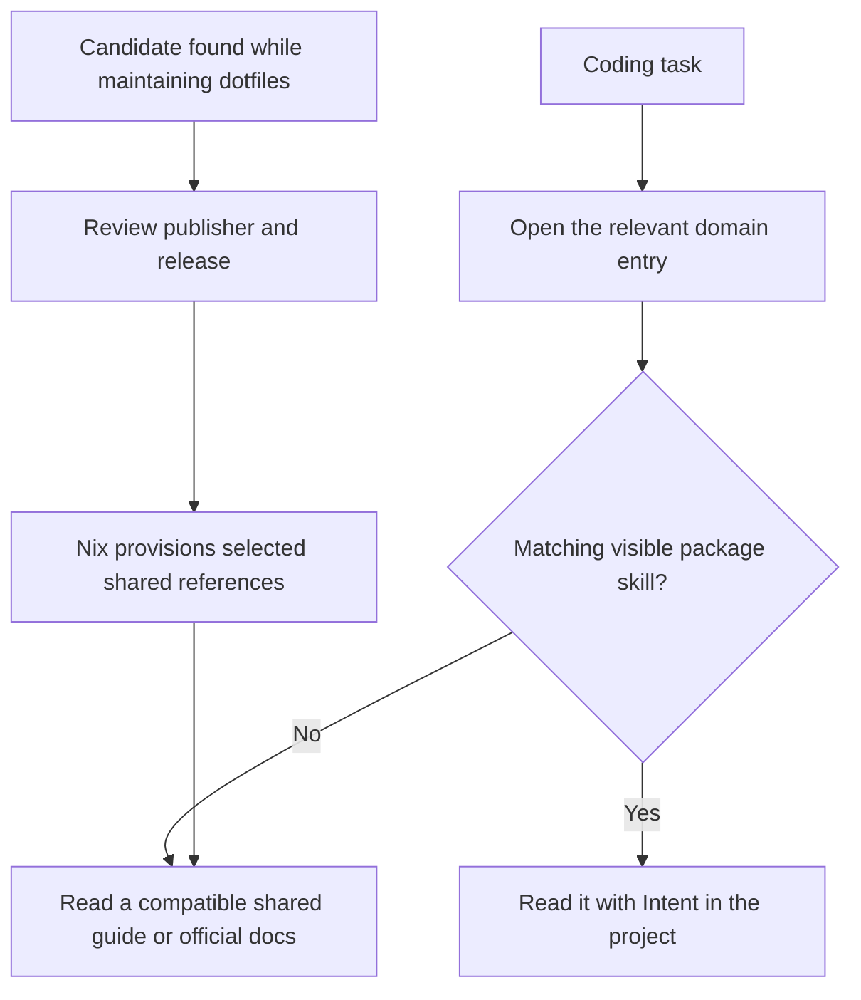

# Project-aware Agent Skills and Lean Instructions - Plan

## Goal Capsule

- **Objective.** On either development machine, a coding agent can find guidance for the software in front of it while starting with fewer instructions and skill descriptions.
- **Product authority.** The owner selected Nix-managed installation, task-time local reads through domain entries and TanStack Intent, and delegation through CE and harness defaults.
- **Open blockers.** None.
- **Delivery.** One implementation PR, verified locally and in CI, with merge authority retained by the owner.

## Product Contract

### Summary

Use the dotfiles checkout to discover useful official skills for the owner's projects. Nix provisions the shared collection on macOS and NixOS. During a coding task, the agent opens a domain entry and reads the relevant installed guide. For Intent-compatible packages, it can read the guide that came with the project's dependency. Remove the personal model ladder and the delegation routing rules that support it.

### Requirements

**Finding and installing shared skills**

- R1. Use skills.sh and Vercel's `find-skills` only to discover candidates during maintenance of this dotfiles repository. The search ends with the candidate's publisher, source and applicable task.
- R2. Nix owns installation, updates and removal of shared skills. One dotfiles revision identifies the same source content on both machines. The discovery workflow must never hand off to `skills add`, `skills update` or another installer.
- R3. Evaluate the official candidates from the 23-project survey and include every compatible candidate with a demonstrated use. Credit the publisher for its actual product, check release compatibility, and reuse existing coverage. Record a reason for each conditional or skipped candidate.

**Using installed guidance**

- R4. Claude Code, Codex, Pi and OpenCode, in standalone and T3 sessions, expose shared skills by domain. A task that needs a particular guide can find it by purpose or name through the domain entry. Grouped references do not each occupy a startup listing.
- R5. On a task involving an Intent-compatible package, use the Nix-provided TanStack Intent CLI to discover locally visible skills and load the relevant one from the working project's dependency. This applies to any compatible publisher, including tRPC. Respect the project's package visibility and working-directory context.
- R6. If the package is absent, a skill is unavailable or its version is unsuitable, use a compatible Nix-managed reference or official documentation for the relevant release. A lookup must not install dependencies, fetch a replacement skill, or generate project instructions or hooks.
- R7. Keep project-owned instructions, product runtime skills, native CE plugins and Xcode-exported material in their existing scopes. Integrate existing local and adapted skills into the collection where the adaptation provides needed behavior.

**Default instructions and delegation**

- R8. Keep rules needed before the first action in the default instructions, including permissions, safety and language. Give each retained task procedure one home in its domain guidance. Delete instructions that duplicate a harness default or repeat the same procedure.
- R9. Retire dotfiles' role-to-model and effort assignments, model rungs, provider preference order, delegation quota preflight and automatic provider fallback. Remove active triggers, documentation and assertions that prescribe those policies. CE and the harness handle ordinary delegation and honor an explicit user selection.
- R10. Preserve external-recipient authorization and disclosure when a delegated task would send material to another provider. A change in who selects the model does not grant permission to send data.

### Key Decisions

- **Discovery stops before installation.** Governs R1, R2. (session-settled: user-directed — chosen over installation by the discovery CLI: Nix must own the shared installation.)
- **Preinstall the common collection.** Governs R2, R4. (session-settled: user-directed — chosen over downloading skills during ordinary work: the owner wants the selected collection present on both machines.)
- **Group discovery by domain.** Governs R4, R8. (session-settled: user-directed — chosen over a single global index or advertising every skill: the owner wants the work area to lead to the reference.)
- **Read project package skills with Intent.** Governs R5, R6. (session-settled: user-directed — chosen over TanStack-only routing or generated project hooks: any compatible package may provide its own task guidance.)
- **Delegate through CE and harness defaults.** Governs R9, R10. (session-settled: user-directed — chosen over retaining provider routing and quota preflight: the owner wants to remove the local delegation policy in full.)

### Candidate Coverage

The survey found nine projects with a direct React declaration, eleven with TypeScript and seven with TanStack packages. Evaluate these publisher families under R3. The families identify concrete work for the initial adoption pass. They do not authorize the installation of every skill in a publisher's collection.

| Work | Candidates and disposition |
| --- | --- |
| Web applications and component libraries | Reuse Vercel React performance and composition. Assess TanStack Router, Start, Table, AI and Hotkeys by release, plus shadcn, Figma, Turborepo, Storybook and Playwright CLI. Prefer existing project declarations when they already cover the task. |
| TypeScript services and integrations | Assess tRPC, NestJS, Hono, Better Auth, Sentry, OpenRouter and A2UI. The checked Drizzle Kit 0.31 releases have no bundled skills. Keep the 1.0 release-candidate guides gated to compatible releases. |
| Java, .NET and native builds | Assess Gradle best practices and wrapper upgrades, .NET C# and ASP.NET Core, EF Core query optimization, MSBuild and NVIDIA CUDA diagnostics. Validate each against the project's build and target framework. |
| Data and infrastructure | Assess Redis, AWS S3, Cloudflare Workers/D1 and Wrangler, Terraform, Flux, Docker, GitLab CI, Grafana and Confluent's client-specific Kafka guides. Keep Flux and Argo procedures distinct. |
| Mobile, protocols and documents | Assess official Flutter and Dart guides, FastMCP client and MCP server development skills. Reuse existing Expo and document skills. Treat a product's MCP connection as a separate capability from a skill. |
| Official coverage gaps | The survey did not verify general application skills from the Rust, TypeScript or Java language maintainers for these projects. Keep access to version-matched official documentation for those languages and for specialist libraries such as DCMTK, fo-dicom, dcm4che and Cornerstone. |

### Acceptance Examples

- AE1. **Add a shared skill** (R1–R3). Searching for a Gradle skill in dotfiles identifies Gradle's own guide. The selected revision enters the Nix declaration. Applying that revision on both hosts gives the same guide, even after upstream publishes an update.
- AE2. **Start a React task** (R4, R8). A React component change reaches the web entry and its composition guide. A fresh session does not receive every component guide or the mobile references. Compare repository-controlled startup instruction bytes and exposed skill entries before and after, for each harness and launch mode.
- AE3. **Use a package guide** (R5, R6). In a project where Intent lists `@trpc/server#server-setup`, the agent loads that project version. In a checkout without installed dependencies, the same task takes the fallback path and leaves project state untouched.
- AE4. **Handle a version split** (R3, R5, R6). React Table 9.3.1 ships a getting-started skill. For a project on 8.10.7, the agent uses v8 guidance. Upstream publication of a v9 skill does not make it compatible with the v8 project.
- AE5. **Delegate a review** (R9, R10). A CE review uses its configured behavior or the user's explicit model choice. No personal role ladder, usage check or provider substitution runs. External review still observes the authorized recipient boundary.
- AE6. **Respect other checkouts** (R1, R7). A project independently declaring `find-skills` is identified in the survey. Applying this dotfiles change does not edit that project's declarations.

### Scope Boundaries

- The adoption pass concerns the owner's development stacks and includes the relevant official skills found for them. A directory ranking by itself does not establish relevance or authorship.
- Installed project packages may supply references to Intent. Changing another project's dependencies, instructions, hooks or independently managed skills requires a separate change in that project.
- The retired model policy governs delegated work. Interactive session defaults, provider credentials, model catalogs and standalone usage-reporting tools have separate owners.

### Sources

- The current four-harness delivery and two domain entry patterns are defined in [shared skill roots](../../../home/h82/agents/skills.nix), [pinned skills](../../../home/h82/agents/pinned-skills.nix) and the [mobile entry](../../../home/h82/agents/skills/mobile-lenses/SKILL.md).
- The shared CLI already has a [Nix package](../../../packages/tanstack-intent.nix) and a [release pin](../../../packages/tanstack-intent-release.json). The owner's Linux machine verified local listing with version 0.5.6 and loaded both TanStack and tRPC references. [Intent discovery](https://tanstack.com/intent/latest/docs/cli/intent-list) · [Intent loading](https://tanstack.com/intent/latest/docs/cli/intent-load)
- The public discovery skill describes both search and installation. R1 and R2 define the local boundary. [find-skills](https://www.skills.sh/vercel-labs/skills/find-skills)
- The existing [startup template](../../../home/h82/agents/instructions/instructions.md.tmpl) points to the [T3 guide](../../../home/h82/agents/instructions/t3-guide.md), which currently specifies the ladder, quota preflight and provider fallback.

## Planning Contract

### Key Technical Decisions

- KTD1. Assemble domain skill directories before Home Manager publishes them. Keep one regular entry file per domain and materialize each underlying guide and its assets in an identified reference directory. Use directory links at the four native roots. Preserve local renderer adaptations, licenses and target-relative links. Covers R2, R4 and R7.
- KTD2. Reuse the current immutable sources for existing skills. Pin additional public archives by revision and content hash, selecting only the guides needed by the domain. Each candidate gets one disposition: Nix reference, version-matched Intent read, existing project coverage, or a documented reason to defer. Covers R2 and R3.
- KTD3. Give the general development domain a lightweight Intent routing rule, reachable for any package ecosystem that ships Intent skills. Use the installed `intent list` and `intent load` in the working project. Resolve available versions there, with a local reference or version-specific docs as fallback. Keep `find-skills` search reachable from this repository's maintenance instructions only. Covers R1, R5 and R6.
- KTD4. Keep the native and T3 template delivery paths. Move shared procedures to a domain entry or an installed reference, remove the T3 delegation ladder and update the render receipts. Preserve the external review recipient boundary and T3-specific operations that the runtime still needs. Covers R8–R10.

## Implementation Units

### U1. Publish domain entries through Home Manager

Group existing standalone references in the shared skill modules. Keep design and mobile routing intact, including their selected files and local adaptations. Update the independently maintained expected skill sets and materialized-tree checks. Verify old member names are absent at the root and any referenced support files remain available.

### U2. Pin the official references

Select compatible, redistributable development skills from Candidate Coverage. Group them at installation, with a publisher and version note where guidance is release-specific. Keep package-dependent TanStack and tRPC instructions on the Intent path. Integrate the additional domain entries with U1 and exercise at least one representative from each group. Keep the project inventory outside Git.

### U3. Slim the startup instructions

Update the common template, task and T3 guides, repo routing documentation and affected checks. Retire the delegation policy wherever it is actively prescribed. Check fresh renders for each managed harness in both launch modes, and confirm that an external review still checks all recipients.

### U4. Wire project discovery and verify local loading

Add dotfiles-only discovery instructions and an installed domain route to the existing Nix-provided Intent CLI. Test a disposable project with an ordinary third-party package, a version-specific guide and a missing result. Check that the resolver leaves the fixture unchanged. Compare the same repository-controlled startup inputs against the pre-change revision, using clean homes and distinguishing runtime listings from filesystem proxies.

## Verification Contract

- Compare declarations, real skill entry files and supporting assets for every managed root. Verify a negative case for missing or duplicate entries, and check that source pins cannot float on reapplication.
- Run the affected skill, instruction, Codex discovery and T3 launch checks on the available builder. Compare standalone and T3 instruction bytes and discovery entries using the same pinned harness versions and project context. Keep unavailable platform or signed-in session measurements explicitly separate from local evidence.
- Exercise the Intent route with no network access and without hooks or generated project files. Compare available references across compatible and missing package versions.
- Run the repository's changed-file checks, formatter and Markdown lint. Use full CI for system and Darwin builds. Local validation uses fixtures and makes no host switch.

## Definition of Done

The four units satisfy R1–R10, the public candidate dispositions are recorded, and checks distinguish Nix delivery from runtime discovery. One PR contains the implementation and its verification. The owner retains merge authority.
