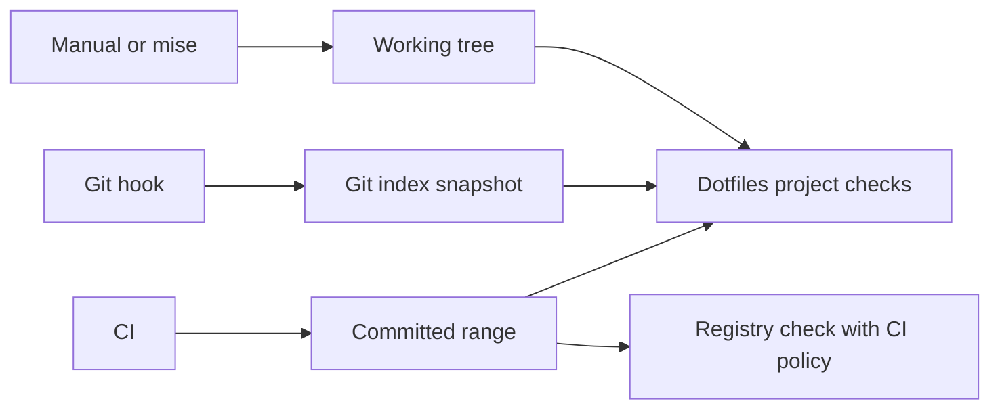

# Retire agent-usage and keep agent-check local to dotfiles

## Goal Capsule

- **Objective.** Contributors can check any dotfiles checkout without installing either helper globally. Other projects choose their own checks.
- **Product authority.** The owner confirmed the repository-only scope for `agent-check` and the retirement of `agent-usage`. Existing machines follow the [tool retirement policy](../../../docs/contributing.md#tool-retirement).
- **Means.** Remove the usage reader and give contributors a checker in the checkout with a pinned environment for its dependencies (KTD1, KTD2).
- **Open blockers.** None.

## Product Contract

### Summary

Retire `agent-usage` on NixOS and macOS. Keep `agent-check` in dotfiles for manual checks, the optional Git pre-commit hook, and CI. Remove its integration with user-wide agent instructions and edit sessions.

### Problem Frame

Home Manager puts both commands on the user's `PATH`. The dotfiles pre-commit hook prefers the installed copy of `agent-check` even when the current branch contains a different version. Standalone agents also receive instructions to run it in any project that defines the task. [Home Manager modules](../../../home/h82/agents/default.nix) · [Pre-commit hook](../../../.githooks/pre-commit) · [Agent instructions](../../../home/h82/agents/instructions/instructions.md.tmpl)

### Requirements

**Host installation and maintenance**

- R1. Retire `agent-usage` and its dedicated maintenance, including the Claude Agent SDK pin and its scheduled updates, under the repository's tool retirement policy.
- R2. End user-wide installation of `agent-check` on both platforms and retire its use as a shared runner for other repositories' tasks.

**Checks within dotfiles**

- R3. A contributor can run `agent-check` manually on working-tree changes in any dotfiles clone or linked worktree using the tool supplied by that checkout.
- R4. When the repository's pre-commit hook is enabled, it runs the checkout's Nix formatting and Markdown checks against the staged contents, even if another `agent-check` is on `PATH`.
- R5. CI runs the project checks and the existing registry-policy check against the committed change range and reports failures from either step.

**Agent sessions**

- R6. Remove the instruction to use `agent-check` from user-wide agent guidance. Any instructions for invoking it belong to dotfiles.
- R7. Remove dotfiles-managed post-edit source warnings and turn-end requests to run `agent-check`, including in previously trusted checkouts.

### Key Decisions

- **Keep the checker in dotfiles.** Governs R2, R3, R4, R5, R6. (session-settled: user-directed — chosen over deleting the checker entirely: the owner wants it available for dotfiles.)
- **Keep the Git hook and CI as the automatic entry points.** Governs R4, R5, R7. (session-settled: user-approved — chosen over retaining native edit and turn-end feedback: the owner confirmed that automation should run at commit time and in CI.)

### Acceptance Examples

- AE1. A contributor with no global helper introduces a formatting error in a second dotfiles worktree. Running the documented check there reports the error. Covers R2, R3.
- AE2. A contributor stages invalid Markdown, then fixes only the working copy. The enabled hook still rejects the staged version. Covers R4.
- AE3. A pull request introduces a registry dependency that the existing CI policy does not approve. The registry step fails even if formatting passes. Covers R5.
- AE4. An agent edits a file and finishes its turn in a previously trusted project. It receives neither the post-edit source warning nor a request to run `agent-check`. Covers R6, R7.
- AE5. A fresh managed user profile on either platform contains neither command. The scheduled updater has no `agent-usage` SDK release to refresh. Covers R1, R2.

### Scope Boundaries

The retirement preserves existing credentials, caches, and session data. Shared provider authentication and unrelated development tools remain outside its scope. The native guards for Git hook bypasses and frozen tests are independent of the feedback retired in R7.

## Planning Contract

- KTD1. Retire the usage reader, Claude SDK wrapper, lockfile and matching updater fixtures together. Keep the separately pinned Claude CLI, the acpx update and every shared provider credential. Covers R1.
- KTD2. Use `scripts/agent-check` from the checkout for Git, mise and CI. A flake development shell on both platforms provides the checker's runtime dependencies, including Python with `packaging`, Go and the linters. Drop the installable checker package and generic task discovery. Covers R2–R5.
- KTD3. Keep the existing staged and range snapshots. Run the dotfiles checks against the selected tree. Preserve the separation between offline source advisories and the registry-only invocation with its trusted policy. Covers R3–R5.
- KTD4. Use the existing managed-hook identity and empty event declarations to reconcile former Claude and Codex handlers. Preserve Codex hook positions and custom handlers in shared groups. Pi and OpenCode receive extensions containing only the existing pre-command and frozen-test guards. Covers R6, R7.

## Implementation Units

### U1. Retire the usage reader

Remove the usage Home Manager import, Python and Node readers, SDK package and release files, dedicated tests and scheduled maintenance. Update the acpx updater tests to exercise success and rollback with a single package. Existing caches and credentials belong to the owner. Covers R1 and AE5.

### U2. Localize the checker and its entry points

Remove the checker from Home Manager and the flake package exports. Preserve the existing development tools that share its Home Manager module. Replace mise, just and make discovery with direct dotfiles checks. The Git hook invokes the checkout's script and CI provides the same script with pinned dependencies. Update the shared flake check, staged Markdown fixture and CI workflow tests for the new entry points. Verify partially staged files and a linked worktree with a competing executable on `PATH`. Covers R2–R5 and AE1–AE3.

### U3. Retire agent-session feedback

Remove the scanner and turn-end request from the quality hook, its options, hook declarations and extension templates. Exercise reconciliation using old managed post-edit and stop handlers mixed with unrelated hooks. Keep native pre-command and frozen-test behavior covered in the supported harnesses. Covers R6, R7 and AE4.

### U4. Align instructions and contributor documentation

Move checker guidance from the shared instruction template into repository instructions. Refresh the rendered instruction receipts. Update the checker guide, repository reference, contributing guide and README to describe checkout-local commands, dependencies, Git hook setup and CI. Covers R1–R7.

## Verification Contract

- Build the affected Linux flake checks for `agent-check`, `agent-hooks`, `agent-instructions`, `lint-staged-markdown`, workflow routing and dependency updates. Use disposable Git state and fake registry responses for behavior tests.
- Exercise the documented manual command and CI's pinned entry point, check the branch diff, run Nix formatting and lint the affected Markdown files.
- Request the repository's full CI for the final head, including Darwin, VM and host builds. Report local and CI evidence separately.

## Definition of Done

AE1–AE5 hold. No active dotfiles caller depends on either globally installed helper. The usage-only SDK and retired session handlers have no active delivery path. Shared credentials and unrelated native guards retain their existing ownership. The branch contains the plan, implementation and verification changes for this work.
