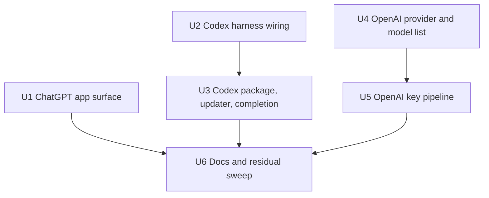

# Remove OpenAI Account Surface - Plan

## Goal Capsule

- **Objective:** After the OpenAI subscription ends, a rebuild installs and authenticates nothing that depends on an OpenAI account, while every remaining agent provider works unchanged.
- **Means:** Remove each OpenAI-account surface in place, wiring before package and provider before key (KTD1).
- **Product authority:** The repository owner. This plan is the full active scope; surrounding work is not active scope.
- **Execution profile:** One pull request, six units. `ce-work` implements and commits the units in order; `lfg` ships the pull request and watches CI.
- **Stop conditions:** The SOPS edit cannot run because the recovery age identity is unavailable; or research invalidates a session-settled decision.
- **Open blockers:** None at planning time.

## Product Contract

### Summary

Remove every surface that needs an OpenAI account: the ChatGPT app on both hosts, the Codex harness across packaging, agent configuration, T3 Code, and checks, and the OpenAI API key from SOPS through agent credential staging and CI. Providers that never used the key stay as they are.

### Problem Frame

The OpenAI subscription is ending. Today the configuration installs the ChatGPT app, manages Codex as a first-class coding agent, and publishes an OpenAI API key into Pi, OpenCode, and omp from SOPS and into the dependency-update workflow from a GitHub Actions secret. Leaving that in place after the subscription ends produces failed authentication, a dead harness entry in every agent surface, and a key that keeps being distributed. Unrelated OpenAI-branded model references served by OpenRouter, Synthetic, OpenCode Go, and Copilot are not part of the account and do not share that failure.

### Requirements

**OpenAI-account surfaces**

- R1. The configuration stops installing ChatGPT on both hosts: no NixOS package, no macOS cask, and no Dock entry.
- R2. Codex stops being a managed harness: no package or update pin, no `~/.codex` settings or hook activation, no T3 Code provider, no cross-model review peer token, no hook, plugin, skill-root, or instruction-delivery wiring, and no shell completion.
- R3. The OpenAI API key leaves the configuration: no SOPS entry, no cli-auth option or default, no credential-manifest row, no Pi, OpenCode, or omp credential staging on either host, no GitHub Actions refresh step or secret reference, and no OpenAI model list or updater.
- R4. Pi and OpenCode declare no OpenAI provider. Pi keeps Synthetic, Anthropic, and Ollama; OpenCode keeps Synthetic, Anthropic, and OpenCode Go.
- R5. No remaining configuration or refresh path can recreate an OpenAI-account dependency after this change.

**Retention and current state**

- R6. Third-party-served OpenAI model references stay: OpenRouter Whisper dictation, Synthetic `gpt-oss-120b`, OpenCode Go `gpt-*` models, Copilot `gpt-4.1`, and the `openai-completions` protocol strings.
- R7. Historical records under `.compound-engineering/artifacts` stay unchanged.
- R8. Current-state documentation no longer says ChatGPT or Codex is installed or managed, or that the OpenAI API key is published.
- R9. The check set matches the new surface: removed package and check names are gone, dependent fixtures and assertions are updated, and `./scripts/agent-check` plus `nix flake check` pass.

### Key Decisions

- D1. Scope is the OpenAI account, not the OpenAI name. (session-settled: user-directed — chosen over removing every OpenAI model reference: OpenRouter, Synthetic, OpenCode Go, and Copilot models do not use the OpenAI key.) Governs R4, R6.
- D2. Pi and OpenCode keep their tools and lose only the OpenAI provider. Governs R4.
- D3. One atomic change. (session-settled: user-approved — chosen over a staged key-first cutover: the single-owner repository gains nothing from an intermediate state, and a staged state would leave provider entries pointing at a removed key.) Governs R5, R9.
- D4. Key revocation and local state cleanup stay outside the plan. (session-settled: user-directed — chosen over a revoke-plus-checklist option: the request is repository-only.)

### Acceptance Examples

- AE1. Covers R1, R2, R4.
  - **Given** a production NixOS host and the updated configuration,
  - **When** a switch completes,
  - **Then** the user environment has no ChatGPT or Codex package and Pi and OpenCode start on their non-OpenAI providers.
- AE2. Covers R1, R2.
  - **Given** the macOS host and the updated configuration,
  - **When** Home Manager and Homebrew settle,
  - **Then** no ChatGPT cask or Dock entry is declared and T3 Code lists no Codex provider.
- AE3. Covers R3.
  - **Given** a production host with the updated secrets configuration,
  - **When** secrets are published,
  - **Then** no OpenAI key is written to the cli-auth directory or staged into any agent credential store.
- AE4. Covers R3, R5.
  - **Given** the dependency-update workflow and no OpenAI secret,
  - **When** the workflow completes,
  - **Then** it performs no OpenAI model refresh and reports no OpenAI warning.
- AE5. Covers R6.
  - **Given** the updated hosts,
  - **When** the agents start,
  - **Then** OpenRouter dictation, Synthetic `gpt-oss`, OpenCode Go GPT models, and the Copilot model setting remain available.
- AE6. Covers R9.
  - **Given** a clean checkout,
  - **When** `./scripts/agent-check` and `nix flake check` run,
  - **Then** both pass with the reduced check set.

### Success Criteria

- A repository-wide search of tracked active configuration finds no `openai_api_key`, `enableOpenaiApiKey`, `OPENAI_API_KEY`, `@OPENAI_KEY@`, `openai=`, `api.openai.com`, ChatGPT package or cask, or Codex harness reference outside R6's retention allowlist, R7's history, the pinned generated omp completion at `packages/zsh-completions/_omp`, removal assertions and retirement code paths, and Compound Engineering's own config examples that name supported peers.
- Both host configurations evaluate and build.
- The dependency-update workflow names no OpenAI secret.

### Scope Boundaries

- Revoking the key at OpenAI, deleting the GitHub Actions secret, and cleaning local state (`~/.codex`, `~/.chatgpt`, agent credential stores, and existing copies under `~/.local/state/cli-auth`) are outside this plan. The configuration stops writing the key; existing copies are left for the owner.
- The macOS retired-cask step uninstalls the dropped ChatGPT cask without `--zap`, so the app bundle is removed and user data under `~/Library` stays. This uses the repository's existing retirement mechanism rather than a manual step.
- Removing third-party OpenAI model references is outside; R6 keeps them.
- A repository-wide denylist check was considered and not built: the refresh jobs that could reintroduce the surfaces are removed, and the existing checks cover the change.
- Historical artifacts and git history stay untouched.
- The untracked `.agents/plugins/compound-engineering` checkout and the pinned generated `packages/zsh-completions/_omp` are not repository surface to edit.

### Dependencies and Assumptions

- The OpenAI subscription ends, and no remaining workflow needs an OpenAI account.
- The Pi and OpenCode OpenAI providers authenticate only through the removed key.
- OpenRouter, Synthetic, and Ollama `openai-completions` endpoints are third-party or local and do not contact OpenAI.
- The macOS secret-publication path stages the same key as the NixOS path, so both must change together.
- The macOS retired-cask step uninstalls a dropped cask on the next apply and never runs `--zap`.

### Sources / Research

- `docs/repository-reference.md` — current managed-harness inventory.
- `modules/shared/cli-credentials.json` and `secrets/README.md` — credential manifest and SOPS flow.
- `docs/agent-routing.md` and `docs/macos.md` — current-state agent and cleanup descriptions.
- `tests/linux-checks.nix` and `tests/darwin-config.nix` — check registries that must track the removal.
- `.github/workflows/update-dependencies.yml` — OpenAI refresh and package-update steps.

## Planning Contract

**Product Contract preservation:** requirements unchanged; one factual assumption corrected to the repository's retired-cask behavior.

### Key Technical Decisions

- KTD1. Remove surfaces in dependency order: harness wiring before its package, OpenAI provider before its key. Every unit leaves the tree evaluable.
- KTD2. Delete the SOPS key with `sops unset` and the documented `SOPS_AGE_KEY_CMD` pipeline, never by hand. Hand-editing breaks the file MAC; dropping the MAC breaks decryption. Set `SOPS_AGE_KEY_CMD` to stream `gpg --batch --no-tty --decrypt -- secrets/bootstrap/MS-7D91/age-key.asc`, run the edit, then unset it. No plaintext identity file is created and no secret value is printed.
- KTD3. Remove the OpenAI credential as one set: the manifest row, the NixOS cli-auth option and its default, and every option-gated staging call. Removing only the row leaves the option defaulted on and a sync pointed at a file that is no longer decrypted.
- KTD4. T3 Code removal retires three paths: the provider instance, the legacy `providers` block, and `providerModelPreferences`. Deleting the declaration alone leaves the app's last value, and a legacy block re-migrates into a new instance on load.
- KTD5. Remove Codex from instruction delivery and skill roots, but do not edit instruction receipts: Codex renders the base template, so its receipt is the base receipt (verified). Shared scripts lose only their Codex branch; generic TOML support stays if another consumer uses it.

### High-Level Technical Design

The units form two independent chains that meet at the documentation and residual sweep.

### Assumptions

- The YubiKey card is available and its PIN is cached, or the owner supplies it. If neither holds, U5 stops the run as blocked; it does not hand-edit ciphertext.
- The ChatGPT NixOS check only asserts a desktop wrapper and binary; it is decorative, so removal needs no behavioral replacement.
- `scripts/agent-settings` keeps its generic TOML mode unless implementation finds no remaining TOML consumer.
- Darwin-only checks are verified in CI on `aarch64-darwin`; this Linux checkout cannot build them.
- Third-party model IDs and protocol strings are not OpenAI-account dependencies and remain.

### Risks and Mitigations

- SOPS re-encryption failure could leave the secrets file inconsistent. Mitigation: run on a clean worktree, verify `sops -d` after the edit, and restore the file from git on failure. The `SOPS_AGE_KEY_CMD` route leaves no identity file to clean up.
- Many fixtures name the removed surfaces. Mitigation: the residual search and `nix flake check` are the safety net; do not chase only the files listed here.
- A missed T3 retired path would leave the Codex provider visible after an apply. Mitigation: assert all three retired paths in `tests/t3code-traits.nix`.
- A missed instruction delivery would leave `~/.codex/AGENTS.md` as a managed output. Mitigation: assert the delivery map and host activation have no Codex entry.
- A missed Pi wrapper call would hand `pi-state` an unresolved key placeholder. Mitigation: remove the wrapper argument and search for `@OPENAI_KEY@` and `openai=`.

## Implementation Units

### U1. Remove the ChatGPT app surface

**Goal:** No host installs or shows ChatGPT, and no updater, check, or CI step refers to it.

**Requirements:** R1, R9.

**Dependencies:** None.

**Files:**

- Delete `packages/chatgpt.nix`, `packages/chatgpt-version.json`, `scripts/chatgpt-release`, `tests/chatgpt.nix`, `tests/test_chatgpt_release.py`.
- Modify `packages/default.nix`, `packages/agent-tools.nix`, `home/h82/default.nix`, `modules/shared/darwin-apps.nix`, `modules/darwin/dock.nix`, `modules/darwin/retired-casks.nix`, `tests/linux-checks.nix`, `tests/darwin-config.nix`, `tests/darwin-outputs.nix`, `tests/desktop-autostart.nix`, `tests/python-script-checks.nix`, `tests/update-workflow.py`, `tests/update-dependencies-reconcile.sh`, `.github/workflows/update-dependencies.yml`.

**Approach:**

1. Delete the package and release helper, and remove their exports and builders.
2. Remove the user-package import and the macOS cask and Dock path.
3. Add the ChatGPT cask to the retired-cask list so an existing Mac removes the app without zapping user data.
4. Remove the check registration, ChatGPT test files, and ChatGPT-specific Darwin and autostart assertions.
5. Remove the ChatGPT update step and commit path from the dependency workflow and its reconcile fixtures.

**Patterns to follow:** The repository's prior cask retirements (`grok-bot`, `orca`, `wifiman`) move the dropped cask into the retired list and assert the removal.

**Test scenarios:**

1. `nix eval .#packages.x86_64-linux --apply builtins.attrNames` lists neither `chatgpt` nor `chatgpt-release`.
2. The Darwin cask mapping has no `chatgpt` and `tests/darwin-config.nix` passes without it.
3. The retired-cask list includes `chatgpt`, and `tests/darwin-outputs.nix` asserts its uninstall path.
4. The Dock `persistent-apps` list has no ChatGPT entry.
5. `tests/linux-checks.nix` registers no `chatgpt` check and the shard guard still passes.
6. The dependency workflow and reconcile fixtures run without a ChatGPT step.

**Verification:** The package and check-name evaluations show the removed names; the targeted Darwin and workflow checks pass.

### U2. Remove the Codex harness wiring

**Goal:** No Codex hook, plugin, skill root, instruction delivery, T3 Code provider, or cross-model peer remains.

**Requirements:** R2, R9.

**Dependencies:** None.

**Files:**

- Delete `home/h82/agents/codex.nix`, `docs/codex.md`, `tests/codex-settings.nix`.
- Modify `home/h82/agents/default.nix`, `home/h82/agents/agent-hooks.nix`, `home/h82/agents/agent-plugins.nix`, `home/h82/agents/quality-hooks.nix`, `home/h82/agents/skills.nix`, `home/h82/agents/cross-model-peers.nix`, `scripts/agent-instructions`, `scripts/agent-plugin-sync`, `scripts/agent-quality-hook`, `scripts/t3-instructions.py`, `scripts/opencode-serving-model`, `home/h82/t3code.nix`, `tests/linux-checks.nix`.
- Modify tests `tests/agent-hooks.nix`, `tests/agent-settings.nix`, `tests/agent-plugins.nix`, `tests/agent-instructions.nix`, `tests/agent-instructions.py`, `tests/darwin-config.nix`, `tests/darwin-outputs.nix`, `tests/t3code-traits.nix`, `tests/t3code-launch.py`, `tests/t3code-opencode-enabled.py`, `tests/test_t3_instructions.py`, `tests/test_agent_plugin_sync.py`, `tests/test_agent_settings.py`, `tests/korean-skills.nix`, `tests/official-skills.nix`, `tests/pinned-skills.nix`, `tests/lib/agent-activation.py`, `tests/lib/cross-model-peers.nix`, `tests/acpx-config.sh`, `tests/test_opencode_serving_model.py`.

**Approach:**

1. Remove the module import and every harness registry entry: agent hooks, plugin membership, skill roots, and instruction deliveries.
2. Remove the Codex branches from shared scripts. Keep generic TOML handling where another consumer needs it.
3. Remove the T3 Code provider instance and harness entry. Add retired paths for `providerInstances.codex`, `providers.codex`, and `providerModelPreferences.codex` so an applied host drops the provider instead of re-migrating it.
4. Remove the `codex` peer token and the option description's mention.
5. Delete the `codex-settings` check with the activation it asserts. Leave instruction receipts unchanged; update only the delivery map and rendering expectations.

**Patterns to follow:** The existing Orca and OpenCode retirements in `.compound-engineering/artifacts/solutions/` show per-entry removal and retired-path handling.

**Test scenarios:**

1. A host evaluation exposes no `my.agentHooks.codex`.
2. T3 Code merged settings have no `providerInstances.codex`, no `providers.codex`, and no `providerModelPreferences.codex`; an existing legacy block is pruned.
3. `CROSS_MODEL_PEERS` contains no `codex`.
4. Skill roots contain no `.codex/skills`.
5. The instruction delivery map and host activation have no Codex entry.
6. Shared scripts accept Claude, Pi, and OpenCode only.
7. `tests/linux-checks.nix` registers no `codex-settings` check.

**Verification:** Host configurations evaluate; the targeted agent, T3, and instruction checks pass.

### U3. Remove the Codex package, updater, and completion

**Goal:** No Codex package, update pin, completion, or CI update step remains.

**Requirements:** R2, R9.

**Dependencies:** U2.

**Files:**

- Delete `packages/codex.nix`, `packages/codex-release.json`, `scripts/codex-release`, `tests/codex.nix`, `tests/codex-apps.py`, `tests/t3code-codex-home.py`, `tests/test_codex_release.py`.
- Modify `packages/default.nix`, `packages/agent-tools.nix`, `packages/zsh-completions.nix`, `home/h82/default.nix`, `tests/linux-checks.nix`, `tests/darwin-config.nix`, `tests/python-script-checks.nix`, `tests/zsh-prezto.py`, `tests/update-workflow.py`, `tests/update-dependencies-reconcile.sh`, `.github/workflows/update-dependencies.yml`, `docs/shell.md`.

**Approach:**

1. After U2 leaves no references, delete the package, pin, updater, and their tests.
2. Remove the package export, builder, and user-package import.
3. Remove Codex completion generation, drop `codex` from the `tests/zsh-prezto.py` loop, and update the completion count from seven to six.
4. Remove the Codex update step, pin commit, and reconcile fixtures.

**Test scenarios:**

1. The package set lists no `codex` or `codex-release`.
2. The completion derivation contains six registrations and the shell check passes.
3. The dependency workflow and reconcile fixtures have no Codex step.
4. `tests/linux-checks.nix` registers neither `codex` nor `codex-settings`.

**Verification:** The package and check-name evaluations show the removed names; the targeted completion and workflow checks pass.

### U4. Remove the OpenAI provider and model list

**Goal:** Pi and OpenCode declare no OpenAI provider, and no OpenAI model list, updater, or CI refresh remains.

**Requirements:** R3, R4, R5, R6, R9.

**Dependencies:** None; U5 depends on this unit.

**Files:**

- Delete `home/h82/agents/openai-models.json` and `home/h82/agents/openai-models.nix`.
- Modify `home/h82/agents/pi.nix`, `home/h82/agents/opencode.nix`, `scripts/provider-models-watch`, `tests/python-script-checks.nix`, `tests/opencode.nix`, `tests/test_provider_models_watch.py`, `tests/update-workflow.py`, `.github/workflows/update-dependencies.yml`.

**Approach:**

1. Remove the OpenAI provider row and API mapping from Pi.
2. Remove the OpenAI model entry from OpenCode. Leave the `--credential openai=...` staging call for U5.
3. Remove the OpenAI branch, filter, floor, and key from the model watcher, keeping Anthropic.
4. Delete the committed list and its CI refresh step and outputs.
5. Leave third-party catalogs and protocol strings untouched (R6).

**Test scenarios:**

1. The rendered Pi `models.json` has no `openai` provider.
2. The OpenCode declared settings have no `providers.openai`.
3. The model watcher rejects `--provider openai` and still refreshes Anthropic.
4. The dependency workflow has no OpenAI refresh step or `OPENAI_API_KEY` environment.
5. The third-party catalog entries named in R6 remain present.

**Verification:** The rendered model files and declared settings show no OpenAI provider; the targeted watcher and workflow checks pass.

### U5. Remove the OpenAI API key from SOPS and credential staging

**Goal:** The OpenAI key is absent from SOPS, the credential manifest, cli-auth options, and all agent staging.

**Requirements:** R3, R9.

**Dependencies:** U4.

**Files:**

- Modify `secrets/provider-services.yaml`, `modules/shared/cli-credentials.json`, `modules/nixos/system/secrets.nix`, `modules/nixos/profile.nix`, `home/h82/agents/pi.nix`, `home/h82/agents/opencode.nix`, `home/h82/agents/omp.nix`, `packages/pi.nix`, `scripts/pi`, `secrets/README.md`, `docs/macos.md`.
- Modify tests `tests/agent-api-key-secrets.nix`, `tests/auth-provisioning.nix`, `tests/host-secrets.nix`, `tests/darwin-outputs.nix`, `tests/lib/fake-secrets.nix`, `tests/cli-credentials-migration.py`, `tests/opencode.nix`, `tests/omp.nix`, `tests/pi-activation.py`, `tests/pi-wrapper.py`, `tests/test_opencode_auth_sync.py`, `tests/test_agent_plugin_sync.py`, `tests/python-script-checks.nix`, `tests/update-workflow.py`.

**Approach:**

1. Remove the OpenAI credential row, cli-auth option and default, and every Pi, OpenCode, and omp staging call and key-file default. Remove the `--credential 'openai=@OPENAI_KEY@'` argument and `@OPENAI_KEY@` substitution from the Pi wrapper and package.
2. Delete the SOPS key with `sops unset secrets/provider-services.yaml '["openai_api_key"]'`. Set `SOPS_AGE_KEY_CMD` to stream the recovery identity from `secrets/bootstrap/MS-7D91/age-key.asc` through `gpg --batch --no-tty --decrypt`, run the edit, then unset the variable. No plaintext identity file is created and no value is printed.
3. Verify the file still decrypts (`sops -d --output /dev/null`) and the key name is absent.
4. Do not add deletion of existing local credential stores or published cli-auth copies; that stays out of scope. Do not hand-edit the ciphertext or drop the MAC if the identity is unavailable — stop and report the blocker.

**Patterns to follow:** `docs/contributing.md` and `secrets/README.md` document the `SOPS_AGE_KEY_CMD` maintenance flow and the `sops unset` command shape.

**Test scenarios:**

1. The credential manifest has no `openai_api_key` row.
2. A host evaluation exposes no `my.cliAuth.enableOpenaiApiKey`.
3. No host activation stages an OpenAI key into Pi, OpenCode, or omp; the Pi wrapper has no `@OPENAI_KEY@` argument.
4. The SOPS file decrypts and contains no `openai_api_key`.
5. The `auth-provisioning` VM check passes with the key absent.

**Verification:** The SOPS decrypt check and key search pass; the auth-provisioning VM check passes; `agent-check` passes.

### U6. Update current-state documentation and sweep residual references

**Goal:** Documentation matches the new surface, and no active reference outside the retention allowlist remains.

**Requirements:** R5, R6, R7, R8, R9.

**Dependencies:** U1, U2, U3, U4, U5.

**Files:**

- Modify `README.md`, `docs/repository-reference.md`, `docs/agent-routing.md`, `docs/contributing.md`, `docs/macos.md`, `docs/shell.md`, and `docs/decide.md` if its provider text names the removed surface.
- Modify any remaining active-configuration or test file found by the residual search.

**Approach:**

1. Rewrite current-state sentences: active agents are Claude Code, Pi, and OpenCode; no ChatGPT or Codex installation; no OpenAI key in the credential tables.
2. Remove links to the deleted Codex guide and update counts and lists.
3. Run a repository-wide search for `openai_api_key`, `enableOpenaiApiKey`, `OPENAI_API_KEY`, `@OPENAI_KEY@`, `openai=`, `api.openai.com`, `chatgpt`, and `codex`. Classify each hit as retained (R6/R7), generated upstream help (`packages/zsh-completions/_omp`), documentation, or a fix.
4. Do not edit the generated omp completion or add a denylist check.

**Test scenarios:**

1. The documentation checks pass and instruction rendering receipts are unchanged.
2. The residual search returns only the allowlist, history, generated upstream help, and third-party references.
3. `docs/codex.md` is absent and no live documentation links to it.

**Verification:** The residual search is clean outside the allowlist; `agent-check` and the documentation checks pass.

## Verification Contract

| Gate | Command | Applies |
| --- | --- | --- |
| Repository checker | `nix develop .#agent-check -c ./scripts/agent-check` | Every unit |
| Formatting | `nix fmt -- --ci` | Every unit |
| Declared checks | `nix flake check` | Every unit; Linux checks locally |
| Package names | `nix eval .#packages.x86_64-linux --apply builtins.attrNames` | U1, U3 |
| Check names | `nix eval .#checks.x86_64-linux --apply builtins.attrNames` | U1, U2, U3 |
| Targeted checks | `nix build --no-link .#checks.x86_64-linux.<name>` | The checks each unit edits |
| Credential VM check | `nix build --no-link .#vmChecks.auth-provisioning` | U5 |
| SOPS integrity | `SOPS_AGE_KEY_CMD="sh -c 'gpg --batch --no-tty --decrypt -- secrets/bootstrap/MS-7D91/age-key.asc'" sops -d --output /dev/null secrets/provider-services.yaml` | U5 |
| Residual search | `rg -n -i 'openai_api_key\|enableOpenaiApiKey\|OPENAI_API_KEY\|@OPENAI_KEY@\|openai=\|api\.openai\.com\|chatgpt\|codex'` over tracked active paths | U6 |
| Darwin evidence | CI `checks.aarch64-darwin.darwin-outputs` and `darwinConfigurations` build | U1, U2, U5 |

The residual search allowlist is R6's third-party model and protocol references, R7's `.compound-engineering/artifacts` history, the pinned generated omp completion at `packages/zsh-completions/_omp`, removal assertions and retirement code paths, Compound Engineering's own config examples that name supported peers, and the untracked plugin checkout. Any other hit is a defect.

## Definition of Done

- U1 through U6 are complete, and the Product Contract requirements are unchanged.
- No ChatGPT package, cask, Dock entry, updater, or check remains; the macOS retired-cask step removes the installed app without zapping user data.
- No Codex package, pin, provider, peer, hook, plugin, skill root, instruction delivery, completion, or CI step remains.
- `secrets/provider-services.yaml` contains no `openai_api_key` and still decrypts; no manifest row, cli-auth option, or agent staging remains.
- Third-party OpenAI model references and historical artifacts are untouched.
- `./scripts/agent-check`, `nix fmt -- --ci`, `nix flake check`, and the `auth-provisioning` VM check pass on the available builder.
- Darwin evidence is recorded from CI on the current head; a missing Darwin builder is pending evidence, not a pass.
- No dead-end cleanup code or abandoned experimental change remains in the diff; no plaintext identity file was created.
