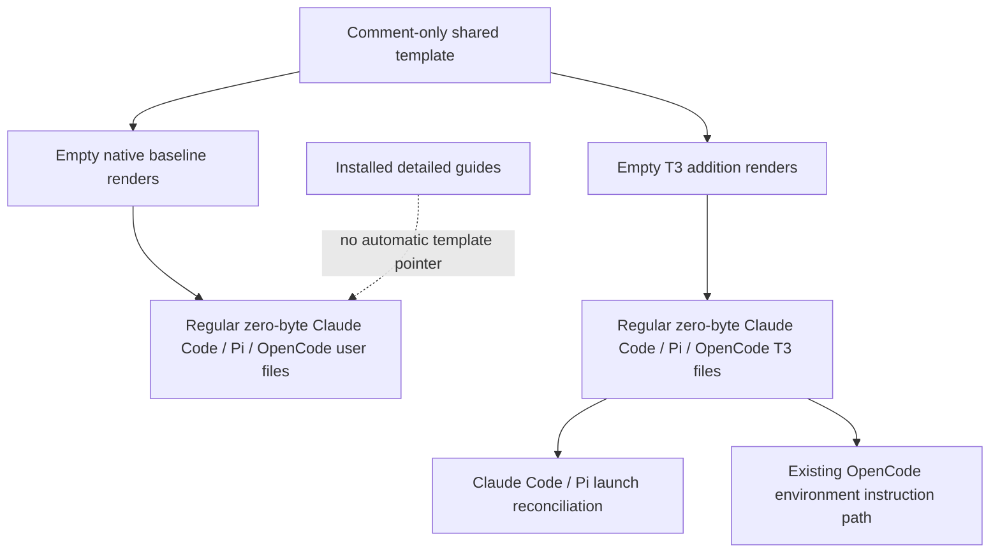
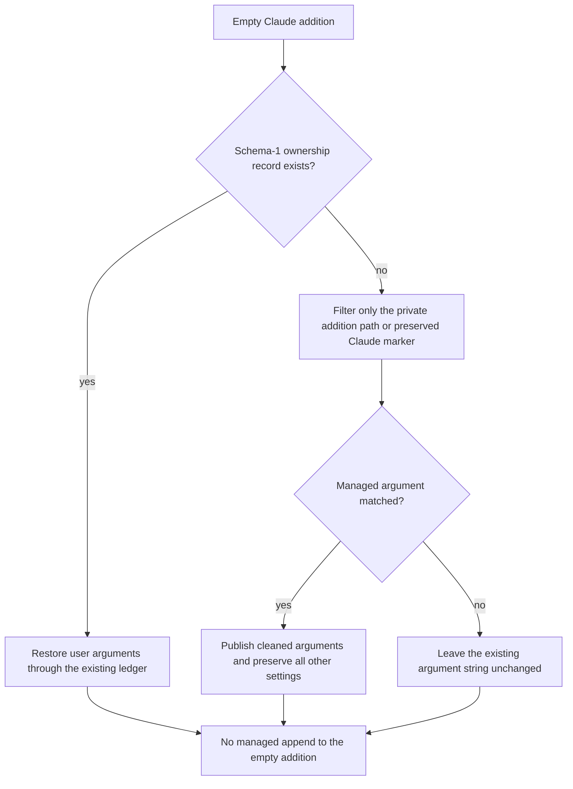

# Harness Instruction Reset - Plan

## Goal Capsule

- **Objective:** Fresh sessions on the currently instruction-connected harnesses start without the repository's personal instruction content, leaving a clean baseline for a later redesign.
- **Means:** Use the comment-only skeleton and existing delivery surfaces, adding only the record-free Claude cleanup needed for R4 (KTD1, KTD3).
- **Product authority:** The Product Contract and its settled decisions govern WHAT; the Planning Contract governs HOW without narrowing scope.
- **Execution profile:** One PR. The implementing agent completes U1–U4 and supplies the Verification Contract evidence; the autonomous pipeline ships the approved work and watches CI.
- **Completion owner:** The implementing agent finishes every unit, and the shipping workflow records committed and uncommitted findings separately.
- **Stop conditions:** Stop rather than drop native destinations, change project instructions or independent harness settings, weaken user-argument preservation, or override a session-settled decision.
- **Open blockers:** None.

---

## Product Contract

### Summary

Remove every live rule from the shared personal-instruction template while retaining source comments for future editing.
Existing native and T3 delivery mechanisms remain connected, but their rendered instruction bodies become empty.

### Problem Frame

The shared template currently injects working and language rules plus detailed-guide triggers into personal agent sessions.
The owner has no incident or measured quality problem to solve through another incremental rewrite; the desired starting point is an intentional reset with no inherited personal policy.

### Requirements

**Template and rendered state**

- R1. Remove all live instruction content from `home/h82/agents/instructions/instructions.md.tmpl`, including working rules, guide triggers, language rules, skill directives, headings, example policies, and placeholder prose.
- R2. Leave only source-template comments marking future editing regions and a common-baseline/T3 branch skeleton so every baseline and T3 render is byte-empty.

**Harness behavior**

- R3. Normal activation leaves empty regular files at the existing native user-scope destinations for Claude Code, Pi, and OpenCode without removing their shared-template wiring.
- R4. Empty T3 additions cause the composer to remove only its managed Claude Code and Pi append-instruction arguments while preserving user-provided arguments and unrelated controls.
- R5. OpenCode's T3 configuration retains its existing environment-based path to the empty addition without delivering instruction content or disturbing unrelated environment state.

**Preserved surfaces and maintenance**

- R6. Keep the installed task guide and T3 guide available at their existing user-scope paths even though the reset template no longer references them automatically.
- R7. Update repository documentation and materialized-output regression checks to enforce R1–R6 instead of expecting removed rules, guide pointers, or non-empty rendered output.

### Key Decisions

- **Finish at an empty baseline.** Governs R1. (session-settled: user-directed — chosen over rebuilding instructions now or splitting reset and rebuild: the owner selected comments-only output as this work's final state.)
- **Keep comments out of rendered sessions.** Governs R2, R3, R4, R5. (session-settled: user-directed — chosen over rendered Markdown comments: the reset must contribute no comment or instruction content to fresh agent input.)
- **Define coverage by existing instruction connections.** Governs R3, R4, R5. (session-settled: user-approved — chosen over adding omp during the reset: the owner confirmed that currently unconnected harness integration is separate work.)

### Acceptance Examples

- AE1. **Covers R1, R2, R3.** Given the committed template, rendering each native harness baseline and each T3 context produces a byte-empty file while the source retains only its comment skeleton and branch structure.
- AE2. **Covers R4.** Given an empty T3 addition and previously composer-managed Claude Code or Pi append arguments, reconciliation removes those managed arguments and retains pre-existing user arguments and unrelated controls.
- AE3. **Covers R5.** Given an empty OpenCode T3 addition, materialization leaves the existing environment entry selecting that path, leaves unrelated environment entries untouched, and produces no rendered instruction body.
- AE4. **Covers R3, R6.** Given activation into an isolated home, the three native instruction destinations remain present and empty, and both detailed guides remain installed and readable.

### Scope Boundaries

- Designing or authoring replacement common, harness-specific, or T3 instruction content is deferred.
- Adding omp or any other currently unconnected harness to shared-template delivery is deferred.
- Retiring or reorganizing the detailed guides, renderer, native delivery adapters, T3 composer, or shared skills is outside this reset.
- Changing project-level instructions or independent harness-native settings, including Claude Code's configured conversation language, is outside this reset.

### Sources / Research

- Current shared content and native delivery: `home/h82/agents/instructions/instructions.md.tmpl`, `home/h82/agents/instructions/default.nix`, and `scripts/agent-instructions`.
- T3 rendering and empty-addition behavior: `home/h82/t3code.nix` and `scripts/t3-instructions.py`.
- Current contributor and enforcement contracts: `docs/contributing.md`, `docs/agent-routing.md`, `tests/agent-instructions.py`, and `tests/t3code-launch.py`.
- Historical precedent only: `.compound-engineering/artifacts/plans/2026-11-05-0037-feat-harness-user-instructions-plan.md` records an earlier comments-only skeleton; this Product Contract governs the current reset.

---

## Planning Contract

- **Product Contract preservation:** restructured, no scope change: the delivery visualization moved to High-Level Technical Design; all R/AE IDs and product requirements are unchanged.

### Key Technical Decisions

- KTD1. **Use only whitespace-trimmed Go-template comments and an outer `.t3` branch.** Governs R1, R2. Every production and direct-test render supplies `.t3`; avoiding other evaluated context keys preserves those callers while whitespace trims produce exact zero bytes. (session-settled: user-directed — chosen over rendered Markdown comments: the reset must contribute no comment or instruction content to fresh agent input.)
- KTD2. **Keep all receipt keys while separating byte proof from branch proof.** Governs R1, R2, R3, R6, R7. Point every existing key at the SHA-256 of empty input so current manifest lookups remain valid, and use independent per-destination checks plus temporary rendered markers to catch wrong branches, whitespace, and missing files. Review the source skeleton directly rather than adding a source-substring test that would reject legitimate comments or pass for the wrong reason.
- KTD3. **Reuse the composer's path-scoped ownership filter for record-free Claude cleanup.** Governs R4. When an empty Claude addition has neither a schema-1 record nor native controls, pass the existing arguments through `clean_owned`; remove only the private addition path or `CLAUDE_MARKER` tokens, preserve unmatched arguments and settings, and leave an untouched argument string untouched. Existing ledger-backed restoration remains the normal migration path, while the record-free branch also covers ledger loss and a state-ahead interruption.
- KTD4. **Verify migration through activation and retain the existing OpenCode ownership boundary.** Governs R4, R5, R7. Exercise a prior composed launch with its ownership record before applying empty additions twice, then inspect the resulting settings and state. Keep `OPENCODE_CONFIG_CONTENT` repository-owned as one value; preserve other named environment entries and unrelated settings rather than promising to merge keys inside that owned value.

### High-Level Technical Design

The reset retains three delivery destinations and adds no new renderer or settings path.

The existing composer handles recorded migration; KTD3 closes only the record-free Claude gap.

### Assumptions

- OpenCode and T3 accept an environment-listed zero-byte instruction file at runtime; repository checks prove the materialized path and bytes, not signed-in application behavior.
- Review evidence is sufficient for the source's comment-only shape because behavioral checks cannot distinguish intended empty output from prose hidden in an unevaluated branch.

### System-Wide Impact

The reset removes only repository-rendered personal content. Project instructions, installed skills, T3 controls, and independent harness settings remain active; Claude Code retains its own Korean conversation setting while Pi and OpenCode lose the removed shared language directive.

Both detailed guides remain installed but dormant until manually opened or referenced by future instructions. Native destinations stay distinct empty files rather than disappearing or being consolidated.

### Risks & Dependencies

- Empty output collapses existing prose and duplication assertions into failures or vacuous passes. Exact byte checks, regular-file identity, argument-token checks, and non-empty mutation witnesses are required rather than new blanket absence assertions.
- The record-free Claude branch changes an existing ownership edge case. KTD3 limits deletion to the private addition path and marker, and U2 must prove user-owned arguments and fresh configurations survive.
- Darwin materialization cannot execute on the Linux builder. The Darwin output check requires its supported builder, and local Linux success must not be reported as Darwin evidence.

### Implementation Research

- Composer behavior and migration seams: `scripts/t3-instructions.py` and `tests/test_t3_instructions.py`.
- Existing materialized settings coverage: `tests/agent-instructions.py`, `tests/t3code-launch.py`, and `tests/t3code-opencode-enabled.py`.
- Empty-fixture and mutation risks: `.compound-engineering/artifacts/solutions/best-practices/converged-fixture-state-defeats-nix-check-mutation-testing.md` and `.compound-engineering/artifacts/solutions/best-practices/substring-sentence-check-passes-a-negated-instruction.md`.
- Argument ownership evidence: `.compound-engineering/artifacts/solutions/best-practices/unanchored-grep-fragment-misses-destination-argument.md`.
- Renderer boundaries that remain unchanged: `.compound-engineering/artifacts/solutions/logic-errors/go-text-template-missingkey-error-misses-index-and-printed-nulls.md`.

---

## Implementation Units

### U1. Reset the template and native materialized assertions

**Goal:** Produce exact empty native and T3 renders while keeping native delivery, guide installation, and branch isolation observable.

**Requirements:** R1, R2, R3, R6, R7; KTD1, KTD2.

**Dependencies:** None.

**Files:** `home/h82/agents/instructions/instructions.md.tmpl`, `tests/lib/agent-instruction-receipts.json`, `tests/agent-instructions.py`.

**Approach:**

1. Replace live template content with source comments and only the outer `.t3` branch, trimming every literal newline that could reach a render.
2. Set all five existing receipt keys to the empty-input SHA-256 without changing their consumers.
3. Replace non-empty guide, heading, and receipt assertions with exact zero-byte and regular-file checks; remove the self-colliding duplication probe and vacuous negative prose assertions.
4. Preserve guide-content checks against the materialized guides directory and temporary harness markers for branch isolation rather than adding source-text assertions.

**Execution note:** This is configuration plus materialized-output verification; use real renders and activation artifacts, not source-string fixtures.

**Test scenarios:**

- Render every native host-kind/harness combination and every direct T3 context through the real renderer; each result is exactly `''`, including no trailing newline, and an appended branch probe emits only the selected harness marker.
- Seed pre-existing native instruction content before isolated activation; each destination is replaced by a non-symlink regular zero-byte file, retired destinations remain absent, and both installed guides still contain their checked passages.
- Inject whitespace-only, Markdown-comment, heading, and foreign-instruction mutations into rendered output; each mutation fails the exact receipt or byte assertion instead of becoming an identity comparison.

**Patterns to follow:** `scripts/agent-instructions` supplies the real activation boundary, and `tests/text-template.nix` continues to own renderer fail-closed behavior without modification.

**Verification:** `tests/agent-instructions.py` proves R1–R3 and R6 for every materialized entry and rejects non-empty mutations for their own reasons. It does not claim live provider discovery.

### U2. Close record-free Claude append cleanup

**Goal:** Ensure an empty Claude addition cannot leave a managed append behind merely because the private ownership record is absent.

**Requirements:** R4; KTD3.

**Dependencies:** None.

**Files:** `scripts/t3-instructions.py`, `tests/test_t3_instructions.py`.

**Approach:**

1. In the empty-addition, no-record, no-controls branch, inspect existing launch arguments with the existing tokenizer and `clean_owned` ownership rules.
2. Remove only the current private addition path and preserved Claude marker; when nothing matches, retain the original argument string and avoid introducing a new state record.
3. Leave non-empty composition, recorded removal, Pi controls, Claude depth handling, publication rollback, and unrelated settings unchanged.

**Test scenarios:**

- Given no state file, an empty Claude addition, and launch arguments containing the private managed append plus user-owned inline/file appends and unrelated flags, reconciliation removes only the private path or marker and preserves every user-owned token.
- Given settings that still contain a prior managed append after the ownership state was lost or advanced ahead of settings publication, the next empty reconciliation removes it and a second reconciliation is settings/state byte-idempotent.
- Given a fresh empty addition with no managed argument, existing user argument bytes and unrelated controls remain untouched; existing non-empty and Pi ownership tests continue to pass unchanged.

**Verification:** The direct composer unit suite proves the record-free and interrupted-state shapes, normal recorded migration, and unrelated-control preservation without editing host state.

### U3. Align T3 launch materialized checks with empty additions

**Goal:** Make the end-to-end T3 check validate empty baseline/additions, managed-argument removal, user-state preservation, and OpenCode's empty configured path.

**Requirements:** R1, R2, R3, R4, R5, R7; KTD2, KTD3, KTD4.

**Dependencies:** U1, U2.

**Files:** `tests/t3code-launch.py`.

**Approach:**

1. Replace prose and mandatory-append assertions with exact zero-byte, regular-file, key-absence, and token-level launch assertions for all three addition files and their providers.
2. Add an activation-level migration fixture containing prior composed arguments, a matching schema-1 record, and user-owned arguments; leave the existing unit-level composer coverage to U2.
3. Assert Pi retains exactly one `--approve`, Claude retains its depth environment handling, and OpenCode retains exactly one environment instruction path to its empty addition without launch arguments.
4. Replace witnesses that become false or vacuous with stale managed arguments, non-empty additions, missing files, and key-absence violations while preserving the existing unrelated-settings mutations.

**Test scenarios:**

- In a fresh isolated home, the native baseline and all three T3 additions are non-symlink regular zero-byte files, Claude has no `launchArgs` key, Pi has no append and exactly one `--approve`, and OpenCode's environment lists only its empty addition.
- After activation starts from the seeded non-empty migration state, user-owned arguments and unrelated settings survive, managed appends disappear, and a second activation leaves settings and ownership state byte-identical.
- Injecting a stale managed append, a non-empty addition, `launchArgs = ''` where absence is required, or a missing native control fails the assertion that owns that behavior.

**Patterns to follow:** Keep `tests/t3code-opencode-enabled.py` as the seam proving replacement of the owned OpenCode JSON value and preservation of other named environment entries; do not duplicate or weaken that contract.

**Verification:** `tests/t3code-launch.py` and the existing OpenCode settings test prove AE2–AE4 at the materialized activation boundary, including migration and unrelated-state preservation.

### U4. Align user and contributor documentation

**Goal:** Replace claims about shared personal policy and non-empty launch additions with the retained empty-delivery contract.

**Requirements:** R7.

**Dependencies:** U1, U2, U3.

**Files:** `docs/agent-routing.md`, `docs/contributing.md`, `README.md`, `CONCEPTS.md`.

**Approach:**

1. Describe comment-only shared source, byte-empty native files, dormant installed guides, and future source-editing regions without reintroducing personal instruction text.
2. Document empty-addition behavior for Claude, Pi, and OpenCode while keeping unrelated T3 settings and model controls distinct.
3. Remove shared-language claims from instruction-routing documentation, retain Claude's independent language setting where relevant, and update the delivery-path definition to describe wiring rather than a delivered common policy.

**Test expectation:** none — documentation only; the materialized checks in U1 and U3 validate the behavior being described.

**Verification:** A reader encounters no claim that user instructions still provide working/language rules, that T3 still adds non-empty guide pointers, or that project instructions and independent harness settings were reset.

---

## Verification Contract

Run the checks from the checkout root without applying a host generation or using real credentials.

| Check | Evidence | Units |
| --- | --- | --- |
| `T3_INSTRUCTIONS_SCRIPT=scripts/t3-instructions.py python3 -I tests/test_t3_instructions.py` | Recorded and record-free composer migration, preservation, and retry behavior | U2, U3 |
| `nix build --no-link .#checks.x86_64-linux.agent-instructions` | Native regular zero-byte files, exact renders, branches, guides, receipts, and mutation witnesses | U1, U4 |
| `nix build --no-link .#checks.x86_64-linux.t3code-traits` | Materialized T3 launch states, additions, controls, OpenCode path, and settings mutations | U3, U4 |
| `nix flake check` | Supported Linux evaluation and declared-check regression coverage | All |
| `nix fmt -- --ci` | Nix formatting remains unchanged where no Nix implementation edit is planned | All |
| `markdownlint-cli2 docs/agent-routing.md docs/contributing.md README.md CONCEPTS.md` | Changed Markdown passes repository lint | U4 |
| `git diff --check` | No whitespace errors in the final diff | All |
| `nix develop .#agent-check -c ./scripts/agent-check` | Repository-mandated aggregate check passes from the checkout | All |
| `nix build --no-link .#checks.aarch64-darwin.darwin-outputs` on `aarch64-darwin` | Darwin materialized delivery evidence | U1, U3, U4 |

Report Linux and Darwin evidence separately; an unavailable Darwin builder leaves that row deferred to supported CI rather than passed. Repository checks prove configuration and materialized outputs, not live signed-in provider behavior. The OpenCode runtime limitation remains the explicit Assumptions entry rather than implicit live-verification evidence.

## Definition of Done

- U1 leaves only the comment/branch skeleton and proves exact empty native and T3 renders with non-empty mutation witnesses.
- U2 removes record-free managed Claude arguments without changing user-owned arguments, unrelated controls, or normal non-empty composition.
- U3 proves fresh and previously composed activation states, idempotent settings/state reconciliation, empty regular files, and the retained OpenCode path.
- U4 removes obsolete shared-policy and launch-pointer claims from every affected reader surface.
- R1–R7 and AE1–AE4 are covered by the unit outcomes above without adding replacement guidance, new harness integration, project-instruction changes, or native-setting changes.
- Required local checks pass, unavailable platform checks are reported as deferred evidence rather than passes, and review findings are either applied or explicitly recorded.
- Remove temporary fixtures and abandoned attempts; the final diff contains no smoke markers, sample policies, or files unrelated to this reset.
