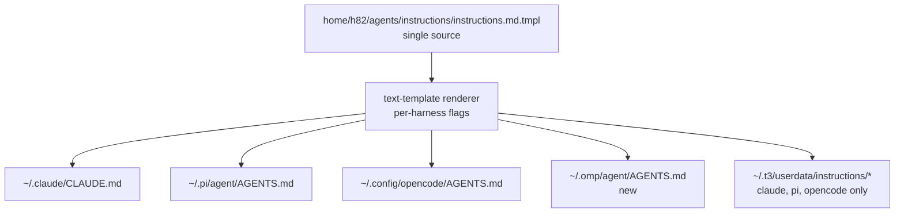
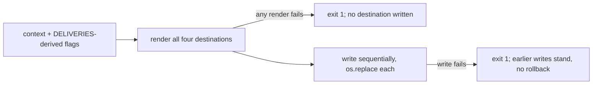

# OMP Instruction Delivery - Plan

## Goal Capsule

- **Objective:** omp sessions receive the same single-source personal instructions as every other repository-managed harness, and omp-specific content reaches only omp.
- **Means:** add omp's native user-scope instruction file to the existing shared-template delivery map, then extend the checks and documentation to cover it (KTD1).
- **Product authority:** This Product Contract and issue #320 govern WHAT; the Planning Contract governs HOW.
- **Execution profile:** One PR. The implementing agent completes U1–U3 and supplies verification evidence; `lfg` ships the work and watches CI.
- **Product Contract preservation:** changed: R2, R4, R6, R9, R12, R13, Scope Boundaries, Success Criteria — clarified native-only `.omp`, explicit discard of pre-existing destination bytes, the full relocation surface, instruction-entry preservation scope, instruction-only doc claims, and delivered-bytes evidence; no behavior change.
- **Stop conditions:** Stop if the pinned omp release no longer resolves to `~/.omp/agent/AGENTS.md`, if a check cannot distinguish a one-sided delivery omission, or if the change would alter T3 contexts or unrelated omp state.
- **Open blockers:** None.

---

## Product Contract

### Summary

Wire omp's native user-scope instruction file at `~/.omp/agent/AGENTS.md` into the shared template, renderer, and activation helper. omp joins the common baseline and gains an explicit `.omp` render flag, with delivery checks and documentation extended to the fourth harness.

### Problem Frame

Claude Code, Pi, and OpenCode already render from one template. omp is installed and managed, but its user session never sees that content, so the single-source guarantee stops at three harnesses and omp-specific content has no safe channel. The harness-instruction reset deliberately left omp out because it had no existing instruction connection; this work is that separate follow-up.

### Requirements

**Delivery wiring**

- R1. `~/.omp/agent/AGENTS.md` is delivered by the existing shared template, renderer, and activation helper; no second instruction source or omp-specific renderer is added.
- R2. The omp render receives an explicit `.omp` template flag that is true only for omp in native renders; T3 renders do not carry it.
- R3. The destination is bound to the verified boundary of the pinned omp release: its `.omp/ directories` context provider reads `<agent dir>/AGENTS.md`, which resolves to `~/.omp/agent/AGENTS.md` by default on omp 19.2.1.

**Activation and preservation**

- R4. Isolated activation creates or reconciles `~/.omp/agent/AGENTS.md` as a regular file containing the rendered bytes, replacing a prior file or link at that exact path without following the link; pre-existing bytes there are repository-managed and are replaced without a backup.
- R5. omp authentication, settings, credentials, plugins, and session state outside `~/.omp/agent/AGENTS.md` are preserved; the delivery adds no cleanup, deletion, or rewrite of those paths.
- R6. Delivery targets the default omp agent directory; relocated config or agent roots from `OMP_PROFILE`, `PI_PROFILE`, `PI_CONFIG_DIR`, or `PI_CODING_AGENT_DIR` are not resolved.

**Checks and receipts**

- R7. The instruction-delivery check covers omp: the unchanged comments-only template renders a zero-byte `~/.omp/agent/AGENTS.md`, and the Claude, Pi, and OpenCode renders are unchanged.
- R8. The marker probe covers omp and common content: a temporary common marker reaches omp and every other selected harness, while an omp-only marker reaches only omp.
- R9. The activation-level check executes the instruction activation entry in an isolated home, seeds `config.yml`, a session record, and `agent.db`, and proves both the link replacement of R4 and byte-identical survival of those seeded files.
- R10. Receipts cover omp through the existing per-harness digest lookup; no redundant omp key is added while its bytes equal the shared empty baseline, and an omp-specific key is added when omp-specific rendered bytes first exist.
- R11. T3 behavior is unchanged: omp is not a T3 provider, so the T3 render contexts and launch checks keep their current harness set and gain no `.omp` value.

**Documentation**

- R12. `docs/contributing.md` lists omp in the instruction-delivery set without implying plugin, skill, or T3 parity; adds `.omp` as a native-only template variable; states the receipt fallback; and describes activation at the apply boundary.
- R13. `docs/agent-routing.md` names omp in native instruction-delivery coverage, states its path and unchanged T3 status, and uses the same apply-boundary wording.

### Key Decisions

- KD1. **Extend the existing delivery map.** Reuse the helper's per-delivery render loop and activation entry, adding one destination and its derived flag. Governs R1, R2.
- KD2. **Use only the omp-native config path.** `~/.omp/agent/AGENTS.md` is the verified user-context path; omp's generic `~/.agent` and `~/.agents` roots stay unwired (session-settled: user-approved — chosen over wiring the generic roots: they are not omp-native and would create a second instruction source). Governs R3.
- KD3. **Scope preservation to the instruction entry.** Seed `config.yml`, a session record, and `agent.db`, then execute only the instruction activation entry; `ompConfig` and `ompAuth` own two of those files and are not run. Governs R5, R9.
- KD4. **Cover receipts through the shared empty digest.** The path assertion and the common/omp-only probes carry the variant coverage; duplicate hashes are not treated as additional coverage. Governs R10.
- KD5. **Leave the T3 harness set alone.** omp is not a T3 provider, so adding `.omp` to the T3 context would be unused. Governs R11.
- KD6. **Keep the glossary harness-agnostic.** `CONCEPTS.md`'s `Delivery path` entry already covers any native path and names no harness set; adding a roster would go stale (session-settled: user-approved — chosen over adding a coverage roster: the definition stays accurate without one).
- KD7. **Treat `.omp` as native-only.** Any template read of `.omp` stays inside the non-T3 branch; T3 renders keep failing closed on a top-level read. Governs R2, R11, R12.
- KD8. **Scope the documentation claim to instructions.** omp joins the instruction-delivery roster only; plugin, skill-root, hook, and T3 integration remain outside this work. Governs R12, R13.

### Key Flows

- F1. Activation render
  - **Trigger:** The Home Manager instruction activation entry runs.
  - **Actors:** `agent-instructions` helper and `text-template` renderer.
  - **Steps:** Read the host context, resolve the locale, render every destination into memory with its harness flag set, then write each destination sequentially with a per-file atomic replace; any render failure aborts before the first write, and a later write failure leaves earlier writes in place.
  - **Outcome:** Four native instruction files hold the rendered bytes; unrelated omp files are untouched.
  - **Covers:** R1, R2, R4, R5.

### Acceptance Examples

- AE1. **Covers R7.** Given the unchanged comments-only template and a fresh isolated home, when activation renders, then `~/.omp/agent/AGENTS.md` is a zero-byte regular file and the Claude, Pi, and OpenCode files are byte-identical to their prior renders.
- AE2. **Covers R8.** Given a temporary marker in the common branch, when the template renders for all four harnesses, then every harness receives it; given the same marker in the `.omp` branch only, then only omp receives it.
- AE3. **Covers R4, R5, R9.** Given a seeded `config.yml`, session record, and `agent.db` under `~/.omp/agent`, and the destination seeded first as a regular file and then as a symlink to a sentinel, when the instruction activation entry runs, then the destination is a regular non-symlink file with the rendered bytes, the sentinel is unchanged, and every seeded file is byte-identical.
- AE4. **Covers R10.** Given an empty omp render, when the receipt check runs, then it validates the shared empty digest through the per-harness fallback; a non-empty omp render without a matching receipt fails.
- AE5. **Covers R11.** Given the existing T3 render contexts and launch manifest, when repository checks run, then they still describe claude, pi, and opencode only and require no omp entry.

### Scope Boundaries

- No omp-specific instruction content; the template stays comments-only.
- No plugin, skill-root, hook, model, or T3 provider integration for omp (KD8).
- Generic `~/.agent` and `~/.agents` user context roots are not wired (KD2).
- omp state outside the declared destination is untouched by the instruction entry; full-activation preservation of `config.yml` and `agent.db` is excluded because `ompConfig` and `ompAuth` own them (R9).
- Pre-existing content at the declared destination is discarded, not preserved; content the owner wants to keep belongs outside it (R4).
- Relocated omp config and agent roots are not resolved (R6).
- `CONCEPTS.md` gains no harness roster (KD6).
- No new receipt key while the omp render equals the shared empty baseline (R10).
- No rollback or set-atomic write behavior; replacement is per-file atomic (KTD7).
- No runtime `omp -p` session probe; repository checks prove delivered bytes (KTD9).
- Documentation outside `docs/contributing.md`, `docs/agent-routing.md`, and `CONCEPTS.md` is not updated, even where another page already omits omp.
- No host switch or generation is part of repository verification.

### Success Criteria

- `./scripts/agent-check` passes with pinned tools for the changed files.
- The instruction check proves the zero-byte omp render, common-marker reach, omp-only isolation, symlink replacement, and unrelated-state preservation.
- A one-sided delivery-map omission and a write-through symlink mutation each turn the check red.
- The four native renders change only by the added omp destination; the other three stay byte-identical.
- Repository checks prove delivered bytes; the pinned omp source reading establishes the user-context path, and a live signed-in session is not asserted.

### Sources / Research

- Existing delivery map and helper: `scripts/agent-instructions:14-18`, `scripts/agent-instructions:98-109`.
- Shared template: `home/h82/agents/instructions/instructions.md.tmpl:1-6`.
- Activation entry: `home/h82/agents/instructions/default.nix:36-42,56-64`.
- omp pin and context boundary: `packages/omp-release.json:2-3`; omp v19.2.1 input `packages/coding-agent/src/discovery/builtin.ts:943-975`, `packages/utils/src/dirs.ts:120-134,348,519,653`, `nix/home-manager.nix:53-60`.
- omp module ownership: `home/h82/agents/omp.nix:22-29,102-117`.
- Checks: `tests/agent-instructions.py:11-27,77-93,151-164`, `tests/agent-instructions.nix:28-32,43-62,82-93,114`, `tests/lib/agent-instruction-receipts.json:2-6`.
- T3 harness set: `home/h82/t3code.nix:58-72`; `tests/lib/t3code-launch-manifest.nix:8-19`; `tests/t3code-launch.py:143-145`.
- Docs: `docs/contributing.md:14-17,22-23`, `docs/agent-routing.md:3,55`, `CONCEPTS.md:75`.
- Learnings applied: `.compound-engineering/artifacts/solutions/logic-errors/go-text-template-missingkey-error-misses-index-and-printed-nulls.md`, `.compound-engineering/artifacts/solutions/best-practices/mutation-testing-reveals-decorative-nix-check-assertions.md`, `.compound-engineering/artifacts/solutions/best-practices/nix-check-reads-option-value-not-materialized-output.md`, `.compound-engineering/artifacts/solutions/best-practices/home-manager-activation-does-not-run-on-every-rebuild.md`, `.compound-engineering/artifacts/solutions/integration-issues/antigravity-acp-runtime-loads-no-global-rule-files.md`.
- Prior scope boundary: `.compound-engineering/artifacts/plans/2026-11-26-1020-refactor-reset-harness-instructions-plan.md` (omp deferred).

---

## Planning Contract

### Key Technical Decisions

- KTD1. **Add one entry to the delivery map; do not touch the activation module.** `DELIVERIES` in `scripts/agent-instructions` already derives every render's flags from its keys, and `home/h82/agents/instructions/default.nix` calls the packaged helper generically. Adding `"omp": ".omp/agent/AGENTS.md"` supplies `.omp = true` only for omp and `.omp = false` for the other three. Governs R1, R2.
- KTD2. **Keep `.omp` out of every T3 context and every top-level template read.** The renderer fails closed on missing keys, while T3 contexts (`home/h82/t3code.nix:58-72`, `tests/agent-instructions.py:102-106`, `tests/t3code-launch.py:143-145`) deliberately omit `.omp`. Any future `.omp` content goes inside the non-T3 branch; the T3 test loop keeps its explicit `claude`, `pi`, `opencode` iteration rather than deriving it from `DELIVERIES`. Governs R2, R11, R12. See `go-text-template-missingkey-error-misses-index-and-printed-nulls.md`.
- KTD3. **Make the three delivery enumerations agree in the check.** Add `omp` to `scripts/agent-instructions`, `tests/agent-instructions.py`, and `.omp/agent/AGENTS.md` to `tests/agent-instructions.nix` `deliveryPaths`; extend the Nix manifest with the resolved delivery-path list and assert set equality against the Python map so a one-sided omission fails. Governs R7, R8, R9. See `mutation-testing-reveals-decorative-nix-check-assertions.md`.
- KTD4. **Extend the executed activation fixture, not the generated script.** The fixture already runs `home.activation.agentInstructions.data` against a temporary `HOME`. Add a regular-file and a symlink seed at the omp destination, plus unrelated `config.yml`, `sessions/newer.jsonl`, and `agent.db` bytes; assert the destination becomes a regular non-symlink file, the sentinel target is unchanged, and every seeded file is byte-identical. Do not run `ompConfig` or `ompAuth`. Governs R4, R5, R9. See `nix-check-reads-option-value-not-materialized-output.md`.
- KTD5. **Assert the common marker, not only harness-only markers.** The current probe checks only the per-harness token. Add an assertion that every delivery, including omp, contains the common marker. Governs R8. See `converged-fixture-state-defeats-nix-check-mutation-testing.md`.
- KTD6. **Keep the receipt fallback and add no omp key now.** `receipt()` selects `kind-harness` when present and otherwise `kind`; the empty omp render validates against the shared digest. Add `nixos-omp`/`darwin-omp` only when omp-specific bytes exist. Governs R10.
- KTD7. **Keep the current write phases and failure contract.** Renders are buffered before any write, so a render failure aborts with no file changed. Writes are sequential and per-file atomic through `os.replace`; a later write failure leaves earlier writes in place, and no rollback is added. A wrong-shape destination or unwritable parent fails the apply rather than being deleted or relocated. Governs R4, R5.
- KTD8. **Use apply-boundary wording in docs.** The instruction entry runs at the apply boundary; on NixOS it runs only when the rebuild produces a new Home Manager generation. Do not write "on every rebuild" or "on every switch." Governs R12, R13. See `home-manager-activation-does-not-run-on-every-rebuild.md`.
- KTD9. **Separate delivered-bytes evidence from runtime-loading evidence.** The repository checks prove the file exists with the expected bytes; the pinned omp source shows that `<agentDir>/AGENTS.md` is the user-context path. Do not add a live `omp -p` probe or claim a signed-in session loaded it. Governs the Success Criteria. See `antigravity-acp-runtime-loads-no-global-rule-files.md`.

### High-Level Technical Design

### Assumptions

- A1. The target home sets none of `OMP_PROFILE`, `PI_PROFILE`, `PI_CONFIG_DIR`, or `PI_CODING_AGENT_DIR` (R6).
- A2. The upstream omp module continues to own `config.yml`, and `ompAuth` owns the credential store, so the instruction entry is the only writer of `AGENTS.md` (R5, R9).
- A3. The pinned omp release remains 19.2.1 during implementation; a pin change revalidates R3 before content is added.

---

## Implementation Units

### U1. Add omp to the native delivery and renderer checks

- **Goal:** Deliver a zero-byte `~/.omp/agent/AGENTS.md` from the shared template and prove common/omp-only isolation.
- **Requirements:** R1, R2, R7, R8
- **Dependencies:** None
- **Files:** `scripts/agent-instructions`, `tests/agent-instructions.py`
- **Approach:**
  1. Add `"omp": ".omp/agent/AGENTS.md"` to `DELIVERIES` in the helper.
  2. Add the same entry to the Python test's `DELIVERIES` map.
  3. Extend `exercise()` to assert the common marker in every harness render and keep the per-harness marker isolation.
  4. Keep the T3 loop iteration at `(None, 'claude', 'pi', 'opencode')` and build its flags from that explicit three-name set, not from `DELIVERIES`, so no T3 context carries `.omp`.
  5. Do not edit the template. If a comment or branch is added later, place any `.omp` read in the non-T3 branch (KTD2).
- **Patterns to follow:** The existing `claude`, `pi`, and `opencode` entries and the current branch-probe shape.
- **Test scenarios:**
  - Empty template and fresh temp home: `~/.omp/agent/AGENTS.md` is a zero-byte regular file; the other three renders stay zero-byte.
  - Common marker: all four rendered files contain it.
  - omp-only marker: only the omp file contains it; each other harness receives only its own marker.
  - Non-empty omp render with no matching receipt: the receipt check fails.
  - Mutation: remove `omp` from the helper map; the Python read fails.
  - Mutation: make `.omp` true for another harness; the branch probe fails.
- **Verification:** The instruction check passes on Darwin; the Linux check passes where a Linux builder is available.

### U2. Bind the destination guard and prove activation preservation

- **Goal:** Prove the native path is not declared as a `home.file`, that a symlink is replaced without touching its target, and that unrelated omp files survive.
- **Requirements:** R3, R4, R5, R9
- **Dependencies:** U1
- **Files:** `tests/agent-instructions.nix`, `tests/agent-instructions.py`
- **Approach:**
  1. Add `.omp/agent/AGENTS.md` to `deliveryPaths` so the check asserts zero matching `home.file` entries.
  2. Extend the manifest with the resolved delivery-path list and assert set equality with the Python `DELIVERIES` values (KTD3).
  3. In the activation loop, seed the omp parent with `config.yml`, `sessions/newer.jsonl`, and `agent.db`, then seed the destination as a regular file and, in a separate round, as a symlink to a sentinel.
  4. Run only `entry['activation']`; assert the destination is a regular non-symlink file, the sentinel is unchanged, and every seeded file is byte-identical.
- **Patterns to follow:** The existing regular-file seed and receipt assertion in `tests/agent-instructions.py`; the resolved-`target` zero-entry assertion in `tests/agent-instructions.nix`.
- **Test scenarios:**
  - Zero `home.file` entries resolve to `.omp/agent/AGENTS.md`.
  - Manifest delivery paths equal the Python map; removing omp from either side fails.
  - Symlink destination: replaced by a regular zero-byte file; sentinel bytes unchanged.
  - Seeded `config.yml`, session record, and `agent.db`: byte-identical after the instruction entry.
  - Existing Claude, Pi, and OpenCode activation fixtures unchanged.
- **Verification:** The instruction check passes with the new manifest field and fixtures.

### U3. Align the instruction documentation

- **Goal:** Describe the fourth instruction delivery without implying full harness parity or an unconditional activation guarantee.
- **Requirements:** R12, R13
- **Dependencies:** U1, U2
- **Files:** `docs/contributing.md`, `docs/agent-routing.md`
- **Approach:**
  1. In `docs/contributing.md`, scope the instruction-delivery roster to include omp while leaving plugin, skill-root, hook, and T3 obligations on their existing explicit harness set.
  2. Add `.omp` to the template-variable list as native-only and state that T3 renders do not carry it.
  3. State the receipt fallback: omp uses the shared `kind` digest until omp-specific bytes exist.
  4. Use apply-boundary wording and the NixOS new-generation condition (KTD8), and state that the destination is generated after the first apply with pre-existing content replaced without a backup (R4).
  5. In `docs/agent-routing.md`, add the omp path and state that omp shares its normal home and baseline but has no T3 provider instance.
  6. Leave `CONCEPTS.md` unchanged; its `Delivery path` entry remains harness-agnostic.
- **Patterns to follow:** The existing native-coverage sentence and T3 paragraph in both docs.
- **Test scenarios:**
  - Markdown lint passes on both changed files.
  - No sentence claims omp plugin/skill/hook parity.
  - No sentence claims reassertion on every rebuild or switch.
- **Verification:** `./scripts/agent-check` with pinned tools, plus a read-through for the two prohibited claims.

---

## Verification Contract

| Command | Applies | Proves |
| --- | --- | --- |
| `nix develop .#agent-check -c ./scripts/agent-check` | Every change | nixfmt and markdownlint on changed files |
| `nix build --no-link .#checks.aarch64-darwin.darwin-outputs` | macOS | Darwin closure, including the instruction delivery entry |
| `nix build --no-link .#checks.x86_64-linux.agent-instructions` | Linux builder or container | Linux instruction delivery and activation fixture |
| `nix build --no-link .#checks.x86_64-linux.t3code-traits` | Linux builder or container | T3 launch and rendered-file expectations unchanged |
| `nix build --no-link .#checks.x86_64-linux.text-template` | Only if the template or renderer changes | Renderer fail-closed behavior; not expected here |

Mutation rounds to record before trusting the new check:

- Remove `omp` from the helper map: the Python read and file assertion go red.
- Remove `omp` from the Python map only: the manifest set-equality assertion goes red.
- Make `.omp` true for another harness: the branch probe goes red.
- Point the omp destination at another path: the path assertion goes red.
- Replace the atomic replace with a write-through: the symlink sentinel assertion goes red.
- Leave the bare `{"t3": true}` render green after adding omp: T3 placement is proved.

Report platform-only results separately: a Linux-only run does not establish the Darwin activation path, and a Darwin-only run does not build the Linux check.

---

## Definition of Done

- U1 done when the helper and Python map both carry omp, the common and omp-only probes pass, and the T3 iteration set is unchanged.
- U2 done when the Nix path guard, manifest set equality, symlink replacement, and seeded-state preservation all pass.
- U3 done when both docs name omp accurately, `CONCEPTS.md` is unchanged, and markdown lint passes.
- Global: four native instruction files render, the omp file is zero-byte under the unchanged template, and the other three renders are byte-identical.
- Global: every required check that the platform can run passes; unavailable platform checks are reported with the reason.
- Cleanup: no mutation leftovers, temporary fixtures, throwaway scripts, or backup files remain in the diff.
