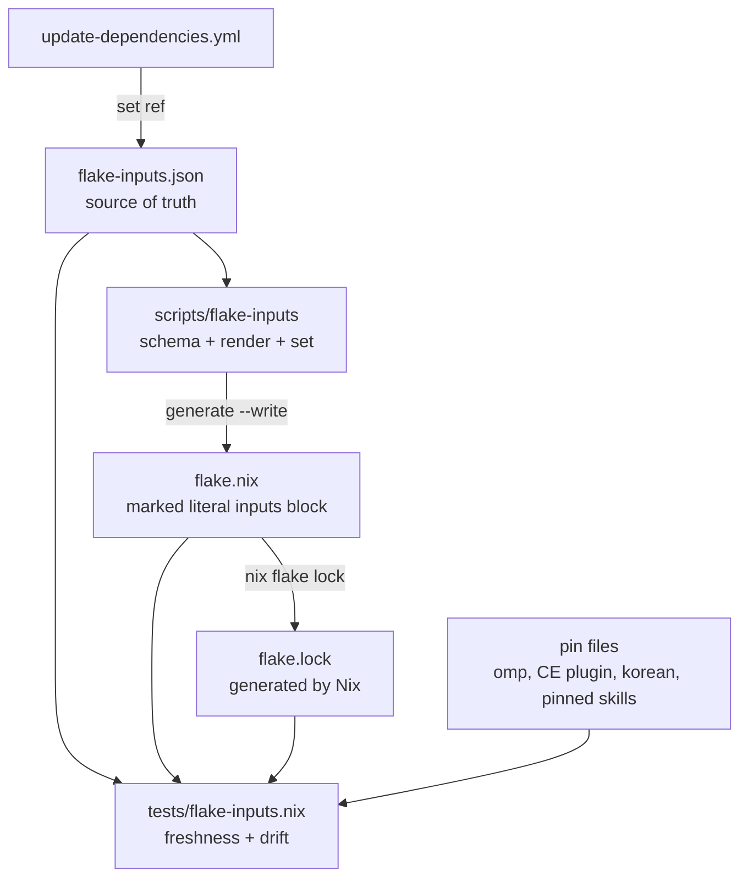

# Flake Input JSON Registry - Plan

## Goal Capsule

- **Objective:** Every external flake input reference is declared once as data, and the repository fails its own checks when that declaration, an existing pin, and `flake.lock` disagree. Today the same reference lives in `flake.nix`, in a pin file, and in the lock, and maintenance edits the source file with `sed`.
- **Means:** A JSON registry rendered into a literal `inputs` block in `flake.nix` (KTD1), with a packaged generator (KTD3) and one consistency check (KTD4).
- **Authority:** Requirements (`R1`-`R10`) win on behavior; Key Technical Decisions win on mechanism within those requirements; units override neither.
- **Execution profile:** One pull request. `ce-work` implements and verifies; the caller ships.
- **Stop conditions:**
  - Regenerating the block changes `flake.lock` at all, or changes any node's `locked.rev`, `narHash`, or `original`.
  - The generator cannot reproduce today's input references exactly.
  - The consistency check cannot fail independently for each source it compares.

---

## Product Contract

### Summary

Move every external input reference — repository, branch, tag, or commit, the `flake = false` flag, nested inputs, and `follows` edges — into `flake-inputs.json`. A packaged generator renders that registry into a marked `inputs` block in `flake.nix`, which Nix requires to be literal. Maintenance automation edits the registry and regenerates the block instead of running `sed` on `flake.nix`. One repository check validates the registry and detects drift between it, the existing pin files, and `flake.lock`.

### Problem Frame

`flake.nix` currently mixes the input graph with upstream URLs, branches, release tags, and commit revisions (`flake.nix:6-121`). The same facts live again in `packages/omp-release.json`, `home/h82/agents/agent-plugin-pins.nix`, `home/h82/agents/korean-skills-pin.nix`, and `home/h82/agents/pinned-skills-pin.nix`, and a third time in the generated `flake.lock`. Maintenance closes the gap with value-shaped `sed` substitutions (`.github/workflows/update-dependencies.yml:195-227`), which can rewrite a coincidentally matching value and leave the three sources drifted. The `brew-src` container repair showed the cost: making an input continuously updatable became another source-edit convention instead of a registry change.

The refactor is behavior-neutral by construction. The resolved input graph, the lock, and every host configuration must be identical afterwards.

### Requirements

**Registry and generation**

- R1. `flake-inputs.json` is the sole source of every external input reference: repository, branch, tag, or commit, `flake = false`, nested inputs, and `follows` edges. No hand-written external URL, branch, tag, or commit remains in `flake.nix` outside the generated span.
- R2. The registry models the declared graph, not a flat list: 20 root inputs plus the nested `nix-homebrew.inputs.brew-src` override, with every current `follows` edge preserved.
- R3. `flake.lock` stays generated by Nix and is never hand-edited. After the cutover it is byte-identical to the committed lock, and no input is re-resolved.

**Maintenance automation**

- R4. Maintenance reads and writes the registry, then regenerates the input layer. No maintenance step rewrites `flake.nix` with a regular expression; both current rewrite sites (the Compound Engineering tag and the `omp` tag) are converted.
- R9. The update workflow's regression coverage (`tests/update-dependencies-reconcile.sh`, `tests/update-workflow.py`) exercises the real step and asserts the resulting registry entry, generated block, and lock revision.

**Consistency checks**

- R5. One repository check validates the registry's schema and detects drift in both directions between three independently maintained sources: the registry, the existing pin files, and `flake.lock`. Each comparison fails for its own reason, and no expected set is derived from the source under test.

**Preserved behavior**

- R6. `brew-src` keeps tracking Homebrew `main`: the nested entry stays branch-tracking, a scheduled `nix flake update` still moves it, and `tests/darwin-config.nix`'s `original.ref == "main"` assertion keeps passing.
- R7. The repository's required checks and affected host builds pass; Linux-only evidence is recorded separately, never claimed from a macOS evaluation.
- R10. No module, package, or host behavior changes: every consumer that reads `inputs.<name>` keeps resolving the same source.

**Documentation and guards**

- R8. The repository documents the registry as the source of truth, marks the generated span do-not-edit, and keeps the host-name guard covering the input declarations after they move out of `flake.nix`.

### Key Decisions

- KD1. **The reference data lives in a JSON registry.** (session-settled: user-directed — chosen over another source-code edit convention inside `flake.nix`: a registry keeps each reference reviewable as data and lets automation edit a field instead of rewriting source.) Governs R1, R4.
- KD2. **`flake.lock` stays generated, never hand-edited.** (session-settled: user-directed — chosen over hand-curating lock entries: Nix owns resolution, so a hand edit would be overwritten or contradicted on the next relock.) Governs R3, R5.
- KD3. **The refactor does not upgrade dependencies.** (session-settled: user-directed — chosen over relocking to current upstream heads during the refactor: a behavior-neutral change is the only way to attribute later breakage.) Governs R3, R7.

### Success Criteria

- `nix flake lock` after regeneration adds no input and changes no node; `git diff --exit-code flake.lock` then shows no lock change.
- `nix flake metadata --json` reports the same `original` specification for every declared input before and after.
- Each pairwise consistency comparison fails under a mutation of only its own source, with its own message.

### Scope Boundaries

- Not migrating `packages/*.json` release pins or the three Nix pin registries into the registry. They stay independent sources; the new check compares them.
- Not changing pin semantics: mutable tags keep their `expectedRev` guard, commit-pinned inputs keep their `rev`, and `brew-src` keeps tracking `main`.
- Not generating the whole `flake.nix`. Considered and rejected: it would relocate the `outputs` body and make every unrelated edit pass through the generator, for the same freshness guarantee a marked span gives.
- Not replacing the `sed` edits on the Nix pin files (`agent-plugin-pins.nix`). They are outside the issue's target (`flake.nix`) and still feed the drift check.

### Sources

- Nix manual, flake format: `inputs` is an attrset of flake references; `follows` is a `/`-separated input path; `flake = false` marks a non-flake source.
- Nix 2.35.6 rejects non-literal flake inputs: `inputs = builtins.fromJSON (builtins.readFile …)`, `inputs = import ./inputs.nix`, a `let`-bound input set, and an interpolated `url` all fail at flake load (`expected a set but got a thunk`, `expected a string or a path but got a thunk`). Only a literal attrset with literal strings is accepted; see NixOS/nix#4945 and the upstream explanation in <https://discourse.nixos.org/t/why-cant-i-use-let-variables-in-flake-nix-inputs/39929>.
- `flake.lock` shape at this tree: 39 nodes, 20 root inputs; `nix-homebrew.inputs.brew-src` is a non-root node; `follows` edges are arrays such as `["nixpkgs"]`.
- Check-design learnings: [converged fixture state](../solutions/best-practices/converged-fixture-state-defeats-nix-check-mutation-testing.md), [trait split from the thing under test](../solutions/best-practices/trait-split-check-cannot-catch-a-widened-default.md), [null/empty operands fail open](../solutions/best-practices/nullable-option-empty-operand-passes-a-shell-comparison.md), [checks must not import a `builtins.toFile` copy](../solutions/best-practices/nix-check-importing-tofile-copy-fails-read-only-flake-check.md), [grep checks pass on echoes](../solutions/best-practices/activation-step-grep-check-passes-an-echo-only-step.md), [`lib.hasInfix` over a whole file overflows on Linux](../solutions/logic-errors/lib-hasinfix-over-whole-activation-script-overflows-linux-nix-stack.md), [worktree copies write the real index](../solutions/best-practices/copied-git-worktree-writes-the-real-index.md).

---

## Planning Contract

### Key Technical Decisions

- KTD1. **Generate a marked, literal `inputs` block in `flake.nix`.** (session-settled: user-directed — chosen over reading the registry at evaluation time: Nix rejects non-literal flake inputs, so the registry must render a literal block.) The generator owns only the span between two marker comments; everything outside is hand-written. Markers are asserted to appear exactly once and in order, and the span must be non-empty, so a removed marker fails instead of silently skipping.
- KTD2. **The registry splits the reference into typed fields.** Each entry is exactly one of `{ repo, ref | rev, flake?, note?, inputs? }` or `{ follows: "input/path" }`; `repo` is a flake reference without a revision segment (`github:owner/name`), restricted to types where appending `/segment` is valid (`github:`, `gitlab:`, `sourcehut:`). A parent entry's `inputs` map holds child entries of the same two shapes, so a `follows` edge is always `inputs: { nixpkgs: { follows: "nixpkgs" } }` and a nested override is `inputs: { brew-src: { repo: "github:Homebrew/brew", ref: "main" } }`. Chosen over storing one full URL string per input: automation then edits `ref` or `rev` as a typed field, and the check can distinguish a mutable tag from an immutable commit without parsing strings.
- KTD3. **One packaged Python generator, `.#flake-inputs`, owns the format.** Modes: `generate` with `--write` or `--check`, and `set <input> --ref <ref>`, plus `--registry`/`--flake` paths. `set` covers the only planned consumer, the workflow's two tag moves; a commit bump adds `--rev` when an automation consumer needs it. It validates the schema (unknown keys, `ref` with `rev`, empty strings, non-Boolean `flake`, malformed `follows`, duplicate keys), writes atomically, and leaves bytes outside the span untouched. Output must already satisfy `nix fmt -- --ci`; the exact layout is settled against `nixfmt` during implementation. Chosen over `jq`-only edits plus a separate renderer: one tool owns schema, rendering, and freshness, so they cannot disagree. Packaging follows the repository convention that the update workflow invokes a packaged helper (`packages/default.nix:14-16`).
- KTD4. **One shared check compares three independent sources.** `tests/flake-inputs.nix`, registered in `tests/shared-checks.nix`, runs the generator in `--check` mode against the committed `flake.nix` (byte comparison), asserts no external literal exists outside the span, and compares registry against `flake.lock` and against the pin files:
  - Registry ↔ lock: root input names equal the registry's top-level names; each declared node's `original` matches `repo`/`ref`/`rev`, and its `flake` flag matches the lock node's flag (top-level entries only — a nested override inherits its parent's declaration); for each nested name the registry declares, the parent's lock edge exists and its target, normalized from string or array, equals the declared `follows` path or nested node. Lock edges the registry does not declare are upstream-owned and ignored, because `lanzaboote` and `omp` carry their own nested inputs. `nix-homebrew.inputs.brew-src → brew-src` is asserted explicitly, with `brew-src.original.ref == "main"`.
  - Registry ↔ pins: `omp` ref equals `v<version>` from `packages/omp-release.json`; the Compound Engineering ref equals `tag` from `agent-plugin-pins.nix`; the korean-skills ref equals its `tag`; every pin registry entry with an `input` compares its `ref` to the registry entry's `ref` when one exists, otherwise to its `rev` — six pinned-skills entries record a commit in the pin's `ref`.
  - Presence guards: the registry, the root input map, and each declared class (ref-pinned, rev-pinned, `flake = false`, `follows`, nested override) are non-empty; every lookup uses `or` defaults and fails inside the builder with a named message. No expected set is computed from the registry for its own comparison, and no check imports a `builtins.toFile` copy.
- KTD5. **Automation edits the registry, regenerates, then relocks.** The two rewrite sites become: read the current ref from `flake-inputs.json` by key, write the new ref with `.#flake-inputs set`, regenerate, then `nix flake lock --update-input <name>` and compare the lock revision to the pin. The workflow keeps its existing commit grouping and publication order.
- KTD6. **`flake-inputs.json` sits at the repository root**, beside `flake.nix` and `flake.lock`, so the relative paths in the generator, check, and workflow stay uniform. `tests/host-name-guard.nix` adds it to its scanned paths.

### High-Level Technical Design

The check is the only place the three sources meet; nothing in the runtime path reads the registry.

```mermaid
sequenceDiagram
  participant WF as update workflow
  participant GEN as flake-inputs
  participant LOCK as nix flake lock
  participant PIN as pin file
  WF->>GEN: read current ref from registry
  WF->>PIN: write new tag / expectedRev
  WF->>GEN: set <input> --ref <new>
  GEN->>GEN: validate, write JSON, regenerate span
  WF->>LOCK: --update-input <input>
  WF->>WF: compare locked rev with pin rev
  Note over WF: fail the step when they disagree
```

### Assumptions

Un-validated bets made because this run has no synchronous user; correct them at review if wrong.

- The registry file name and location are `flake-inputs.json` at the repository root.
- A marked span is preferred over a wholly generated `flake.nix`; the `outputs` body stays hand-written.
- The nested `brew-src` entry needs no `flake = false` field: today's override merges with `nix-homebrew`'s own declaration, and the refactor copies that exact input spec.
- Pin files stay independently maintained; the check compares them rather than deriving them from the registry.
- Python 3 is available in the check sandbox, the development shell, and the CI runner; the generator uses the standard library only.
- The lock staying byte-identical is sufficient proof of "no dependency upgrade" for this change; no separate long-term guard is added.

### System-Wide Impact

- **Contributors:** the edit path for an input reference moves from `flake.nix` to `flake-inputs.json` plus a regeneration; a hand edit inside the span now fails the check.
- **Maintenance:** the update workflow's dependency step gains a flake evaluation and loses two `sed` calls; its failure modes change from a silent no-op to a loud step failure.
- **CI:** one new check in both platform check sets and, through `check-shards`, in a light shard; the dependency verification path (`scripts/ci-update-verify`) builds it as part of the existing check set.
- **Hosts:** none, by construction — the declared graph and lock are identical; the proof is the lock and metadata comparison, not a behavior change.

### Risks & Dependencies

- **Generator output drifts from `nixfmt`.** Mitigated by making `nix fmt -- --ci` part of verification and testing the rendered string exactly.
- **A `nix flake lock` run may rewrite the lock even when the graph is unchanged** (ordering or formatting). If it does, the plan's R3 proof fails; stop and investigate rather than committing a lock diff.
- **Marker fragility.** A hand edit inside the span, or a duplicated marker, must fail `--check`; the check asserts exactly one ordered pair and regenerates the whole span.
- **The workflow step now depends on `nix run .#flake-inputs`,** which evaluates the flake. A malformed registry fails the step loudly instead of silently keeping old pins, which is the intended trade.
- **New check on Linux.** The local macOS builder cannot build `checks.x86_64-linux`; local evidence is limited to the Darwin check and text-level derivation inspection, with CI carrying the Linux shard.
- **`brew-src` tracks Homebrew `main` by requirement (R6).** The scheduled run applies unpinned upstream Homebrew source unattended; this refactor neither changes that exposure nor widens it.

---

## Implementation Units

### U1. Add the JSON registry

- **Goal:** Capture the current declared input graph in `flake-inputs.json`, entry for entry, without changing any file Nix reads.
- **Requirements:** R1, R2.
- **Dependencies:** None.
- **Files:** `flake-inputs.json`
- **Approach:** `version: 1` plus an `inputs` map in today's declaration order. For each of the 20 root inputs, record `repo` (the URL without its final ref/rev segment), then `ref` or `rev` exactly as `flake.lock`'s `original` records it, `flake = false` for the 12 non-flake inputs, and a `note` array for the constraints currently written as comments in `flake.nix` (mutable-tag pinning, pinned skills, `omp` release coupling). Nested entries: `home-manager`, `disko`, `lanzaboote`, `sops-nix`, `nix-darwin`, and `omp` carry `inputs: { nixpkgs: { follows: "nixpkgs" } }`; `nix-homebrew` carries `inputs: { brew-src: { repo: "github:Homebrew/brew", ref: "main" } }`. `vercel-agent-skills` is a `ref` (tag `agent-skills-<sha>`), not a `rev`.
- **Patterns to follow:** JSON consumed by Nix elsewhere in the repository (`packages/omp.nix` reading `builtins.fromJSON`); note text moved from `flake.nix:37-58`.
- **Test expectation:** none -- declarative data, validated and compared by U4's check.

### U2. Build the packaged generator and its unit tests

- **Goal:** One tool that validates the registry, renders the marked span deterministically, and updates one entry's reference fields.
- **Requirements:** R1, R4.
- **Dependencies:** U1.
- **Files:** `scripts/flake-inputs`, `packages/flake-inputs.nix`, `packages/default.nix`, `tests/flake-inputs.py`
- **Approach:** Python 3, standard library only. CLI: `generate (--write | --check)` and `set <input> --ref <ref>`, with `--registry` and `--flake` paths. Rendering joins `repo` with `/<ref>` or `/<rev>`, emits `flake = false`, `inputs.<name>.follows`, and nested `inputs.<name>.url` in registry order, and writes through a temporary file plus rename. Schema errors name the entry path. Package it with the existing helper pattern and expose it on both platforms in `packages/default.nix`. U4's check runs `tests/flake-inputs.py` under `pkgs.python3` against the packaged generator, so the unit cases execute in CI.
- **Patterns to follow:** `scripts/release_pin.py` for argument handling and atomic JSON writes; `packages/agent-tools.nix`'s `helperWith`; `tests/agent-check.py` for a Python test invoked from a check.
- **Test scenarios:**
  - Renders `repo` + `ref` as `github:owner/name/<ref>`, `repo` + `rev` as `github:owner/name/<rev>`, and bare `repo` with no segment.
  - Renders `flake = false`, a nested `follows` edge, and a nested `repo`/`ref` override as `inputs.<dep>.url`.
  - Renders multi-line `note` entries as comment lines above their entry.
  - `--write` leaves every byte outside the markers unchanged, and a second run produces no diff.
  - `--check` exits non-zero when the registry changed but `flake.nix` did not, naming the stale span.
  - `--check` exits non-zero when the start marker is missing, duplicated, or after the end marker.
  - `--check` exits non-zero when an external URL literal appears outside the span.
  - `set` changes only the named entry's `ref`; every other registry byte and every byte of `flake.nix` outside the span is unchanged.
  - Rejects an unknown entry key, `ref` together with `rev`, an empty string, a non-Boolean `flake`, a malformed `follows` path, a non-hosted `repo` type, and duplicate JSON keys.
  - The rendered span equals the committed `flake.nix` span and passes `nixfmt` unchanged.
- **Execution note:** Establish the exact `nixfmt`-stable layout from a real `nix fmt` run before freezing the renderer's string expectations.

### U3. Switch `flake.nix` to the generated span

- **Goal:** Replace the hand-written `inputs` block with the generator's output, proving the resolved graph did not move.
- **Requirements:** R1, R2, R3, R10.
- **Dependencies:** U2.
- **Files:** `flake.nix`
- **Approach:** Run `.#flake-inputs generate --write` against the registry; keep `description` and `outputs` untouched. Move the per-input explanatory comments into registry `note` fields so no knowledge is lost, leaving only the marker header in `flake.nix`. Stage the registry before evaluating, because Nix reads only tracked files.
- **Patterns to follow:** A literal `inputs` attrset is mandatory; no `let`, `import`, or interpolation may appear inside it (KTD1).
- **Test scenarios:**
  - Regenerating with an unchanged registry is a no-op.
  - `nix flake lock` reports no added or updated input, and `git diff --exit-code flake.lock` passes.
  - `nix flake metadata --json` reports the same `original` for all 20 root inputs and for `brew-src`.
  - `nix eval .#darwinConfigurations --apply builtins.attrNames` and the `nixosConfigurations` equivalent are unchanged.
  - A consumer-level evaluation that reads `inputs.<name>` (for example `nix eval .#packages.aarch64-darwin.omp.drvPath`) still resolves.
- **Verification:** The lock and metadata comparisons above; then the Darwin host build in the Verification Contract.

### U4. Add the registry consistency check

- **Goal:** Fail the repository when the registry, a pin, or the lock disagree, or when the generated span is stale.
- **Requirements:** R5, R6.
- **Dependencies:** U3.
- **Files:** `tests/flake-inputs.nix`, `tests/shared-checks.nix`
- **Approach:** A `runCommand` that receives `self` and the packaged generator. It runs `tests/flake-inputs.py` under `pkgs.python3` for the generator's unit cases, runs the generator in `--check` mode for freshness and the outside-span literal scan, and emits bash assertions from `builtins.fromJSON` values (registry, lock) and imported pin files (KTD4). Every lookup uses `or` defaults and reports a named failure. Normalize lock edges (`"nixpkgs"` and `["nixpkgs"]`) before comparing. Register the check in `tests/shared-checks.nix` so both platform check sets include it.
- **Patterns to follow:** `tests/agent-plugins.nix:200-280` for named builder failures, `tests/darwin-config.nix:17-33` for lock reads, `tests/pinned-skills.nix` for pin iteration.
- **Test scenarios:**
  - Clean tree passes, and every declared class is non-empty (fail with a distinct message when the registry, root input map, or any class is emptied).
  - Mutating one registry `ref` alone fails against the lock's `original.ref`.
  - Mutating one registry `rev` alone fails against the lock's `original.rev`.
  - Flipping one root entry's `flake` alone fails against the lock node's `flake` flag.
  - Mutating one pin's `tag` alone fails against the registry ref.
  - Mutating a commit-pinned pin's `ref` (for example `context7`) fails against the registry `rev`.
  - Mutating `omp-release.json`'s `version` alone fails against the `omp` ref.
  - Moving `brew-src` in the registry from the nested override to a root input fails the root-input set comparison before any relock; after a relock it is a genuine, deliberate graph change.
  - Deleting a registry entry fails on the root-input set comparison, not by shrinking the expected set.
  - Hand-editing inside the generated span fails the freshness comparison.
  - Adding a `github:` literal outside the span fails the literal scan.
  - `nix flake check --no-build` evaluates the check without IFD or network.
- **Verification:** Every mutation round fails from the builder with the intended message; restore the tree and the check passes.

### U5. Convert maintenance automation

- **Goal:** Remove both `sed` rewrites of `flake.nix` and make the workflow edit the registry instead.
- **Requirements:** R4, R9.
- **Dependencies:** U2, U3.
- **Files:** `.github/workflows/update-dependencies.yml`, `tests/update-dependencies-reconcile.sh`, `tests/update-workflow.py`
- **Approach:** Read the current Compound Engineering ref with `jq -r` from `flake-inputs.json`; compare with the resolver's tag; write it with `nix run .#flake-inputs -- set compound-engineering-plugin --ref <tag>`; regenerate. Do the same for `omp` with `--ref v<version>`. Keep `nix flake lock --update-input`, the lock-vs-pin comparison, the existing pin-file `sed`, and the commit grouping, adding `flake-inputs.json` to each affected commit. Update the reconcile harness fixture to include the registry and generator, and execute the real step against its `nix` stub.
- **Patterns to follow:** `tests/update-workflow.py` step extraction with `yq`/`jq`; `scripts/ci-update-publish` ordering; `${PIPESTATUS[0]}` in any new piped status read.
- **Test scenarios:**
  - A newer plugin tag updates the registry ref, the generated span, and the lock revision, and the commit carries `flake-inputs.json`, `flake.nix`, `flake.lock`, and the pin file.
  - A newer `omp` release updates the registry ref to `v<version>`, regenerates, relocks, and the commit carries the registry, `flake.nix`, `flake.lock`, and `packages/omp-release.json`.
  - An unchanged upstream tag produces no commit.
  - A lock revision that disagrees with the pin fails the step with the existing message.
  - The workflow body contains no `sed` command whose target is `flake.nix`.
  - The reconcile harness passes unchanged in its non-registry scenarios.
- **Verification:** The reconcile test drives the extracted step end to end against a scratch Git origin.

### U6. Document the generated layer and extend the host-name guard

- **Goal:** Make the generated span discoverable and keep the guard's coverage as declarations move out of `flake.nix`.
- **Requirements:** R8.
- **Dependencies:** U4.
- **Files:** `docs/repository-reference.md`, `docs/contributing.md`, `tests/host-name-guard.nix`
- **Approach:** In the repository reference's `flake.nix` bullet, describe the registry, the generator, the marked span, and the check. In contributing's coding-style section, state that the span is generated and edits go to `flake-inputs.json` plus a regeneration. Add `flake-inputs.json` to the host-name guard's scanned paths.
- **Patterns to follow:** Existing concise bullet style in `docs/repository-reference.md`; the guard's declared path list.
- **Test expectation:** none -- documentation and a guard path list; the guard itself is verified in the Verification Contract.

---

## Verification Contract

| Command | Covers | Where |
| --- | --- | --- |
| `nix develop .#agent-check -c ./scripts/agent-check` | Repository's changed-file checks | Both platforms |
| `nix fmt -- --ci` | Generated span is formatter-stable | Linux builder or CI `fmt` job |
| `nix flake lock` then `git diff --exit-code flake.lock` | R3: relocking the regenerated declaration changes nothing | Both platforms |
| `nix flake metadata --json` diff against the pre-change output | R2/R10: same `original` specs | Both platforms |
| `nix flake check --no-build` | Whole flake evaluates; new check evaluates without IFD | Both platforms |
| `nix build --no-link .#checks.aarch64-darwin.flake-inputs` | New check and its generator unit cases execute on Darwin | macOS builder |
| `nix build --no-link .#darwinConfigurations.MacBook-Pro-Mac17-9.system` | Affected production macOS host | macOS builder |
| `nix eval --json .#checks.x86_64-linux.flake-inputs.drvPath` plus `nix derivation show -r` | Linux check inputs on macOS (text-level only) | macOS builder |
| `nix build --no-link .#checkShards.hosts` on the PR head with the `full-ci` label | Linux checks, VM tests, both host outputs | CI |
| Reconcile harness check (`update-dependencies-reconcile`) | R9: workflow's real step | CI Linux shard |

Linux-only results are CI evidence. The macOS derivation inspection proves the check's inputs, not its shell execution, and is reported as such.

## Definition of Done

- R1-R10 hold; every requirement is traceable to a unit and a verification result.
- `flake.lock` is byte-identical, and `nix flake metadata` originals are unchanged for every declared input.
- The consistency check fails independently for each mutation round in U4 and passes on the clean tree.
- No `flake.nix` rewrite by regular expression remains in maintenance automation.
- `brew-src` still tracks `main`, and `darwin-config` still passes.
- Docs state the registry is the source of truth and the span is generated.
- Cleanup: scratch flakes, copied worktrees, and mutation fixtures are deleted; the diff contains no abandoned rendering attempts, dead CLI flags, or commented-out old input blocks.
