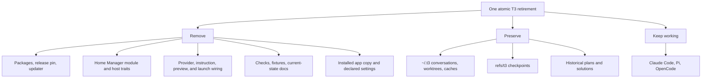
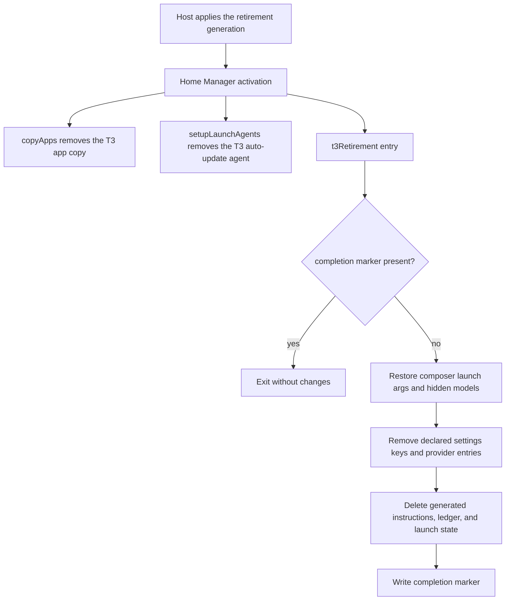
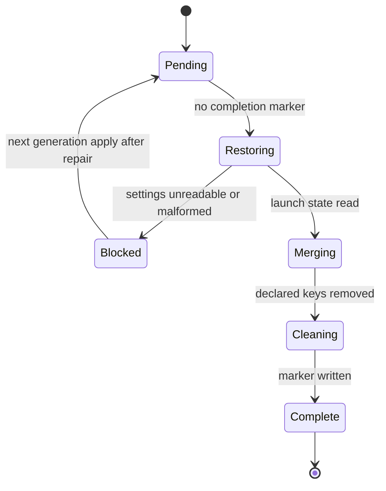

# Retire T3 Code - Plan

## Goal Capsule

- **Objective:** Both managed hosts stop installing, configuring, and launching T3 Code from this repository, and the installed T3 Code app and this repository's declared T3 settings are removed from the local environment. T3 conversations, worktrees, caches, and git checkpoints remain.
- **Means:** One atomic change with a one-shot cleanup entry (KTD1).
- **Product authority:** The repository owner. A replacement orchestrator and migration of active T3 work are not active scope.
- **Execution profile:** One pull request; spent-entry pruning is a post-apply follow-up (KTD5, R8).
- **Who finishes:** `lfg` implements, reviews, commits, opens the pull request, and watches CI; the owner applies the change on each host.
- **Open blockers:** None.

---

## Product Contract

### Summary

Retire T3 Code from both hosts: remove its packages, release pin and updater, Home Manager module and host traits, provider and instruction wiring, checks, and current-state documentation. Clean up the installed app and the settings this repository declared once, and preserve all local T3 data.

### Problem Frame

T3 Code is a desktop orchestrator moving toward closed source. The owner judges that direction incompatible with the repository's policy, so keeping T3 Code as a managed tool contradicts the configuration's purpose.

Both hosts currently enable its CLI and desktop traits. Every switch reinstalls and reconfigures it, and the scheduled dependency workflow keeps its release pin current. The same configuration also keeps T3-specific routing documents, Flutter instructions, tests, and runtime hooks alive, so the policy conflict persists across every update.

### Requirements

**Retirement completeness**

- R1. Fresh production and bootstrap configurations contain no T3 Code package, release pin, updater, Home Manager module, host trait, provider instance, instruction addition, project configuration, or check.
- R2. Both hosts stop declaring the T3 traits, and no active module, check, or fixture branches on a T3 option.
- R3. No remaining component produces or consumes a T3-specific runtime hook: a T3 preview target, a T3 launch environment variable, or a launchd environment entry that existed only for an agent launched by T3.
- R4. No remaining repository path can install, update, or reconfigure T3 Code.

**Local cleanup**

- R5. The first apply after the change removes the installed T3 Code desktop app, the `t3` CLI, and the T3 auto-update launch agent from each host's user environment.
- R6. That apply removes only the keys and generated files this repository declared under `~/.t3`: merged server and client settings keys, ownership ledgers, launch state, and generated instruction files. Keys and files the repository did not write remain.
- R7. T3 conversations, worktrees, caches, usage data, and the repository's `refs/t3` checkpoints remain untouched.
- R8. After the cleanup has run on both hosts, the repository removes the one-shot entry and its checks instead of keeping a permanent no-op.

**Shared agent surface**

- R9. Claude Code, Pi, and OpenCode keep their packages, settings, plugins, instruction delivery, model routing, and CLI workflows; only T3-specific wiring leaves.
- R10. Current-state documentation and glossary examples no longer present T3 Code as installed, managed, or a supported workflow, and describe the remaining CLI and GUI paths accurately.
- R11. Historical plans and solutions under `.compound-engineering/artifacts` stay unchanged.
- R12. The check set matches the new surface, and `./scripts/agent-check` passes from the checkout root.

### Key Decisions

- **Retire repository management and the installed artifacts; preserve local data.** The owner wants the app gone, not the conversations or worktrees it produced. (session-settled: user-directed — chosen over repository-only removal and over deleting `~/.t3` and `refs/t3`: the app contradicts policy, while the data remains useful.) Governs R5–R7.
- **One atomic retirement change; no staged deprecation or compatibility options.** The repository has one owner, and a Nix generation rollback covers a failed apply. (session-settled: user-approved — chosen over stopping installation in one change and deleting later: the staged state only keeps dead declarations alive.) Pruning the spent cleanup entry is the separate post-apply step in R8. Governs R1, R4, R12.
- **No replacement orchestrator or active-work migration in this plan.** (session-settled: user-directed — chosen over bundling a new tool or moving T3 worktrees now: both are separately valuable work.) Governs the Goal Capsule and R7.
- **Remove T3-specific shared code only where T3 was its sole producer or consumer.** Shared GUI and CLI behavior stays. (session-settled: user-approved — chosen over deleting every T3 mention regardless of consumer and over keeping dead T3 branches: dead machinery should go without changing other harnesses.) Governs R3, R9.
- **Treat historical artifacts as evidence and current-state docs as the surface to update.** Historical plans and solutions explain how T3 was configured; they are not instructions for a tool the repository no longer manages. Governs R10, R11.
- **Make the local cleanup one-shot and prune it once spent.** A permanent cleanup entry would keep a dead declaration alive. Governs R6, R8.

### Key Flows

- F1. First apply after retirement
  - **Trigger:** The owner applies the changed configuration on a host that still has T3 Code installed.
  - **Actors:** Repository owner; Home Manager activation.
  - **Steps:** Close T3 Code and stop the `t3` CLI before applying so neither rewrites the settings during cleanup. The profile loses the T3 package; activation removes the macOS app copy and the declared settings keys or files; the T3 launch agent, Dock entry, and desktop entry disappear; T3 data stays.
  - **Outcome:** No T3 Code app or `t3` CLI remains; user data and worktrees are intact.
  - **Covers R5–R7.**
- F2. Fresh configuration
  - **Trigger:** A production or bootstrap configuration evaluates without a prior T3 installation.
  - **Actors:** Repository owner; Nix evaluation.
  - **Steps:** No T3 package, option, check, or documentation path is selected; the cleanup entry finds nothing to remove.
  - **Outcome:** A fresh host has no T3 surface and no cleanup error.
  - **Covers R1, R2, R4.**
- F3. Spent cleanup removal
  - **Trigger:** Both hosts have applied the cleanup.
  - **Actors:** Repository owner.
  - **Steps:** The one-shot entry and its checks leave the repository; the general retirement mechanism stays.
  - **Outcome:** No permanent no-op remains.
  - **Covers R8.**

### Acceptance Examples

- AE1. Installed host, first apply
  - **Covers R5–R7.**
  - **Given** a host with T3 Code installed and user-created keys under `~/.t3`,
  - **When** the owner applies the changed configuration once,
  - **Then** the app copy and `t3` CLI are gone, repository-declared keys and generated files are gone, user keys and conversations remain, and `refs/t3` and the worktrees still exist.
- AE2. Fresh bootstrap and production evaluation
  - **Covers R1, R2, R4, R12.**
  - **Given** a clean checkout and either host kind,
  - **When** the configuration is evaluated and `./scripts/agent-check` runs,
  - **Then** no T3 package, option, updater, or check is selected, and the check passes.
- AE3. Remaining harnesses
  - **Covers R3, R9.**
  - **Given** a Claude Code, Pi, or OpenCode CLI session after the change,
  - **When** it starts with the same user settings,
  - **Then** its package, settings, plugin, and instruction delivery are unchanged, and no T3 preview target or T3 launch environment is produced.
- AE4. Historical and current documentation
  - **Covers R10, R11.**
  - **Given** the repository after the change,
  - **When** a reader opens the current-state docs and the historical artifacts,
  - **Then** the current docs no longer claim T3 is installed or supported, and the historical plans and solutions are byte-identical.
- AE5. Second apply
  - **Covers R6, R8.**
  - **Given** a host that has already run the cleanup,
  - **When** the owner applies the configuration again,
  - **Then** no T3 file or key is removed again and no error is reported.

### Scope Boundaries

**Deferred for later**

- A replacement GUI or orchestrator.
- Migrating active work out of the T3 worktrees.
- Deleting `~/.t3` or the `refs/t3` checkpoints; R7 preserves them.

**Outside this product's identity**

- Blocking future T3 installations at the OS or network level.
- Rewriting or deleting historical plans and solutions.
- Changing model routing or the remaining agent harnesses.

**Deferred to Follow-Up Work**

- Prune the one-shot retirement entry, its helper, and its check after both hosts have applied and the owner confirms (R8).

### Dependencies / Assumptions

- The macOS app under `~/Applications/Home Manager Apps` is a directory copy, not a symlink, so removing the package does not remove it.
- `agent-settings` can remove nested keys through a one-shot migration while leaving keys the repository never wrote.
- Home Manager removes the profile `t3` CLI and the auto-update launch agent when their declarations leave.
- The one-shot cleanup runs on the first apply on each host; NixOS activation runs when the rebuild produces a new Home Manager generation.
- The T3 worktrees are ordinary git worktrees and stay usable without the app.
- The repository's retirement precedent leaves historical artifacts unchanged and prunes a spent entry after every host has applied it.

### Sources / Research

- `docs/repository-reference.md` and `docs/agent-routing.md` describe the current T3 packaging, provider routing, settings precedence, and launch behavior that the change removes or rewrites.
- `docs/contributing.md` defines the `agent-settings` retirement keys and the cask retirement pattern.
- `CONCEPTS.md` defines *Host trait*, *Default context*, *Activation reassertion*, and *Spent entry*, which constrain this plan.
- Prior retirement plans `2026-11-18-2219-chore-retire-antigravity-plan.md` and `2026-11-25-0935-refactor-remove-openai-account-surface-plan.md` establish the preserve-local-data and leave-historical-artifacts pattern.
- The solutions under `.compound-engineering/artifacts/solutions/integration-issues/` that name T3 remain historical evidence for the removed tool.

---

## Planning Contract

**Product Contract preservation:** unchanged; this section and the implementation sections are additions.

### Key Technical Decisions

- KTD1. One atomic cutover with a one-shot cleanup entry. (session-settled: user-approved — chosen over a staged stop-install-then-delete sequence: the repository has one owner and a Nix generation rollback covers a failed apply, while the cleanup entry makes the single cutover safe.) Governs R1–R8.
- KTD2. Home Manager owns app-copy and launch-agent removal. Home Manager's app copy uses rsync with `--delete`, and its launch-agent setup removes agents missing from the new generation; custom deletion would duplicate that work and risk touching another app. Governs R5.
- KTD3. Restore composer-managed state, then remove declared settings with `agent-settings`. The recorded launch state preserves user arguments; value-aware removals preserve user keys inside repo-declared provider entries; the completion marker is written last so an interrupted activation retries. Governs R6–R8.
- KTD4. Remove T3-specific shared code only where no remaining producer or consumer exists. The preview helper, the Pi T3 environment gate, and the Claude launchd waiver serve only T3 launches; cross-model peer variables and terminal session variables stay generic. Governs R3, R9.
- KTD5. Prune the one-shot entry only after both hosts apply. Pruning earlier would drop the cleanup the second host still needs. Governs R8.

### High-Level Technical Design

The cutover changes what each host applies, then runs one cleanup entry. Home Manager builds the new generation without T3, removes the app copy and launch agent it no longer declares, and the retirement entry edits only `~/.t3`.

The cleanup is a small state machine. A malformed settings file leaves the state untouched and the marker absent, so the next apply that produces a new Home Manager generation retries after the owner repairs it. On NixOS, a no-op rebuild of the same generation does not rerun activation.

### Risks & Dependencies

- A malformed `settings.json` or `client-settings.json` makes `agent-settings` refuse. The helper warns, leaves the file and marker untouched, and returns success so the switch is not stranded; the next apply that produces a new generation retries.
- A user may have edited a declared value or added a field inside a provider entry. Nested removals are value-aware, and keys the repository never wrote survive; only fields the repository declared are removed.
- NixOS Home Manager activation runs only when the rebuild produces a new generation. The retirement change produces one; applying an older generation would not run the cleanup.
- The two T3 worktrees contain uncommitted changes. Nothing in this plan deletes them; the owner should inspect them before any later data cleanup.
- Home Manager's app-copy and launch-agent cleanup behavior is version-dependent. The implementation confirms it against the generated activation on the macOS host before relying on it.
- `~/.t3` is about 13GB and the repository holds 987 `refs/t3` checkpoints. Both remain by design; this plan reclaims no disk space.

### System-Wide Impact

The change removes a managed agent surface, so the shared instruction template, instruction receipts, Pi plugin wrapper, Claude launchd environment, and current-state routing docs move together. CI loses a dependency-update target and two checks. No remaining harness changes its package, model routing, or credential path.

### Research

- `scripts/agent-settings` documents `remove`, value-aware `removePaths`, and one-shot `migration` entries over a per-settings ledger; `tests/test_agent_settings.py` proves nested removal and migration behavior.
- `.compound-engineering/artifacts/solutions/integration-issues/t3code-settings-json-value-outranks-repository-t3-json.md` records that dropping a declared key alone leaves the written value, so retirement needs an explicit removal.
- `.compound-engineering/artifacts/solutions/best-practices/home-manager-activation-does-not-run-on-every-rebuild.md` explains why the cleanup needs a new generation; the retirement change creates one.
- `.compound-engineering/artifacts/solutions/best-practices/order-home-manager-link-cleanup-after-link-generation.md` distinguishes `home.file` link cleanup from the copied app bundle, which uses a different Home Manager mechanism.
- The generated Home Manager activation on the macOS host uses rsync with `--delete` for the app copy and removes undeclared launch agents; this is the evidence for KTD2.

---

## Implementation Units

### U1. Remove T3-specific checks and fixtures

- **Goal:** Delete the checks that exist only to prove T3 Code's package, traits, launch composer, and instruction additions before the code they cover leaves.
- **Requirements:** R1, R2, R12.
- **Dependencies:** None.
- **Files:**
  - `tests/t3code.nix` (delete)
  - `tests/t3code-traits.nix` (delete)
  - `tests/t3code-launch.py` (delete)
  - `tests/t3code-opencode-enabled.py` (delete)
  - `tests/lib/t3code-launch-manifest.nix` (delete)
  - `tests/test_t3_instructions.py` (delete)
  - `tests/linux-checks.nix`
- **Approach:**
  1. Remove the T3 check attributes and imports from `tests/linux-checks.nix`.
  2. Delete the T3-only test files and the launch manifest.
  3. Leave shared test files that also cover other harnesses for U5, so their non-T3 assertions stay reviewable.
- **Test expectation:** none -- this unit only removes checks for behavior later units delete; the final repository check proves the remaining set evaluates.
- **Verification:** `tests/linux-checks.nix` no longer references a T3 check, and `./scripts/agent-check` still evaluates the flake.

### U2. Remove T3 Code from host and desktop configuration

- **Goal:** Both hosts stop installing and configuring T3 Code; the host trait, Home Manager module, Dock entry, plasma pin, and project configuration disappear.
- **Requirements:** R1, R2, R4, R5.
- **Dependencies:** U1.
- **Files:**
  - `home/h82/t3code.nix` (delete)
  - `t3.json` (delete)
  - `home/h82/default.nix`
  - `modules/shared/host.nix`
  - `hosts/MS-7D91/default.nix`
  - `hosts/MacBook-Pro-Mac17-9/default.nix`
  - `modules/darwin/dock.nix`
  - `home/h82/desktop/kde/plasma.nix`
  - `modules/shared/darwin-apps.nix`
  - `lib/host-facts.nix`
  - `tests/fixtures/hosts/magnolia/default.nix`
  - `tests/darwin-config.nix`
  - `tests/darwin-outputs.nix`
  - `tests/plasma-taskbar.nix`
- **Approach:**
  1. Delete the module and project file, and remove the import.
  2. Remove the two `my.t3` options and the host declarations, then remove the Dock and plasma conditionals.
  3. Remove the T3 entries from the Darwin app-coverage map and update the host-facts comment.
  4. Update fixtures and checks to assert the package, app copy, launch agent, Dock entry, and plasma pin are absent.
- **Patterns to follow:** `modules/darwin/retired-casks.nix` shows how an absent declaration is asserted; the Dock module already replaces the full `persistent-apps` list on every apply.
- **Test scenarios:**
  - A production macOS configuration has no `t3code-desktop` package, no `T3 Code (Beta).app` in the applications derivation, no T3 launch agent, and no T3 Dock path.
  - A production NixOS configuration has no `t3` CLI or desktop package and no T3 plasma taskbar entry.
  - A bootstrap configuration evaluates with no `my.t3` option read.
- **Verification:** the updated `tests/darwin-config.nix`, `tests/darwin-outputs.nix`, and `tests/plasma-taskbar.nix` pass; `./scripts/agent-check` passes.

### U3. Add the one-shot retirement cleanup

- **Goal:** After U2 removes the app and CLI, remove the repository-declared settings under `~/.t3` and the generated instruction and ledger files once, while preserving user-written keys, conversations, worktrees, caches, and refs.
- **Requirements:** R5–R8.
- **Dependencies:** U2.
- **Files:**
  - `home/h82/t3-retirement.nix` (new)
  - `scripts/retire-t3` (new)
  - `tests/test_retire_t3.py` (new)
  - `home/h82/default.nix`
  - `tests/python-script-checks.nix`
- **Approach:**
  1. Add a Home Manager activation entry ordered after `installPackages` that runs the helper unless `DRY_RUN` is set.
  2. Have the helper exit without changes when a completion marker exists.
  3. Reuse the launch-state restoration logic from `scripts/t3-instructions.py` to restore provider launch arguments and environment from `dotfiles-launch-state.json`, and remove only the Pi hidden models and Claude subagent-depth entry the repository added. U5 deletes the composer once the helper owns this logic.
  4. Run `agent-settings` with a removal declaration derived from the deleted module's server and client settings. Use value-aware nested removals; remove the declared fields inside provider instances and the OpenCode environment entry by name, pruning only objects the removals empty.
  5. Delete the generated instruction files, ownership ledger, and launch state, then write the completion marker last.
  6. On unreadable or malformed JSON, leave every file untouched, warn, and exit successfully without writing the marker so a later generation apply retries.
- **Execution note:** Start with the cleanup tests against a seeded home. The activation rewrites user state, so prove the no-op, malformed, second-run, and user-key-preservation cases before wiring the activation entry.
- **Test scenarios:**
  - A seeded home with repository-declared server and client keys and a user-only key loses the declared keys and keeps the user key.
  - A launch state with base arguments and user-added arguments restores the base arguments and keeps the user arguments.
  - A missing `settings.json`, `client-settings.json`, or launch state completes successfully without creating files.
  - A malformed `settings.json` leaves every file byte-identical, writes no marker, and returns success.
  - A second run with the marker present changes no file's inode or mtime.
  - An interrupted run without the marker completes the remaining removal on the next invocation.
- **Verification:** the new `retire-t3` Python check passes; `./scripts/agent-check` passes.

### U4. Remove T3 packages, release pin, updater, and CI step

- **Goal:** No repository path remains that builds, updates, or publishes T3 Code.
- **Requirements:** R1, R4, R12.
- **Dependencies:** U2.
- **Files:**
  - `packages/t3code.nix` (delete)
  - `packages/t3code-cli.nix` (delete)
  - `packages/t3code-app-bundle.nix` (delete)
  - `packages/t3code-release.json` (delete)
  - `scripts/t3code-release` (delete)
  - `tests/test_t3code_release.py` (delete)
  - `packages/default.nix`
  - `packages/agent-tools.nix`
  - `.github/workflows/update-dependencies.yml`
  - `tests/update-dependencies-reconcile.sh`
  - `tests/python-script-checks.nix`
- **Approach:**
  1. Delete the package definitions, pin, updater, and updater test.
  2. Remove the flake package outputs and the agent-tools binding.
  3. Remove the T3 update block and commit call from the dependency workflow; renumber the remaining step comments only when it improves reading.
  4. Update the workflow reconciliation fixture to stop expecting a T3 candidate.
- **Test scenarios:**
  - Evaluation exposes no `t3code`, `t3code-cli`, or `t3code-release` package.
  - The dependency workflow fixture produces no T3 commit candidate and no warning for a missing T3 step.
- **Verification:** `tests/update-dependencies-reconcile.sh` and `./scripts/agent-check` pass.

### U5. Remove T3-specific shared code and keep the remaining harnesses working

- **Goal:** Delete every shared code path whose only producer or consumer was T3 Code, and leave Claude Code, Pi, and OpenCode behavior otherwise unchanged.
- **Requirements:** R3, R9.
- **Dependencies:** U2, U3.
- **Files:**
  - `scripts/serve-html` (delete)
  - `tests/serve-html-profiles.nix` (delete)
  - `packages/agent-tools.nix`
  - `home/h82/default.nix`
  - `packages/pi-subagents/entry.js`
  - `tests/pi-subagents.py`
  - `home/h82/agents/claude.nix`
  - `tests/claude.nix`
  - `scripts/t3-instructions.py` (delete)
  - `home/h82/agents/instructions/t3-guide.md` (delete)
  - `home/h82/agents/instructions/instructions.md.tmpl`
  - `home/h82/agents/instructions/default.nix`
  - `scripts/agent-instructions`
  - `tests/agent-instructions.nix`
  - `tests/agent-instructions.py`
  - `tests/lib/agent-instruction-receipts.json`
  - `tests/text-template/context.json`
  - `tests/text-template/render.md.tmpl`
  - `scripts/agent-settings`
  - `tests/test_agent_settings.py`
  - `tests/tokscale.sh`
  - `home/h82/agents/synthetic-models.nix`
  - `tests/test_synthetic_models_watch.py`
  - `home/h82/agents/cross-model-peers.nix`
  - `home/h82/agents/fff-server.nix`
  - `home/h82/security/ssh.nix`
  - `home/h82/dev/android.nix`
  - `home/h82/agents/skills/design-lenses/SKILL.md`
- **Approach:**
  1. Remove `serve-html` and its package, profile, and check because its output is a T3 preview target.
  2. Remove the T3 environment-variable gate from the Pi subagent wrapper; keep its skill and prompt path discovery and its `--no-skills`/`--no-prompt-templates` handling.
  3. Remove the Claude launchd rm-waiver agent; keep the session variable for terminal sessions.
  4. Delete the old launch composer once the retirement helper owns its restoration logic, then remove the `t3` instruction-template branch, the flag in `scripts/agent-instructions`, the T3 guide, and the T3 receipt.
  5. Remove `migrateInstances` from `agent-settings` because no remaining declaration uses it; update its tests and the Tokscale fixture.
  6. Remove the `t3-fallback` role from the synthetic model source and update the catalog test.
  7. Update comments in the shared modules to name GUI or CLI launches generically, and remove the T3 preview paragraph from the design-lenses skill.
- **Test scenarios:**
  - A standalone Pi session loads the subagent extension with no T3 environment variables; `--no-skills` still suppresses skills.
  - A Claude Code terminal session keeps the dangerous-rm session variable, and no launchd agent sets it.
  - Every native instruction render is byte-empty and its receipt matches.
  - `agent-settings` rejects a declaration that still uses `migrateInstances`.
  - The synthetic catalog test passes without a `t3-fallback` role.
- **Verification:** `tests/pi-subagents.py`, `tests/test_agent_settings.py`, `tests/agent-instructions.*`, `tests/test_synthetic_models_watch.py`, and `./scripts/agent-check` pass.

### U6. Update current-state documentation

- **Goal:** A reader of the current docs no longer sees T3 Code as installed, managed, or a supported workflow, and the remaining CLI and GUI paths are accurate.
- **Requirements:** R10, R11.
- **Dependencies:** U1–U5.
- **Files:**
  - `README.md`
  - `docs/agent-routing.md`
  - `docs/flutter.md`
  - `docs/macos.md`
  - `docs/adding-a-host.md`
  - `docs/install.md`
  - `docs/contributing.md`
  - `docs/repository-reference.md`
  - `docs/decide.md`
  - `CONCEPTS.md`
- **Approach:**
  1. Remove T3-only bullets, tables, sections, and links from the README and current-state docs.
  2. Rewrite `docs/agent-routing.md` around the remaining harnesses and shared instruction delivery; keep the task guide.
  3. Rewrite the Flutter host-check and verification sections for terminal sessions; delete the "Work from T3 Code" section.
  4. Replace the T3 examples in `CONCEPTS.md` with the remaining host-trait and default-context terms.
  5. Do not edit `.compound-engineering/artifacts`; historical plans and solutions stay as evidence.
- **Test expectation:** none -- documentation only; the verification is a current-state reference scan plus `./scripts/agent-check`.
- **Verification:** `rg -n -i 't3' README.md docs CONCEPTS.md AGENTS.md` returns only intentional historical or migration references; `./scripts/agent-check` passes.

---

## Verification Contract

| Check | Applies to | Command | Done signal |
| --- | --- | --- | --- |
| Repository check | All units | `./scripts/agent-check` (or `nix develop .#agent-check -c ./scripts/agent-check` when the pinned tools are absent) | Exits 0 |
| Cleanup helper check | U3 | New `retire-t3` Python check, run by `./scripts/agent-check` | Every seeded-home scenario passes |
| Host configuration checks | U1, U2, U4 | `tests/darwin-config.nix`, `tests/darwin-outputs.nix`, `tests/plasma-taskbar.nix`, `tests/linux-checks.nix` | No T3 package, app copy, launch agent, Dock entry, plasma pin, or check remains |
| Shared harness checks | U5 | `tests/pi-subagents.py`, `tests/test_agent_settings.py`, `tests/agent-instructions.nix`, `tests/agent-instructions.py`, `tests/test_synthetic_models_watch.py` | Pass with no T3 branches |
| Current-state scan | U6 | `rg -n -i 't3' README.md docs CONCEPTS.md AGENTS.md` | Only intentional historical or migration references remain |
| Mutation round | U3 | Break user-key preservation and marker-last ordering one at a time | The cleanup check fails for that reason, then passes when restored |

The cleanup helper check is a repository check: it runs against a temporary home and needs no live T3 installation. The physical first-apply behavior on each host remains owner evidence; the agent proves the generated activation and helper, not the live switch.

---

## Definition of Done

- R1–R7 and R9–R12 are true in the checkout; R8 remains open under Deferred to Follow-Up Work until both hosts apply.
- `./scripts/agent-check` passes from the checkout root, and the new cleanup check passes with its mutation round.
- A current-state reference scan finds no T3 installation, provider, instruction, preview, or updater path outside historical artifacts and preserved user data.
- The cleanup is idempotent: a second run changes nothing, and malformed settings do not strand the switch.
- No abandoned experiment or temporary T3 helper remains except the one-shot retirement entry and helper that R8 later prunes.
- The owner has a recorded post-merge step: apply on both hosts, then prune the spent entry.

| Unit | Done when |
| --- | --- |
| U1 | T3-only checks and fixtures are gone, and the remaining check set evaluates. |
| U2 | Both host kinds evaluate without T3 packages, traits, app copy, launch agent, Dock entry, or plasma pin. |
| U3 | The cleanup helper passes its seeded-home, malformed, second-run, and interrupted-run tests. |
| U4 | No package, pin, updater, or dependency-update path for T3 remains. |
| U5 | Claude Code, Pi, and OpenCode checks pass with no T3-specific shared branch. |
| U6 | Current-state docs and glossary examples no longer present T3 as installed or supported. |
